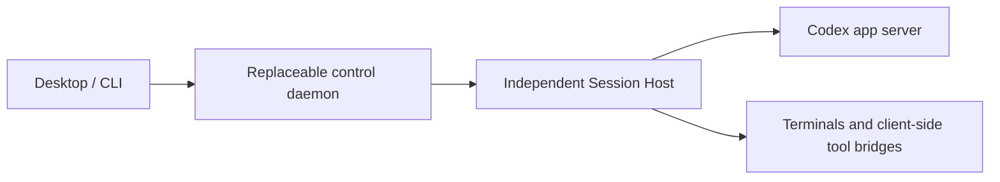

# 0002: Preserve runtimes across control daemon upgrades

Status: architecture accepted by the user, 2026-10-18. Not implemented or verified.
Detailed protocol and implementation choices remain subject to validation against
the [product requirements](../prd.md).

## Context and evidence

Upgrading the application must eventually allow running coding-agent turns to
continue without restarting their provider process or tools. Restoring saved
conversation history after a restart does not establish active-turn continuity.

The inspected Paseo checkout is based on commit
`a486b0558168c08890890e787d55cfb88c0d7256`, with uncommitted changes in the
Codex provider. These observations describe that working tree, not a released
binary:

- `packages/server/src/server/bootstrap.ts` closes agents and shuts down the
  provider runtime during daemon shutdown.
- `packages/server/src/server/agent/providers/codex-app-server-agent.ts` starts
  `codex app-server` with private stdio pipes. It already uses a detached process
  on non-Windows systems.
- `packages/server/src/server/agent/providers/codex/app-server-transport.ts`
  closes stdin, rejects pending RPCs and terminates the child process tree on
  disposal. Detaching the process alone would not change this lifecycle.

The installed `codex-cli 0.163.0` exposes `app-server daemon`, a Unix socket
listener and `app-server proxy --sock`. Its `daemon update` help explicitly warns
that updating may interrupt running work. Only version/help commands were run.

The inspected [Codex source revision](https://github.com/openai/codex/tree/70b5cfc73b25458a7af225d24b16ef4794f8f380)
is evidence about source behavior, not an attestation of the installed binary:

- [Thread connection cleanup](https://github.com/openai/codex/blob/70b5cfc73b25458a7af225d24b16ef4794f8f380/codex-rs/app-server/src/request_processors/thread_processor.rs#L3466)
  removes subscriptions without unconditionally cancelling the thread.
- [Thread unloading](https://github.com/openai/codex/blob/70b5cfc73b25458a7af225d24b16ef4794f8f380/codex-rs/app-server/src/request_processors/thread_lifecycle.rs#L11)
  waits for a thread to have neither subscribers nor active work.
- [Command execution cleanup](https://github.com/openai/codex/blob/70b5cfc73b25458a7af225d24b16ef4794f8f380/codex-rs/app-server/src/command_exec.rs#L388)
  terminates connection-owned commands. Process execution cleanup also kills
  connection-owned processes. This is distinct from a thread's internal tools;
  it prevents a blanket claim that every operation survives reconnection.
- [Approval replay tests](https://github.com/openai/codex/blob/70b5cfc73b25458a7af225d24b16ef4794f8f380/codex-rs/app-server/tests/suite/v2/thread_resume.rs#L4624)
  exercise pending approval replay on thread resume using the same connection.
  They are not proof of cross-connection handoff and were not executed here.

The [official app-server documentation](https://developers.openai.com/codex/app-server)
describes stdio, WebSocket and Unix socket transports. It currently labels
app-server and the WebSocket transport experimental. Version compatibility must
be tested rather than inferred from the existence of a socket.

## Architecture

The Session Host owns the long-lived provider connection, in-flight RPC
correlation, pending approval routing and any Fleetpane-managed tool bridge or
terminal whose lifetime matters to a running turn. The control daemon owns the
replaceable application API and coordination logic. Desktop disconnection or
control daemon shutdown must not dispose the Session Host's provider transport.

Run the host independently under a platform supervisor, outside the control
daemon's termination group or service cleanup scope. Evaluate Codex's managed
daemon and socket before adding provider lifecycle machinery. Fleetpane's host
still needs to retain any connection-bound state required by its supported
workflows; a new proxy process alone does not preserve the old connection.

Keep the host small and its protocol versioned. Runtime identity must include
the provider version and account/configuration boundary. Sharding and process
counts remain a measured choice; this proposal does not require one host process
per conversation or a single shared host for every account.

## Control daemon replacement

1. Start the new control daemon alongside the old one. Verify host protocol
   compatibility, read a state snapshot and consume subsequent ordered events.
   The host continues reading provider output throughout the upgrade.
2. Briefly pause admission of new mutations. The host serializes ownership
   transfer and advances a controller generation; every mutating request must
   carry the current generation. Late writes from the old daemon are rejected.
   Commands already accepted remain owned by the host, with results available
   to the new controller.
3. Route the UI to the new daemon, recover pending approvals and release the old
   daemon. Its exit closes only its host connection. Provider processes and the
   host-to-provider connection remain intact. If startup fails before ownership
   transfer, the old controller remains usable; any transfer back must advance
   the generation again.

The host must support a consistent snapshot plus event cursor. Bound in-memory
queues and retained output; when a cursor expires, explicitly require a fresh
snapshot rather than silently losing state. Slow or absent UI readers must not
block provider output consumption. Approval requests retain their original
identity and are never automatically accepted because a controller is absent.

Assign host-level operation identities to mutations so a reconnect can retrieve
an accepted command's status. Codex JSON-RPC IDs alone do not establish
idempotency. If a provider outcome is uncertain, expose that uncertainty and
reconcile it; never blindly resend a prompt or tool invocation. Host failure
recovery is a separate contract from replacement of a live control daemon.

## Upgrade and migration limits

- Desktop and control daemon upgrades target continued execution with the same
  host, provider connection, provider process and active turn.
- Session Host or Codex app-server upgrades cannot generally migrate live
  process memory, network requests and executing tools. Start a new runtime
  version for new work, let the old version finish its active turns, then move
  idle conversations using supported resume behavior. Maintain compatible host
  versions until old work finishes. Do not combine every application update with
  a provider restart.
- Existing Paseo sessions with private stdio pipes cannot be adopted by locating
  their PID alone. A cooperative migration would also need transport, parser,
  pending RPC and side-channel state. Without that support, move sessions at an
  idle boundary; do not promise uninterrupted takeover of existing active work.

## Required acceptance evidence

| Scenario | Required observation |
| --- | --- |
| Upgrade while a turn streams | Same host/provider PID, provider connection, thread ID and turn ID; eventual completion without an interrupt |
| Upgrade during an agent tool | Same running child process and one execution of the requested side effect |
| Upgrade during a Fleetpane terminal command | Connection-owned process continues; input/output remains usable afterward |
| Upgrade while approval is pending | Same request identity, no implicit decision, one effective answer |
| Old daemon writes after transfer | Host rejects the stale controller generation |
| Reply races with transfer | New controller can recover accepted operation status; no duplicate prompt or tool submission |
| New daemon fails before transfer | Old controller remains functional and runtime is untouched |
| UI stays disconnected beyond event retention | Runtime continues; reconnect explicitly resynchronizes current state |

First prove these cases with a deterministic provider fixture, then with an
isolated real Codex runtime at a pinned version. Run no experiments against a
user's live sessions. No handoff tests or runtime migration were performed as
part of this architecture investigation.
