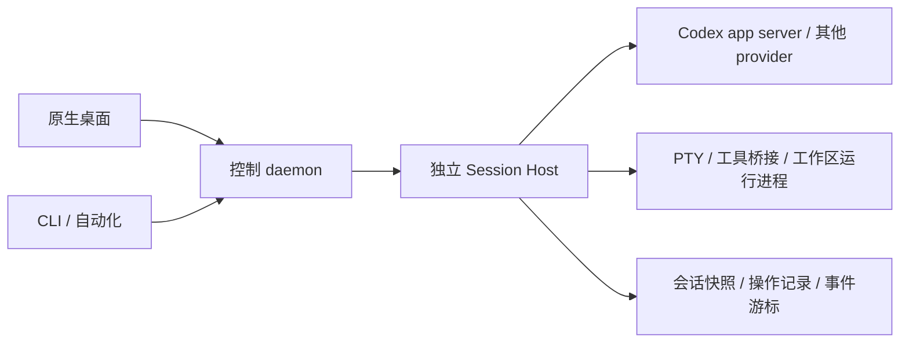

# Fleetpane 产品需求文档

版本：v0.1 草案。更新：2026-10-20。

本文定义产品范围、工作流、实施顺序和验收要求，不代表功能已经实现。
实现状态以 [行为状态表](status.md) 为准，架构细节见 [Session Host ADR](adr/0002-preserve-runtimes-across-control-daemon-upgrades.md)。
用户已确认最终目标达到 donut-paseo 的功能完成度；[功能对照](parity.md) 跟踪参考工作流、现有证据和缺口。
这是整个 Fleetpane 的产品 PRD，覆盖日常开发、并行会话、审查和自动化；
daemon 升级和会话迁移是其中的运行时与兼容性模块。

## 1. 产品定位和已确认决策

Fleetpane 是面向大量并行编程 Agent 会话的原生桌面工作台。
以 Paseo 的项目、工作区、会话和配套开发工具为主要参考，重点改善两个问题：
会话多时界面变慢，以及更新应用或控制 daemon 时中断正在运行的任务。

| 项目 | 决策与边界 |
| --- | --- |
| 项目形态 | 独立公开仓库 Fleetpane；现有仓库为 Apache-2.0 |
| 核心技术 | Rust；界面、控制 daemon、Session Host、协议和领域逻辑分层 |
| 会话运行架构 | 已确认采用独立 Session Host；应用和控制 daemon 的生命周期不拥有运行中会话 |
| 主要产品参考 | Paseo；选择性吸收 cmux、Conductor、Zed 的工作流设计 |
| 桌面工具包 | 已选择 GPUI Kit；当前固定 0.7.3，输入法、终端和可访问性仍须分别验收 |
| 首版平台 | 工作假设：Linux 桌面和 Linux headless host 优先；macOS、Windows 保留架构边界，另行验收 |
| 首版 Agent | 优先验证用户常用的 OpenCodex 和 DeepSeek Harness；完整 provider 覆盖仍按参考行为逐项补齐 |
| 当前实现 | 共享 CLI／GPUI Kit 会话命令、Unix Session Host、同窗口本地多 Host、Codex 和 DeepSeek ACP、模型选项、富内容与有界历史分页已有局部证据。自有控制 daemon、持久恢复、终端、工作区开发工具和完整 provider 覆盖尚未完成，详见行为状态表 |

用户已确认 Rust、GPUI Kit、Session Host 和 donut-paseo 功能完成度目标。
平台验收范围、下文实施优先级及性能数值仍是产品提案；编写需求不启动真实会话迁移或运行时升级。

## 2. 用户、问题和成功标准

主要用户是同时推进多个项目、多条分支和多个 Agent 会话的开发者。
工作可能运行在本机，也可能运行在一台长期在线的 Linux 开发机。
用户主要需要分派工作、识别阻塞、补充指令、审批工具调用、审查代码和运行验证。

| 用户问题 | Fleetpane 应提供的结果 |
| --- | --- |
| 会话增多后，列表、切换和输入明显变慢 | 打开应用只加载目录；仅为可见内容订阅详细事件，后台任务不拖慢输入 |
| 更新 daemon 会连带重启 Codex | 更新控制端时保留 Host、provider 连接、当前 turn 和正在执行的工具 |
| 很难知道哪个 Agent 正在等我 | 一个可操作的待处理队列，区分审批、提问、失败和完成待审查 |
| 多任务共享目录容易互相修改 | 清楚展示工作目录和分支，支持独立 worktree，保留显式共享目录模式 |
| 恢复后不知道任务究竟做到了哪一步 | 显示真实运行状态和最后同步位置；无法确认结果时明确标记，避免重复发送 |
| 替换工具意味着丢失旧上下文 | 保留旧工具可用性，按空闲会话迁移，提供导入预览和问题报告 |

首版成功的定义是：用户能从创建工作区、运行 Codex、审批和补充指令，一直完成到
查看 Diff、运行测试和归档；同时，在有活动任务时完成一次控制 daemon 升级，
任务无需重新发送提示词、重新运行工具或手动恢复。

## 3. 借鉴来源和取舍

调研日期为 2026-10-18。以下是当前官方资料或本地参考源码的观察；
“Fleetpane 采用方式”是产品选择，不是对竞品能力或性能的额外推断。

| 来源 | 已观察到的设计 | Fleetpane 采用方式 | 阶段 |
| --- | --- | --- | --- |
| [Paseo 工作流](https://paseo.sh/docs/why) | Agent、文件、终端、Diff 和工作区整合；客户端与 daemon 分离 | 沿用 Agent 为中心的工作区，增加独立 Session Host 生命周期 | P0 |
| [Paseo 并行开发](https://paseo.sh/docs/parallel-development) | 独立 worktree、分支和任务并行 | 工作区隔离、清晰的目录归属及安全归档 | P0 |
| [Paseo 连接方式](https://paseo.sh/docs/connectivity) | 本机、SSH 和可选 relay | 先本机与 SSH；移动端和 relay 后置 | P0 / P2 |
| [Paseo provider](https://paseo.sh/docs/providers) | 复用外部 Agent 的配置、认证和工具 | provider 能力协商；保留原生配置，先做好 Codex | P0 / P1 |
| [Paseo 编排](https://paseo.sh/docs/orchestration) | Agent 委派、CLI 和跨工作区工作 | 共享命令入口；再补父子会话、自动化和扩展 | P0 / P1 |
| [Paseo 计划任务](https://paseo.sh/docs/schedules) | 新会话定时任务与已有会话 heartbeat 分开 | 明确执行对象、并发、运行记录和控制端交接时的去重 | P1 |
| [Paseo 浏览器](https://paseo.sh/docs/browser)、[语音](https://paseo.sh/docs/voice) 与 [插件](https://paseo.sh/docs/plugins) | 页面验证、语音交互和用户扩展 | 纳入完整路线图，独立定义生命周期和资源成本 | P1 / P2 |
| [cmux](https://cmux.com/) | 侧栏展示工作区上下文；待处理通知、快捷键和可编程入口 | 紧凑状态行、待处理导航、统一 CLI；不把每个会话都做成常驻终端 | P0 |
| [Conductor 工作区](https://www.conductor.build/docs/concepts/workspaces-and-branches) | 一个工作流包含独立代码、终端和运行环境 | 工作区成为会话和开发工具的共同上下文 | P0 |
| [Conductor Diff](https://www.conductor.build/docs/reference/diff-viewer) 与 [Checks](https://www.conductor.build/docs/reference/checks) | 代码审查、具体行反馈和检查状态集中呈现 | P0 本地 Diff 和验证输出；P1 行评论、PR 和 CI 汇总 | P0 / P1 |
| [Zed Agent Panel](https://zed.dev/docs/ai/agent-panel) | 多会话导航、上下文附件及审查入口 | 键盘切换、文件和选区引用；按需展开工具详情 | P0 |
| [Zed External Agents](https://zed.dev/docs/ai/external-agents) | 明确区分外部 Agent 与宿主的配置和能力 | 不用统一 UI 假装所有 provider 支持相同功能 | P0 / P1 |

参考源码为 Paseo checkout 基线 `a486b0558168c08890890e787d55cfb88c0d7256`，
其中 Codex provider 存在未提交修改。参考了 `docs/product.md`、`docs/glossary.md`、
`docs/architecture.md`、`docs/agent-lifecycle.md`、`docs/timeline-sync.md`、
`docs/providers.md` 和对应实现；它们描述的是所检查的工作树，不代表已安装二进制的行为证明。
公开文档和本地 fork 可能不同，移植时应逐项核对。

不复制竞品的私有实现、视觉资产或未经许可证审查的代码。
首版可分阶段交付，最终功能完成度目标不因此缩减。参考中尚未移植的能力必须明确列出，
不能用一条会话链路通过代替整个产品完成；竞品的性能宣传也不是 Fleetpane 的基准证据。

## 4. 核心概念与状态

| 概念 | 产品含义 |
| --- | --- |
| 主机 / Host profile | 用户连接的一台机器及其连接配置；与下面的 Session Host 不同 |
| 项目 / Project | 用户管理的一组代码工作区；身份不随分支、目录显示名或远端地址修改而改变 |
| 工作区 / Workspace | 某台主机上的具体工作目录，拥有会话、终端、布局和 Git 上下文 |
| 会话 / Session | 可继续对话的 Agent 上下文；具有 Fleetpane ID 和独立的 provider session/thread ID |
| Turn | 一次用户输入触发的执行；完成一个 turn 不等于整个开发任务验收完成 |
| Session Host | 常驻运行组件，持有 provider 连接、活动请求、审批、终端及必要工具桥接 |
| 控制 daemon | 对客户端提供目录、命令和协调服务，可独立升级替换 |
| 待处理项 / Attention | 需要用户处理的具体事件，有来源、对象、原因和解决状态 |

产品须分别表达以下状态，不能用单一颜色或单一布尔值代替：

| 维度 | 示例及规则 |
| --- | --- |
| 连接 | 在线、重连、离线；客户端断线不推断 Agent 已停止 |
| 运行时 | 加载中、可用、已释放、故障；关闭窗口不释放运行时 |
| Turn | 空闲、运行中、等待审批、等待回答、停止确认中、完成、中断、失败、结果待确认 |
| 可见性 | 活跃、归档；归档不等同于删除历史或删除目录 |
| 关注状态 | 未读完成、未处理错误、待审批、待回答；“已读”不能代替审批决定 |

首版为 Fleetpane 管理的每个会话维护一个前台 turn。
Steer、排队输入和新 turn 是不同操作；不支持的能力须明确提示，不能暗中转换为中断重启。
Provider 内部后台任务和子 Agent 不得被错误地表示为已经退出或与前台 turn 同时完成。

## 5. 信息架构和交互原则

桌面默认由三部分组成：左侧项目、工作区和会话目录；中间会话与输入区；
可按需打开的文件、Diff 和终端区域。待处理队列和历史搜索为独立入口。
主机、分支、目录、provider 和状态随当前上下文显示，避免误操作到另一工作区。

图中的边表示通信和数据责任，不表示父子进程绑定。界面和控制 daemon 退出时，
不得由父进程清理、进程组或服务停止策略连带终止 Host 和运行中的工作。

- 关闭标签页只关闭视图；停止 turn、释放运行时、归档、删除记录分别是显式操作。
- 首次使用只要求选择项目并准备好 Agent，不要求理解 Session Host 或订阅协议。
- 列表按元数据增量更新；会话详情、终端和 Diff 按需加载。
- 后台新输出不抢焦点，不自动切换会话，不破坏正在输入的草稿或文本选择。
- 全局命令面板、最近会话切换和下一个待处理项须可用键盘完成；快捷键可查看和修改。
- 文件和工具内容有大小限制时明确显示截断和展开方式，不用空白或成功状态隐藏缺失内容。

## 6. 完整功能地图、范围和优先级

### 6.1 完整产品功能地图

对照 Paseo 的主要工作流建立下列地图。表中的功能点是 Fleetpane 计划覆盖的内容，
并非宣称每项都与所检查的 Paseo 版本完全一致。P0 / P1 / P2 代表交付顺序，
后续功能仍属于本 PRD 的产品范围。

| 功能域 | 要覆盖的功能点 | 首版 / 后续安排 | 对应需求 |
| --- | --- | --- | --- |
| 项目和工作区 | 目录注册、分组、worktree、分支、工作区独立状态、归档与恢复 | P0 基础；P1 冷归档与恢复未提交内容 | WS-01 至 WS-05、EXT-18 |
| 会话管理 | 创建、命名、置顶、筛选、归档、继续上下文、释放闲置运行时 | P0；P1 标签、保存的筛选及批量操作 | AG-01、AG-09、EXT-16 |
| 对话与时间线 | Markdown、代码块、工具详情、计划、错误、分页、流式更新和复制 | P0；能力依赖 provider | AG-02、AG-07、AG-08 |
| 输入与上下文 | 草稿、图片、文件、选区、原生命令、排队、Steer 和停止 | P0；P1 issue / PR 等上下文来源 | AG-03 至 AG-06、EXT-04 |
| 多 provider | 模型、模式、推理强度、原生配置与认证、能力发现和自定义 provider | P0 Codex；P1 Claude Code / ACP | SET-02、SET-03、EXT-01 |
| 多 Agent 协作 | 父子会话、委派、状态和结果回传、跨工作区协作、手动 detach | P1 | EXT-07 |
| 文件工具 | 文件树、预览、搜索、路径跳转、外部编辑器、文件编辑 | P0 读取和引用；P1 编辑、全文搜索 | DEV-01、EXT-03、EXT-04 |
| 终端 | PTY、分屏、历史、搜索、复制粘贴、重新挂接、运行命令 | P0 | DEV-02、UX-01 |
| Git 操作 | 分支、状态、staged / unstaged Diff、基线比较、stage、commit 和 push | P0 查看；P1 显式写操作 | WS-04、DEV-03、EXT-19 |
| 审查和交付 | Diff 反馈、PR、CI、评论、真实验证结果、待审查清单 | P0 本地查看与验证；P1 forge 集成 | DEV-03、DEV-04、EXT-04、EXT-05 |
| 开发服务 | 工作区脚本、启动状态、端口、预览入口和清理 | P0 手动运行；P1 模板与端口自动化 | DEV-05、EXT-06 |
| 待处理与通知 | 审批、问答、错误、完成、未读、跳转、去重和彻底静音 | P0 | ATT-01 至 ATT-05 |
| 导航与历史 | 最近会话、项目 / 状态筛选、命令面板、历史搜索、上下文分叉 | P0 基础；P1 全文、标签及分叉 | CON-03、UX-03、EXT-03、EXT-16 |
| 布局和偏好 | 标签、分屏、面板恢复、主题、字体、快捷键、语言、可访问性 | P0 基础；P1 更丰富偏好 | UX-01 至 UX-03 |
| Profiles / skills / MCP | 启动预设、原生指令与 skills 来源、MCP 状态和工具目录 | P0 保留原生配置；P1 查看和管理 | SET-03、EXT-14 |
| 计划任务 | 定时新会话、已有会话 heartbeat、暂停、手动运行和运行历史 | P1 | EXT-08 |
| CLI / API / SDK | 工作区与会话操作、JSON、等待结果、工具适配和事件订阅 | P0 CLI；P1 公共 API / SDK / MCP | CON-02、EXT-09 |
| 远程与多主机 | 本机、SSH、主机切换、多主机聚合、离线状态和重连 | P0 本机 / SSH；P1 聚合 | SET-04、CON-01、EXT-02 |
| 跨设备 | 多客户端状态、移动 / Web、设备配对和可选 relay | P0 多客户端语义；P2 新客户端 | ATT-03、CON-04、EXT-11 |
| 浏览器验证 | 工作区页面、截图、快照、交互、console / network 证据和结果回传 | P2，先支持外部浏览器入口 | DEV-05、EXT-12 |
| 语音 | 听写、可编辑转写、语音对话、TTS 和中断 | P2，按需加载 | EXT-12 |
| 插件与外部事件 | Provider / 命令扩展、面板、主题、webhook / issue / mention 触发 | P1 扩展 API；P2 复杂 UI 和事件入口 | EXT-09、EXT-12、EXT-17 |
| 用量与诊断 | 上下文、token、成本来源、运行时版本、资源统计和脱敏导出 | P0 基础诊断；P1 汇总 | SET-02、RUN-07、EXT-15 |
| 运行连续性与替换 | Session Host、升级交接、故障可见、导入和版本兼容 | P0 | RUN-01 至 RUN-07、MIG-01 至 MIG-03 |

### 6.2 首版边界

| 优先级 | 含义 | 范围 |
| --- | --- | --- |
| P0 | 首个可日常使用的版本必须具备 | Codex、Session Host、控制端交接、原生桌面、目录和对话、审批、worktree、终端、只读文件与 Diff、待处理队列、基础搜索、布局和偏好、CLI、本机和 SSH、受控导入 |
| P1 | 扩大 Paseo 工作流覆盖 | Claude Code、ACP、多主机聚合、macOS 产品验收、完整历史搜索、上下文分叉、文件编辑、Git 写操作、GitHub PR / CI、父子 Agent、计划任务、profiles / skills / MCP 和扩展 API |
| P2 | 具备核心稳定性后再评估 | Windows 桌面及 Host 验收、移动端 / Web、relay 配对、语音、内嵌浏览器、复杂插件面板及其他 forge |

P0 不包括完整 IDE / LSP、自研 Agent 推理引擎、云端托管平台、自动合并 PR、
完整复制 Paseo 插件 ABI、跨 provider 无损转换上下文，或把活动进程迁移到另一台机器。
首版提供外部编辑器和浏览器入口；原生界面不依赖常驻 Electron 前端。

## 7. P0 功能需求

以下条目均是待实施需求；验收列定义可观察结果，不表示已通过测试。

### 7.1 安装、配置和主机

| ID | 要做的内容和要点 | 验收要求 |
| --- | --- | --- |
| SET-01 | 安装桌面、CLI 和可独立运行的服务；发现而不是重复启动已有 Host | 二次启动连接同一实例；关闭桌面后任务继续；提供明确的显式停止入口 |
| SET-02 | 检测 Codex 路径、版本、认证和协议能力；提供可操作的诊断 | 未安装、未认证和版本不兼容分别显示原因；不通过创建空会话假装检测成功 |
| SET-03 | 将 Fleetpane 偏好与 provider 原生配置分开；显示生效配置来源 | 保留现有 Codex instructions、skills、MCP 和认证；敏感值不进入普通日志或导出 |
| SET-04 | 保存本机和 SSH 主机配置、服务版本和连接状态 | 同名目录在不同机器上保持独立；SSH 复用 OpenSSH 配置和主机校验；不自动安装或重启远端服务 |

### 7.2 项目和工作区

| ID | 要做的内容和要点 | 验收要求 |
| --- | --- | --- |
| WS-01 | 添加现有目录或 Git 项目，识别稳定项目与工作区身份 | 重启后引用不变；分支重命名、同路径不同主机及 remote 变更不串联历史 |
| WS-02 | 创建工作区：使用现有目录，或基于用户选定 ref 创建独立 worktree | 创建前展示目录、分支、基线；失败报告已完成步骤和残留，不删除用户原有目录 |
| WS-03 | 同一工作区内管理多个会话、终端和布局 | 切换工作区后草稿、标签、文件选择和终端归属不混用；共享同一目录时明确展示 |
| WS-04 | 展示分支、修改文件、Git 状态和 worktree 归属 | 不把 worktree 当作权限沙箱；同目录多会话不自动推断各文件由哪个 Agent 修改 |
| WS-05 | 安全归档工作区和会话，恢复可恢复的历史 | 关闭视图不停止任务；有活动任务须先显式停止并确认；只删除明确归属 Fleetpane 且通过检查的 worktree，不隐式丢弃未提交或未推送代码 |

### 7.3 会话、输入和时间线

| ID | 要做的内容和要点 | 验收要求 |
| --- | --- | --- |
| AG-01 | 创建、重命名、置顶、筛选、归档和恢复 Codex 会话 | 工作区、provider ID 和 Fleetpane ID 可追踪；失败时保留可诊断状态 |
| AG-02 | 发送文本，展示助手输出、工具调用、错误、计划和 provider 提供的用量 | 同一工具调用更新一个条目；不重复追加历史；未知可选事件保留兼容性，未知关键请求明确拒绝 |
| AG-03 | Provider 能力驱动模型、模式、推理强度和原生命令选择 | 不硬编码已失效模型；不支持的选项不假装可用；变更说明从下一 turn 还是当前 turn 生效 |
| AG-04 | 多行输入、会话级草稿、文件 / 选区引用和受支持的图片附件 | 切换、重连和应用更新后草稿仍在；附件来源及发送失败可见；发送前可检查内容 |
| AG-05 | 显式选择排队、Steer 或停止后发送，保留输入顺序和状态 | 运行中不会误发第二个前台 turn；Steer 能力不足时提示；审批未解决时不暗中拒绝审批来发送新消息 |
| AG-06 | 停止当前 turn，显示停止确认中及最终结果 | 对准原 turn ID；迟到确认不停止新 turn；中断失败或结果不明时禁止自动启动替代 turn |
| AG-07 | 虚拟化时间线，先加载最近页，向前分页并保持滚动位置 | 长对话打开不读取全部历史；用户向上阅读时不强制回到底部；有新输出时可跳转 |
| AG-08 | 快照、事件序列和重连补齐，区分历史投影与实时 delta | 重连后无重复用户消息和工具条目；缺页继续补齐；游标失效明确重新同步，未聚焦不等于停止收取必需状态 |
| AG-09 | 显式释放可安全关闭的闲置运行时，并在下次打开 / 发消息时恢复原会话 | 保留历史与身份；存在审批、工具、后台任务或未确认状态时不假装空闲；共享 app server 时不能为释放一个会话而终止其他会话 |

### 7.4 审批、待处理队列和通知

| ID | 要做的内容和要点 | 验收要求 |
| --- | --- | --- |
| ATT-01 | 统一展示工具审批、结构化问题、错误和完成待审查 | 每项包含会话、主机、时间和原因；可直接跳转原位置；完成 turn 不自动标记开发任务验收完成 |
| ATT-02 | 展示原始审批范围、命令 / 路径和 provider 允许的回答选项 | 回答对应原 request ID；没有 UI 或控制端时保持待处理，不自动批准；明确标识已失效请求 |
| ATT-03 | 多客户端和重连时同步处理状态 | 一个有效决定只应用一次；其他窗口能看到解决结果；旧控制端无权提交迟到决定 |
| ATT-04 | 通知按全局、主机、工作区 / 会话及事件类型配置，提供完全静音 | 完全静音关闭声音、系统弹窗及 tray / dock 红点；静音项不计入未读徽标，仍可在应用内查询真实待处理状态 |
| ATT-05 | 待处理筛选、下一项快捷键和完成通知去重 | 普通流式输出不制造通知；重连和事件补齐不重新轰炸；错误不被批量“已读”变成成功 |

### 7.5 文件、终端、验证和审查

| ID | 要做的内容和要点 | 验收要求 |
| --- | --- | --- |
| DEV-01 | 按需文件树、文本预览、路径 / 行号导航及外部编辑器入口 | 大文件和二进制有明确策略；浏览文件不导致整个项目递归扫描；引用选区可发送给当前会话 |
| DEV-02 | 工作区 PTY 终端，支持复制、滚动、搜索、调整大小和重新挂接 | UI 关闭和控制 daemon 升级不终止 shell 或命令；输出持续消费；截断可见；重连不重复发送键盘输入 |
| DEV-03 | 修改文件列表、unified Diff、用户选定基线比较和外部 Diff 入口 | 处理新增、删除、重命名及二进制；显示比较基线；大型 Diff 按需加载；不自动归因全部修改给当前 Agent |
| DEV-04 | 从正确工作区启动用户选择的验证命令，保留退出状态和输出 | 展示命令、cwd、开始结束时间及退出码；“Agent 说通过”与真实执行证据分开；升级不重跑已启动命令 |
| DEV-05 | 当前工作区的运行命令和开发服务入口 | 显示真实启动与退出状态；P0 可手动打开本机或 SSH 转发后的 URL；自动端口分配与端口发现放入 P1 |

### 7.6 Session Host 与控制端交接

| ID | 要做的内容和要点 | 验收要求 |
| --- | --- | --- |
| RUN-01 | Host 独立运行，持有 provider 长连接、活动 RPC、审批、PTY 和必要工具桥接 | 桌面退出、控制 daemon 正常退出或崩溃时，上述资源不跟随销毁 |
| RUN-02 | 新旧控制 daemon 并存，先同步再交接；Host 验证每次修改的 controller generation | 任意时刻只有一个有效控制者；旧实例的迟到发送、停止和审批全部被拒绝 |
| RUN-03 | Host 提供一致快照与有序事件，记录已接纳操作及状态 | 新控制端能恢复目录、活动 turn 和待审批请求；断线后的操作结果可查询，不能仅靠 JSON-RPC ID 去重 |
| RUN-04 | 区分桌面、控制 daemon、Host 和 provider 更新 | 前两者更新不强制更新后两者；不兼容的新控制端在交接前被拒绝，旧端继续服务 |
| RUN-05 | Host / provider 更新采用多代版本并存、排空和空闲迁移 | 新运行时进新 Host；活动 turn、审批、工具及 PTY 留在原 Host；迁移要暂停新写入并原子更新持久路由，不能重复执行；无依赖资源后旧 Host 才退出 |
| RUN-06 | 监测 provider 意外退出、Host 故障和结果不确定的命令 | 不显示假空闲或假完成；不自动重复执行提示词和副作用；提供原始诊断及明确恢复入口 |
| RUN-07 | Host 协议版本协商、健康诊断及受约束的本地访问 | 可查版本、实例身份和兼容范围；默认本机权限边界，不把本地控制接口裸露给公网 |

控制端升级的用户流程：检查兼容性 → 启动新实例 → 读取快照并追上事件 →
短暂暂停新修改请求 → Host 原子移交控制权 → 新实例恢复处理 → 旧实例退出。
整个过程中 Host 持续消费 provider 输出；已接纳的请求由 Host 继续跟踪。
在交接前失败，原实例继续运行；交接后的回切也是一次新 generation 的转移。

Host 自身升级与上述控制端交接分开：新版本就绪后接收新运行时，旧版本继续服务现有
任务并排空。不能仅凭 turn 结束就迁移；待审批、结果未确认的操作、后台 Agent / 工具和
PTY 仍可能持有资源。符合空闲条件后，通过 provider 支持的 resume 恢复上下文，
再以持久化迁移记录和路由 generation 提交新归属。常规更新不设置强杀活动任务的截止时间；
长任务跨越多次更新时可有多代 Host 并存，资源不足则延后更新。
这是一项待实现设计，细节及失败边界见 [Host 自身升级 ADR](adr/0002-preserve-runtimes-across-control-daemon-upgrades.md#updating-the-session-host-itself)。

Host 数量、分片粒度、存储引擎、具体 IPC、事件保留量和 supervisor 实现由后续 ADR 决定。
不得默认“每会话一个 Host”或“所有账号共用一个 Host”；须验证进程成本、认证隔离和故障影响范围。

### 7.7 连接、查询和自动化入口

| ID | 要做的内容和要点 | 验收要求 |
| --- | --- | --- |
| CON-01 | 本机连接及通过 SSH 连接已准备好的 Linux 主机，首版可逐个切换主机 | 网络断开后远端继续工作；重新连接恢复真实状态；不因连接失败重启 Host |
| CON-02 | GUI 和 CLI 共用命令与状态模型，CLI 提供结构化 JSON 和有意义的退出码 | 支持会话 / 工作区列表、创建、发送、状态、等待、停止和审批；相同输入具有相同语义 |
| CON-03 | 标题、项目、工作区和状态筛选，提供最近历史入口 | 搜索不加载全部会话正文；索引未就绪不返回伪空列表；正文全文搜索为 P1 |
| CON-04 | 边界清晰的重连和多客户端访问 | 只对可安全重试的读取或连接建立重试；修改结果不明时查询操作状态；一个慢客户端不阻塞其他客户端或 provider |

CLI 不是 GUI 的调试后门。自动化调用也必须经过权限、能力、操作身份和控制权检查，
不得通过另一条入口绕过停止、审批或并发规则。

### 7.8 迁移和可携带性

| ID | 要做的内容和要点 | 验收要求 |
| --- | --- | --- |
| MIG-01 | 只读扫描 Paseo 会话和工作区；预览可导入项、运行中项及不支持项 | 输出 dry-run 报告；不停止、重载或修改 Paseo；相同数据重复扫描不复制会话 |
| MIG-02 | 在空闲边界导入受支持的 Codex 会话与工作区引用 | 保留可追踪 ID 映射、目录和 provider 原生 thread；使用版本校验和单一写入者确认；导入前先在副本 / 隔离环境验证 |
| MIG-03 | 分批切换和明确回退，导出 Fleetpane 自有元数据和会话引用 | 首批小范围迁移后核对；保留原数据；回退前先释放 Fleetpane 写入权，不能让两个产品同时写同一 thread |

导入的历史、原生 thread 的恢复和正在执行的进程接管是三种不同能力。
现有 Paseo 私有 stdio 会话不能仅凭 PID 接管；首版不承诺无缝接管其活动 turn。
Paseo CLI / SDK / 插件也不自动成为 Fleetpane 兼容接口；不支持的配置和自动化必须列入迁移报告，
尤其不能在导入后默默重新启用计划任务。

### 7.9 原生界面、布局和偏好

| ID | 要做的内容和要点 | 验收要求 |
| --- | --- | --- |
| UX-01 | 工作区标签、分屏、面板尺寸和布局恢复；会话、文件、Diff、终端可组合 | 视图切换不释放 Agent；重启后恢复所属工作区；不可见面板不保留不必要的渲染和订阅 |
| UX-02 | 深浅主题、字体与缩放、界面语言、通知和快捷键设置；区分设备偏好与主机配置 | 英文及简体中文核心界面、状态与错误可读；修改外观无需重启运行时；不同机器的 Agent 配置不互相覆盖 |
| UX-03 | 键盘导航、命令面板、中文输入法、文本选择、剪贴板和基础可访问性 | 核心工作流可用键盘完成；输入法组合期间不会误发送；焦点与屏幕阅读器标签可验证；多行代码及图片粘贴符合能力范围 |

## 8. 后续完整功能需求

### 8.1 P1 / P2 工作包

| ID | 优先级 | 内容和要点 | 进入条件 / 验收边界 |
| --- | --- | --- | --- |
| EXT-01 | P1 | Claude Code 和 ACP provider；能力矩阵与原生认证 | 复用 Host 生命周期合同，但每个 provider 单独验证中断、历史、审批和故障行为 |
| EXT-02 | P1 | macOS 桌面和 Host 产品验收；多主机聚合目录 | 编译成功不等于产品支持；验证输入、通知、服务生命周期和账号边界 |
| EXT-03 | P1 | 正文全文搜索、历史锚点和上下文分叉 | 结果能跳转原条目；区分复制摘要 / 历史与 provider 原生 fork；不隐式回滚文件 |
| EXT-04 | P1 | Diff 行评论、可选文件编辑和审查反馈到 Agent | 反馈绑定路径、基线和行范围；编辑冲突可见；不把整个共享目录的修改都认作单一会话产物 |
| EXT-05 | P1 | GitHub PR、CI、评论和本地验证汇总 | 绑定具体 commit / revision；缺失、排队、失败和通过分别显示；外部写操作由用户显式触发 |
| EXT-06 | P1 | 工作区 setup / run / teardown 配置、端口分配和服务发现 | 新 worktree 的脚本来源与执行时机可见；失败不掩盖；清理只影响所属工作区 |
| EXT-07 | P1 | 父子 Agent、跨工作区委派和手动 detach | 关系与目录归属分开；停止 / 归档父会话前展示子项影响；不把 provider 原生子 Agent 误当成独立受控进程 |
| EXT-08 | P1 | 计划任务、重复执行和运行记录 | 任务定义与每次 run 分开；控制端交接不能重复触发；并发、漏跑、时区和失败策略先形成独立需求 |
| EXT-09 | P1 | 公共 API / SDK、命令和 provider 扩展、MCP 适配层 | 与 GUI / CLI 共用命令，权限按调用者限制；先支持实际集成需要，不兼容旧插件 ABI |
| EXT-10 | P2 | Windows 原生桌面与 Host | 单独验证进程树、命名管道 / IPC、终端、路径、服务和升级；不套用 Unix 实现 |
| EXT-11 | P2 | 移动 / Web 客户端、relay 与配对 | 本地及 SSH 稳定后，单独定义设备身份、授权和端到端加密协议 |
| EXT-12 | P2 | 语音、内嵌浏览器和复杂插件 UI | 有明确使用需求与性能预算；按需启动，不增加所有用户的常驻负担 |
| EXT-13 | P2 | Checkpoint / rewind、更多 forge 和跨 provider handoff | 明确对话回退与文件回退的差别；不承诺跨引擎无损上下文或运行中迁移 |
| EXT-14 | P1 | Agent profiles、instructions / skills 来源、MCP 服务状态和工具目录 | 启动预设变更不暗中修改现有会话；区分原生工具与 Fleetpane 注入工具、可用与已授权 |
| EXT-15 | P1 | Provider 用量、上下文状态、成本来源、资源概览和诊断导出 | 缺失数据不显示为零；估算与原始数值区分；总资源统计覆盖必要子进程；导出可脱敏 |
| EXT-16 | P1 | 会话 / 工作区标签、保存的筛选、批量整理和待处理视图 | 批量操作先显示对象及影响；运行中、待审批和未保存状态不被普通清理操作忽略 |
| EXT-17 | P2 | 外部事件入口，按需接 GitHub、webhook 和消息平台 | 事件身份、目标主机 / 工作区、去重和执行记录可追溯；输出到外部系统独立授权，不默认发送消息 |
| EXT-18 | P1 | 工作区冷归档，恢复未提交文件及 Git index | 快照完整性和可恢复性验证后才移除 Fleetpane 所有的 worktree；共享引用尚存时不清理；恢复不覆盖现有目录 |
| EXT-19 | P1 | 分支、stage / unstage、commit、push 及冲突入口 | 写操作明确显示目录、分支、文件和目标；只包含用户选择的修改；失败保留原始 Git 诊断，不自动 reset 或 force push |

### 8.2 Provider、上下文和协作

- 每个 provider 独立声明模型、图片、工具审批、结构化问题、Steer、取消、历史恢复、
  fork、子 Agent、用量和原生命令能力。已有 Codex 能力不得被错误映射成 Claude / ACP 的能力。
- 创建预设可同时选择 provider、模型、模式、推理级别和用途说明；应用后仍可逐项修改。
  保存预设影响未来创建，不对运行中会话广播配置变更。
- 文件、代码选区、图片、issue、PR / 评论和历史摘要均作为有来源的上下文。
  发送前展示将附加的内容；跨主机路径和本机路径不可混淆。
- 编排流程包括“研究 → 实现 → 独立审查”，可显式选择共享工作区或独立 worktree。
  父会话可以查看子项状态和结果，不能因关闭视图而把仍运行的子项藏成已完成。
- 上下文分叉创建新会话并保留来源链接；对话 checkpoint、provider fork 和代码回退
  分别标识。跨 provider handoff 先采用显式摘要或历史附件，不宣传无损迁移。

### 8.3 编辑、Git 和交付闭环

- 文件编辑支持打开、搜索、保存、重新加载、冲突提示及将选区发送给 Agent；
  不要求先具备完整 IDE 的语言服务才能形成工作闭环。
- Git 面板区分 staged / unstaged、当前工作区与基线比较。分支切换前展示活动任务和修改，
  不把切分支操作当作“切换会话”。
- Diff 支持按文件、commit 和基线审查；行反馈附带路径、内容和 revision，
  汇总后发送给指定 Agent。反馈准备和真正发送是分开的操作。
- PR 流程覆盖创建草稿、打开已有 PR、查看 CI 和评论、跳转本地变更，以及按用户要求修复。
  “模型认为完成”、本地测试、远端 CI、审查与合并状态分别展示。
- 工作区脚本提供依赖准备、开发服务启动和清理；可查看输出、停止和重新运行。
  自动端口分配必须避免不同 worktree 冲突，SSH 预览明确区分远端 URL 与本地转发入口。
- 冷归档用于降低大量历史工作区的磁盘成本；未提交内容和 Git index 的恢复是独立验收项，
  不能仅验证分支还存在就声称工作区已完整恢复。

### 8.4 搜索、计划任务和工具生态

- 搜索覆盖标题、项目、分支、标签、正文和工具结果；可按主机、provider、状态和时间过滤，
  结果跳到原始条目。索引范围和截断可见，删除 / 归档后的搜索行为保持一致。
- 计划任务分开表达“每次新建会话”和“唤醒指定会话”。支持创建、暂停、继续、
  立即运行、修改和查看每次运行记录；创建前展示时区与下一次触发时间。
- 时区 / DST、主机离线漏跑、任务重叠、执行上限和失败后处理均有明确配置与测试。
  不把修改配置、重连或升级误当成一次新的定时触发；不静默补跑可能产生副作用的任务。
- Instructions、skills 和 MCP 管理先展示真实来源、作用域、是否生效及诊断。
  若更改需要重新加载 Agent，先提示影响并等待空闲边界，不为更新目录自动打断活动 turn。
- 扩展从稳定命令、provider 和事件接口起步；GUI、CLI、SDK、MCP 共享业务实现。
  插件安装、更新、启用、禁用和失败隔离有明确入口，主题或扩展 UI 不绑入核心运行时。
- 外部事件与计划任务共用可审计的启动入口，但保留独立事件身份和权限。
  外部内容不会直接获得任意 shell 或消息发送权限；具体集成另有配置和用户授权。

### 8.5 浏览器、语音与跨设备

- 浏览器功能包括工作区标签、开发服务导航、页面 / 可访问性快照、截图、点击 / 输入，
  console / network 证据和回传会话。默认使用隔离的工作区浏览器上下文，不接管用户活动标签。
- 浏览器操作在后台进行，用户可查看和接管。用于活动 Agent 的 browser host 也须有独立生命周期；
  若做不到跨 UI 升级连续运行，必须明确能力限制，不能套用 Session Host 的不中断承诺。
- 语音先提供按键听写、转写预览和发送，再评估连续对话与 TTS。中文能力单独验证，
  不以“多语言模型”名义假定支持中文；本地与云端处理的选择、下载和资源使用可见。
- 移动端和 Web 支持查看、跟进、审批和终端 / Diff 的适配展示；同一请求在不同设备上
  共享解决状态。设备离线、撤销授权和更换主机不会生成重复 turn。
- Relay 是可选连接方式；设备配对、重连和加密协议独立验收。它不取代本机与 SSH，
  也不成为使用 Fleetpane 的强制账号或云服务依赖。

## 9. 性能和资源要求

没有测量证据前，不宣称 Rust 或 GPUI 已解决卡顿。
先定位 Paseo 在实际负载下的输入、渲染、订阅、序列化、历史读取、文件观察和内存成本。
Fleetpane 的首版不得以保留高成本旧 daemon 却只测新 UI 的方式宣称整体更快。

### 工作负载

| 场景 | 测试负载 | 重点 |
| --- | --- | --- |
| W0 | 空项目、无 Agent | 冷启动、基础常驻资源和服务进程数 |
| W1 | 200 个未归档会话，20 个活动流，单个可见会话；每流每秒 10 个合成事件 | 输入、滚动、切换、目录更新和后台流隔离 |
| W2 | 10,000 个归档记录，单个会话 100,000 条历史投影项 | 分页、搜索、索引和缓存上限，不启动等量 provider 进程 |
| W3 | 多轮打开 / 关闭会话、终端和 Diff，反复断连及升级 | 订阅、句柄、线程、FD 和缓存是否释放 |
| W4 | P1 多主机，一台高延迟或离线 | 故障主机不拖慢其他主机和本机输入 |

合成负载验证宿主扩展性，不代表真实 provider 同时运行 20 个任务的资源成本。
真实 Agent 验证另行记录版本、任务、事件速率和全部相关进程。

### 建议目标与测量规则

下列延迟数值是建议目标，未测量、未冻结为发布预算。M0 完成基线后可修订，
须记录理由并在日常使用版本验收前冻结；不能把建议值写成已实现结果。

| 指标 | 建议目标 / 要求 |
| --- | --- |
| W1 输入到可见字符 | p95 ≤ 50 ms；从本地键盘事件到实际呈现测量 |
| W1 已缓存会话切换 | p95 ≤ 100 ms；未缓存内容单独记录，不把占位屏当作内容就绪 |
| 本机冷启动到可操作目录 | p95 ≤ 2 s；不含 provider 冷启动或模型响应 |
| 控制 daemon 升级 | 0 次活动 turn / 工具中断、0 次重复提交；新修改请求暂停建议 p95 ≤ 2 s |
| 内存、CPU 与磁盘 | M0 冻结数值预算；分别报告 UI、控制端、Host、provider 和合计，提供 W0 / W1 / W2 数据 |
| 长期稳定性 | 8 小时合成负载及恢复循环无崩溃、无丢失的已接纳操作；资源在预热后不随循环次数持续增长 |

共同的工程要求：可见列表与时间线虚拟化、增量投影、有界队列和缓存、按需订阅、
工作区级观察共享、慢读者隔离、取消过期查询，以及解析和 I/O 离开渲染线程。
输出合并不能丢失最终文本、工具状态、审批或错误；缓存淘汰与事件缺口必须能够显式恢复。
Host 不能因界面关闭停止消费 provider 输出，也不能无限缓存无人查看的 delta。

基准须在同机、同数据、同窗口条件及 release 构建下比较，绑定源码 revision、
provider 版本和进程清单；保留原始样本、p50 / p95 / p99、内存和 CPU。
模型首 token 延迟与宿主界面延迟分开，不把网络变快归因于原生重写。

## 10. 持久化、恢复和兼容性

- Host 负责活动 turn、待审批、已接纳操作、终端归属和恢复所需的运行记录；
  provider 原生历史仍是 provider 对话的权威来源，UI 投影和缓存不得冒充它。
- 控制 daemon 的目录与搜索索引可重建；不能让升级或重建丢失唯一的审批、操作身份或会话映射。
- 快照与事件游标须表达同一一致性位置；断线不能靠重新发送所有输入重建状态。
- 消息接纳与 provider 接纳分别跟踪。发出后未收到结果时显示“结果待确认”，
  不承诺跨任意故障的 exactly-once；确认不会重复副作用后才能继续。
- schema 与协议有版本。未知可选字段保留向前兼容；不兼容的控制端在转移所有权前拒绝。
- 数据迁移可预览、备份和验证；版本回退不自动假设旧程序可以读取新 schema。
- 认证按主机、账号和配置边界隔离。切换身份不能借助重连暗中接管旧身份的运行时。
- 默认本地存储，无强制 Fleetpane 账号；诊断和数据分享为显式操作，导出支持隐去内容与凭据。

## 11. 关键用户流程和系统验收

| ID | 场景 | 必须看到的结果 |
| --- | --- | --- |
| FLOW-01 | 首次添加项目，建立 worktree，给 Codex 发任务 | 目录、分支和 provider 清晰；输出、审批及结果在同一工作区可追踪 |
| FLOW-02 | 多会话输出时输入、切换及返回旧会话 | 输入和草稿不丢失；后台任务继续；时间线位置稳定，未关注会话不加载完整正文 |
| FLOW-03 | 从待处理队列审批并处理失败 | 决定发往原请求；恢复执行；失败仍保留诊断，不由“已读”消除错误 |
| FLOW-04 | 流式 turn、长工具命令、PTY 命令和待审批期间分别升级控制 daemon | Host / provider / 仍在运行的工具进程和连接身份不变；同 thread / turn 最终完成；副作用计数为 1 |
| FLOW-05 | 交接时旧端迟到写入、新端启动失败或两端重复提交 | generation 拒绝旧端；交接前失败原端可用；已接纳操作可恢复结果，不重复发起 |
| FLOW-06 | 桌面退出、网络断开或客户端长时间不消费输出 | 任务继续；重连恢复；游标过期明确重同步；慢读者不阻塞其他读者 |
| FLOW-07 | Provider 崩溃、Host 崩溃或命令结果无法确认 | 区分运行中断和客户端离线；展示证据；不自动重做可能已产生副作用的动作 |
| FLOW-08 | Diff 审查后运行验证并归档 | 区分 Agent 叙述和真实退出码；保留未提交代码；归档影响预先可见 |
| FLOW-09 | 导入一个空闲 Paseo 会话，再次扫描及恢复 | 不重复、不改变原目录；身份映射可追踪；两个系统不同时写同一原生 thread |
| FLOW-10 | 完全静音后发生完成、失败、审批及重连补齐 | 无声音、系统通知和 tray / dock 徽标；应用内仍可查到未处理事项 |
| FLOW-11 | 在界面中使用中文输入法、复制代码、粘贴图片和调整终端 | 不误发组合中的输入；选择、焦点和剪贴板正确；截图、快捷键和基础屏幕阅读器路径可验证 |

先使用可控 provider fixture、合成历史和副作用计数器验证，再在隔离目录、独立配置和
固定版本的真实 Codex 上验证。升级试验不使用用户正在执行的真实会话。
同 PID 本身不足以通过升级验收，还必须核对连接、turn、工具进程、审批和最终输出。

## 12. 里程碑和实施顺序

以下是有依赖关系的工作包，不附未经估算的日历日期。

| 里程碑 | 要交付的内容 | 退出条件 |
| --- | --- | --- |
| M0：基线与合同 | 冻结首版平台 / provider；Paseo 行为矩阵；性能基线；GPUI 可行性；provider 与 IPC 能力探针；存储和 Host 分片 ADR | 能复现参考工作流；明确未支持项；首版预算与平台范围有记录；无真实会话迁移 |
| M1：运行内核纵向切片 | 独立 Host、Codex adapter、控制 daemon、统一 CLI 命令、操作身份、审批及交接协议 | 不依赖 GUI，完成创建 → 执行 → 审批 → 升级控制端 → 同一 turn 完成；通过 FLOW-04 / 05 的 fixture 和隔离真机验证 |
| M2：桌面工作区闭环 | 原生目录和会话、草稿、时间线、待处理队列、worktree、文件、终端、Diff、布局与基础设置 | FLOW-01 / 02 / 03 / 08 / 10 / 11 通过；W1 可测；现有 Paseo 仍可独立使用 |
| M3：日常使用候选版 | SSH、基础搜索、版本化持久化、导入预览 / 小范围迁移、安装和更新流程、故障恢复 | 所有 P0 和 FLOW 场景具备证据；W0–W3 性能门槛与稳定性通过；从参考工具迁移一批空闲会话后可日常工作 |
| M4：扩大覆盖 | 交付 P1 工作包：其他 provider、macOS、多主机、编辑 / Git / 审查、自动化、profiles / skills / MCP、冷归档与用量视图 | 每项扩展独立验收；新 provider 不能借用 Codex 的通过结果声明兼容 |
| 后续评估 | 交付 P2 工作包：Windows、跨设备、relay、浏览器、语音、复杂插件和外部事件集成 | 核心稳定，确认实际需求与维护成本后排期 |

代码边界建议为 protocol / domain、provider adapters、session host、control daemon、
client、CLI 和 desktop。具体 crate 拆分按纵向切片演进，不为了目录齐全预建空模块。
先使运行时连续性可测，再扩展界面和竞品功能。

## 13. 发布门槛和交付证据

首个日常使用版本发布前，必须具备：

- P0 每个需求的实现入口和验收证据；不支持项明确展示，不以功能数量换算成熟度百分比。
- Session Host 升级场景的 fixture 测试与真实 Codex 证据，包含 revision、二进制版本、
  Host / provider / 工具身份、thread / turn ID、事件及完成结果。
- 原生 GUI 的实际交互、截图或录屏；中文输入、剪贴板、终端及可访问性有独立检查记录。
- 固定 workload 的完整 release 性能报告，含仍需运行的所有进程及未达标项。
- 绑定候选源码 SHA 的适用 CI；本地测试、跨平台编译、运行时验证分别记录。
- 导入、回退和版本不兼容演练；保留用户代码、原有历史与可诊断失败。

仅增加按钮、只通过 unit test、重新恢复历史、或进程仍在但工具已被终止，都不能通过对应工作流验收。
本次文档工作没有实现或验证这些未来能力。

### Paseo 工作区和历史会话迁移补充（2026-10-21）

用户明确迁移范围同时包含工作区与历史会话。以下属于产品验收要求，
具体实现状态和证据见 [迁移验证](verification/2026-10-21-paseo-import.md)。

- 提供源数据预览、目标 Host、工作区和关联会话数量；明确未关联与不支持项。
- 保留项目/工作区原身份、目录、名称、分支、归档与 pin 元数据，原地注册已有目录，
  不覆盖代码、不创建分支。缺失目录保留可诊断记录和会话身份。
- 除会话索引外，导入可用的历史正文、推理、工具调用/结果、已提供的图片和原始记录；
  支持分页查看，导入后的副本不依赖源 daemon 在线或源日志持续存在。
- 重复执行保持稳定身份与历史副本，失败不留下半个可见历史；逐会话报告缺失、损坏、
  不支持与未完成尾记录。预览变化要求重新确认对应工作区。
- 大量工作区支持名称/路径筛选、多选、批量工作区及历史复制、进度、逐项错误/警告和
  在当前复制完成后停止；再次执行复用已保存身份和完整快照。批量验收单独记录在
  [批量迁移验证](verification/2026-10-21-paseo-batch.md)。
- 批次进度和逐工作区结果跨应用重启保留；读取报告不能启动任务。进程中断后保留最后
  checkpoint 并明确完成状态未确认；显式重试必须重新验证原选择、复用完整快照并保存新报告，
  不能覆盖旧报告或与原工作者同时恢复同一批次。[恢复验证](verification/2026-10-21-paseo-receipts.md)。
- 中断后可显式检查并清理无主临时文件，显示文件数和字节数。复制或上下文导出仍持锁时
  拒绝清理；不得通过 PID、文件年龄或旧进程没有响应来推断所有权释放。清理不能改变源文件、
  已发布历史和迁移报告；未知文件必须在删除前报错。旧格式临时文件没有可靠所有权协议，
  仅报告并保留。见 [清理验证](verification/2026-10-21-paseo-scratch.md)。
- 普通导入不能接管运行中任务、自动回答旧问题或重放副作用。历史浏览、显式恢复上下文、
  活动进程交接是各自独立的验收项。完整 legacy Codex 快照支持显式创建独立上下文分叉，
  重复提交被拒绝，重启后只查询原操作；DeepSeek 与依赖独立数据库的分页 Codex 上下文续接
  仍未实现。Host 变化后允许显式重新准备未发送的记录；必须校验旧操作 ID，且与发送原子互斥。
  已发送、失败或结果未知的记录不能被替换。见 [独立分叉合同](adr/0061-independent-codex-history-continuation.md)
  和 [重新准备决策](adr/0062-reprepare-unsent-codex-context.md)。
- 迁移应有真实本地样本读回、合成异常测试、原生渲染/分页证据以及源数据不变性检查。
- 同一个 DeepSeek 会话存在多个历史格式版本时，按 provider 的最新规范文件选择；
  不支持或损坏的新版必须明确报错，不能用旧版副本冒充完整历史。v3/v4 的实现与证据见
  [版本选择验证](verification/2026-10-21-paseo-dsh-v4.md)。已导入快照的刷新需独立显式流程。

## 14. 尚待收敛的选择和主要风险

| 项目 | 当前提案 / 风险 | 收敛点 |
| --- | --- | --- |
| 首版平台与 Agent | Linux + Codex 为工作假设 | M0 冻结；若调整，重排产品验收和 provider 依赖 |
| GPUI 与终端 | toolkit 不自动提供完整终端、输入法或可访问性 | M0 原生原型与可选方案比较，记录 ADR |
| Host 粒度与资源 | 每会话一进程可能昂贵；全部集中又扩大故障影响 | 基于进程成本、账号边界、并发和故障隔离实验决定 |
| 原生协议演进 | Codex app-server 仍有实验性接口；不同版本能力不同 | 固定支持版本和升级兼容矩阵；探针失败时拒绝不兼容操作 |
| Host 自身故障 | 控制端无缝升级不意味着 Host 崩溃也能继续原 turn | 分开记录保障范围；副作用不确定时人工确认或可证明的对账 |
| 活动 Paseo 会话迁移 | 私有 stdio 和进程内状态无现成接管合同 | 首版空闲迁移；如需无缝接管，单独立项且要求原 daemon 配合 |
| 性能预算 | 目前没有可信的同机整体基线 | M0 冻结；禁止提前宣传倍数或内存节省 |
| 扩展范围 | 过早承诺浏览器、移动端、语音和全部插件会推迟核心替换 | P0 先通过日常闭环和持续运行门槛 |

原生重写的验证方法沿用仓库中的 [rewrite skill](../.agents/skills/rust-native-rewrite/SKILL.md)：
基于实际行为建立矩阵，共享命令入口，界面保持轻量，用完整工作负载证明收益。
其 ArtCraft 公开资料来源与适用边界见 [来源说明](../.agents/skills/rust-native-rewrite/references/artcraft-sources.md)。
