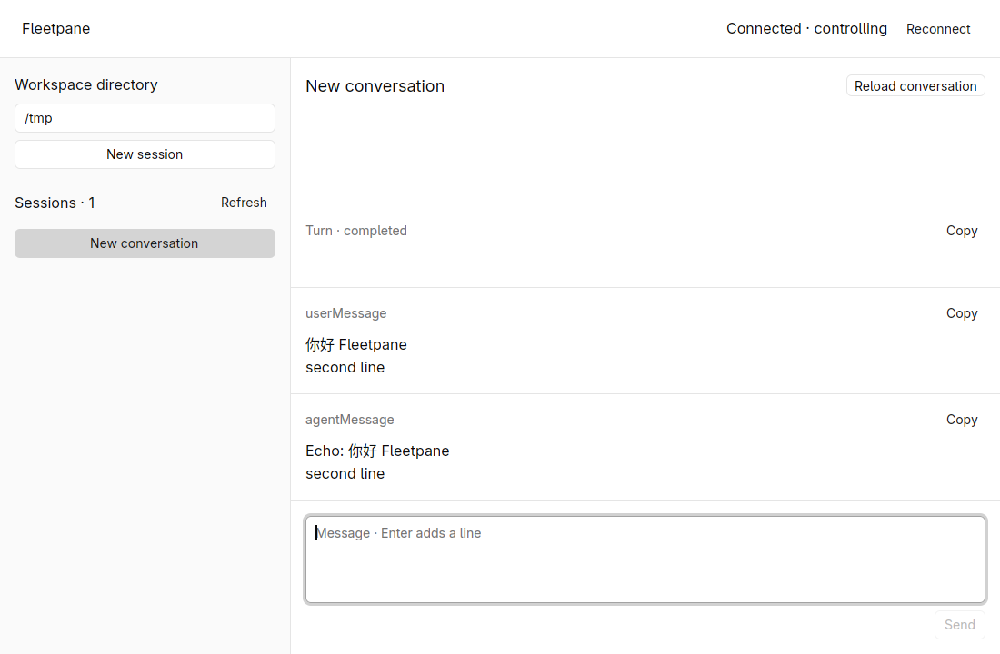
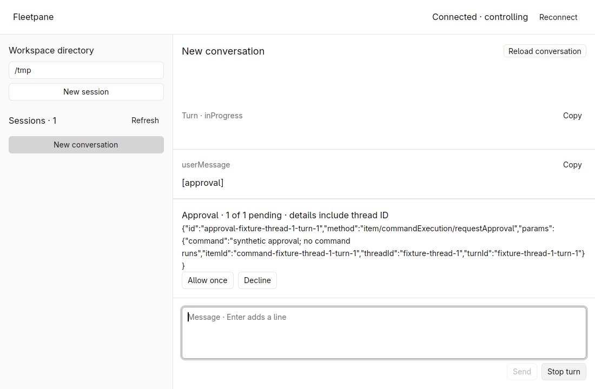
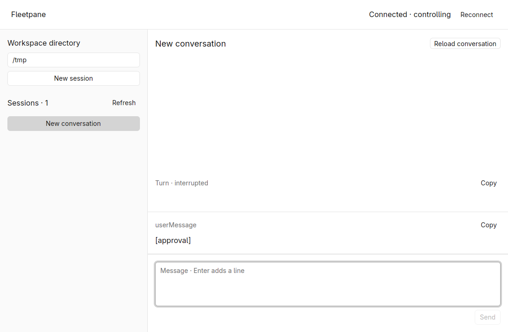
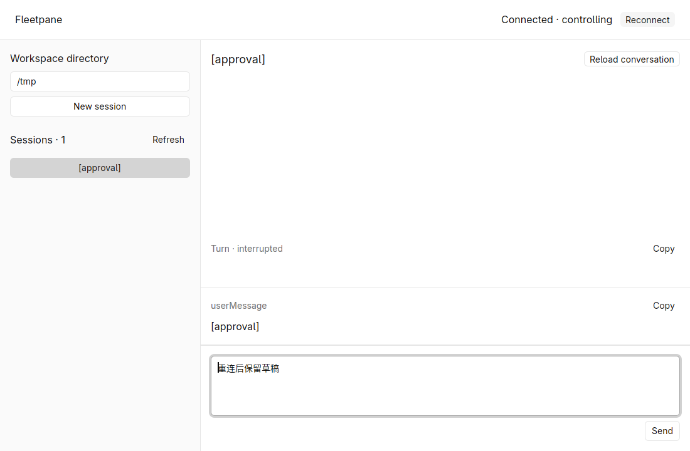

# Conversation basics checks — 2026-10-19

Local working-tree evidence on `feat/session-host-foundation`, based on
`973b0ed883c25356a9f0849681333919d4497387`. These changes are not committed or
published. Rust 1.98.1, GPUI Kit 0.7.3, matching GPUI engine 0.3.9.

## Reproducible checks

```sh
cargo fmt --all --check
cargo test --workspace --locked
cargo clippy --workspace --all-targets --locked -- -D warnings
cargo build -p fleetpane-host --locked
python3 scripts/runtime-smoke.py
python3 scripts/session-smoke.py
python3 scripts/runtime-smoke.py --codex
python3 scripts/codex-session-smoke.py
cargo fmt --manifest-path apps/desktop/Cargo.toml --check
cargo build --manifest-path apps/desktop/Cargo.toml --locked
cargo clippy --manifest-path apps/desktop/Cargo.toml --all-targets --locked -- -D warnings
uvx --offline ruff check scripts/provider-fixture.py scripts/session-smoke.py scripts/codex-session-smoke.py
uvx --offline ruff format --check scripts/provider-fixture.py scripts/session-smoke.py scripts/codex-session-smoke.py
python3 -m py_compile scripts/provider-fixture.py scripts/session-smoke.py scripts/codex-session-smoke.py
```

All passed locally. Root tests: **20 passed** (directory client 4, protocol 4,
Host 5, conversation adapter/projection 7). Ruff was 0.16.8. Root and desktop
Clippy ran with warnings denied. The deterministic conversation smoke was added
to the existing Unix CI jobs; remote CI has not run for this working tree.

| Evidence | Result and acceptance limit |
| --- | --- |
| Rust conversation tests | Chinese delta assembly, stable item identity, no duplication after item completion, retained items after empty turn completion, orphan/malformed known payload rejection, unknown item preservation, active/unknown status send guard, explicit history bound |
| Command adapter tests | Reject relative workspace/empty/oversized prompt, preserve multiline Unicode, select legacy history contract, preserve uncertain UUID/reason, require ordered response boundary |
| Host tests | Response sequence, fencing, deduplication, pending request handoff; provider-resolved request clears only its matching ID/thread, ignores subsequent acknowledgement and rejects malformed resolution |
| `session-smoke.py` | New/list/open, streamed Chinese reply, pre-turn-response notification replay, interrupt active turn, accept and decline across ownership transfer, reject stale approval, failed turn, interrupt waiting approval and remove it on provider resolution; unchanged Host/provider identity |
| `runtime-smoke.py` | Synthetic command/approval handoff; same provider/child PID and one side effect |
| `runtime-smoke.py --codex` | Installed Codex 0.163.0, isolated CODEX_HOME, command/exec across controller transfer; same provider/child PID and one side effect; no model request |
| `codex-session-smoke.py` | Real Codex 0.163.0 with empty CODEX_HOME and a loopback HTTP fixture: create legacy thread, send one text turn, receive one intentional HTTP 400, read persisted failed turn/user item and list thread; no account or LLM call |

The live Codex check with an isolated new runtime exposed an unsupported default:
paginated thread/read, thread/resume and thread/turns/list returned
`list_turns is not supported yet`. New threads now explicitly select legacy
history. Empty legacy threads return a not-materialized error before their
first user message; they are not persisted directory entries yet. This is
reported rather than converted into an empty successful history response.

The later [real saved-history check](2026-10-19-real-workspace-rendering.md) could
read an existing populated paginated thread when its indexed history databases
were included. The initial failure above applies to that new-runtime probe,
not every existing paginated thread.

## Rendered-window checks

All window input, clipboard and captures used the isolated agent-owned workspace
`fleetpane-session-20261019` (1280 × 800 X11). Windows were 1100 × 720. Software
Vulkan used the same temporary Mesa Lavapipe 26.2.5 driver as the previous Kit
checks. The known Mesa DRI3 warning appeared; no panic appeared in desktop logs.
No host display, existing Paseo session or authenticated provider account was used.

| Action | Observed result |
| --- | --- |
| Enter `/tmp`, click New session | Selected new synthetic thread, enabled composer |
| Paste `你好 Fleetpane` and a second line, Send | User text and streamed `Echo: 你好 Fleetpane` / second line appeared; completed turn, cleared composer |
| Copy assistant item | Clipboard readback exactly `Echo: 你好 Fleetpane\nsecond line` |
| Send `[wait]`, Stop turn | Active turn became interrupted; Send available again |
| Send `[approval]`, Decline, then another approval, Allow once | Pending panel showed original request/thread identity; output respectively `Echo: Approval: decline` and `Echo: Approval: accept` |
| Close desktop with Alt+F4, inspect Host, reopen | First desktop exited 0; original Host/provider still running (PIDs 944407 / 944409). Reopened window required Take control; prior accepted and declined history restored |
| Type `草稿 A · keep me`, create/switch sessions, reconnect | Draft restored; after stable rendering, Ctrl+A/C clipboard readback exactly matched draft |
| Send `[fail]` | Visible `Turn · failed` and `{"message":"Synthetic turn failure"}` |
| Final build, new fixture Host, interrupt waiting approval | Pending panel disappeared after provider resolution; Host snapshot `pending_requests: []`, no fault; turn shown as interrupted |
| Final build, type `重连后保留草稿`, Reconnect | Selected conversation reloaded, draft retained, Send available |
| Alt+F4 on all three desktop processes | Each exited with code 0 |

The final fixture Host used PIDs 1124504 / 1124508. Tests launched only their own
Hosts/providers; the isolated workspace and all its test processes were stopped
after checks.









## Limits

No authenticated real LLM answer/tool approval, active real-turn reconnect,
transport-fault GUI operation reconciliation, Host crash/version migration,
large-history pagination, file-change approval runtime, IME composition,
accessibility, macOS/Windows desktop, remote CI or release performance comparison
was accepted. The timeline is plain text with bounded JSON tool previews;
Markdown, terminal emulation, attachments and richer interactive questions remain
pending. Capacity limits and the in-memory journal are documented in
[ADR 0005](../adr/0005-host-backed-conversations.md).
