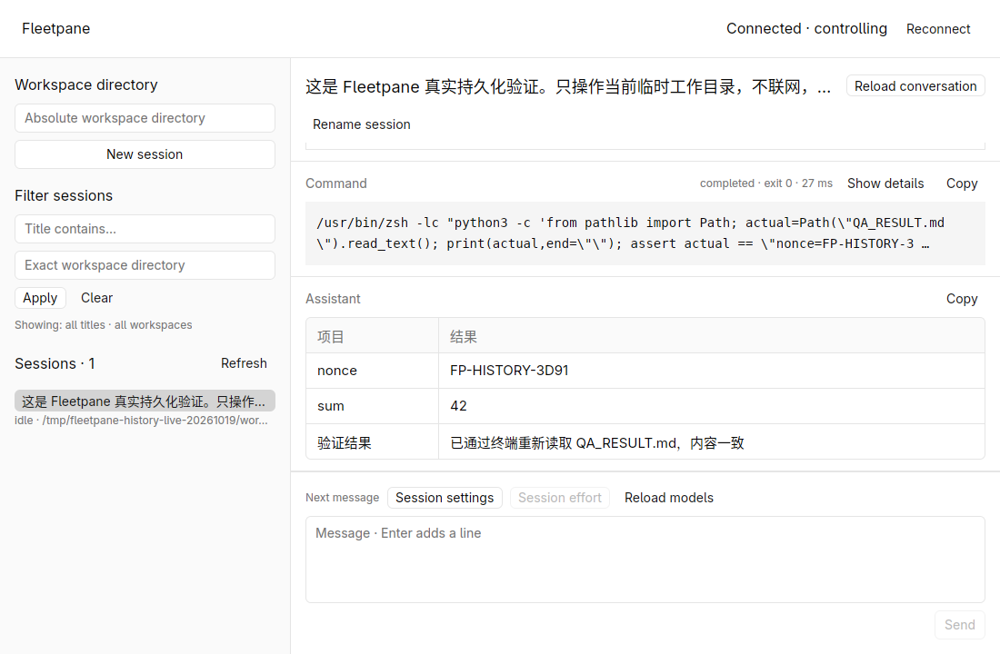
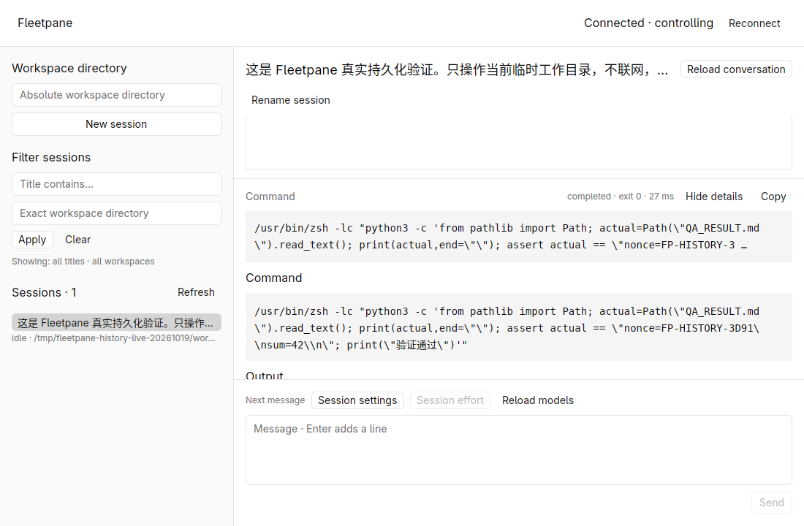
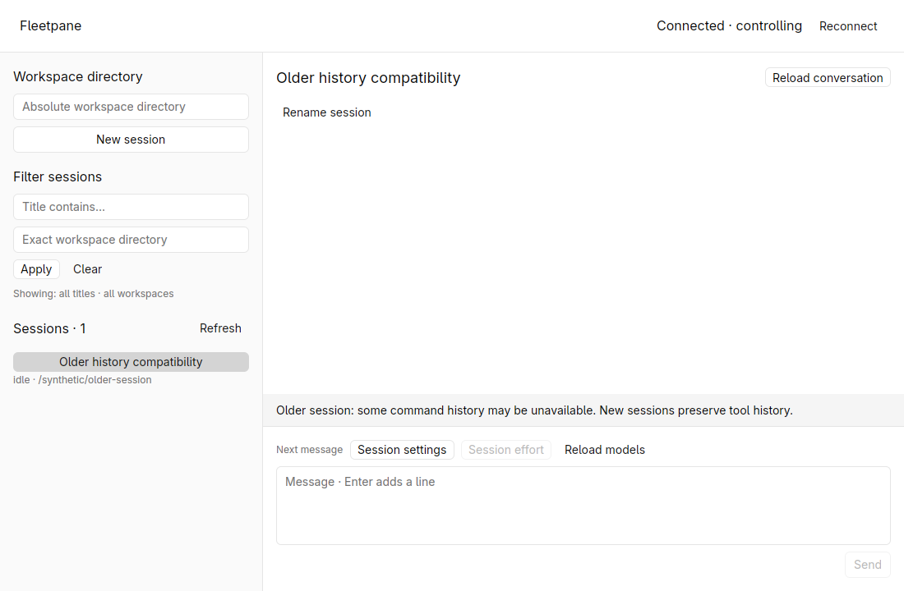

# Durable tool-history verification — 2026-10-19

New Codex threads preserve nested command items through history reload and a
completed Host/provider restart. Tests and native rendering were run against the
uncommitted `feat/session-host-foundation` worktree based on
`973b0ed883c25356a9f0849681333919d4497387`. See
[ADR 0010](../adr/0010-durable-codex-tool-history.md).

Follow-up: [history pagination verification](2026-10-19-history-pagination.md)
subsequently covers metadata-only native recovery and incremental timeline reads.
The full-read limits described below belong to this storage-durability check.

## Root cause and regression

The preceding [live OpenCodex check](2026-10-19-opencodex-live.md) found live
`commandExecution` notifications missing from Codex 0.163.0's legacy history.
Our earlier paginated probe had read an empty thread, before indexed history
existed. A new isolated probe confirmed the same paginated thread supports
`thread/read` and `thread/turns/list` after its first user turn, even when a local
HTTP fixture rejects that turn. The previous capability conclusion was wrong.

`scripts/codex-history-smoke.py` exercises an installed Codex with code mode and
an isolated home. A local SSE model requests one nested terminal command that
reads a nonce and appends one line. With the former Fleetpane binary requesting
legacy mode, the script failed at `history lost or duplicated nested command`.
After switching Create to paginated, it passed:

- Exactly one completed command item equals the live notification in full,
  including identity, output, exit code and duration.
- After stopping the completed Host/provider and starting replacements against
  the same private home, the new Host has a different incarnation/provider PID
  and an empty operation journal. Its startup replay contains no old command.
- A fresh full-thread read returns the identical command item. The file still
  has exactly one appended line; the local model saw exactly two requests for
  the single turn. Reads did not reexecute the command.

This regression uses no external LLM, account credentials or existing sessions.
The test deliberately does not require a zero event sequence on startup: Codex
can send initial account/status notifications before any controller command.

## Real OpenCodex and native acceptance

Environment: Codex 0.163.0, already-running OpenCodex 2.73.0 on loopback port
10100, explicit `gpt-6.1-sol` / `medium`. One additional external model turn ran
in `/tmp/fleetpane-history-live-20261019/workspace`. A private 0700 Codex home
contained fresh configuration and a copied public catalog; no auth file, user
MCP configuration or saved conversation was copied. Agent tool network access
was disabled; the provider client used the existing authenticated proxy.

The turn read `QA_INPUT.txt` (`nonce=FP-HISTORY-3D91`, values 19 and 23), computed
42 with Python, used the file editor to create `QA_RESULT.md`, and reread/asserted
its exact contents through the terminal. It completed with three real command
items, all with exit code 0, and a Chinese Markdown result table.

| Read / interaction | Observed result |
| --- | --- |
| Live completion → CLI `thread/read` | All three command objects exactly equal, with no missing or duplicate ID |
| Native open and Reload conversation | Command card, exit status and duration retained; Show details expands the command/output area |
| Stop completed disposable Host/provider → start replacements | Host 4045207 / provider 4045210 replaced by Host 4060203 / provider 4060204; new operation journal empty |
| New Host CLI `thread/read` | All three saved command objects exactly equal to the original live objects |
| New native window selects unloaded thread | Actual `thread/resume` response contains the same three command objects; card and completed Markdown table render |
| Existing legacy mode | Separate synthetic legacy thread displays the history-loss warning; no real saved legacy thread was modified |

The resulting file was exactly:

```text
nonce=FP-HISTORY-3D91
sum=42
```

Native checks used GPUI Kit 0.7.3 / engine 0.3.9 in the hidden X11 workspace
`fleetpane-history-live-20261019`, software Vulkan, 1100 × 720 application window.
All input and screenshots stayed inside that workspace. The screenshots contain
only generated QA content.







The public [readback summary](assets/history-readback.json) records command IDs
and hashes, matching item counts, binary hashes, process replacement and cleanup.
Raw events, operations and saved thread responses remain under
`/tmp/fleetpane-history-live-20261019`; they were not added to the public repository.

## Automated checks

All passed after the implementation change:

```sh
cargo fmt --all --check
cargo test --workspace --locked -j2
cargo clippy --workspace --all-targets --locked -j2 -- -D warnings
cargo build -p fleetpane-host --locked -j2
python3 scripts/session-smoke.py
python3 scripts/directory-smoke.py
python3 scripts/models-smoke.py
python3 scripts/codex-session-smoke.py
python3 scripts/codex-questions-smoke.py
python3 scripts/codex-history-smoke.py
cargo fmt --manifest-path apps/desktop/Cargo.toml --check
cargo test --manifest-path apps/desktop/Cargo.toml --locked -j2
cargo clippy --manifest-path apps/desktop/Cargo.toml --all-targets --locked -j2 -- -D warnings
cargo build --manifest-path apps/desktop/Cargo.toml --locked -j2
uvx --offline ruff check scripts/codex-history-smoke.py scripts/codex-session-smoke.py scripts/provider-fixture.py
uvx --offline ruff format --check scripts/codex-history-smoke.py scripts/codex-session-smoke.py scripts/provider-fixture.py
git diff --check
```

The workspace suite has 35 passing tests; the separate native crate has 4.
Synthetic process checks cover directory/model/conversation behavior. Optional
Codex scripts use local rejecting-HTTP or SSE fixtures and make no external LLM
calls; the live acceptance above is a separate real-proxy turn.

## Cleanup and limits

Only disposable test Hosts/providers were restarted, after the turn completed.
The hidden workspace was then stopped and its remaining app processes, providers
were checked gone. Workspace shutdown sent SIGTERM; the prototype left two socket
nodes. Each was verified to belong to this test and refuse connections before
removal; no live listener was removed. Graceful SIGTERM handling remains a Host
service-lifecycle gap. Global Codex configuration SHA-256 and the shared
`opencodex-proxy.service` MainPID 968 still matched the pre-test baseline;
`ocx ready --json` remained ready with proxy child PID 1046. No shared provider or
Paseo session was restarted. No credentials were copied or published.

The new default cannot recover commands already discarded by legacy storage and
does not convert old threads. Full-thread hydration still has 500-item / 2 MiB
and 256 KiB frame bounds; incremental timeline loading and large-output durability
remain unaccepted. The intentional restart validates completed disk history;
active turns, Host crash recovery, journal persistence, process adoption and
version drain remain unfinished. DeepSeek Harness ACP support, remote CI,
non-Linux desktop behavior and performance comparisons were not established.
No commit or push was performed for this change.
