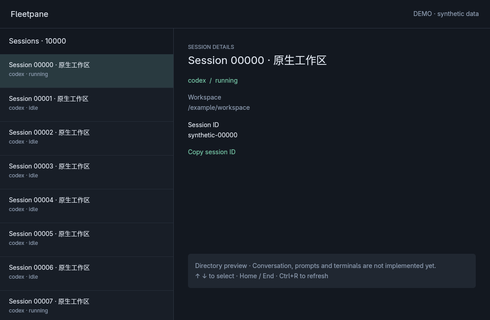

# First native directory and Session Host verification

Date: 2026-10-19. Implementation branch: `feat/session-host-foundation`, based on
`973b0ed883c25356a9f0849681333919d4497387`. This records local working-tree checks,
not a remote CI result or a release acceptance.

## Environment and commands

Linux x86_64, Rust 1.98.1, GPUI 0.2.2, installed `codex-cli 0.163.0`.

```sh
cargo fmt --all --check
cargo test --workspace --locked
cargo clippy --workspace --all-targets --locked -- -D warnings
cargo build -p fleetpane-host --locked
python3 scripts/runtime-smoke.py
python3 scripts/runtime-smoke.py --codex
cargo fmt --manifest-path apps/desktop/Cargo.toml --check
cargo clippy --manifest-path apps/desktop/Cargo.toml --all-targets --locked -- -D warnings
cargo build --manifest-path apps/desktop/Cargo.toml --locked
```

All completed successfully. The workspace has 12 unit/integration tests: 4 protocol,
4 directory-client and 4 host-state tests. Native dependency versions are locked;
the transitive `proc-macro-error2` future incompatibility notice remains visible.
The Python fixtures also passed `ruff check`, formatting and byte compilation.

## Process handoff evidence

The smoke script creates its own temporary directory, private socket and provider.
Every request runs a new `fleetpane-host request` process; it exits after its
response, closing its control connection. The provider remains behind the host's
original stdio connection. A file gate keeps a command running while ownership
moves to another controller; the command writes a single marker before the
handoff and prints its PID after the new controller releases the gate.

Observed with both the deterministic provider and real isolated Codex:

- Host and provider PIDs remain unchanged before and after handoff.
- The same command PID is alive on both sides of the transfer and eventually
  returns a successful result to the new controller.
- Old controller writes are rejected as `stale_controller`; competing claims
  using an outdated generation are rejected as `ownership_conflict`.
- The admitted operation is discoverable in snapshot and status after reconnect.
  Submitting its same UUID and contents under the new lease does not execute it
  again. The marker contains exactly one line.
- The new controller retrieves the operation's result and ordered provider event.
- A second host cannot bind over or unlink the live socket.

Synthetic approval case: request ID 999 remains pending across a second handoff.
An answer under the old lease is rejected, one explicit decline reaches the
provider, and a duplicate answer is rejected after resolution.

The real Codex check uses its own empty `CODEX_HOME` and `command/exec`. It sends
no LLM turn and touches no existing session. The installed binary version was
read with `codex --version`; a source revision was not inferred from its version.

Representative final stdout (PIDs are local test instances):

```json
{"provider":"fixture","host_pid":269950,"provider_pid":269951,"command_pid":269973,"controllers":3,"one_side_effect":true,"result":"PASS"}
{"provider":"codex","host_pid":270024,"provider_pid":270025,"command_pid":270188,"controllers":2,"one_side_effect":true,"result":"PASS"}
```

Each run creates new PIDs. The assertions in the executable script are the
reproducible evidence, rather than these incidental numbers.

## Native window evidence

Ran the debug desktop executable in its own `agent-workspace-linux` X11 display,
1100 x 720 window. No host desktop input was used. Initial launch could not create
a Vulkan surface because the isolated X server has no DRI3 support. For GUI QA,
Arch's signature-verified `vulkan-swrast` 26.2.5 package was extracted under a
temporary directory and supplied only to the test process via `VK_DRIVER_FILES`
and `LD_LIBRARY_PATH`. It was not installed globally. Software rendering is a
verification environment, not evidence of hardware-GPU performance.

Observed in `--demo` with 10,000 synthetic entries:

- The directory and details rendered, including Chinese titles.
- End selected `synthetic-09999` and scrolled the virtualized list to its end.
  Up selected `synthetic-09998`; Home returned to the first entry.
- Clicking Copy session ID followed by workspace clipboard readback returned
  `synthetic-09999`, then `synthetic-09998`, matching the selected sessions.
- A read-only connection to one existing local Paseo daemon rendered a real
  directory page. Its source revision was not attested; private metadata and
  screenshots are omitted from the repository.
- Connecting to an unused loopback port showed an explicit connection-refused
  banner. No successful empty-directory state was substituted for the error.
- Alt+F4 closed the last native window and exited its application process.
- With no usable Vulkan surface, startup reports the error and exits with status
  1 instead of remaining alive without a window. This was checked separately
  without the software driver override.



## Acceptance limits and next work

This establishes a rendered native directory and a host/controller transport
slice. It does not establish complete control daemon replacement, live LLM turn
or agent-tool continuity, real provider approvals, terminal/PTY continuity,
provider upgrades, durable journal/crash recovery, or adoption of existing Paseo
stdio runtimes. There is no desktop-to-Host conversation workflow yet.

Chinese glyph rendering and copying an ID do not validate Chinese IME,
editable-composer behavior, selection/paste, or accessibility. GUI pagination and
its 5,000-entry cap need a dedicated multipage fixture. Wayland, macOS and Windows
desktop acceptance are pending. The new CI jobs have not run remotely.

No cold-start/latency/memory benchmark against Paseo was run. Debug builds,
software Vulkan, synthetic directory entries and feature coverage cannot establish
an overall performance improvement. Continue with a Host-backed conversation
workflow, input/IME validation and a measured release-build workload comparison.
