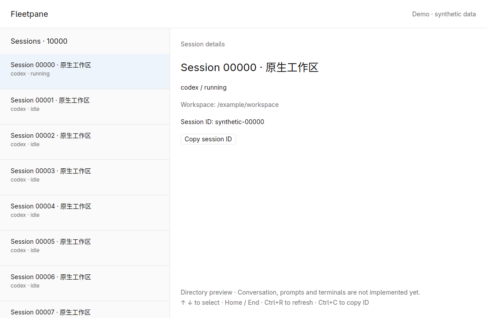
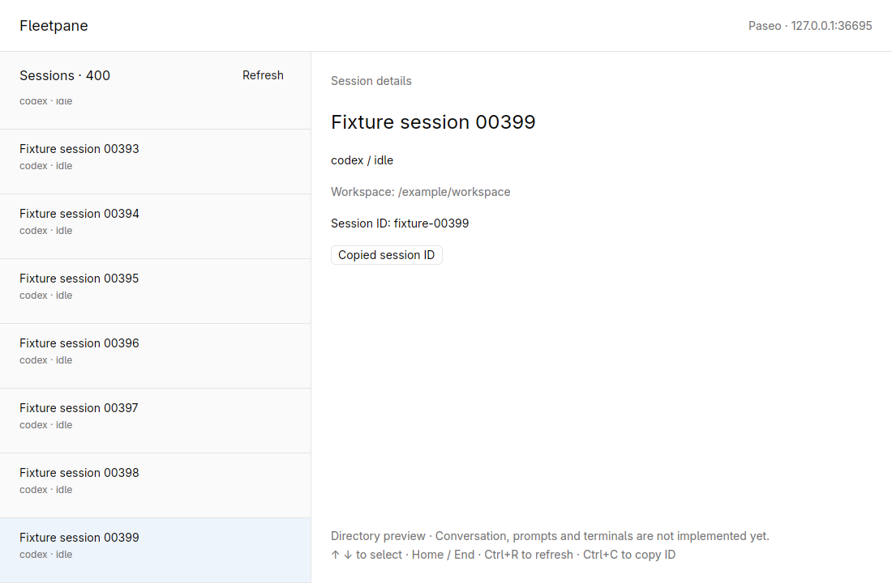

# GPUI Kit migration checks — 2026-10-19

Local working-tree evidence for `feat/session-host-foundation`. The application
is a directory/Host foundation, not a replacement release. Historical direct
GPUI 0.2.2 results remain in [the earlier record](2026-10-19-foundation.md).

## Scope and environment

- GPUI Kit 0.7.3; matching GPUI engine/platform family 0.3.9; default upstream
  backend. Rust 1.98.1. Separate desktop manifest and lockfile.
- Isolated agent-owned Linux X11 workspace, 1280 × 800; software Vulkan uses
  Mesa Lavapipe 26.2.5 extracted into a temporary directory. It does not establish
  hardware GPU, Wayland, IME or platform accessibility acceptance.
- Synthetic `--demo` data and a two-page loopback WebSocket fixture. No existing
  Codex session is modified, no provider is restarted and no model request is sent.

## Reproducible checks

```sh
cargo fmt --all --check
cargo test --workspace --locked
cargo clippy --workspace --all-targets --locked -- -D warnings
cargo fmt --manifest-path apps/desktop/Cargo.toml --check
cargo build --manifest-path apps/desktop/Cargo.toml --locked
cargo clippy --manifest-path apps/desktop/Cargo.toml --all-targets --locked -- -D warnings

# Run each GUI in an isolated native workspace with a working Vulkan driver.
cargo run --manifest-path apps/desktop/Cargo.toml --locked -- --demo

# The fixture prints an ephemeral loopback address and serves 200 + 200 entries.
cargo run -p fleetpane-client --example directory_fixture --locked
cargo run --manifest-path apps/desktop/Cargo.toml --locked -- 127.0.0.1:PORT

# Explicit connection-refused state; use a verified unused local port.
cargo run --manifest-path apps/desktop/Cargo.toml --locked -- 127.0.0.1:1
```

Root tests passed (12 tests). Both manifests passed formatting checks; root and
desktop Clippy passed with warnings denied; the desktop build passed. The fixture
example is included in root Clippy's `--all-targets` check. Directory fixture
entries are synthetic and safe to share.

## Native-window observations

All input and clipboard operations ran inside workspace
`fleetpane-kit-20261019`; no host display input was used. The light system theme
rendered through Kit's semantic theme tokens.

| Check | Observed result |
| --- | --- |
| 10,000-entry demo | Virtualized directory and Chinese titles rendered |
| End, Ctrl+C | Clipboard readback `synthetic-09999` |
| Up, click Kit Copy button | Clipboard readback `synthetic-09998` |
| Home, Ctrl+C | Clipboard readback `synthetic-00000` |
| Down, Tab, Enter | Copy button received visible focus and keyboard activation; clipboard `synthetic-00001` |
| Fixture initial page | 200 sessions; fixture logged entries `0..200` |
| Select last entry and click Refresh | Another `0..200` request; selection/clipboard remained `fixture-00199` |
| Click Load next page, End, Ctrl+C | Count 400; fixture logged `200..400`; clipboard `fixture-00399`; no next-page button remained |
| Ctrl+R | Fresh `0..200` request; count returned to 200 and missing prior selection resolved to `fixture-00000` |
| Resize to 900 × 560 | List, details, copy and pagination remained visible; footer wrapped inside detail pane |
| Verified unused 127.0.0.1:1 | Visible connection-refused banner, zero entries and Refresh remained available |
| Alt+F4 on each of three native windows | Each application exited with code 0 |

The software-rendering environment emitted a Mesa DRI3 warning; rendering and
input still completed. No GPU acceleration claim is made. The isolated workspace
and its fixture process were stopped after checks.





## Remaining acceptance

No editable composer or terminal exists yet: rendered Chinese labels are not
IME evidence. Screen readers, interface zoom, alternate theme values,
macOS/Windows, hostile-transport timing, and the 5,000-session GUI cap still need
their own checks. No release performance comparison or remote CI result is
claimed. Session Host version drain is an architecture design, not an
implemented or exercised migration mechanism.
