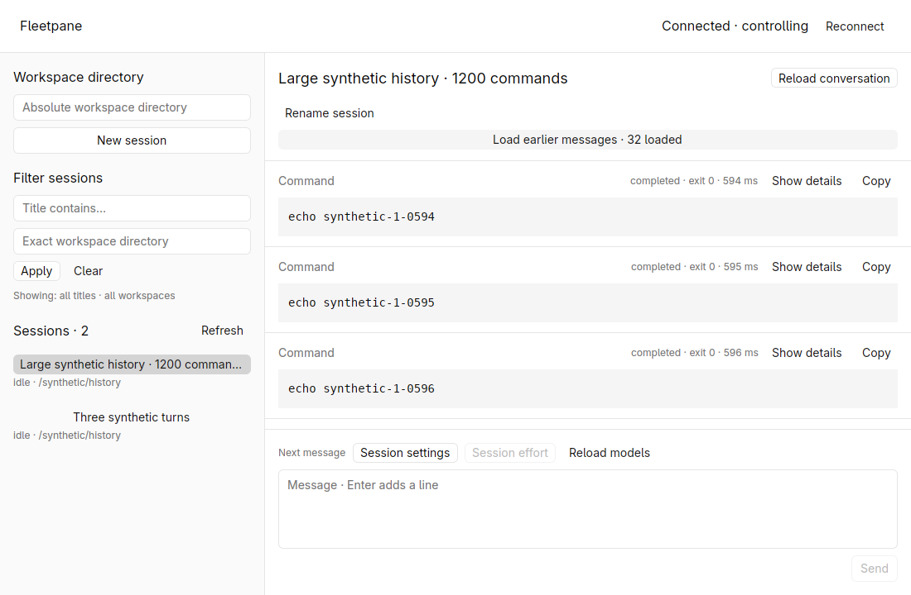
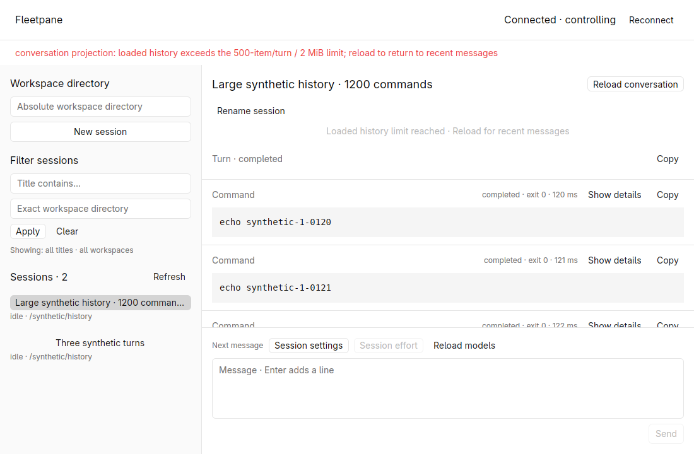
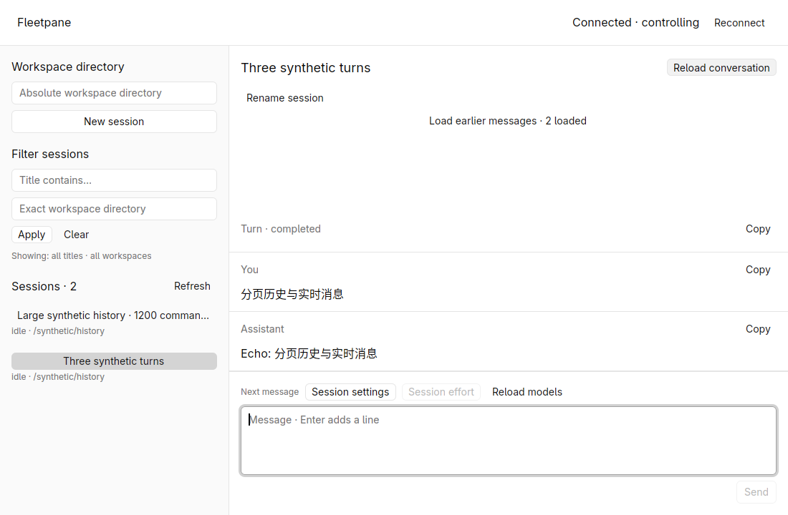
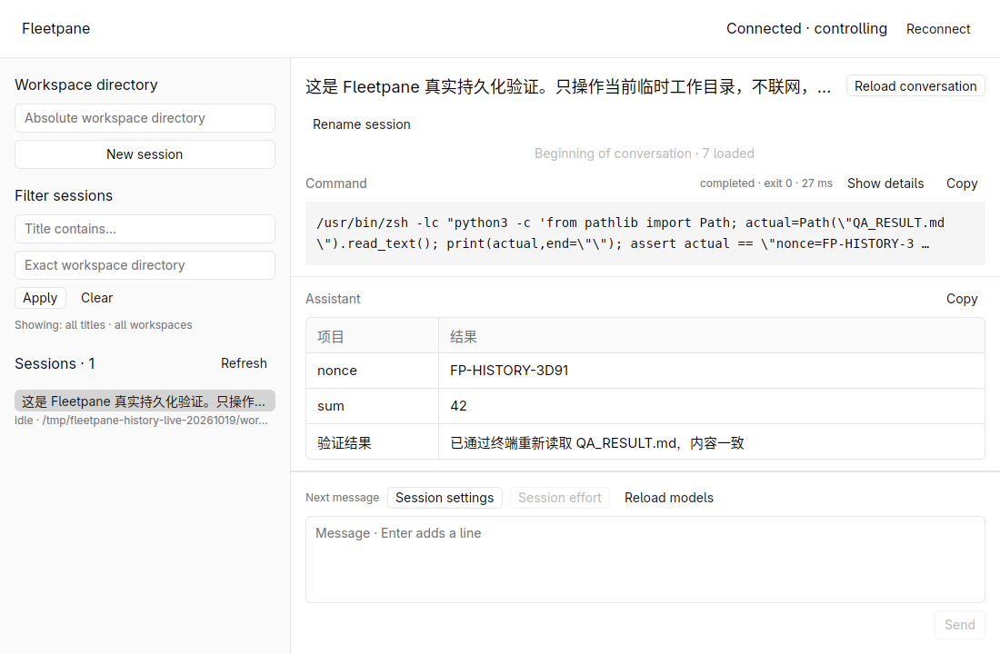

# Incremental history verification — 2026-10-19

The native desktop opens recent Codex history without requesting the complete
conversation. Older loads preserve the visible rows and reconcile with concurrent
streamed text. See [ADR 0011](../adr/0011-incremental-conversation-history.md).
This is local evidence from the uncommitted `feat/session-host-foundation`
worktree based on `973b0ed883c25356a9f0849681333919d4497387`.

## Protocol and automated checks

Bindings generated from installed Codex 0.163.0 confirmed metadata-only read/resume,
descending `thread/turns/list` with `itemsView: notLoaded`, and scoped
`thread/items/list` cursors. The shared adapter requests one turn and up to 16
entries at a time. No production cursor parsing or provider upgrade was added.

Five new domain tests cover chronological prepend, cross-turn continuation,
atomic rejection of malformed/duplicate/repeating pages, retained limits,
per-item sequence boundaries and new turns during hydration. One overlap
case was reproduced before its fix: an older item from the replay window was
appended after the newest item (`[last, omitted]`). The first-page tail boundary
now keeps it behind the older-history continuation; its regression passes.

All checks passed after the implementation changes:

```sh
cargo fmt --all --check
cargo test --workspace --locked -j2
cargo clippy --workspace --all-targets --locked -j2 -- -D warnings
cargo build -p fleetpane-host --locked -j2
python3 scripts/history-smoke.py
python3 scripts/session-smoke.py
python3 scripts/directory-smoke.py
python3 scripts/models-smoke.py
python3 scripts/codex-history-smoke.py
cargo fmt --manifest-path apps/desktop/Cargo.toml --check
cargo test --manifest-path apps/desktop/Cargo.toml --locked -j2
cargo clippy --manifest-path apps/desktop/Cargo.toml --all-targets --locked -j2 -- -D warnings
cargo build --manifest-path apps/desktop/Cargo.toml --locked -j2
uvx --offline ruff check scripts/history-smoke.py scripts/codex-history-smoke.py scripts/provider-fixture.py
uvx --offline ruff format --check scripts/history-smoke.py scripts/codex-history-smoke.py scripts/provider-fixture.py
git diff --check
```

The workspace has 40 passing tests and the native crate has 4. The new synthetic
process check validates bounded pages of a large conversation and cross-turn end
detection. The installed-Codex/local-SSE check additionally validates metadata-only
resume and exact paged command identity before and after provider replacement,
without another tool execution or external LLM call. CI configuration now includes
the synthetic history smoke; remote CI was not run.

## Native large-history and scroll acceptance

The synthetic fixture has 1,200 commands across two turns and is 5,211,650 bytes.
A separate short conversation has three turns with two commands each. Initial
open requests metadata, one turn without items, and 16 entries, rather than the
5 MB response. The first large page contains commands 584–599; the next contains
568–583. All retain command summaries, exit status and expandable details.

The first GUI check found that older loads snapped to the bottom. GPUI's geometric
end test returns unknown for unmeasured virtual rows; the former code treated
that as permission to follow. Native tail mode and a splice preserving common
rows fix the behavior. On the final rebuilt desktop, the conversation viewport
region `780x324+320+195` has **zero differing pixels** before and after prepending
16 entries, verified with ImageMagick `-metric AE`. The loaded count changes
from 16 to 32 while the same commands 594–596 stay in place.
The [before-load screenshot](assets/paging-before-prepend.png) is retained for the
same pixel comparison against the after-load screenshot below.



Scrolling upward reaches the newly loaded commands. The short conversation loads
all six commands across three turns and disables the button at Beginning of
conversation. Loading the large fixture reaches the 2 MiB retained bound at 480
commands; the next page is rejected atomically, previous content remains visible,
and the button shows the limit state. Reload clears the error and returns to the
recent 16 entries. Limit/end checks preceded the final replay-order refinement;
the final desktop repeated large open/prepend and streaming checks.



## History reads during streaming

The synthetic provider delays turn/item reads by 400 ms while its separate
streaming thread continues. Sending the Chinese prompt and reloading during the
turn puts text deltas between the metadata and item-page response boundaries.
The final rebuilt native desktop displays and copies exactly:

```text
Echo: 分页历史与实时消息
```

Native clipboard readback equals the provider's completed text exactly. The raw
event/operation record establishes that overlap actually occurred; this was not
a reload after the stream had already finished. The final build has two text
deltas in that window. Domain tests also exercise an entirely new turn in the
window, a later update to an existing recent item while an older page loads, and
embedded completion items that overlap a saved snapshot.



## Installed Codex with real saved OpenCodex history

A fresh private Codex home copies only the prior disposable
[real OpenCodex verification](2026-10-19-durable-tool-history.md) data. It contains
one synthetic QA conversation and no auth file or user MCP configuration. The new
Host uses installed Codex 0.163.0 with the already-running loopback OpenCodex
configuration. This check starts **zero new model turns**.

Selecting the unloaded thread sends actual `thread/resume` with
`excludeTurns: true`; the response contains no turns. Turn/item pages then recover
seven entries, including all three command objects exactly equal to the original
live-turn record, including ID, output, exit code and duration. The native window
renders the command card and Chinese Markdown table and shows the beginning of
the conversation. The final rebuilt desktop repeats this recovery.



## Artifacts, isolation and limits

Linux X11, software Vulkan, GPUI Kit 0.7.3 / engine 0.3.9 and a 1100 × 720 native
window were used inside hidden workspace `fleetpane-history-pages-20261019`.
The host desktop/browser was not targeted. Screenshots contain generated QA
content only. The [public summary](assets/paging-readback.json) records runtime
binary hashes, response boundaries, item equality and cleanup. Private raw
operations/events remain under `/tmp/fleetpane-history-pages-20261019`.

Disposable Hosts were stopped with SIGINT after completed turns, then the hidden
workspace was stopped. Readback found no live owned apps/providers or remaining
owned socket nodes. Shared OpenCodex MainPID 968, ready child PID 1046 and the
global Codex configuration hash matched the pre-check baseline. No shared
Paseo/Codex session was restarted. No commit or push was performed.

Retained state still caps at 500 items, 500 turns and 2 MiB, with no eviction or
bidirectional history window. A single item or 16-entry page can still exceed the
256 KiB provider-frame cap; count pagination does not guarantee a byte bound.
The Host journal retains its 128-operation lifetime limit. Existing legacy
history uses bounded full reads and cannot recover discarded nested commands.
Arbitrary active parallel-item histories, remote CI, performance improvements,
non-Linux desktop behavior, DeepSeek ACP and active-turn Host upgrades remain
unaccepted or unimplemented.
