# Model capabilities and reasoning options

Local verification on 2026-10-19. Linux, Rust 1.98.1, GPUI Kit 0.7.3 and
Codex CLI 0.163.0. This records the uncommitted worktree on
`feat/session-host-foundation`, based on
`973b0ed883c25356a9f0849681333919d4497387`.

## Native interaction

An isolated X11 workspace `fleetpane-models-20261019` used software Vulkan,
two synthetic sessions and a reloadable synthetic model file. No user desktop,
saved Codex account, existing runtime or external model service was used.
The normal window was 1100 × 720; a final check used 900 × 640.

| Action | Observed result |
| --- | --- |
| Open model menu | Session settings plus three visible provider models; hidden model absent |
| Down/Enter through model and effort menus | Balanced model selected, then high; request uses `fixture-balanced`, not its display label |
| Send `[options]` | Assistant fixture echoes exactly the admitted model/effort; Host operation parameters independently read back |
| Switch to second session and back | Independent choices; first session retains high and its Chinese multiline draft |
| Change Balanced/high to Quick | Effort resets to the declared low default; old high is not carried to that model |
| Reconnect | Choice and draft retained; same Host/provider identity |
| Remove selected Quick from file, Reload models | Wire identity stays visible with unavailable explanation; Send and effort picker disabled; draft retained |
| Fail catalog request | Error banner; prior catalog, conversation and draft retained |
| Use session settings and send during catalog failure | Both override keys absent from the Host operation and echoed fixture result |
| Reject turn submission | Visible error; prompt remains editable and no synthetic turn is created |
| Close/reopen desktop | Explicit Take control required; same Host/provider; UI-only overrides are not persisted |
| Select Basic in final build | No reasoning control disabled; admitted request has model only, no effort |
| Select Balanced/high and send in final build | Correct keys and values read back again |
| Resize final build to 900 × 640 | Model/effort controls, Reload models, composer and Send stay visible |

The final native Host snapshot had no fault or pending provider requests. Host
PID 2744032 and provider PID 2744035 remained unchanged through reconnect and
desktop replacement. The native Host was launched before the final client cursor
bound change; its actual executable SHA-256 was
`f45f0e14169f5d5a56e985b1fb4f510f2e1d369ab2e5a8d90a9ce7d935c8c2aa`.
The final desktop PID 2808008 executable matched the final build:
`014705b458a907371be1f4a8b5d39d0d4826929633b69356b9e50efb317e03d8`.
The process checks below used the final Host build:
`424d0c47502766afbe23d320a65003df646f01ed69a438540ab3092754f74c57`.

Private synthetic raw records were captured in `/tmp/fleetpane-models-evidence/`:
`final-operations.json`, `snapshot.json`, `final-snapshot.json` and screenshots.
Both desktop generations and their Host/provider were stopped after validation.
Only synthetic screenshots are included here. Menu overlays are captured through
the workspace root screenshot; the window-only capture omits those overlays.

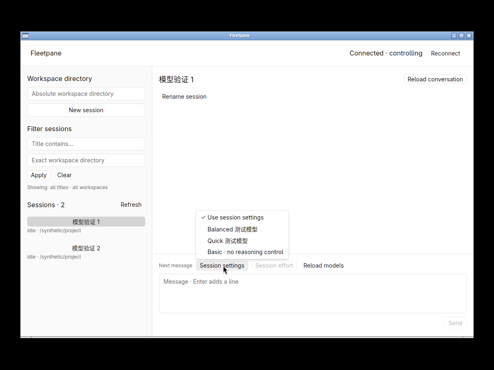
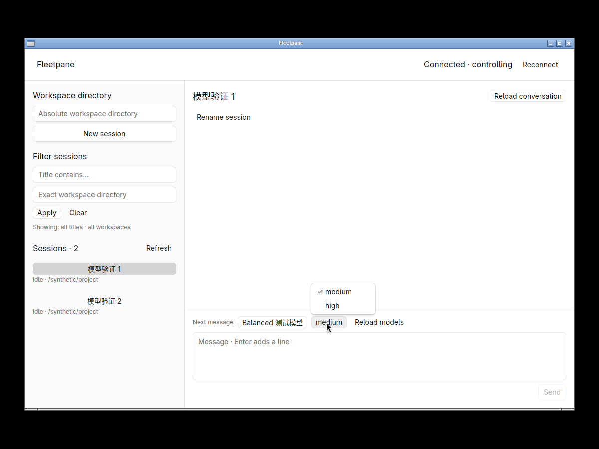
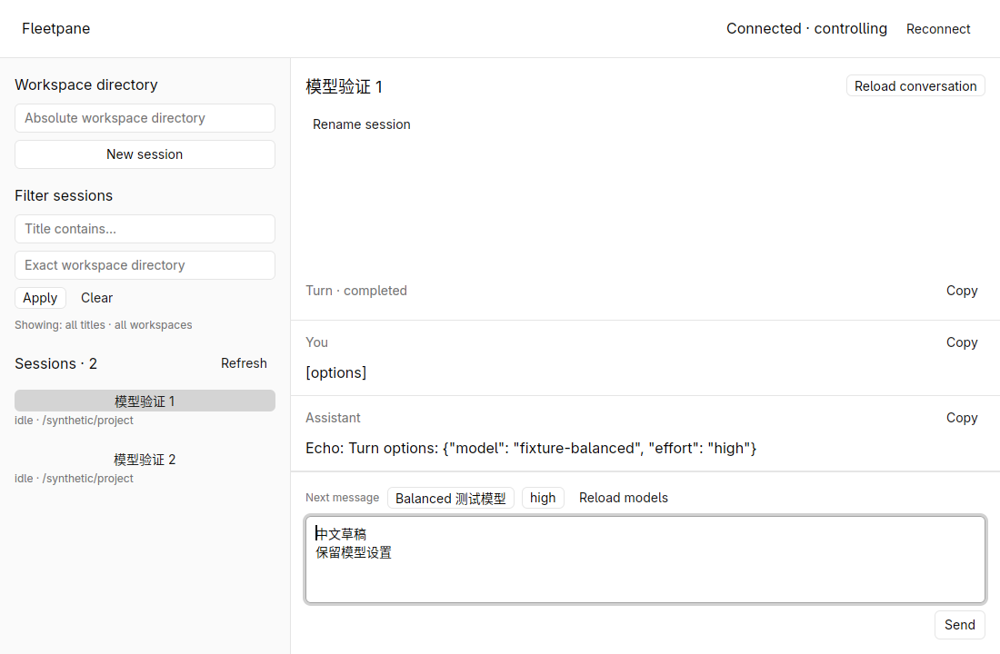
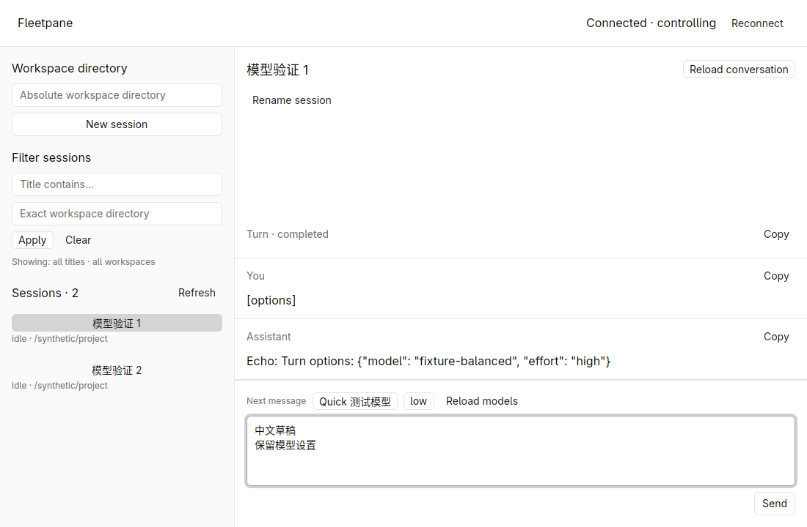
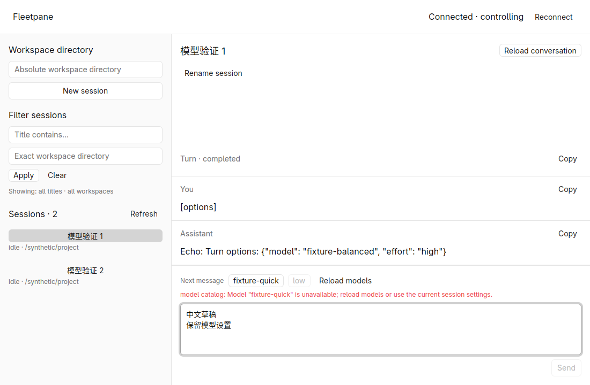
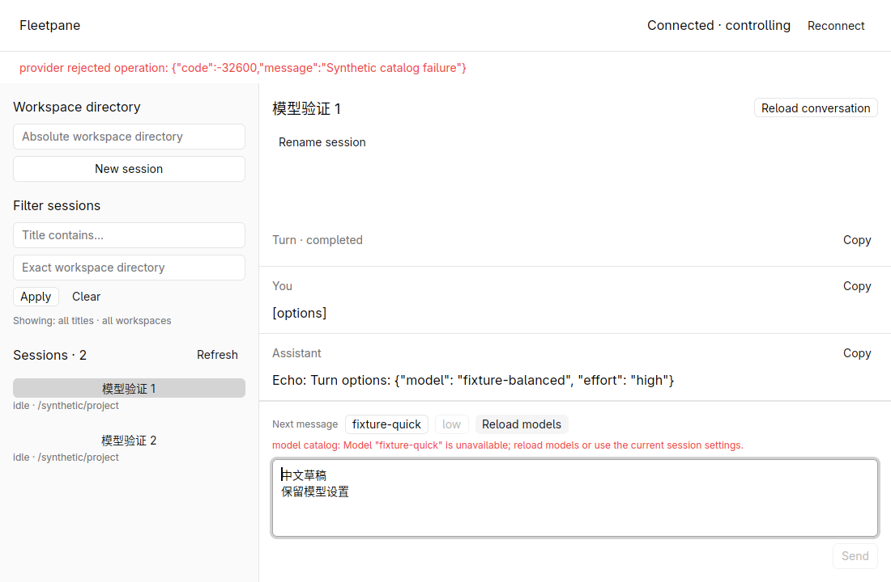
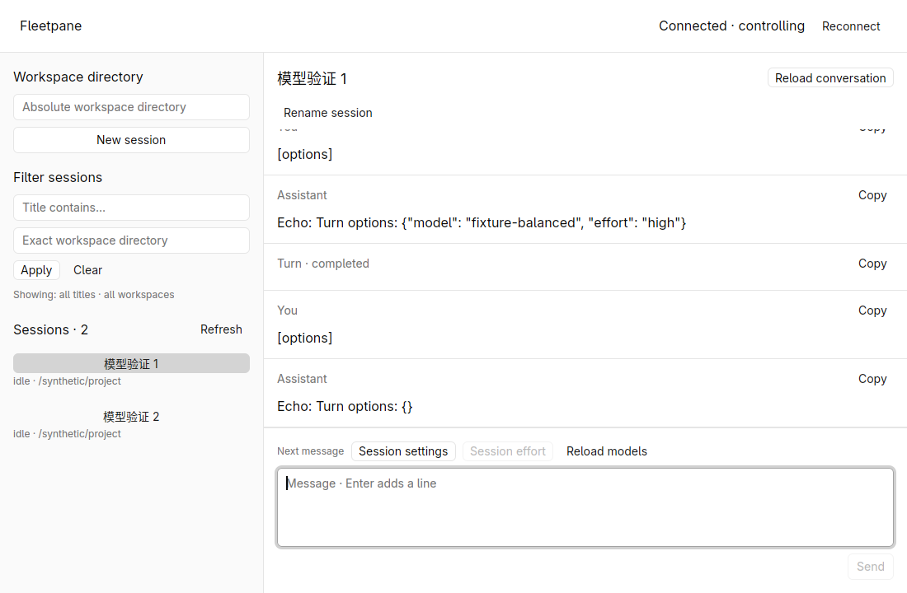
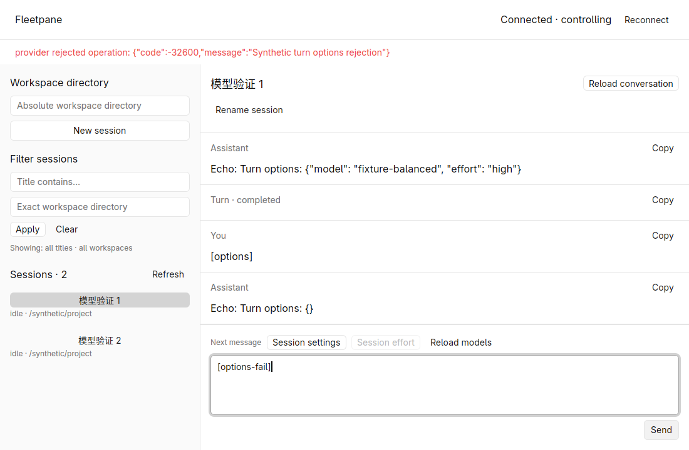
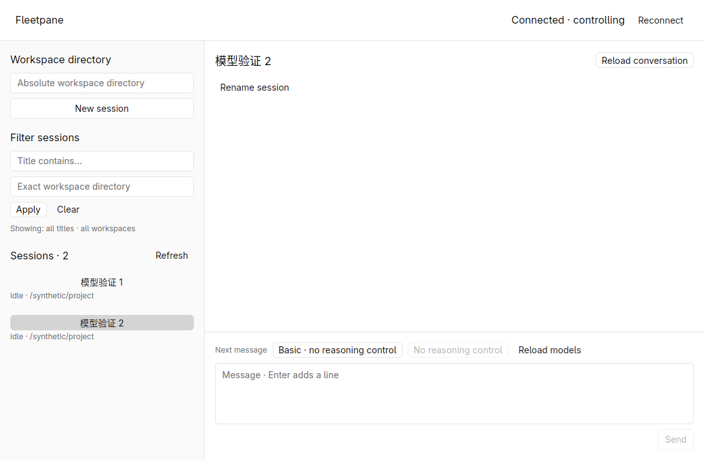
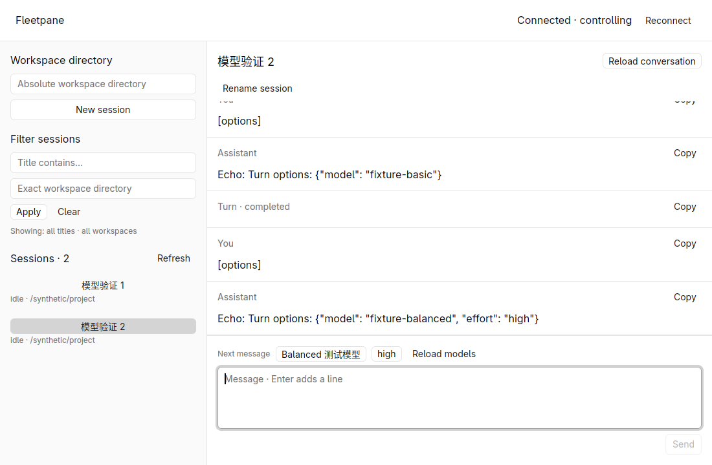
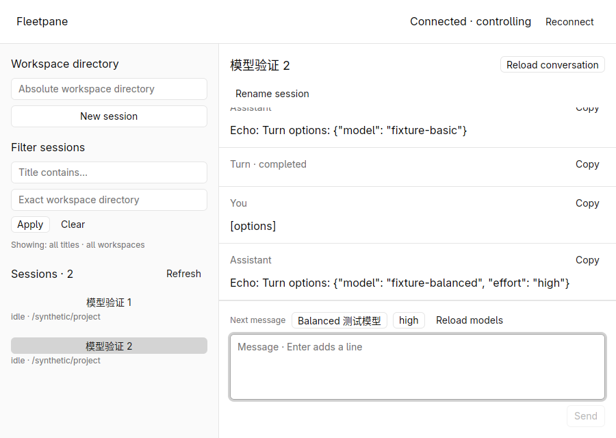

## Domain and process checks

The new catalog tests cover incomplete/empty/hidden capabilities, omitted default
fields, future effort strings, unsupported combinations, duplicate model/effort
identities, repeated cursors, atomic error retention, refresh and completed-page
continuity. Bounds cover 64 rows/page, 256 retained models, 1 MiB encoded metadata
and 4 KiB cursor rejection. Command tests distinguish picker ID from wire model.

`models-smoke.py` runs a private Host with 72 synthetic models, one hidden:
64 + 7 visible rows. An override selects wire model 71 beyond the first page and
round-trips a future effort string. Hidden/missing models, unsupported effort,
effort without model, duplicate/missing flags and failed catalog/turn requests
produce errors without creating turns. Default sends still work during catalog
failure. Host/provider identity stays the same.

`codex-session-smoke.py` runs installed Codex with an empty temporary CODEX_HOME
and a loopback HTTP provider. It reads the actual catalog, selects a returned
model and its declared default effort, sends a second turn and asserts those
values in the HTTP request's `model` and `reasoning.effort`. The local server
intentionally returns HTTP 400: two requests total, no automatic HTTP replay and
no real LLM answer. Prior create/read/list/rename/filter checks also pass.

Commands completed successfully:

```sh
cargo fmt --all --check
cargo test --workspace --locked
cargo clippy --workspace --all-targets --locked -- -D warnings
cargo build -p fleetpane-host --locked
cargo fmt --manifest-path apps/desktop/Cargo.toml --check
cargo test --manifest-path apps/desktop/Cargo.toml --locked -j2
cargo clippy --manifest-path apps/desktop/Cargo.toml --all-targets --locked -j2 -- -D warnings
cargo build --manifest-path apps/desktop/Cargo.toml --locked -j2
python3 scripts/models-smoke.py
python3 scripts/session-smoke.py
python3 scripts/directory-smoke.py
python3 scripts/codex-session-smoke.py
python3 scripts/codex-questions-smoke.py
uvx ruff check scripts/models-smoke.py scripts/provider-fixture.py scripts/codex-session-smoke.py
uvx ruff format --check scripts/models-smoke.py scripts/provider-fixture.py scripts/codex-session-smoke.py
git diff --check
```

**35 root tests and 4 desktop tests passed**. Existing synthetic conversation,
approval/question/handoff and directory process checks passed; the real Codex
question SSE round trip passed using a local model fixture. After the final
cursor-bound and unsupported-reasoning label changes, affected Rust checks/builds,
the new model process check and real Codex model-parameter check passed again.
CI now includes the synthetic model process check; remote CI has not been run.

No authenticated model entitlement, external model completion, live model-catalog
change during a turn, native paged-catalog failure between pages, real IME,
accessibility, macOS/Windows GUI, performance or memory comparison is accepted by
this record. Model choices/catalogs do not survive desktop exits. Archive/restore,
mode/approval-policy selection and account configuration remain separate work.
