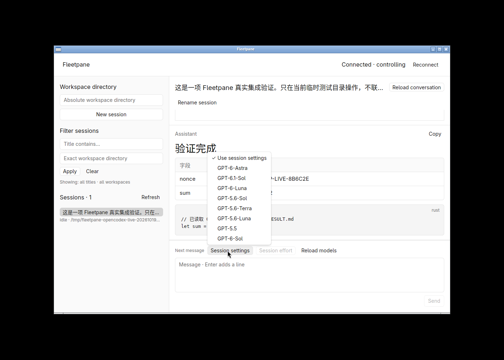
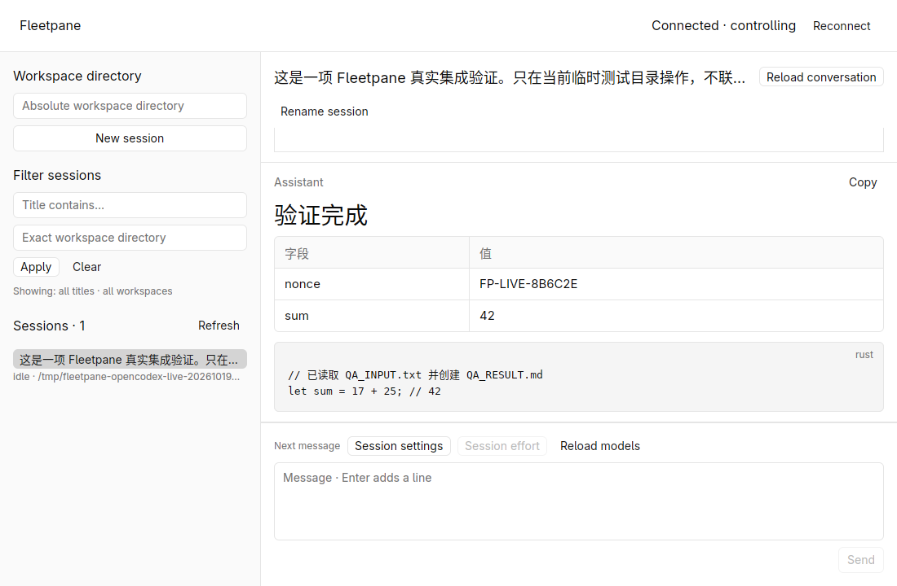
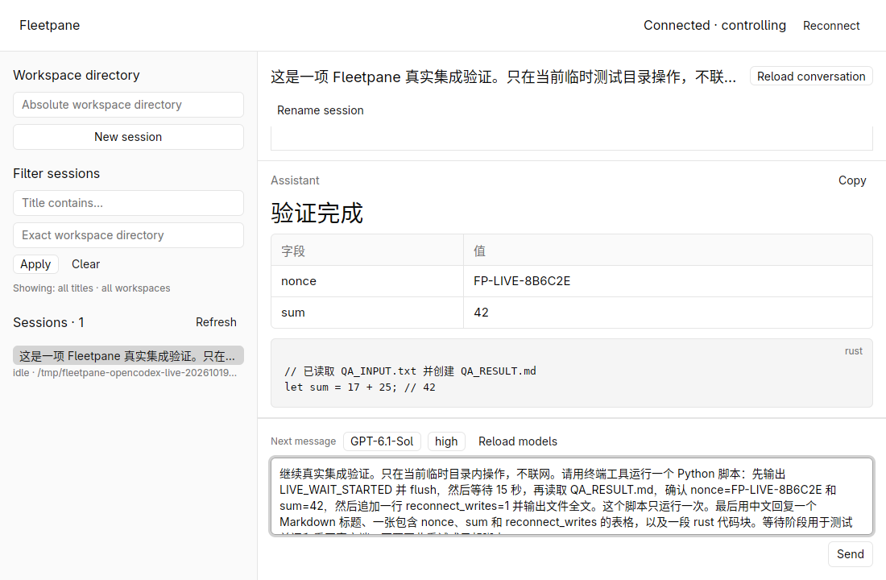
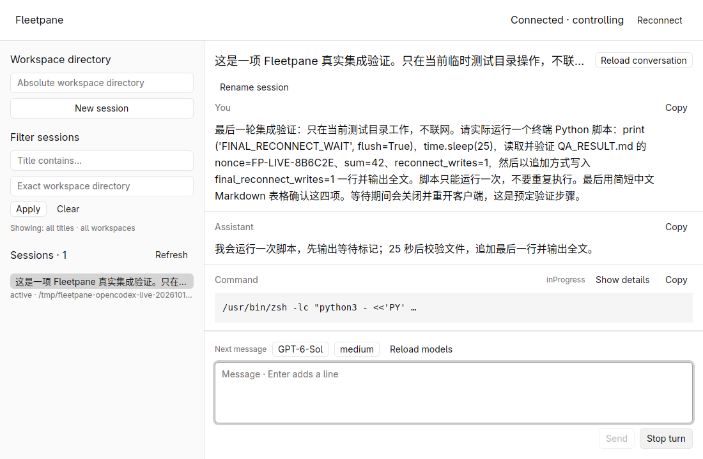
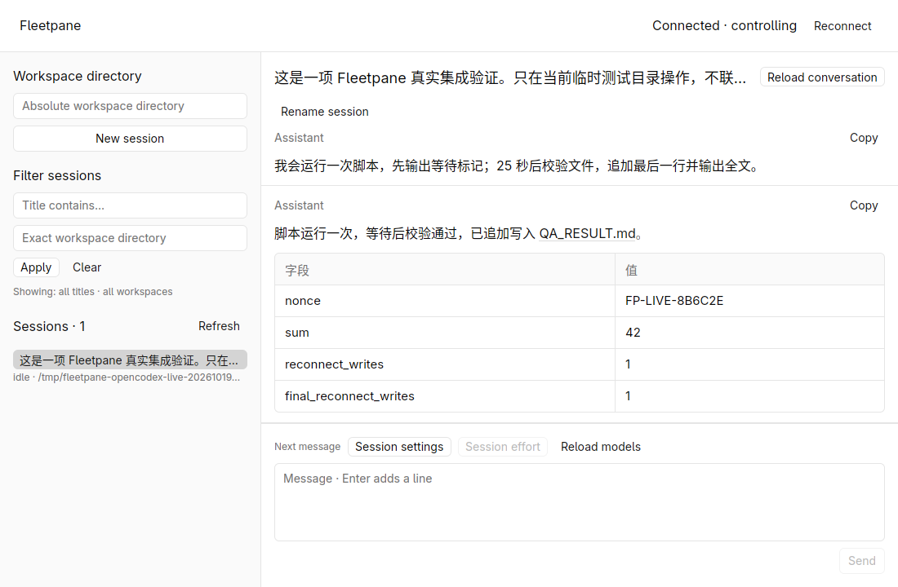
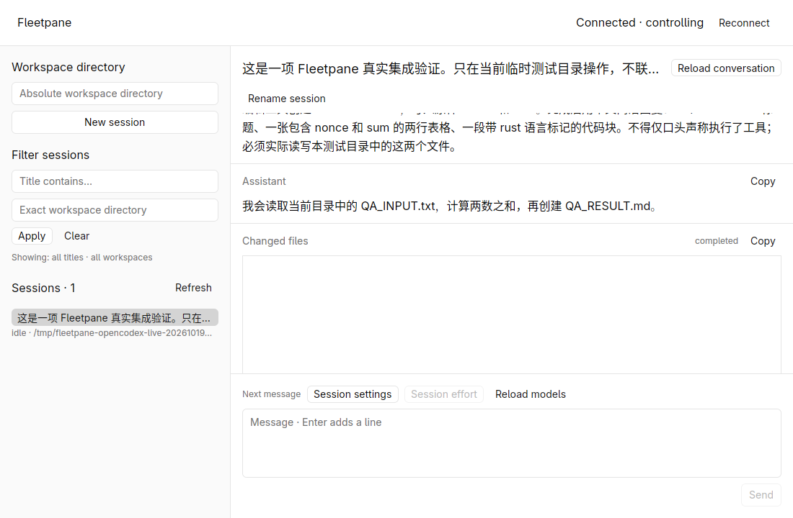
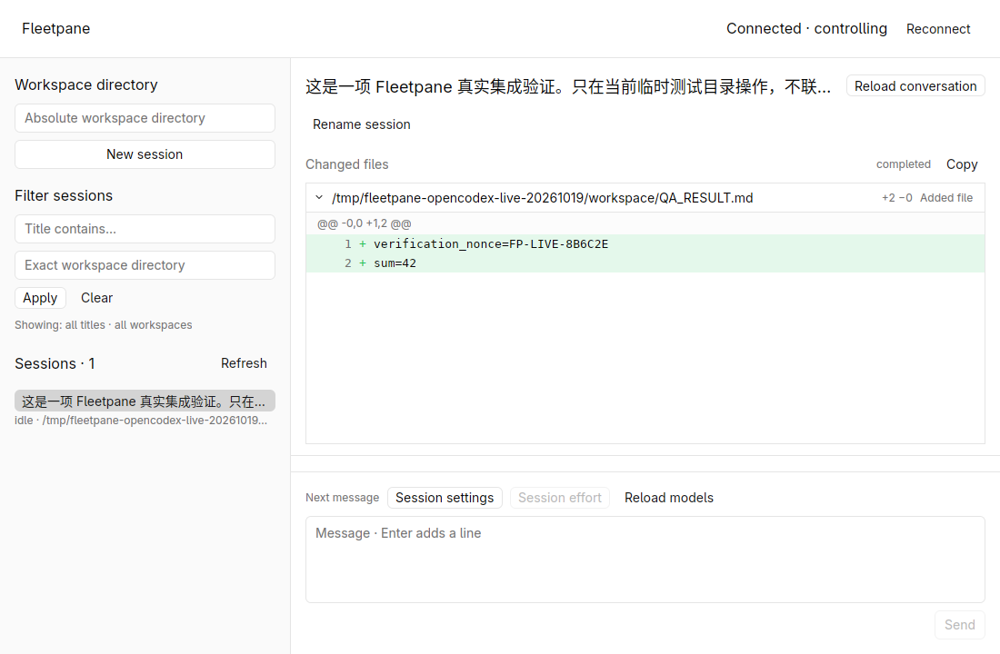

# Live OpenCodex verification — 2026-10-19

Three real external model turns completed through the user's existing OpenCodex
proxy. This is local end-to-end evidence for the covered workflows, not a
replacement-release or all-provider acceptance claim. The uncommitted worktree is
`feat/session-host-foundation`, based on
`973b0ed883c25356a9f0849681333919d4497387`.

Follow-up: this record tested the former legacy history default. New threads now
use paginated storage; the subsequent
[durability verification](2026-10-19-durable-tool-history.md) resolves command loss
on reload for those new threads. Legacy observations below remain historical
evidence and do not describe the new default.

## Environment and isolation

- Codex CLI 0.163.0; OpenCodex 2.73.0, already serving at
  `http://127.0.0.1:10100/v1`. Read-only `ocx ready --json` and
  `ocx models live --provider openai --json` succeeded.
- Rust 1.98.1; GPUI Kit 0.7.3 / engine 0.3.9; Linux X11, software Vulkan,
  1100 × 720 native window. Input stayed inside the hidden workspace
  `fleetpane-opencodex-live-20261019`.
- Dedicated 0700 directory `/tmp/fleetpane-opencodex-live-20261019`, private
  `CODEX_HOME`, copied public model catalog, synthetic workspace and new Host.
  No account credentials, user MCP configuration or saved conversations copied.
  The configured loopback proxy owns its existing upstream authentication.
- Provider `opencodex`, responses API, `requires_openai_auth = false` at that
  loopback endpoint; `workspace-write`, on-request approvals and no agent-tool
  network access. Request and stream retries were both disabled for this check.
  The client itself requires network access to reach the existing model proxy.

The Host inherited only the private Codex configuration for these sessions.
Model calls used the real proxy, not an HTTP/SSE model fixture. Fleetpane did not
change or restart the proxy. Global Codex configuration hash and proxy MainPID
were unchanged at readback.

## Observed behavior

| Entry point | Explicit model / effort | Observed result |
| --- | --- | --- |
| Shared Host CLI | `gpt-6.1-sol` / `medium` | Read QA_INPUT.txt with a real command; computed 17 + 25; apply_patch created QA_RESULT.md with the exact nonce and sum 42; completed Markdown heading/table/Rust fence |
| Native desktop | `gpt-6.1-sol` / `high` | Actual request and rollout turn context contain high; real command waited 15 seconds, verified the file and appended reconnect_writes=1 once; desktop replacement preserved the Host/provider |
| Final rebuilt desktop | `gpt-6-sol` / `medium` | Selected a different model from the live menu; actual request and rollout context match; real command waited 25 seconds, verified the earlier values and appended final_reconnect_writes=1 once; completed Chinese Markdown table after desktop replacement |

All three turns finished `completed`, with no turn error. The native model menu
showed eight visible OpenCodex models. Choosing GPT-6.1-Sol selected its declared
low default; keyboard selection changed it to high. GPT-6-Sol selected medium.
Host operations and persisted Codex `turn_context` records independently confirm
the three explicit wire model/effort pairs. A catalog entry alone was not counted
as successful model access.

The final file contents were asserted exactly:

```text
verification_nonce=FP-LIVE-8B6C2E
sum=42
reconnect_writes=1
final_reconnect_writes=1
```

For the final turn, provider timestamps place command start at
`1792403093249` ms and successful completion at `1792403118220` ms
(exit 0, duration 24971 ms). The isolated workspace's process registry records
desktop PID 3160734 exiting 0 at second `1792403105`, about 13 seconds before
command completion. A replacement desktop launched at that second and explicitly
took control. Host PID 3003682 and provider PID 3003686 remained unchanged across
all desktop generations. Final snapshot had no fault and no pending requests.
This verifies client replacement while a real command runs; control-daemon
installation/upgrade and Host replacement/drain are separate, unfinished work.







## Rendering bug found and fixed

The real generated file-change card initially displayed a blank bordered region.
Waiting did not fill it; resizing the window made the two added lines appear.
The supplied patch parsed correctly and the original JSON retained both lines.

`Diff::render` initially uses the retained viewport width, which is zero. Its
post-layout canvas calls `DiffState::record_paint` and notifies the state when the
measured width changes. Fleetpane's owning `ItemView` did not observe that entity,
so the row was not invalidated for the next paint. Kit's pinned diff story retains
`cx.observe(&state, |_, _, cx| cx.notify())` for exactly this ownership pattern.

Each diff block now retains that subscription and forwards state changes to the
row. It is released together with the block. This changes application observation
ownership; it does not add timers or alter the existing Kit overdraw patch.

A fresh rebuilt desktop opened the same real history. Scrolling to the file card
showed its path, hunk and both added lines without any resize or extra action.
Collapse and expand immediately changed the content. This is manual native
regression evidence; the four pure desktop tests do not establish repaint behavior.




## History gap exposed by live tools

Real live events include `commandExecution` start/completion with command,
output and exit status; the native running command card rendered them. Later
Codex 0.163.0 legacy `thread/read` responses omit these nested code-mode command
items before Fleetpane parses the response. Messages and the apply_patch
file-change item survive. The rollout stores the enclosing custom `exec` call
and its output, rather than reconstructing those nested command items on read.

Consequently, command cards can disappear on history reload. This remains an
acceptance gap. The bounded Host event journal is not a complete durable history;
merging its recent events would not solve later reconnects or restore historical
tool identity. No provider-history fallback or silent conversion was added.

## Checks and artifacts

After the observation fix, these completed successfully:

```sh
cargo fmt --manifest-path apps/desktop/Cargo.toml --check
cargo test --manifest-path apps/desktop/Cargo.toml --locked -j2
cargo clippy --manifest-path apps/desktop/Cargo.toml --all-targets --locked -j2 -- -D warnings
cargo build --manifest-path apps/desktop/Cargo.toml --locked -j2
git diff --check
```

All four desktop tests passed. The final rebuilt binary then completed the third
live turn and the native diff first-open/collapse/expand regression check.
Host executable SHA-256:
`424d0c47502766afbe23d320a65003df646f01ed69a438540ab3092754f74c57`.
Desktop before fix:
`014705b458a907371be1f4a8b5d39d0d4826929633b69356b9e50efb317e03d8`.
Desktop after fix:
`d3277de028ddf63ac1926ace3e0cf920822e5dc47ec30a569640fa0fb9cec404`.

[Structured acceptance summary](assets/opencodex-live-summary.json) contains only
synthetic test output, model options and process/timing evidence. Private local
raw artifacts remain in the 0700 test directory: Host operation replies, ordered
event captures, isolated rollout, snapshots and native screenshots. This record
does not publish account configuration or proxy request logs.

The isolated workspace was stopped after validation. Readback confirmed all four
test desktop PIDs, the test Host and its Codex child were gone. The shared
OpenCodex MainPID and global Codex configuration hash still matched the baseline.
Test logs contained no panic; desktop stderr contained the known software-Vulkan
DRI3 warning. Codex warned that a temporary CODEX_HOME cannot host PATH helper
aliases; the actual terminal and apply_patch tools nevertheless completed.

## Limits

DeepSeek Harness 0.2.0-rc.2 is installed locally; the user's wrapper invokes its
ACP profile. Fleetpane currently has no ACP adapter, so no DeepSeek model turn
was attempted or accepted. The user's requested alternative, OpenCodex, was used.

Real question/approval/cancellation paths, image generation or image tool output,
all eight model entitlements, upstream model identity behind the proxy, IME,
accessibility, non-Linux desktop behavior, remote CI, performance and memory
comparisons were not established here. The proxy's returned model names and
Codex's recorded options are configuration/response evidence, not independent
attestation of an upstream deployment. Attachment upload, terminal emulation,
complete tool-history recovery, service upgrades and Host drain remain unfinished.
