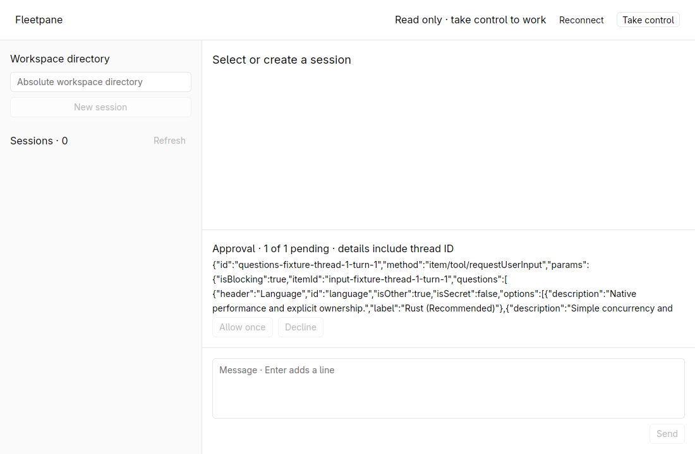
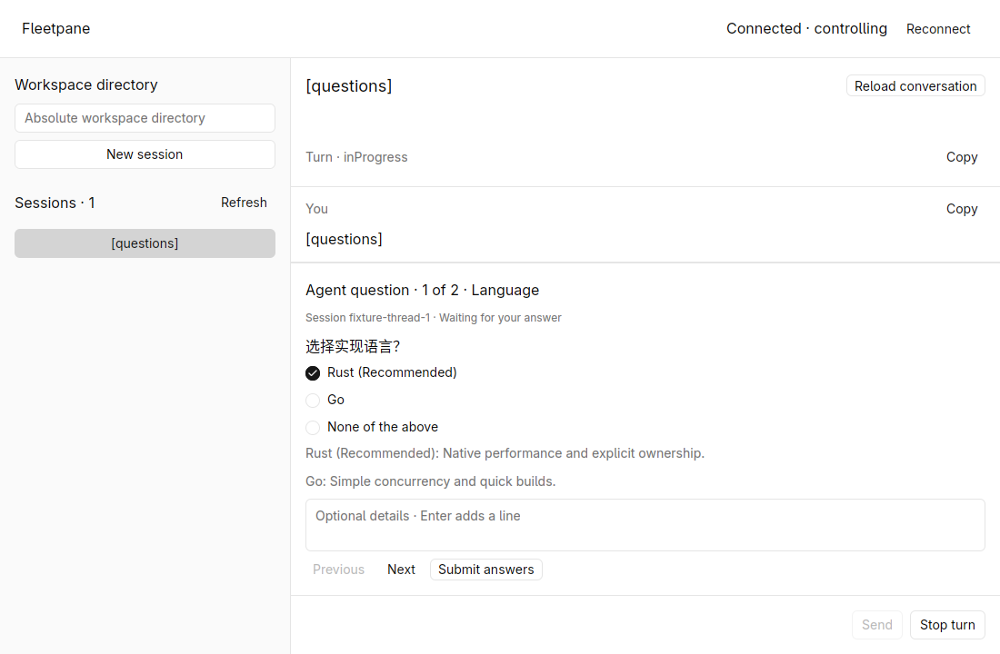
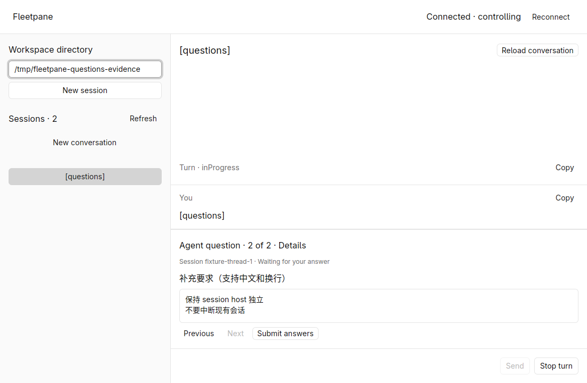
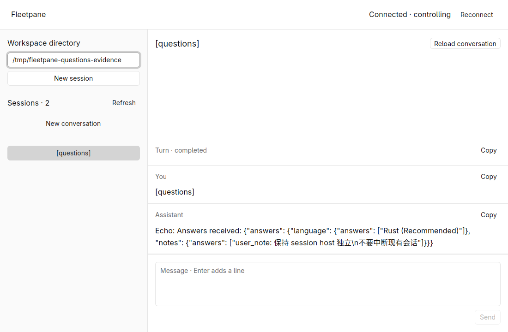
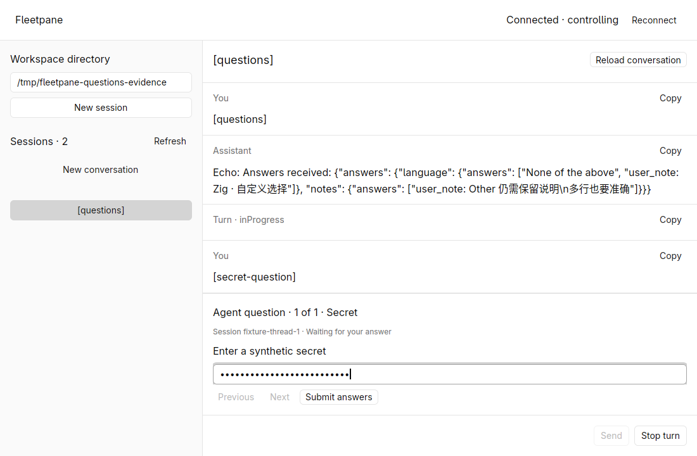
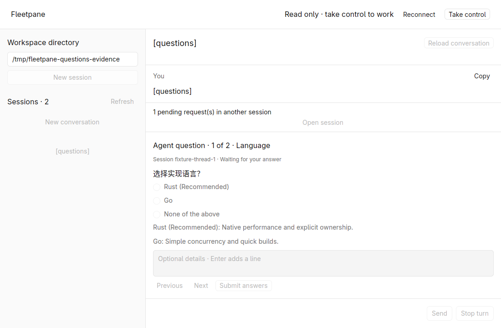
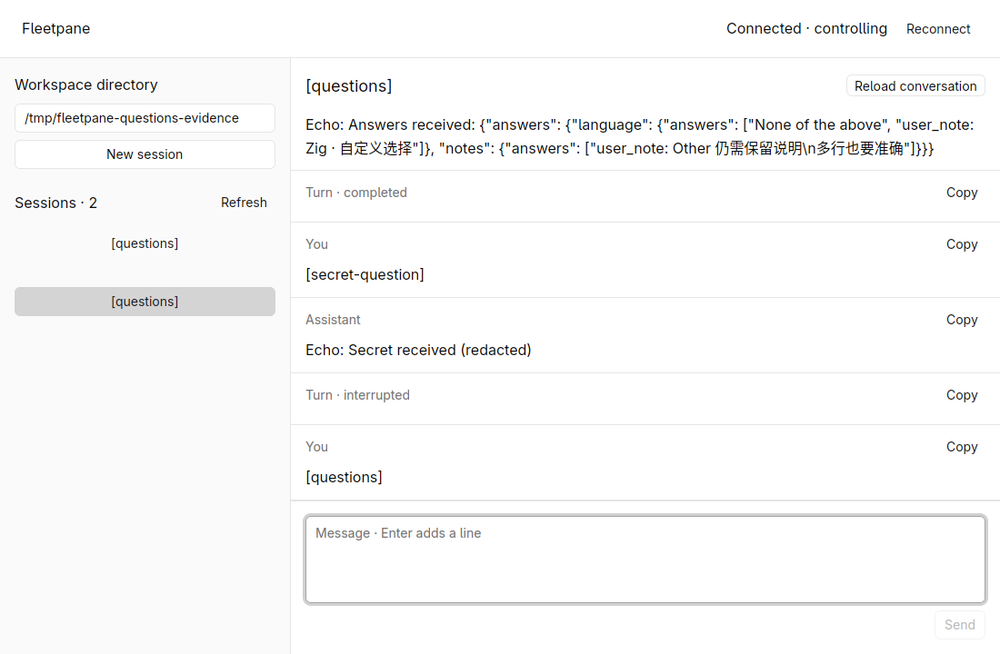

# Agent question verification — 2026-10-19

Worktree: `feat/session-host-foundation`, base
`973b0ed883c25356a9f0849681333919d4497387`, with uncommitted foundation/rendering
and question changes. Linux, Rust 1.98.1, GPUI Kit 0.7.3, isolated X11/software
Vulkan. No existing user runtime was restarted or used for prompts.

## Reproduction and change

The native before-fix window showed `requestUserInput` as raw approval JSON with
disabled actions. The shared client rejected it as unimplemented. Dedicated
typed answers and a retained paged form now handle that method. Questions are
routed to the selected session instead of displaying the first global request.



## Native checks

The isolated synthetic provider emitted real-shaped requests; the native desktop
performed selection, entry, submission and stop. Host events and provider echo
were read back to confirm actual Unicode/newline values, not just their display.

| Scenario | Observed result |
| --- | --- |
| Two questions; single choice and free text | No default selection; Submit disabled until both answered; radio arrow navigation, Previous/Next and click work |
| Unicode multiline answer | Exact `user_note: 保持 session host 独立\n不要中断现有会话` reached the provider; continued assistant message and completed turn |
| Other and optional notes | `None of the above` plus `user_note: Zig · 自定义选择`; second multiline response echoed accurately |
| Reconnect and session switch | Choice, page and typed draft retained in the same window; another session shows a pending-request notice and Open session action |
| Two sessions with pending questions | Each form labels the correct session; Open session changes to that request; stopping one session leaves the other's question pending |
| Controller replacement | Read-only banner and disabled form; explicit Take control restores interaction; process smoke rejects old-lease response |
| Sensitive input | Native field shows dots; fixture acknowledgment is redacted; form removed after submission |
| Stop turn | Interrupted state displayed; corresponding request and form removed; final snapshot has no pending requests |
| Narrow window | Question navigation, input, Submit and Stop remain reachable at the desktop's minimum width and 640 px height |
| Existing command approval | Final build still displays Allow once/Decline and delivers the chosen decision |
| Request missing a thread ID | Globally inspectable JSON with disabled approval buttons; not silently assigned to the selected session |

Host identity and provider PID stayed the same across the native conversation,
reconnect, UI replacement and cancellation checks. Raw local evidence lives in
`/tmp/fleetpane-questions-evidence`; only synthetic screenshots are copied here.








## Real Codex app-server check

`python3 scripts/codex-questions-smoke.py` uses installed **codex-cli 0.163.0**,
an empty temporary CODEX_HOME, and a loopback Responses SSE model fixture. A plan
turn invokes Codex's actual `request_user_input` tool. The Host retains its
request across controller replacement; the shared CLI adapter answers it. The
second model request contains the exact expected selected label and Chinese
multiline note. Codex then emits the assistant message and completes the turn.

Result: `real_codex_question_handoff_answer_continuation=PASS`,
`unicode_multiline_answer_readback=PASS`, **two local model requests**, **zero
external LLM requests**, same Host and provider identity, no pending request.
This validates the installed runtime contract independently of the JSONL provider
fixture. It does not establish authenticated model acceptance.

## Checks

```sh
cargo fmt --all --check
cargo test --workspace --locked
cargo clippy --workspace --all-targets --locked -- -D warnings
cargo build -p fleetpane-host --locked
python3 scripts/session-smoke.py
python3 scripts/codex-questions-smoke.py
cargo fmt --manifest-path apps/desktop/Cargo.toml --check
cargo test --manifest-path apps/desktop/Cargo.toml --locked
cargo clippy --manifest-path apps/desktop/Cargo.toml --all-targets --locked -- -D warnings
cargo build --manifest-path apps/desktop/Cargo.toml --locked
uvx ruff check scripts/provider-fixture.py scripts/session-smoke.py scripts/codex-questions-smoke.py
uvx ruff format --check scripts/provider-fixture.py scripts/session-smoke.py scripts/codex-questions-smoke.py
```

Root: **28 tests passed**; desktop: **4 tests passed**. Formatting, Clippy, build
and process checks passed locally. New domain tests cover no default answer,
Unicode/Other serialization, malformed requests, duplicate question IDs,
missing/wrong answers, multiple-selection rejection and the 64 KiB limit.
The synthetic process check additionally covers invalid submissions preserving
the pending question, stale ownership, duplicate submission and cancellation.

The final build was reopened against the same Host, then its two-question answer
(`最终构建验证\n回答后继续`), command approval decline and missing-thread request
card were checked again.

Final debug desktop SHA-256:
`c38fc0d894c8682b9f44aaa5a3cc3924639e5bee03ed0706185c444cc79d87fd`.
Host executable SHA-256:
`3fa2aaa0bdcd4db9c73c0f7bad550945a3e396ab6b138cbbf36d931339171fd0`.

No remote CI run is claimed. Authenticated external models, actual IME
composition, screen-reader behavior, macOS/Windows rendering, unsupported
provider elicitation methods, question-body rich Markdown and injected answer
transport faults are not accepted by these checks. Drafts do not survive closing
the desktop. This form intentionally requires an answer to every question;
Codex TUI's explicit unanswered confirmation/skip workflow is not implemented.
