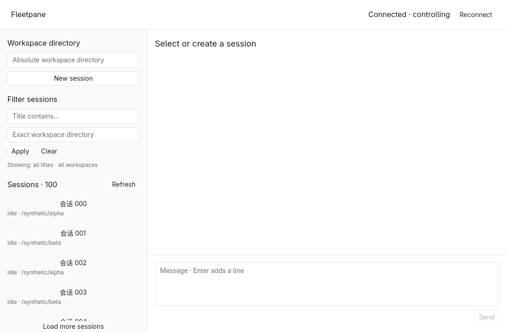
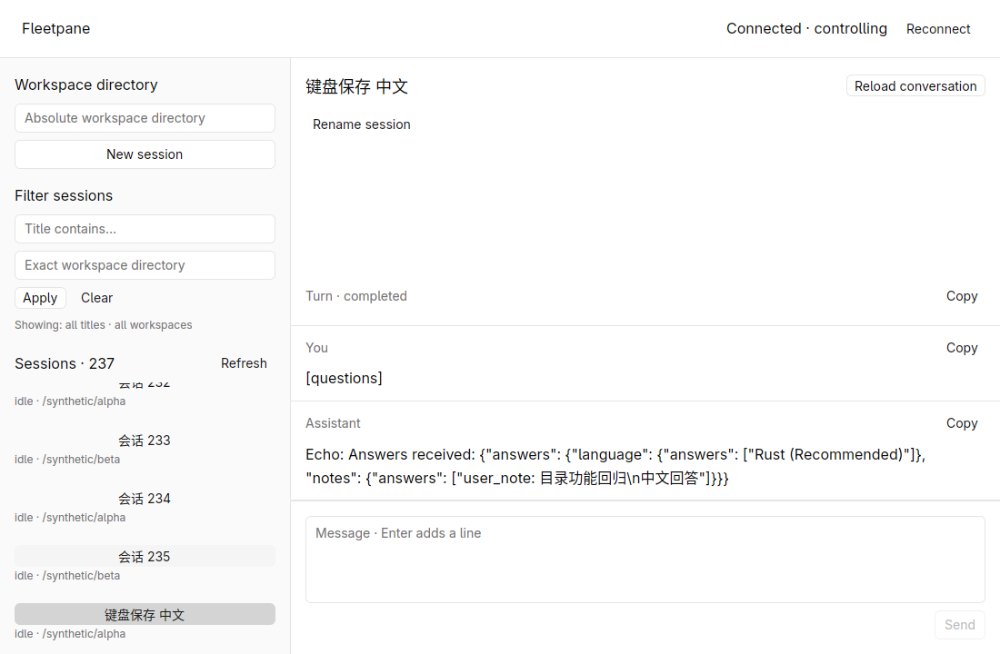
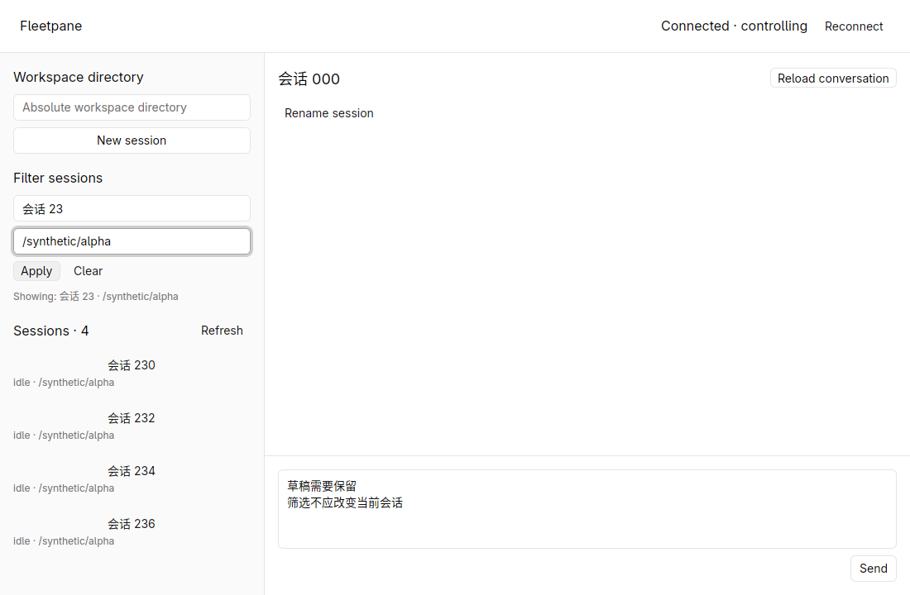
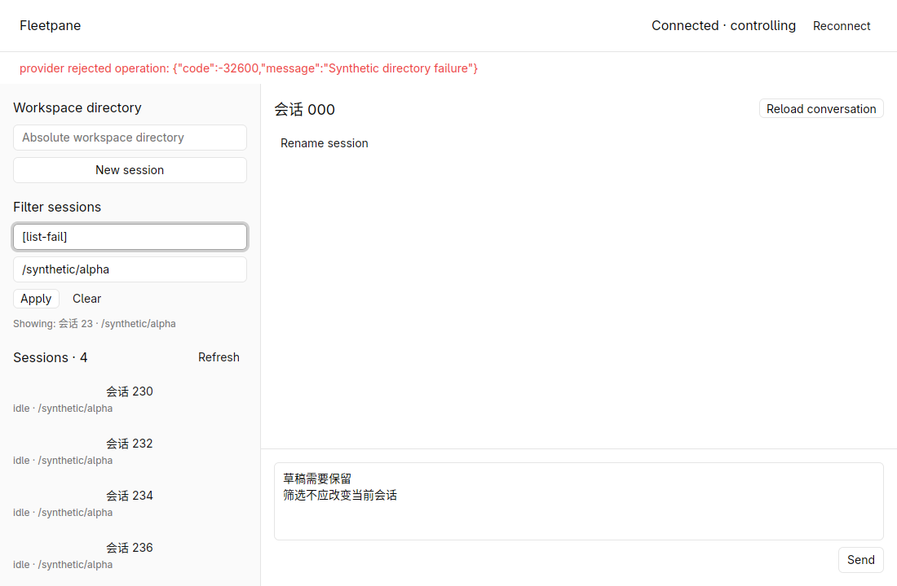
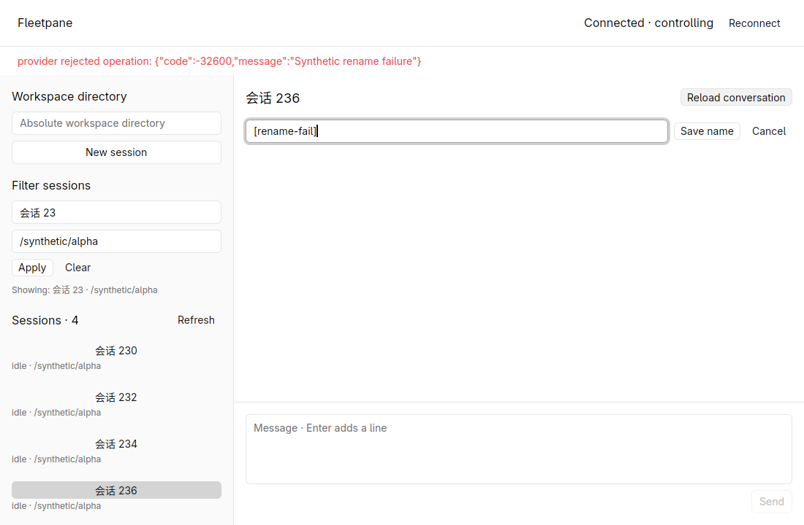
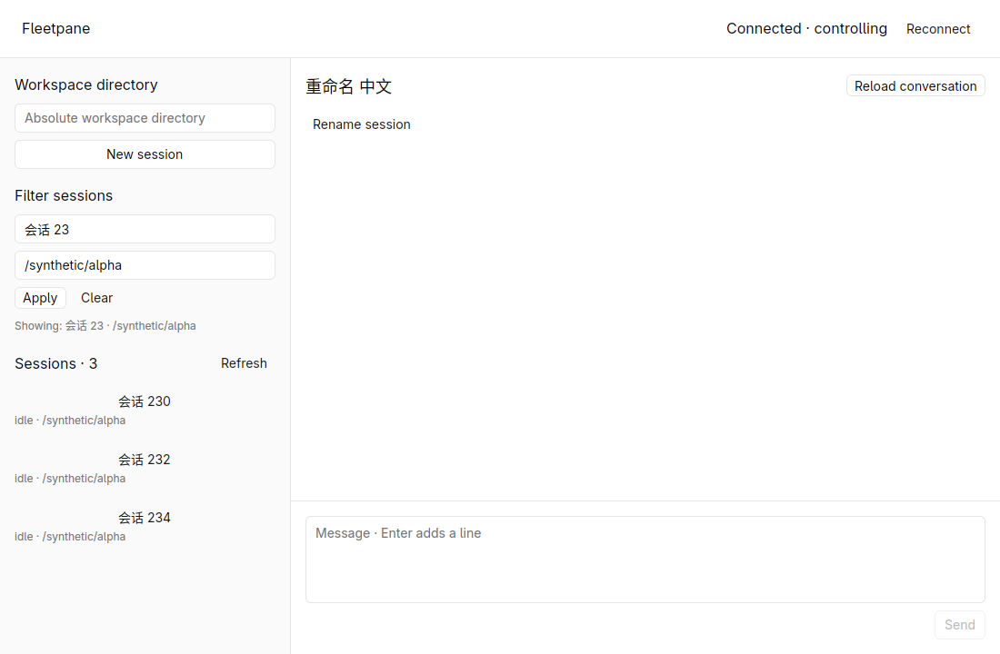
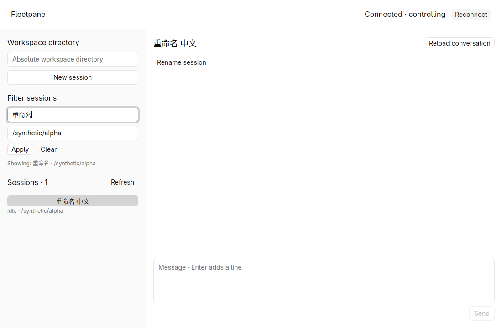
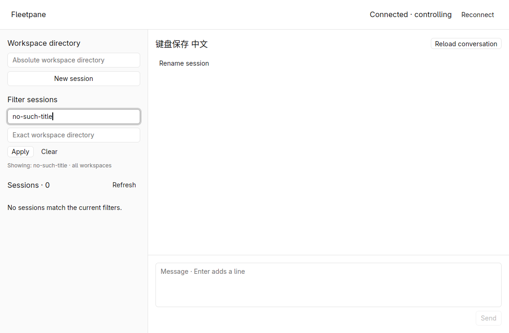
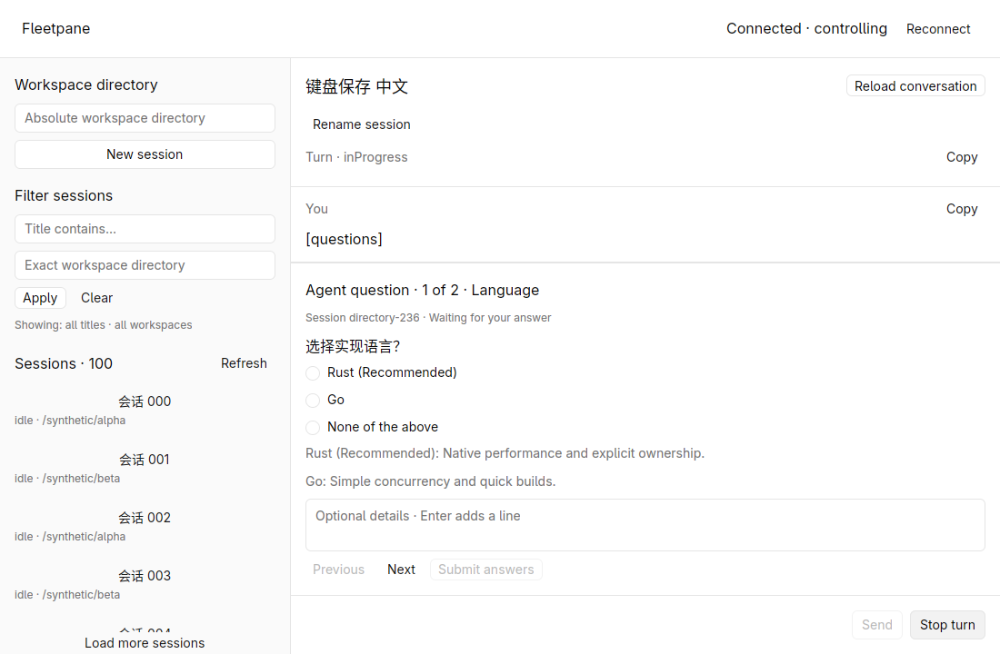
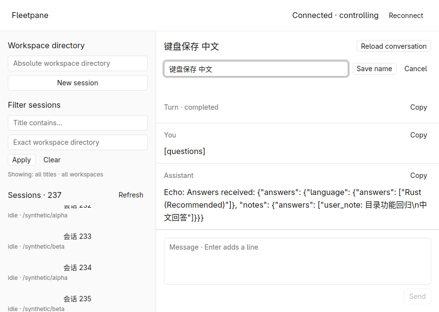

# Session directory verification — 2026-10-19

Branch `feat/session-host-foundation`, base
`973b0ed883c25356a9f0849681333919d4497387` with uncommitted foundation, rendering,
questions and directory changes. Linux; Rust 1.98.1; GPUI Kit 0.7.3; isolated
X11/software Vulkan. All shared examples/screenshots contain synthetic data.

## New behavior and evidence

The previous Host view discarded `nextCursor` after its first 100 rows. It now
supports explicit page loading, global provider title/exact workspace queries,
empty/loading/error states, and session rename through the same CLI/GUI adapter.
Directory query failures preserve the previous successful result and selected
conversation. Rename failures preserve the editor and old title.

| Native workflow | Result |
| --- | --- |
| Load more twice | Count 100 → 200 → 237; last page has no Load more action; wheel reaches row 236 |
| Title `会话 23` and workspace `/synthetic/alpha` | Exactly 230, 232, 234 and 236, including rows beyond the initially loaded page |
| Refresh and filter while another session is open | Selected session stays open; `草稿需要保留\n筛选不应改变当前会话` remains in composer |
| Synthetic directory error | Red error; previous four results, applied-filter label, selected conversation and draft remain |
| Rename error | Old title and editor remain; correction can be submitted |
| Rename to `重命名 中文` | Right title updates; previous filter refreshes from four rows to three; new title is searchable |
| Reconnect | Same selected identity and successful query; title read back from provider |
| Rename cancellation | Entered `未保存的标题`, cancelled, selected/provider title unchanged |
| Keyboard filtering/renaming | Enter applies title query; Enter saves `键盘保存 中文`; earlier Tab/Return also activates Save name |
| No matching title | Explicit empty-result message; selected conversation stays open |
| Clear | All-title/all-workspace first page restored, selected conversation unchanged |
| Narrow 900 × 640 window | Filters, inline name editor, Save/Cancel and composer stay reachable |
| Questions regression | Paged form still fits; exact `目录功能回归\n中文回答` reaches provider, assistant continues, turn completes |

Provider notification/event readback confirmed actual names and Unicode multiline
answer values. Same Host and provider identity across UI close/reopen, ownership
transfer and reconnect. No pending question at end. Existing user runtimes were
not used or restarted. Raw local evidence: `/tmp/fleetpane-directory-evidence`.












## Process and real-runtime checks

`directory-smoke.py` starts an isolated Host and 237-session JSONL fixture. It
reads all pages without duplicate/missing IDs; applies title/workspace queries
and a second filtered page; checks empty results, Unicode rename/readback and
notification, provider/query validation failures and stale-controller rejection.
Result: `global_title_workspace_filters=PASS`,
`rename_readback_notification_errors_fencing=PASS`, same Host/provider.

`codex-session-smoke.py` uses installed **codex-cli 0.163.0**, an empty CODEX_HOME
and a loopback HTTP fixture. After the intentionally failed turn materializes
history, it renames the real thread to `Fleetpane 中文目录验证`, reads it back,
queries by title plus exact cwd, and checks nonmatching titles/directories.
Result: `rename_global_title_workspace_filters=PASS`, one intentional local
HTTP request, no external LLM calls.

The unchanged synthetic conversation workflows and real Codex/local-SSE question
round trip were rerun successfully. This does not establish authenticated LLM
acceptance or real Codex directory pagination above 100 rows.

## Local checks

```sh
cargo fmt --all --check
cargo test --workspace --locked
cargo clippy --workspace --all-targets --locked -- -D warnings
cargo build -p fleetpane-host --locked
python3 scripts/directory-smoke.py
python3 scripts/session-smoke.py
python3 scripts/codex-session-smoke.py
python3 scripts/codex-questions-smoke.py
cargo fmt --manifest-path apps/desktop/Cargo.toml --check
cargo test --manifest-path apps/desktop/Cargo.toml --locked
cargo clippy --manifest-path apps/desktop/Cargo.toml --all-targets --locked -- -D warnings
cargo build --manifest-path apps/desktop/Cargo.toml --locked
uvx ruff check scripts/directory-smoke.py scripts/provider-fixture.py scripts/codex-session-smoke.py
uvx ruff format --check scripts/directory-smoke.py scripts/provider-fixture.py scripts/codex-session-smoke.py
```

**32 root tests and 4 desktop tests passed**. Format, Clippy, builds and process
checks passed. Domain tests cover query/cursor continuity, repeated/cyclic
cursors, duplicate IDs, overlap merging, atomic error retention, refresh reset,
oversized page and 5,000-row cap; name command validation and notification
projection are checked too. The encoded 8 MiB aggregate bound is implemented;
it lacks its own threshold test. CI includes the synthetic directory smoke
command; no remote CI run is claimed.

Final desktop debug executable SHA-256:
`611b45b04ee5074c31f23ca192c3b2ffbc530d6fb76b1721b9d79123494ebf01`.
Host debug executable SHA-256:
`282b7eeac9fe1a611b3c40163520a8458c014d463e341f4303cad96c181481f4`.

5,000 sessions were checked in domain tests; native acceptance covers 237.
No performance comparison, memory benchmark, real IME composition, screen reader,
macOS/Windows or query transport fault injection acceptance is claimed. Concurrent
updated-at pagination is best effort; Refresh reconciles its changing index.
Filter state is not persisted across desktop exits. Conversation history retains
its existing 500-item / 2 MiB limit; archive, pin and full-text search are pending.
