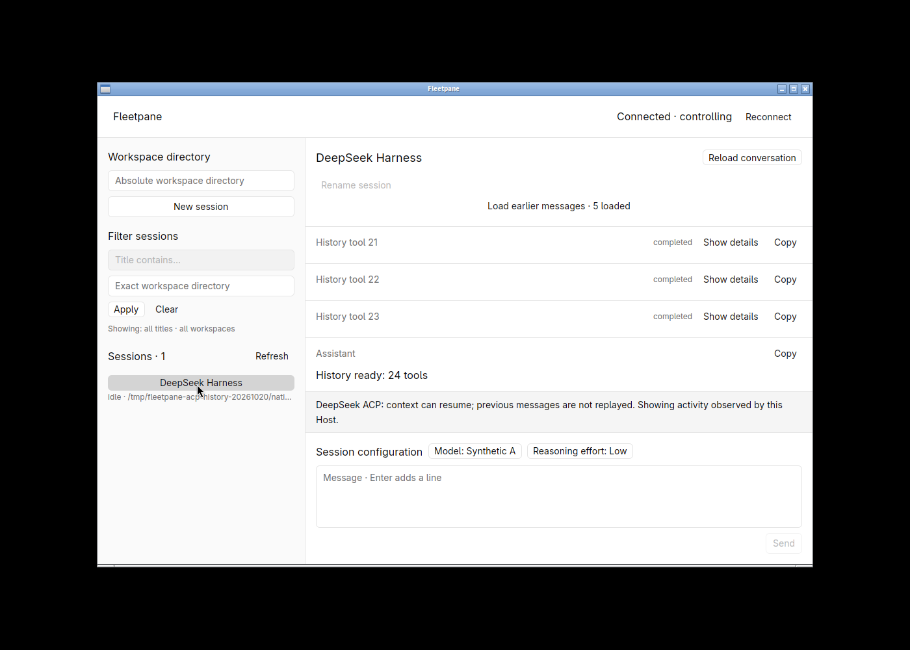
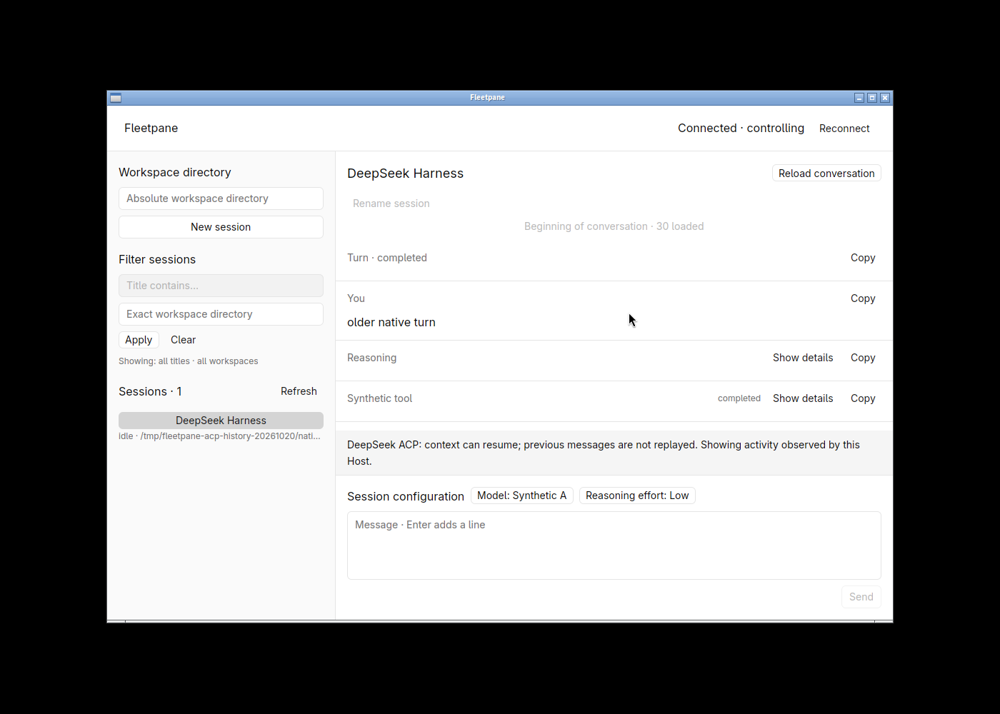
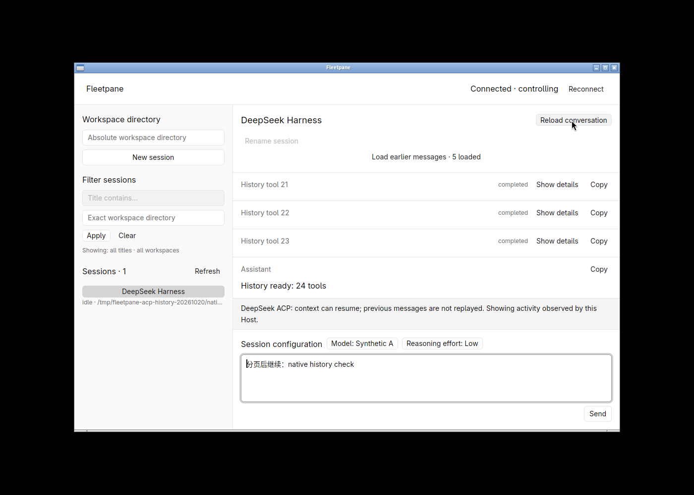
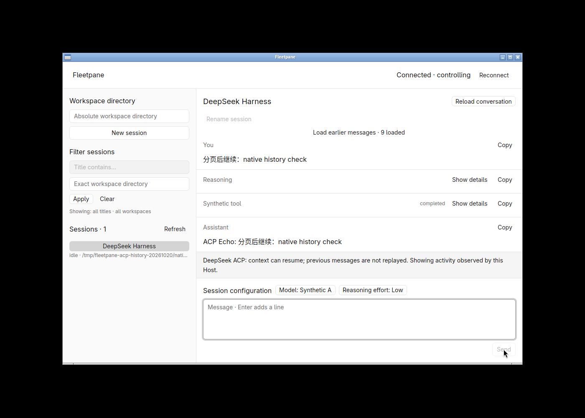

# ACP observed-history paging and concurrent Host streams

2026-10-20; `973b0ed883c25356a9f0849681333919d4497387` plus the uncommitted
foundation. Rust 1.98.1, GPUI Kit 0.7.3; Linux X11, hidden desktop 1100 × 720,
software Vulkan. All Hosts, workspaces and credentials copies were task-owned;
existing Paseo/Codex/DeepSeek runtimes were not restarted or adopted.

## Reproduced failure and fix

Previously ACP `thread/read` ignored `includeTurns`, resident resume ignored
`excludeTurns`, and the desktop only paged `historyMode: paginated` conversations.
Metadata inspection of a retained synthetic turn containing 24 tools with 60,000
output characters each failed with `provider message exceeds frame limit` and
faulted the healthy Host. The history itself was within the 2 MiB cache budget.
`scripts/acp-history-smoke.py` reproduced the failure against the previous binary.

ACP now advertises `historyPaging: true` separately from `acp-observed` replay
semantics. Metadata reads omit turns; pages use the existing shared traversal and
watermark reconciliation. A page contains at most one metadata-only turn or 16
items and fits the exact 256 KiB encoded reply budget, including continuation.
Immutable anchors keep older continuations stable when new activity appends.
Cursors reject wrong Host generations, sessions, turns and traversal types.

After the fix, the same 1,449,683-byte / 26-entry synthetic turn loads in pages of
5, 4, 4, 4, 4 and 5 entries without loss or duplication. Full reads exceeding the
budget produce a command error; the Host remains healthy and accepts another
turn with the same processes. Read-only paging does not consume mutation slots.
Explicit resume is still a mutation. Invalid flags, limits and cursors fail.

## Native and real-provider verification

Opening the seeded conversation initially loaded five entries. **Load earlier**
advanced through 9, 13, 17, 21 and 26 entries, then the previous turn, ending at
30 with **Beginning of conversation**. The visible tool-21/22/23 rows retained
their position after the first earlier load. Scrolling reached tool 00 and the
earlier user prompt. Copy on tool 00 yielded 60,348 bytes of valid JSON with its
exact `BEGIN 00`, 60,000-character body and `END 00` output.

Reload returned to the most recent page while preserving a Chinese composer
draft. Sending it produced the exact synthetic echo, with unchanged Host/provider
PIDs and no Host fault. The native no-replay warning remained visible.






An independent DSH 0.2.0-rc.2 Host completed an external model turn reading
`sample.txt` and returning a Markdown table. Paged entries included a user message,
ACP tool and assistant message with the exact synthetic compass/nonce values.
Both inspect and resident resume returned metadata only with paging enabled.
The temporary credentials copy was removed after the owned Host exited.

## Concurrent Host workload

`scripts/concurrency-smoke.py` starts 20 synthetic ACP sessions and establishes
all 20 are simultaneously in progress. Each emits 50 chunks at a configured
10 chunks/s. It reads metadata while consuming events, replaces the controller,
rejects the stale lease and cancels one session. Nineteen sessions complete with
all 50 chunks; the cancelled session retains its exact prefix. Every prompt runs
once, no text is duplicated or lost, and Host/provider PIDs remain unchanged.
All 41 mutations are accounted for. This scenario also runs in Unix CI.

Measured release command:

```sh
cargo build --release -p fleetpane-host --locked -j2
python3 scripts/concurrency-smoke.py --binary target/release/fleetpane-host --output samples.json
```

On Linux x86_64 / Python 3.12.12, 427 samples of a sequential Unix-socket snapshot
plus metadata query had p50 **0.762 ms**, p95 **2.761 ms**, p99 **4.216 ms**.
Sampled RSS peaks during the stream were Host 5,400 KiB, Python fixture provider
18,692 KiB, probe/controller 21,452 KiB; the sampled combined peak was 45,536 KiB.
The fixture uses one Python thread per stream. The measured binary and fixture
SHA-256 identities, all latency samples and per-session chunk counts are in
[the raw result](assets/concurrency-20-release.json).

This is a short synthetic Host correctness/response experiment. It measures no
desktop input/render latency, real DSH/Codex model capacity, network/API limits,
long soak, 200-session directory or same-machine incumbent baseline. No Rust
speedup multiplier, W1 PASS or production concurrency limit follows from it.
RSS values are samples of these three processes, not a real-agent resource budget.

## Checks and remaining limits

Passed: workspace tests **55**, desktop tests **4**, both strict Clippy targets,
both format checks, Ruff checks/format for the modified scripts. Process checks:
ACP lifecycle, ACP large history, concurrent streams, shared session lifecycle,
large Codex-style history and repeated queries. Real Codex 0.163.0 with a local
SSE model retained command identity/output across paging and Host/provider restart,
executed its command once and completed 160 reads before another mutation.
That local SSE regression makes no external Codex model-success claim.

DSH still does not replay transcript updates on resume. Observations remain in
Host memory, capped at 500 items/turns, 2 MiB per conversation and 8 MiB combined
with metadata; there is no eviction/windowing. A single oversized item cannot fit
a page. The prototype also retains its 64-resident-ACP-session and 128-mutation
lifetime limits. Durable recovery, version drain and the remaining
[parity workflows](../parity.md) are open. Remote CI, other OSes, IME and full
replacement readiness were not verified.
