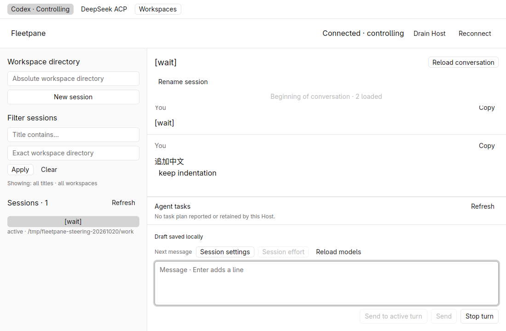
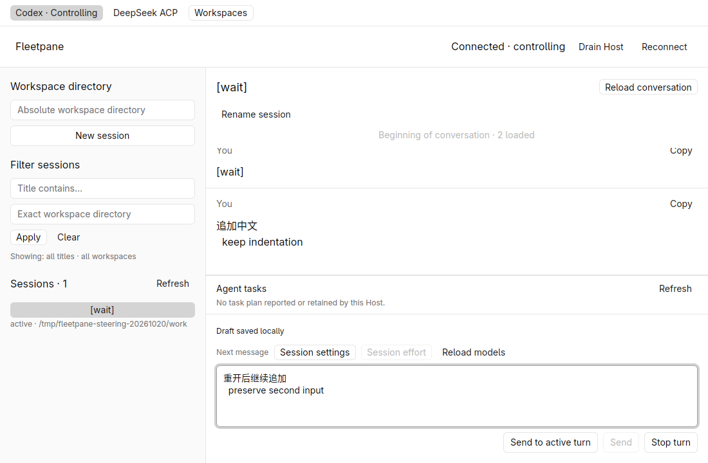
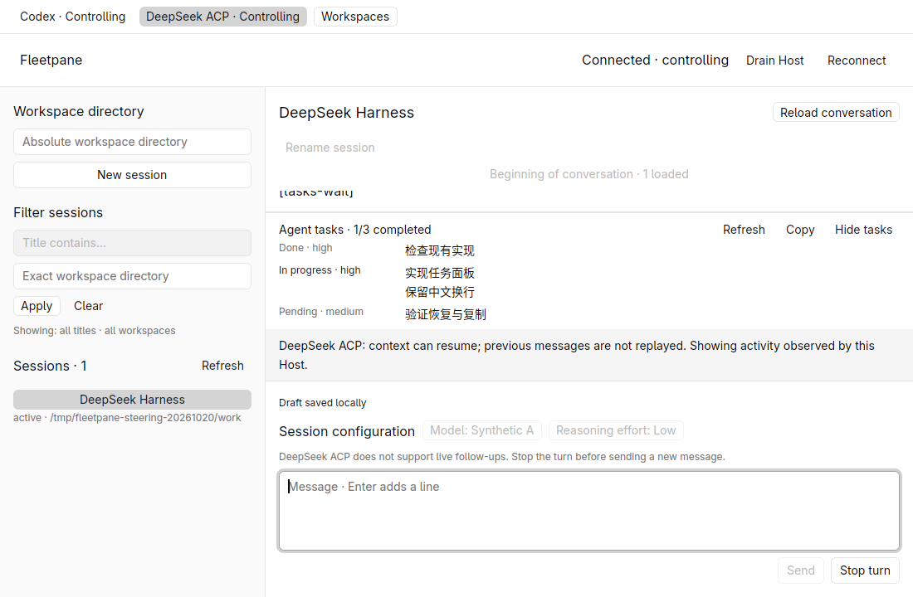
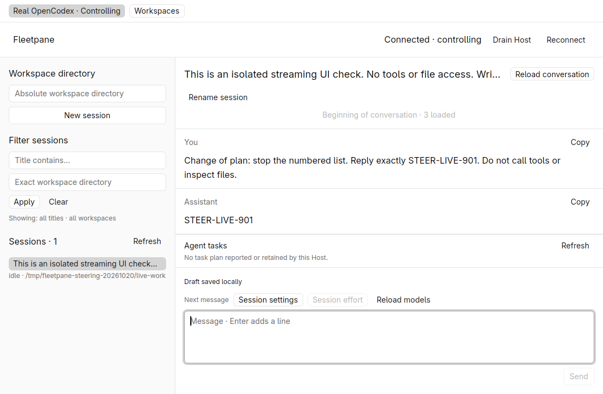

# Active-turn follow-ups — 2026-10-20

Local Rust 1.98.1 development builds, GPUI Kit 0.7.3, Linux X11/software Vulkan,
1100 × 720 isolated native window. The follow-up changes are uncommitted on top
of `c91d269247207a08898e264c81083df4fbd4e745`; the foundation and platform fixes
were pushed separately. This is evidence for the covered workflows, not full
Paseo parity, performance measurements, or macOS/Windows native acceptance.

The pushed foundation at `c91d269247207a08898e264c81083df4fbd4e745`
passed [all four remote CI jobs](https://github.com/arucil/fleetpane/actions/runs/39419922181):
Linux desktop plus Linux, macOS and Windows Rust checks. This run excludes the
local follow-up changes described below.

## Behavior and regression proof

Codex follow-ups use `turn/steer` with the original `expectedTurnId`. Only an
acknowledgement naming that turn can clear the durable draft. Rejection restores
editable text; pending, unknown and malformed acknowledgements retain the text,
operation UUID and original parameters. Recovery checks the existing receipt and
never resends. There is no fallback to a new turn, automatic approval resolution,
model override or cross-provider queue. DeepSeek ACP reports unsupported rather
than silently starting another prompt. See [ADR 0024](../adr/0024-active-turn-follow-ups.md).

Passed on the final Rust source:

```sh
cargo fmt --all --check
cargo test --workspace --locked -j2
cargo clippy --workspace --all-targets --locked -j2 -- -D warnings
cargo build -p fleetpane-host --locked -j2
cargo fmt --manifest-path apps/desktop/Cargo.toml --check
cargo clippy --manifest-path apps/desktop/Cargo.toml --all-targets --locked -j2 -- -D warnings
cargo test --manifest-path apps/desktop/Cargo.toml --locked -j2
cargo build --manifest-path apps/desktop/Cargo.toml --locked -j2
python3 scripts/steering-smoke.py
python3 scripts/drafts-smoke.py
python3 scripts/tasks-smoke.py
uvx --offline ruff check scripts/
uvx --offline ruff format --check scripts/provider-fixture.py scripts/steering-smoke.py scripts/workspaces-smoke.py
git diff --check
```

Root tests: 92 passed; desktop tests: 4 passed, 96 total. Two new unit tests cover
exact request/acknowledgement identity and saved-draft recovery. The private-Host
process smoke covers exact Chinese multiline text in the original turn, one
dispatch for an operation UUID, stale ownership and drain refusal, wrong-turn
rejection, malformed acknowledgement preservation, pending approval preservation,
Stop followed by rejection of the old turn, unsupported ACP, controller loss and
Host restart without replay. The new smoke is added to the local Unix CI workflow;
it is not part of the already pushed foundation CI run.

The push also exposed platform defects independently of this feature: Windows
ACP fixtures used Unix-only absolute paths; Windows Clippy found a Unix-only
helper; macOS SQLite rejected system directory aliases and some Unix socket
fixtures exceeded its path bound. The storage fix canonicalizes the checked
directory while continuing to reject a symlink at the private directory or
database leaf. A new ancestor-alias regression failed before the fix and passes
afterward. Workspace smoke assertions now compare canonical paths, matching the
existing product contract. A short private `TMPDIR` alias reproduced that failure
on Linux. Workspace, comparison and worktree process smokes all pass through the
alias after the correction, including the existing worktree deadline checks.
These checks changed no Git Diff product behavior.

## Native and real-provider acceptance

Two private fixture Hosts ran Codex and DeepSeek ACP. In the native window, the
Codex **Send to active turn** action sent `追加中文\n  keep indentation \n`
exactly once, displayed the provider's user item and cleared the acknowledged
draft. A second unsent multiline draft survived normal window closure and
replacement. Before taking control in the replacement, both complete Host
snapshots were unchanged, including Host/provider PIDs. The restored draft was
sent to the same turn. Stop interrupted that turn; readback contained one turn
and exactly the initial user item plus the two follow-ups. ACP displayed the
unsupported hint, disabled ordinary Send while active and retained Stop.





A separate real OpenCodex 0.163.0 app server used a private `CODEX_HOME` and a
synthetic workspace. During a running response, the shared CLI sent a follow-up
requesting the exact response `STEER-LIVE-901`. Its receipt named the original
turn; completed readback contained one turn, the follow-up user item and that
assistant response. The final native binary opened and rendered the same history.
The live Host used the feature build before the unrelated storage-alias fix;
the final desktop and fixture window-replacement checks used the rebuilt binary.
Artifact hashes and selected synthetic readbacks are in the
[public receipt](assets/steering/receipt.json).



The isolated desktop and all three owned Hosts/providers were stopped afterward;
their sockets and provider processes were confirmed gone. No shared Paseo daemon,
existing Codex/DSH session or proxy configuration was restarted or modified.
The real-provider check establishes same-turn text steering; real DSH live
steering remains unsupported. Permission-clear semantics, queued input and
cancellation of unread follow-ups remain open.
