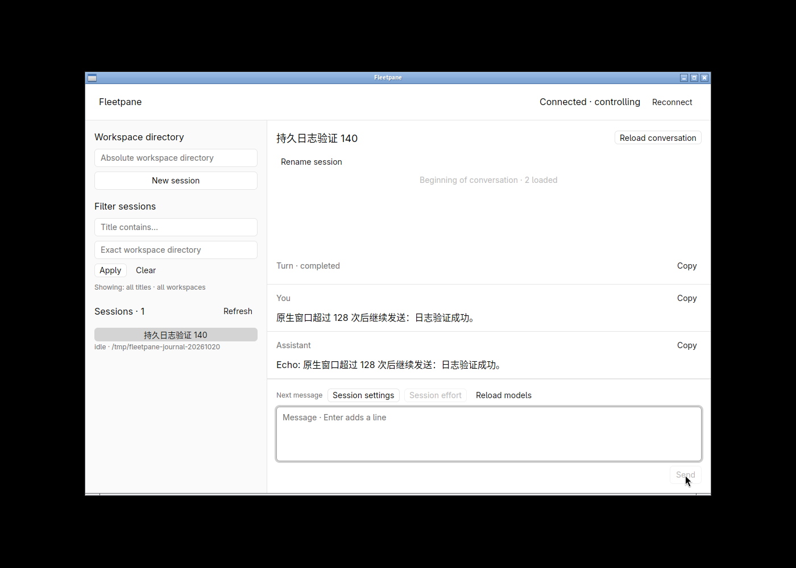
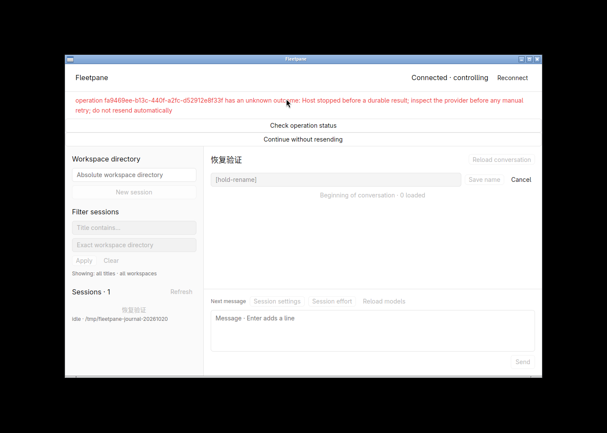
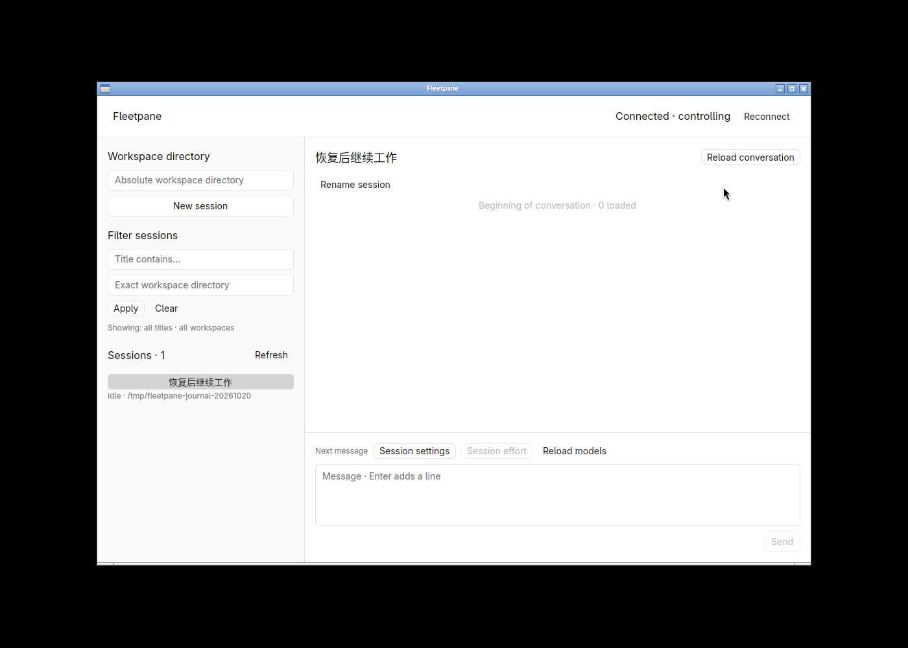

# Durable Host operation receipts, 2026-10-20

Local Linux development builds, Rust 1.98.1, GPUI Kit 0.7.3. The checkout is
uncommitted foundation work on `feat/session-host-foundation`, based on
`973b0ed883c25356a9f0849681333919d4497387`. This is local evidence, not remote CI
or replacement-release acceptance. Architecture and limits: [ADR 0015](../adr/0015-durable-operation-receipts.md).

`python3 scripts/journal-smoke.py --baseline --host OLD_EXECUTABLE` reproduced
128 settled mutations and rejection of the 129th. With the new Host,
`python3 scripts/journal-smoke.py` completed 300 mutations, evicted old resident
records and found every durable receipt through 32-row pages. Repeating the
oldest UUID returned its saved result without another side effect. Changing its
params returned a conflict; appending an admission did not shift the older pages;
a cursor bound to a different journal was rejected.

The process test then waited until the fixture had fsynced a side effect for a
held operation, killed the owned Host/provider process group, and restarted the
same configuration over its stale socket. It recovered 301 receipts, marked the
held one unknown, preserved the finished result without an old event watermark,
rejected the old controller lease and did not dispatch either old UUID again.
One new mutation completed afterward: 302 receipts and exactly 302 side effects.
A second live owner and a changed workspace binding failed before provider
launch. Human CLI receipt reads did not change ownership.

Three storage regression tests cover exclusive ownership, restart recovery,
completion CAS, old watermark removal, disk-page exhaustion on admission and
completion, corruption, unsupported schema and unsafe file permissions. A failed
completion write leaves an accepted receipt that recovers as unknown, never a
reported success. Tests use synthetic data and owned private directories.

Native QA used an isolated hidden 1400×1000 desktop. After one thread creation
and 140 renames, the Host had 141 durable receipts and 128 resident IDs; the
oldest UUID was already outside RAM. The native window took control, selected the
session and sent `原生窗口超过 128 次后继续发送：日志验证成功。`. The same Host/provider
completed one turn, rendered the Chinese user/assistant messages and exposed
all 142 receipts through the journal API.



A second native scenario held a synthetic rename after provider receipt and
killed the owned Host/provider. The existing window kept its pending UUID. On
the replacement Host it reconnected, **Check operation status** showed the saved
unknown result, and **Continue without resending** explicitly released the local
block. After reconnect/reload, a new Chinese rename completed in the same window.
The held request appeared exactly once in the fixture's receive log; its receipt
remained unknown. The fixture loaded a synthetic initial thread from a fixed
history file; this does not prove restoration of a real provider's private state.




Validation commands:

```sh
cargo fmt --all --check
cargo test --workspace --locked
cargo clippy --workspace --all-targets --locked -- -D warnings
cargo build -p fleetpane-host --locked
cargo fmt --manifest-path apps/desktop/Cargo.toml --check
cargo test --manifest-path apps/desktop/Cargo.toml --locked
cargo clippy --manifest-path apps/desktop/Cargo.toml --all-targets --locked -- -D warnings
cargo build --manifest-path apps/desktop/Cargo.toml --locked
python3 scripts/journal-smoke.py
python3 scripts/runtime-smoke.py --codex
python3 scripts/codex-history-smoke.py
```

60 workspace tests and four desktop tests passed. Existing session, directory,
models, history, query, ACP, ACP history, multi-Host and 20-stream concurrency
process tests passed. Real Codex 0.163.0 executed one isolated command across
controller replacement; its local SSE-model history scenario preserved command
output across a provider restart and 160 paged reads before a new mutation. Those
Codex checks use no external LLM. No new real DeepSeek/model acceptance or
Paseo performance comparison is claimed for this slice. No physical disk-full,
power-loss, concurrent file-tampering or network-filesystem experiment was run.

Task-owned native scripts, logs and receipts are in
`/tmp/fleetpane-journal-20261020/`; public screenshots contain synthetic data only.
All task-owned providers/Hosts/windows were stopped after verification; shared
Paseo, Codex, DSH and OpenCodex services were not restarted or adopted.
