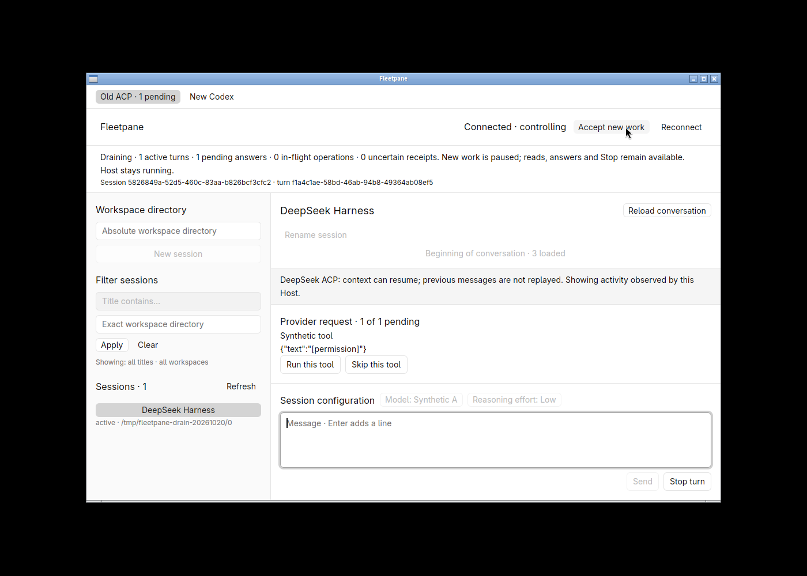
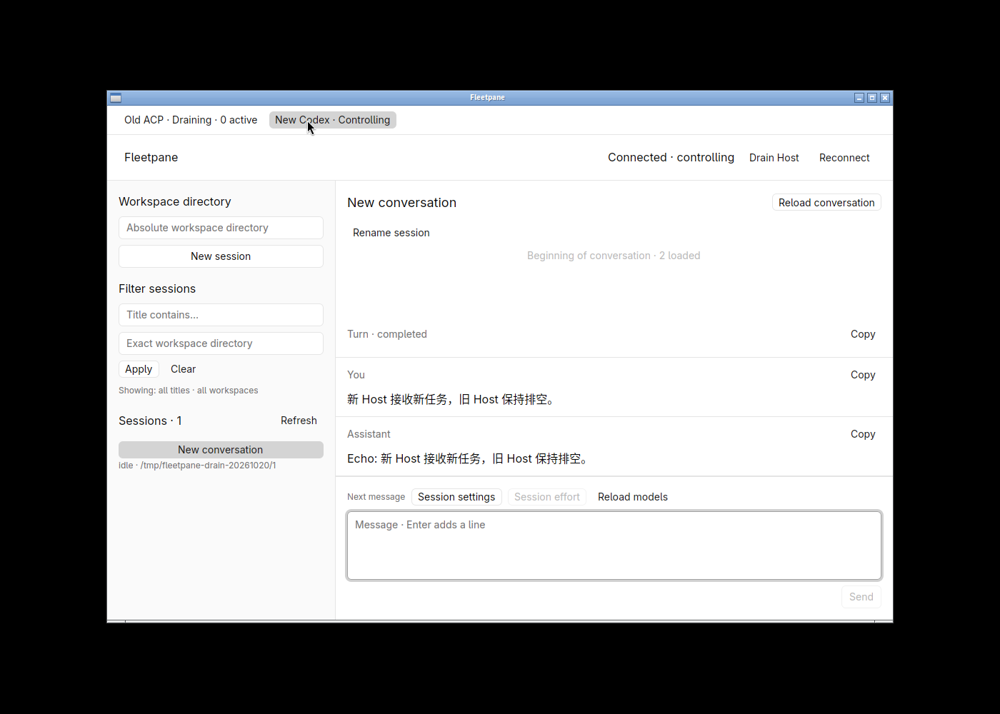
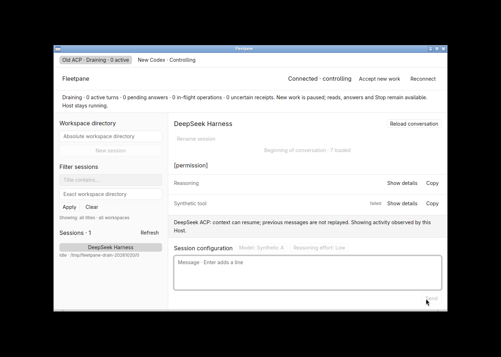

# Local Host admission drain verification

Date: 2026-10-20. Local uncommitted `feat/session-host-foundation` tree based on
`973b0ed883c25356a9f0849681333919d4497387`; Linux x86_64, Rust 1.98.1,
GPUI Kit 0.7.3 / engine 0.3.9, debug builds. This is admission drain acceptance,
not complete version migration, routing or automatic retirement. Semantics:
[ADR 0016](../adr/0016-persistent-host-admission-drain.md).

## Automated checks

```sh
cargo test --workspace --locked
cargo test --manifest-path apps/desktop/Cargo.toml --locked
cargo clippy --workspace --all-targets --locked -- -D warnings
cargo clippy --manifest-path apps/desktop/Cargo.toml --all-targets --locked -- -D warnings
cargo fmt --all -- --check
cargo fmt --manifest-path apps/desktop/Cargo.toml -- --check
uvx ruff check scripts
uvx ruff format --check scripts/drain-smoke.py scripts/runtime-smoke.py
cargo build -p fleetpane-host --locked
python3 scripts/drain-smoke.py
python3 scripts/runtime-smoke.py --codex --drain
python3 scripts/journal-smoke.py
```

65 workspace tests and four desktop tests pass. Lifecycle tests cover lease-
independent generation CAS, conservative mutation policy, exact activity identity,
idle-before/after-start ordering, malformed/capacity errors, migration and restart.
The admission-corruption regression failed before the fix: dropping a schema-2
admission table silently recreated ready state. Startup now rejects a missing
table, missing row or negative generation. Only new/schema-1 journals initialize
admission. Migration preserves operation outcomes and an established drain.

The two-Host process smoke runs separately for synthetic Codex and synthetic
ACP. It holds active work on the old Host, enters drain, replaces the controller,
rejects stale lease/generation, rejects new/create/resume/config/command/future
mutations without growing the journal, and retrieves the old UUID without replay.
Reads still work. Codex Stop or ACP permission decline completes the same turn
on unchanged processes. An independently ready Host finishes new work. Killing
and restarting the owned old Host changes incarnation but preserves drain;
explicit ready advances generation and permits new work. The CLI drain/ready
commands and multi-Host read-only probe are included. No automatic exit occurs.

Real Codex 0.163.0 is also exercised without a model request. A file-gated
`command/exec` child starts before controller replacement/drain; new execution
is refused, then the original child is released. Host/provider/child identities
stay unchanged, the command completes and appends exactly once. The separate
journal smoke checks durable receipts and conservative crash unknowns after the
schema migration. Test processes, sockets and temporary homes are cleaned up.

## Native window acceptance

An isolated 1400 × 1000 X11 workspace with software Vulkan rendered the native
1100 × 720 window. Two explicitly configured synthetic endpoints used private
homes under `/tmp/fleetpane-drain-20261020`; existing Paseo/Codex/DSH runtimes and
the user's visible desktop were not controlled. Local raw identity/stage receipt:
`/tmp/fleetpane-drain-20261020/receipt.json`.

Old ACP Host/provider PIDs were 2231176/2231178. Its active thread
`5826849a-52d5-460c-83aa-b826bcf3cfc2`, turn
`f1a4c1ae-58bd-46ab-94b8-49364ab08ef5` and permission ID 10 were unchanged by
**Drain Host**, with generation 1 saved on disk. The banner displayed one active
turn and one pending answer. New-session, rename/configuration and Send were
disabled; permission choices and Stop remained enabled. **Skip this tool**
settled the exact request/turn while the Host stayed draining and alive.



The New Codex tab retained separate control on PIDs 2231195/2231198. A Chinese
message sent through the composer completed on that Host, with exact readback.
The old Host remained draining. An early read before completion saw `inProgress`;
acceptance used the later completed result, not the initial read.



**Accept new work** explicitly reopened old admission at generation 2. A second
synthetic permission turn was started, then drained again at generation 3.
Native **Stop turn** produced an interrupted turn and removed its pending
request. The banner showed zero observed activity; the Host stayed running in
drain with the same identities. Zero is not proof that every descendant resource
has exited.



The window and isolated workspace were closed. Both owned Host/provider groups
were stopped and sockets removed; the receipt records cleanup completion.
The native interactions preceded the final storage-only corruption fix. Tests,
strict Clippy and process drain/journal/real-command checks were rerun afterward,
and the desktop rebuilt. No native controls or rendering changed in that fix.

## Acceptance limits

Native approval/Stop uses synthetic ACP; no live DeepSeek model turn or real
provider approval was requested for this slice. The real Codex test covers local
command execution, not LLM streaming. Both old/new test Hosts run the current
executable; this does not prove packaged mixed-version upgrades. There is no
automatic new-Host selection, runtime transfer, provider restoration, complete
tool/PTY resource ledger, supervisor, updater, power-loss proof, remote CI result
or new performance measurement. Admission mode survives a crash; active provider
state does not. Full donut-paseo parity remains open in [the inventory](../parity.md).
