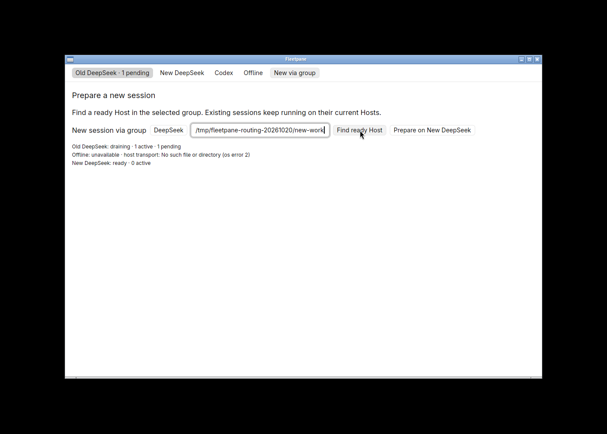
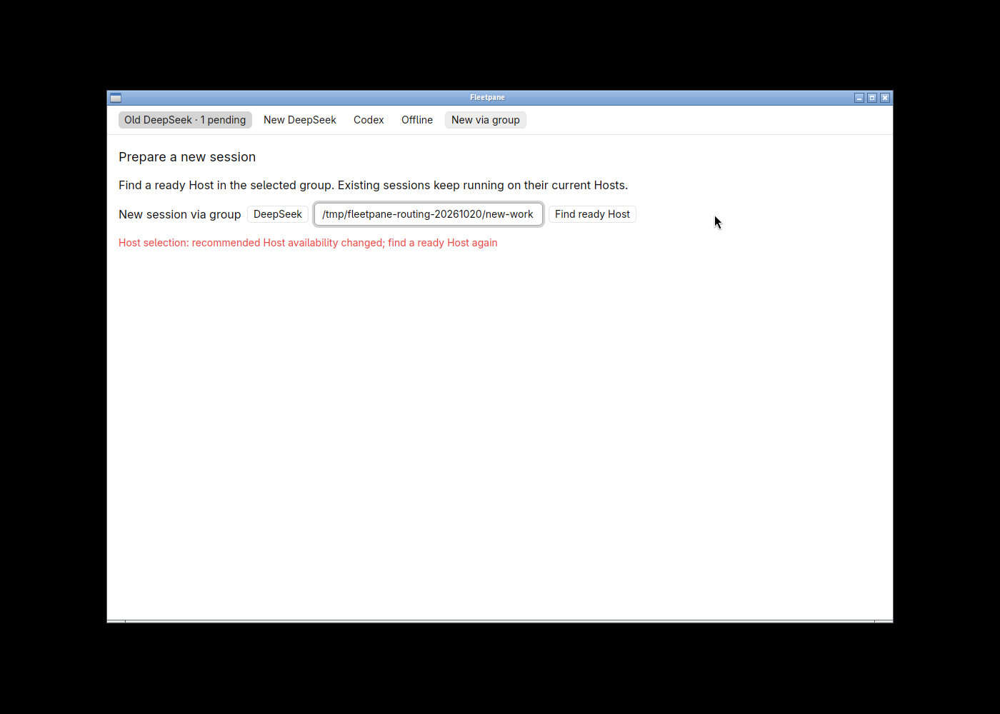
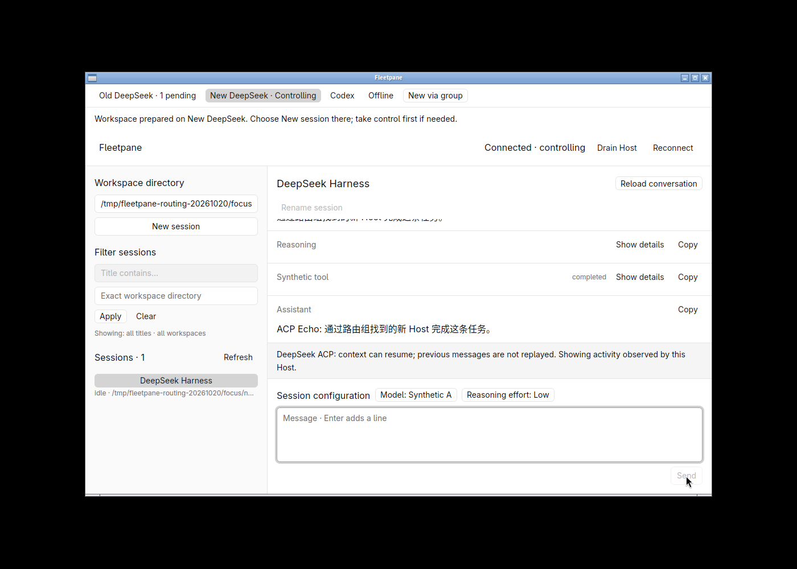
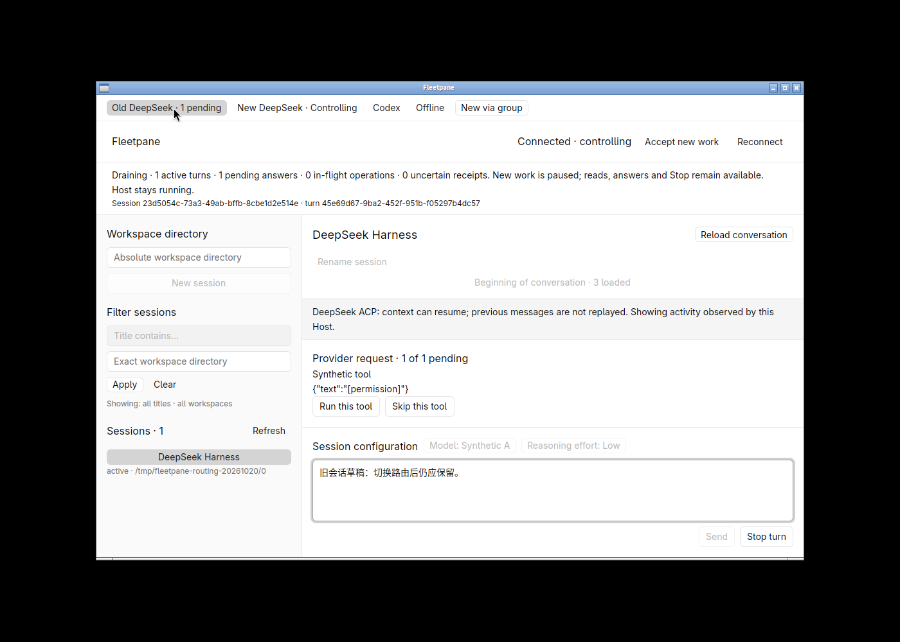
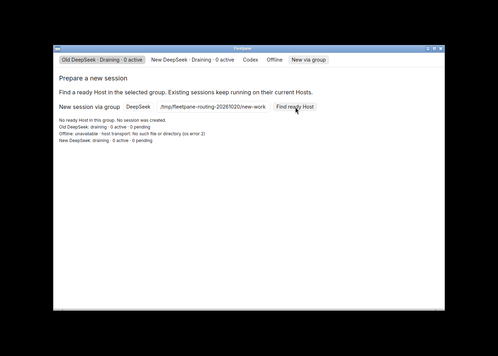
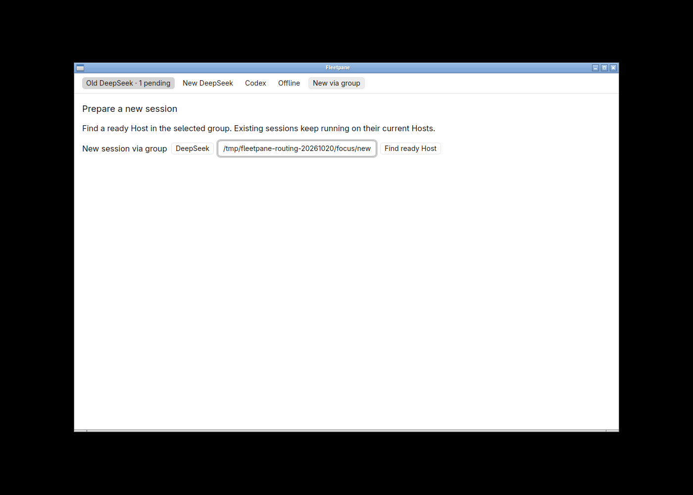

# Explicit ready-Host selection verification

Date: 2026-10-20. Local uncommitted `feat/session-host-foundation` based on
`973b0ed883c25356a9f0849681333919d4497387`; Linux x86_64, Rust 1.98.1,
GPUI Kit 0.7.3 / engine 0.3.9, debug builds. Decision:
[ADR 0017](../adr/0017-explicit-ready-host-selection.md). This accepts explicit
group recommendations and normal per-Host creation, not durable routing.

## Automated checks

```sh
cargo test --workspace --locked
cargo test --manifest-path apps/desktop/Cargo.toml --locked
cargo clippy --workspace --all-targets --locked -- -D warnings
cargo clippy --manifest-path apps/desktop/Cargo.toml --all-targets --locked -- -D warnings
cargo fmt --all -- --check
cargo fmt --manifest-path apps/desktop/Cargo.toml -- --check
uvx ruff check scripts
uvx ruff format --check scripts/routing-smoke.py
cargo build -p fleetpane-host --locked
cargo build --manifest-path apps/desktop/Cargo.toml --locked
python3 scripts/routing-smoke.py
python3 scripts/multihost-smoke.py
python3 scripts/drain-smoke.py
python3 scripts/session-smoke.py
```

68 workspace and four desktop tests pass. New domain tests cover explicit ordered
group membership/validation, priority, draining/faulted/offline candidates, no
ready result, stale incarnation/admission/fault checks and duplicate Host aliases.
Configurations without groups remain accepted. Unknown fields/members, repeated
members/names and excessive/invalid names fail validation.

`routing-smoke.py` starts two synthetic Codex Hosts and one synthetic ACP Host,
plus an offline endpoint. Every CLI recommendation is checked against readbacks:
no controller claim, receipt growth, admission change, pending-answer change or
Host/provider identity change. Draining the old Codex Host preserves its active
turn and selects the ready member. Explicit creation/send on that member finishes
while old work keeps its original identity. Draining both members produces no
target despite the independent ACP group being ready. A later create against the
drained target is refused without journal growth or cross-Host replay. Stop still
settles old work. Changing configuration priority is reflected in a new CLI
invocation. Two paths to one live Host are rejected. Provider exit is reported as
unavailable. All owned processes and sockets are cleaned up.

The multihost, drain and session smoke regressions also pass. Strict Clippy,
formatters and desktop tests were rerun after the final input-focus change. CI
configuration includes the new smoke on Unix; no remote CI run was performed.

## Native acceptance

An isolated 1400 × 1000 X11 workspace rendered the 1100 × 720 native window using
software Vulkan. Only owned synthetic endpoints and private homes were used.
Canonical local receipt: `/tmp/fleetpane-routing-20261020/receipt.json`; final
focus/creation recheck: its `focus/receipt.json`. Existing Paseo, DSH and Codex
processes and the user's visible desktop were not controlled.

Initial old ACP Host/provider PIDs were 3657128/3657132; new ACP 3657150/3657166;
independent Codex 3657173/3657181. The old ACP Host was draining with permission ID
10 on thread `23d5054c-73a3-49ab-bffb-8cbe1d2e514e`, turn
`45e69d67-9ba2-452f-951b-f05297b4dc57`. The configured DeepSeek group ordered old,
offline, new endpoints; Codex had its own explicit group.

**New via group** showed a separate chooser while old view polling continued.
The input accepted the workspace path. **Find ready Host** displayed old draining
with one active/pending request, the offline error, and new ready. The new Host
still had no controller or receipt. Preparing after an external drain refused
the stale recommendation and did not create work, transfer ownership or answer
the old request. After explicitly reopening the new endpoint, finding/preparing
again selected its tab and copied the exact directory. Its existing controller
required explicit **Take control**, then **New session** created one ACP session.





A Chinese message completed through the new session composer with exact bounded
history readback. The independent Codex journal remained empty. Returning to the
old tab showed its retained Chinese draft and the same pending permission;
**Skip this tool** completed that original turn on unchanged processes.





After draining both ACP endpoints, the DeepSeek chooser displayed **No ready Host
in this group** and no prepare button. The ready Codex endpoint was not selected.
Changing the group explicitly through its native menu then recommended Codex,
without creating or claiming it. Closing/reopening the window reloaded the same
groups and observed the same processes/drain states; a new DeepSeek probe again
reported no target. Drafts/results are not persisted by this feature.



## Focus regression and final recheck

Before the focus fix, opening the chooser and pasting without first clicking its
directory input left that input empty. The old draft remained intact, but the
pasted directory was lost. The root cause was opening a new screen without
assigning focus to its input. Opening now explicitly focuses the chooser input;
normal Host selection restores composer focus. Repeating the exact sequence
placed the path in the directory field and left the old draft unchanged.



The final build was retested in a second owned workspace, with old ACP PIDs
3760649/3760660, new ACP 3760669/3760717, independent Codex 3760763/3760822 and
desktop 3782862. It again passed read-only recommendation, stale refusal,
prepare/take-control/create, completed new message, old pending isolation and
old permission answer. All windows, owned Host/provider groups and isolated
workspaces were closed; owned sockets were removed.

## Limits

This slice makes no external model requests. ACP/Codex providers in these tests
are synthetic; previous live-provider evidence is separate. Groups declare user
intent and do not verify accounts/credentials/provider equivalence. A ready
recommendation is a snapshot, not a reservation; the Host admission gate handles
submission races. A generation change observed before preparation is rejected,
but there is no atomic cross-Host admission or persistent ownership table. Late
read-result UI guards were code-reviewed; a deliberately stalled native probe
was not separately exercised. No automatic session creation/failover, runtime
migration, provider launch/recovery, remote transport, resource-complete
retirement, packaged update or new performance measurement is claimed.
