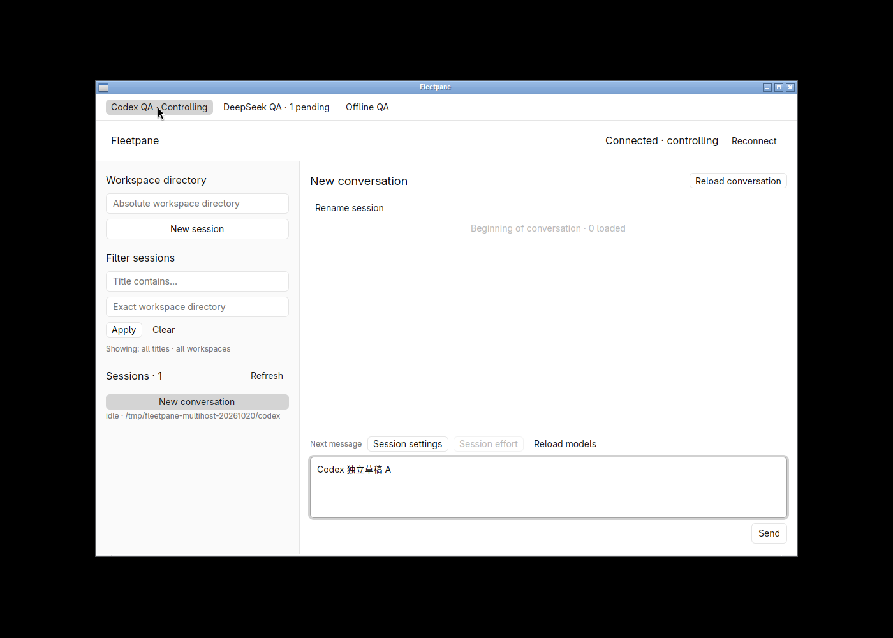
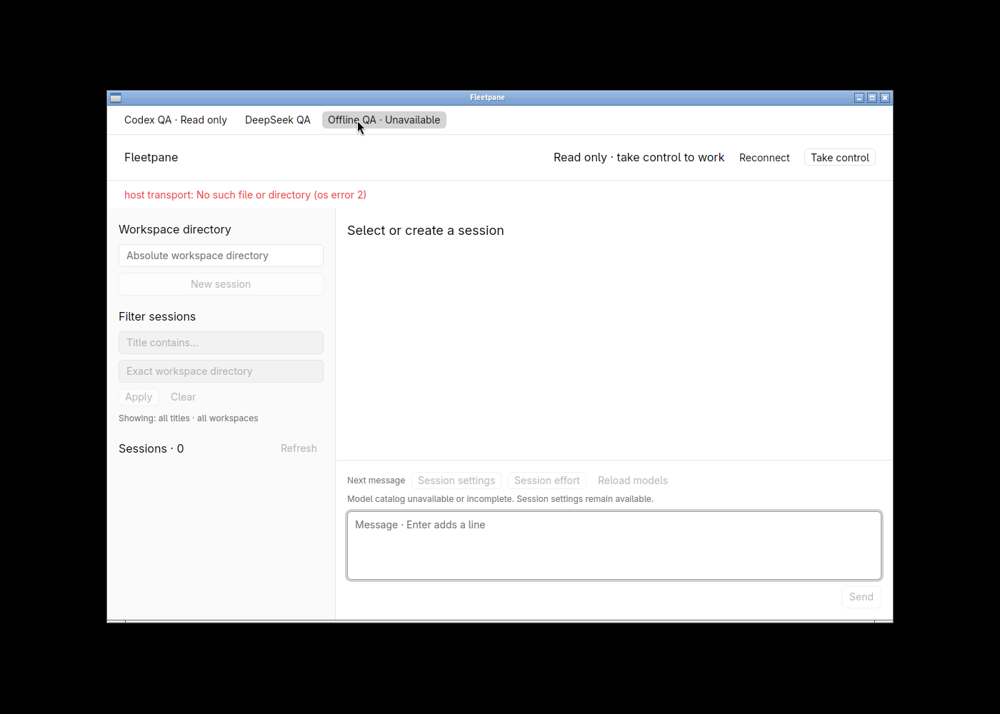
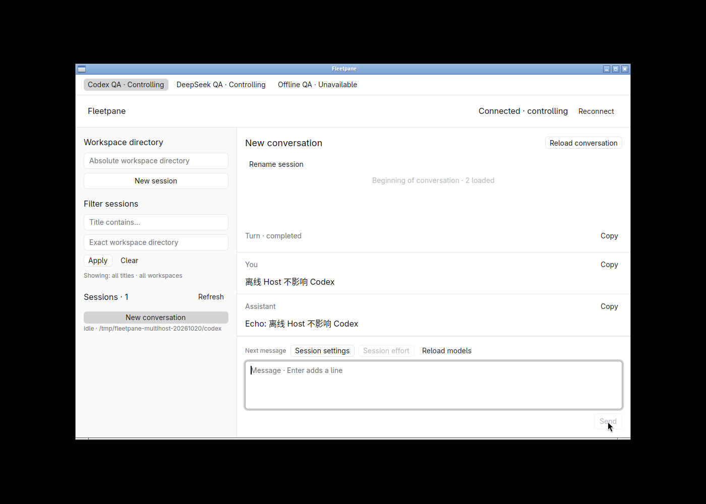
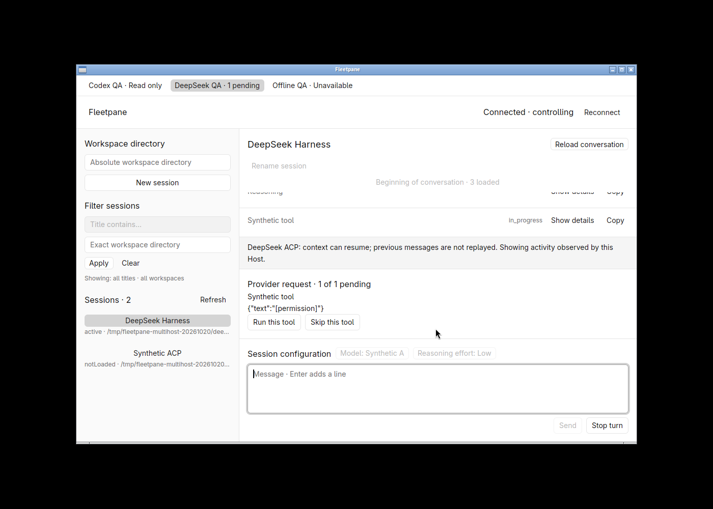
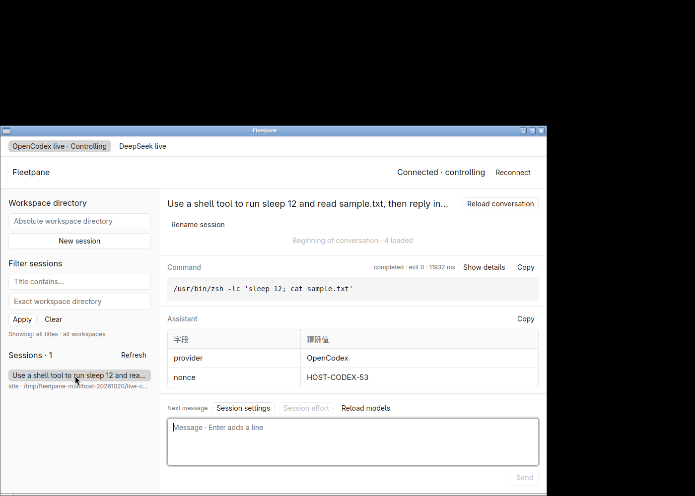
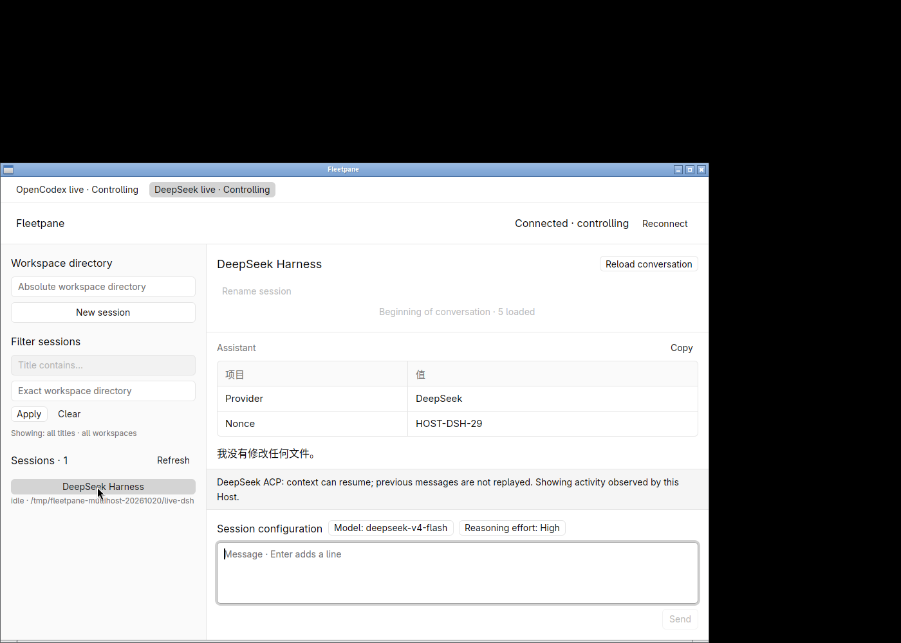

# Native local multi-Host workbench — 2026-10-20

Local changes on `973b0ed883c25356a9f0849681333919d4497387` plus the existing
uncommitted foundation. Rust 1.98.1, GPUI Kit 0.7.3, Linux X11/software Vulkan,
1100 × 720 windows in the hidden `fleetpane-multihost-20261020` workspace.
Public screenshots contain synthetic workspaces/prompts. No existing user
sessions or shared provider runtimes were restarted, adopted or modified.

## Behavior and process checks

Previously `--host` selected one socket and one native view. `--hosts FILE` now
uses a shared validated configuration and retains a distinct native `HostView`
for each named endpoint. New views connect lazily, read snapshots and require
explicit takeover when a controller already exists. Selecting an initialized
Host neither claims ownership nor resumes its selected session. Opened views
keep their bounded background polls while only the selected view renders.

`scripts/multihost-smoke.py` starts two synthetic Codex Hosts, two ACP Hosts and
an unavailable endpoint. Read-only probes return configuration-order snapshots
and errors without claiming any lease. The Codex fixtures deliberately emit the
same thread and turn IDs; each history contains only its own Host's text. Both
ACP fixtures emit permission ID `10`; rejecting one leaves the other unchanged.
A lease from another Host is rejected even when provider IDs match.

After one task-owned Host is stopped, the report marks only that Host unavailable
and a surviving Host accepts/completes another turn with unchanged Host/provider
PIDs. Unknown configuration versions and duplicate entries fail explicitly.
The process check is included in Unix CI; remote CI was not run here.

## Native checks

The window showed Codex, DeepSeek and Offline tabs. Before selecting DeepSeek,
its view was not initialized. Selecting it first showed read-only state; taking
control was explicit. No provider process was started by the desktop.

A Chinese Codex draft, `Codex 独立草稿 A`, remained after selecting DeepSeek and
returning. Native Ctrl+A/C read back exactly that draft. Hidden DeepSeek received
a permission request and its tab displayed **1 pending** while Codex's composer
remained focused with its own draft. Returning to DeepSeek showed the original
request and exact provider-offered choices. Selection uses separate entity state
and changes input focus, rather than reusing the previous Host's input object.



Selecting an unavailable socket showed its own transport error. Returning to
Codex and sending `离线 Host 不影响 Codex` produced the exact synthetic echo with
the original Codex Host/provider PIDs. The unavailable endpoint remained labelled
separately; no global busy/error state blocked the healthy Host.




Manual permission QA exposed the fixture's artificial 45-second timeout: its
thread raised without settling the prompt if a human took longer to answer.
The fixture now waits for an explicit response or cancellation, matching the
intended pending-request lifecycle; process-test deadlines still bound tests.
An owned fixture Host was replaced to load that correction. A new request stayed
pending for **72 seconds**, then native **Skip this tool** cleared it with no Host
fault and the same provider PID. This was fixture maintenance, not evidence of a
production adapter timeout fix or live runtime migration.



## Real OpenCodex and DeepSeek

Dedicated provider homes and synthetic workspaces were created. Codex 0.163.0
used the already-serving OpenCodex proxy at loopback port 10100 and an isolated
configuration/public model catalog; no Codex credentials or user sessions were
copied. DeepSeek Harness 0.2.0-rc.2 used a temporary 0600 credentials copy in an
independent `DSH_HOME`. The shared OpenCodex service was neither restarted nor
reconfigured.

Both Hosts completed external model turns using a shell tool to sleep/read
`sample.txt`, then rendered Chinese Markdown tables in the same native window.
OpenCodex returned `HOST-CODEX-53`; DeepSeek returned `HOST-DSH-29`. Shared paged
reads verified each expected nonce and absence of the other Host's nonce, with
four and five entries respectively. Both native table and command/tool rendering
were visually inspected.




A second real DeepSeek prompt requested a 15-second shell sleep. Immediately
after the native send and switch to OpenCodex, a read-only metadata query still
showed that exact DeepSeek turn **inProgress**. It subsequently completed with
`DeepSeek 后台任务完成`; Host and provider PIDs remained unchanged. Closing the
desktop also left both independently managed Hosts available. This establishes
covered local selection/continuity behavior, not version drain or crash recovery.

## Checks and limits

Passed commands:

```sh
cargo test --workspace --locked -j2
cargo clippy --workspace --all-targets --locked -j2 -- -D warnings
cargo fmt --all -- --check
cargo test --manifest-path apps/desktop/Cargo.toml --locked -j2
cargo clippy --manifest-path apps/desktop/Cargo.toml --all-targets --locked -j2 -- -D warnings
cargo fmt --manifest-path apps/desktop/Cargo.toml -- --check
uvx ruff check scripts/acp-fixture.py scripts/multihost-smoke.py
uvx ruff format --check scripts/acp-fixture.py scripts/multihost-smoke.py
python3 scripts/multihost-smoke.py
python3 scripts/session-smoke.py
python3 scripts/acp-smoke.py
python3 scripts/acp-history-smoke.py
python3 scripts/query-smoke.py
python3 scripts/codex-history-smoke.py
```

Workspace tests: **57**; desktop tests: **4**. Both native and Host binaries built.
The Codex history regression used the real Codex binary and a local SSE model;
it does not establish an external model turn by itself. The separate real
provider checks above used external models. Invalid version, conflicting modes
and repeated `--host` flags also exited with code 2 before GUI startup.

This slice does not implement durable routing/recovery, Host launching, account
setup, remote transport, session migration or version drain. Configuration and
drafts are not persisted by the desktop; the JSON file is read only at startup.
Existing per-Host journal/cache limits remain, including 128 lifetime mutations.
No eight-Host memory/performance budget, other-OS native acceptance, long soak,
remote CI or complete donut-paseo replacement is claimed.
