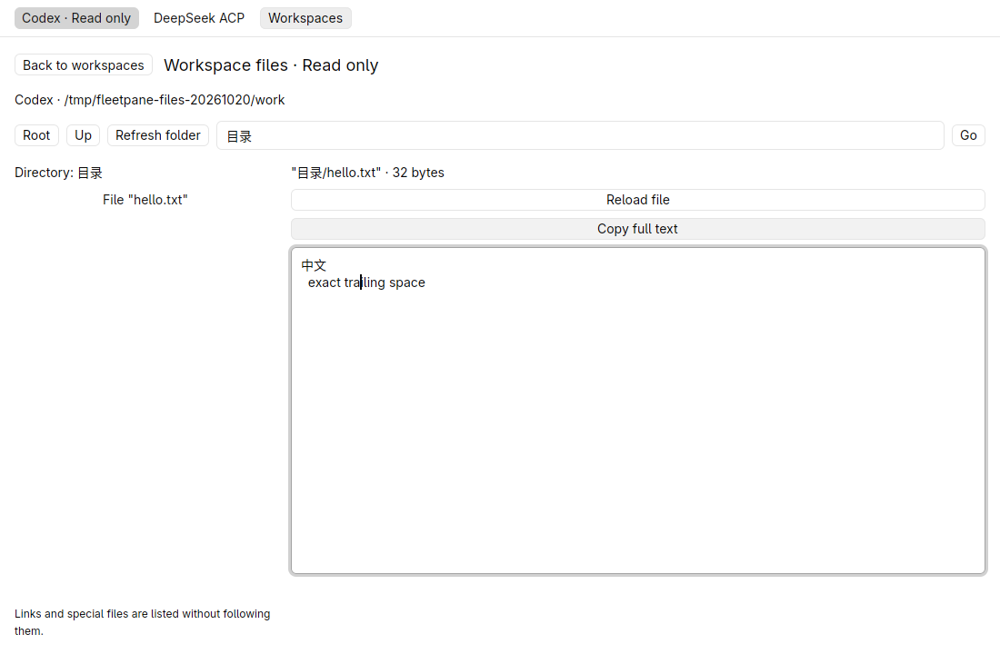
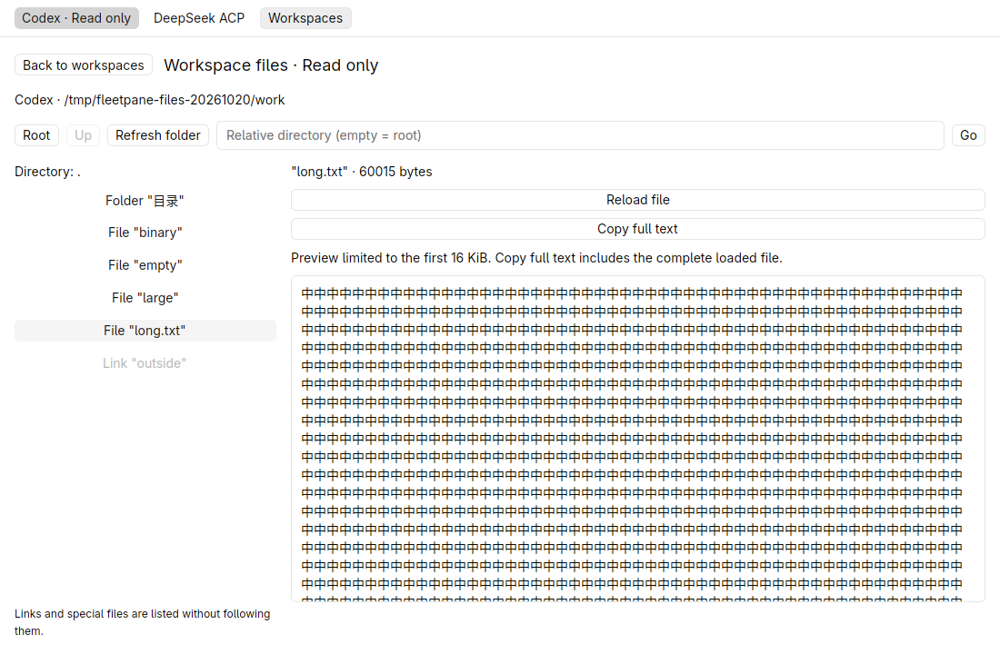
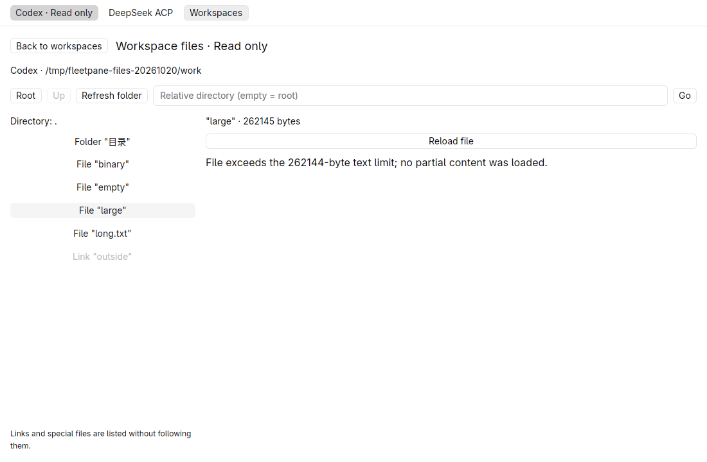
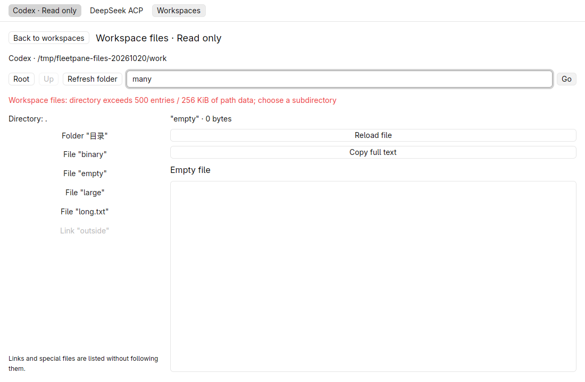
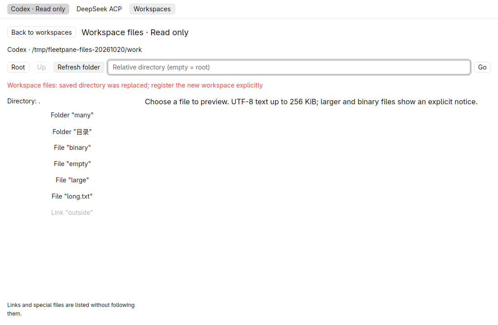
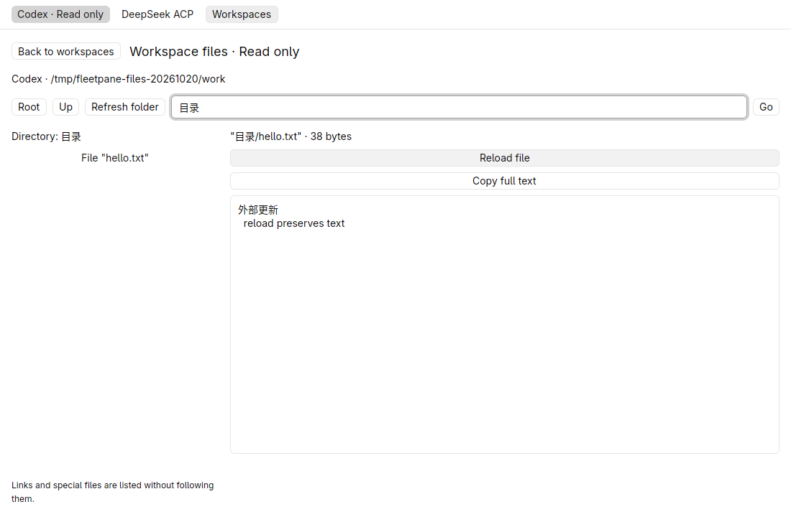

# Read-only workspace files — 2026-10-20

Local uncommitted changes based on `c91d269247207a08898e264c81083df4fbd4e745`,
including the preceding active-turn and pin slices. Rust 1.98.1 development builds,
GPUI Kit 0.7.3, Linux X11/software Vulkan, isolated 1100 × 720 native window.
New changes have local acceptance only; the passing foundation CI excludes them.
No Windows/macOS native or real-model acceptance is claimed for this slice.

## Shared engine and process proof

The GUI and CLI use the same workspace listing/read methods. Single-directory
listing is bounded to 500 entries / 256 KiB path data and rejects unsupported
non-UTF-8 names explicitly. Text reads retain exact bytes as UTF-8 up to 256 KiB.
Binary and larger files return distinct notices. Root identity and relative
descriptor walks reject parent traversal, symlinks, special files and replaced
directories. Reads recheck file metadata and identity. These observations are
not atomic snapshots or locks. See [ADR 0026](../adr/0026-read-only-workspace-files.md).

Passed commands:

```sh
cargo test --workspace --locked -j2
cargo clippy --workspace --all-targets --locked -j2 -- -D warnings
cargo build -p fleetpane-host --locked -j2
cargo fmt --all --check
cargo clippy --manifest-path apps/desktop/Cargo.toml --all-targets --locked -j2 -- -D warnings
cargo test --manifest-path apps/desktop/Cargo.toml --locked -j2
cargo build --manifest-path apps/desktop/Cargo.toml --locked -j2
cargo fmt --manifest-path apps/desktop/Cargo.toml --check
python3 scripts/files-smoke.py
python3 scripts/workspace-pins-smoke.py
uvx --offline ruff check scripts/
uvx --offline ruff format --check scripts/files-smoke.py
git diff --check
```

Root tests: 99; desktop tests: 5, 104 total. Four new engine tests cover exact
multiline/CRLF/Chinese/newline names, directory ordering and repeated listing,
binary/empty/large content, invalid paths, symlinks/FIFO, root replacement,
non-UTF-8 names, 501-entry refusal and bounded workers. The worker test blocks
both permits, verifies the five-second errors do not free occupied slots, releases
them, and then times out work inside a separately created/dropped Tokio runtime.
Runtime destruction returns before that OS worker is released; subsequent work
recovers after release. This uses controlled blocking channels, not a hung real
network filesystem. The desktop test verifies UTF-8 preview truncation without
modifying the original text.

The process smoke registers two Host bindings to a real Git workspace while
private Codex/ACP fixture turns remain active. It observes exact nested text,
long/empty/binary/large files, dotfiles, symlinks, FIFO, invalid traversal,
directory/name bounds and replaced roots. Rejected reads do not poison later
reads. All regular file hashes, including Git metadata, remain unchanged;
complete Host snapshots remain equal. The existing workspace-pin process smoke
also passes. The new file smoke is added to local Unix CI configuration.

## Native acceptance

The hidden native window used a registered ordinary directory while two owned
Codex/ACP fixture Hosts ran active turns. **Browse files** opened the root,
**Folder "目录"** navigated into it, and the text row displayed Chinese multiline
content. Pasting `MUST-NOT-EDIT` into the read-only preview changed neither its
display nor file bytes. **Copy full text** returned the original 32 bytes exactly,
including CRLF, indentation, trailing whitespace and final newline.



A 60,015-byte Chinese file displayed the explicit 16 KiB preview notice. Clipboard
readback equalled the entire original text and included its `FULL-COPY-END` marker.
Binary, empty and 262,145-byte files displayed their distinct messages. Link rows
were disabled. A 501-entry directory returned a visible error, leaving the last
successful directory labelled and usable.





Replacing the saved root with a new directory made **Refresh folder** fail with
an identity error; none of the replacement contents appeared. Restoring the
original root allowed refresh/navigation again. A controlled external edit was
visible after **Reload file**, and clipboard readback preserved its new CRLF text.
The test restored the original bytes and removed its added capacity-test folder;
all original file hashes then matched the initial receipt.




Both complete Host snapshots stayed equal throughout, including ownership,
admission, journal/events and Host/provider process identities. The native
window, hidden workspace and two owned Hosts/providers were stopped afterward;
their sockets were removed. No shared runtime was used or restarted. Selected
synthetic proof, artifact hashes and cleanup are in the
[receipt](assets/files/receipt.json).

File selection/navigation is transient. Editing, conflict-aware save, recursive
trees, live watchers/search, syntax highlighting, media and larger-file streaming
remain open. No Git Diff feature work was included. Unix descriptor APIs compile
on the covered Linux setup; remote macOS checks have not run on these changes.
