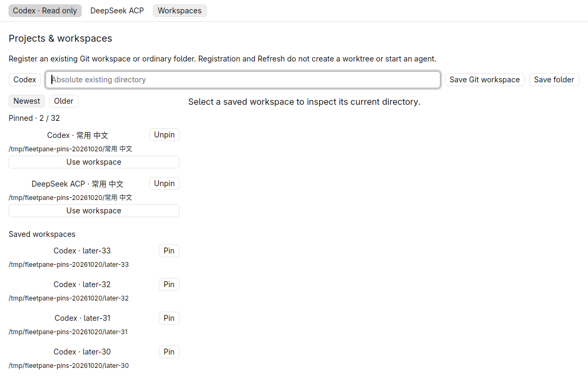
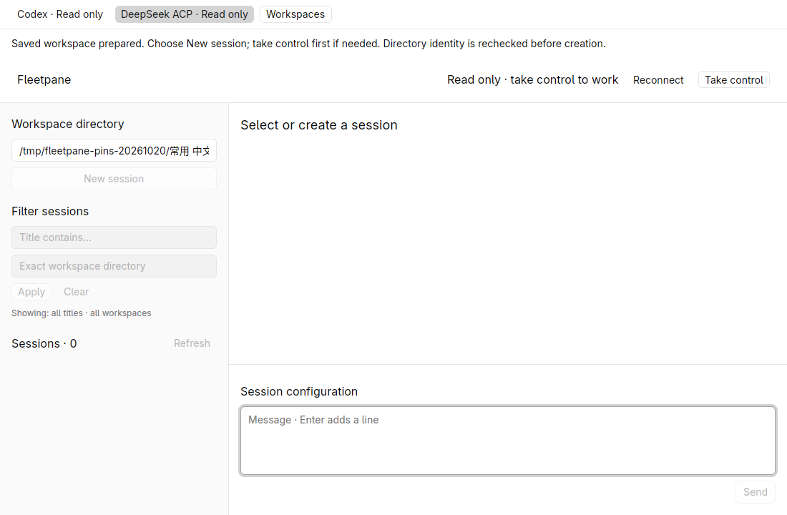
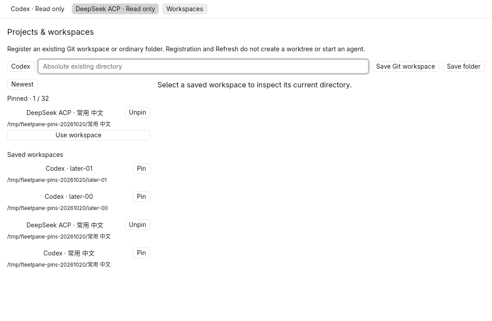
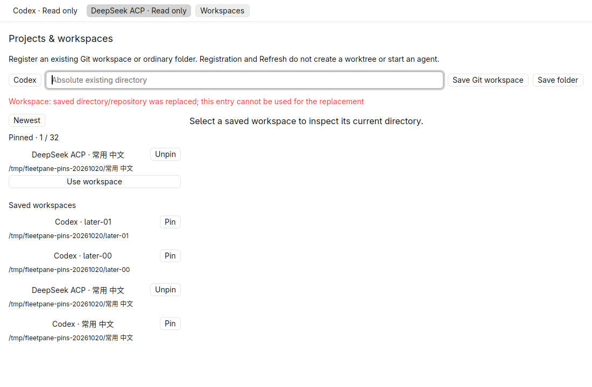

# Workspace pins — 2026-10-20

Local uncommitted changes on `c91d269247207a08898e264c81083df4fbd4e745`,
including the previous active-turn follow-up slice. Rust 1.98.1 development builds,
GPUI Kit 0.7.3, Linux X11/software Vulkan, isolated 1100 × 720 native window.
The previously pushed foundation has passing remote CI; these new pin changes
have local evidence only. No macOS/Windows native acceptance or performance
comparison is claimed.

## Engine and process evidence

Pins reference stable workspace IDs, retain insertion order on repeated explicit
sets and remain independent of the newest/older 32-record catalog pages. Two
Hosts can pin the same canonical directory independently. Unpin deletes only the
preference, without modifying workspace identity or directory contents. There
are at most 32 pins; the SQLite write transaction serializes capacity checks.
The GUI applies only the committed result. The local controller state upgrades
from schema 4 to 5; older creation/workspace/worktree migrations and draft
revisions remain covered. See [ADR 0025](../adr/0025-local-workspace-pins.md).

Passed commands:

```sh
cargo test --workspace --locked -j2
cargo clippy --workspace --all-targets --locked -j2 -- -D warnings
cargo build -p fleetpane-host --locked -j2
cargo fmt --all --check
cargo clippy --manifest-path apps/desktop/Cargo.toml --all-targets --locked -j2 -- -D warnings
cargo test --manifest-path apps/desktop/Cargo.toml --locked -j2
cargo build --manifest-path apps/desktop/Cargo.toml --locked -j2
cargo fmt --manifest-path apps/desktop/Cargo.toml --check
python3 scripts/workspace-pins-smoke.py
python3 scripts/drafts-smoke.py
python3 scripts/creations-smoke.py
python3 scripts/workspaces-smoke.py
python3 scripts/steering-smoke.py
uvx --offline ruff check scripts/
uvx --offline ruff format --check scripts/workspace-pins-smoke.py
git diff --check
```

Root: 95 tests; desktop: 4 tests, 99 total. Three new engine tests cover
idempotent ordering, Host separation, reopen, unknown-ID refusal, off-page pins,
35 concurrent capacity contenders and transactional schema-4 upgrade without
changing saved draft bytes. A missing versioned pin table is rejected explicitly.

The process smoke starts private Codex and ACP fixture Hosts with active turns,
saves exact multiline drafts, registers 36 real folders/Host bindings and pins
entries outside the newest page. Separate CLI processes observe persisted pins;
four concurrent processes setting the same pin retain one entry and its order.
Unpin, unknown-ID failures and a replaced directory preserve both exact drafts
and both complete Host snapshots. No ownership, admission, journal entry, event,
provider PID or turn changes. The smoke cleans up its Hosts and is included in
the local Unix CI workflow. Creation, workspace catalog, draft and follow-up
process regressions pass after the state-store upgrade.

## Native acceptance

The isolated desktop started read-only against two separately owned active
fixture Hosts. Both had an older saved entry for the same Chinese directory,
behind the newest 32 catalog records. Native clicks pinned ACP and Codex
independently, retained each ordinary catalog entry and exposed both shortcuts
after returning to **Newest**. A normal close and replacement of the window
restored both pins and their exact order. Complete Host snapshots before and
after were equal.




Clicking **Use workspace** on the ACP shortcut selected the ACP Host and filled
the correct directory. The window remained read-only, created no session and
preserved both Host snapshots. It prepares the existing new-session flow; it
does not reopen or select an existing conversation.



Unpinning Codex left ACP pinned and the original Codex entry available with a
**Pin** button on its older catalog page. Replacing only the synthetic saved
directory made **Use workspace** fail visibly; the pin remained saved and no
Host state changed. The original synthetic directory was then restored.




The [public synthetic receipt](assets/workspace-pins/receipt.json) records source
and binary hashes, selected identities, readback and cleanup. Both desktop
processes, the hidden workspace and the two owned Hosts/providers were stopped;
their sockets were confirmed removed. No user Paseo/Codex/DSH process was adopted
or restarted. Real model inference is not needed for this controller preference;
real-provider pin coexistence has not been separately accepted. Workspace tabs,
drag ordering, pin shortcuts, selection restoration and live preference broadcasts
remain open. Git Diff behavior was not extended.
