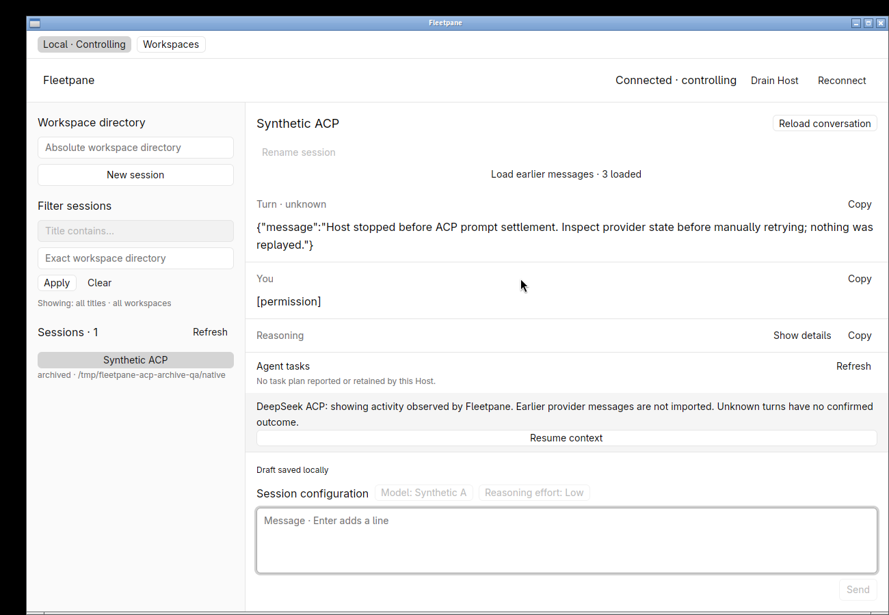
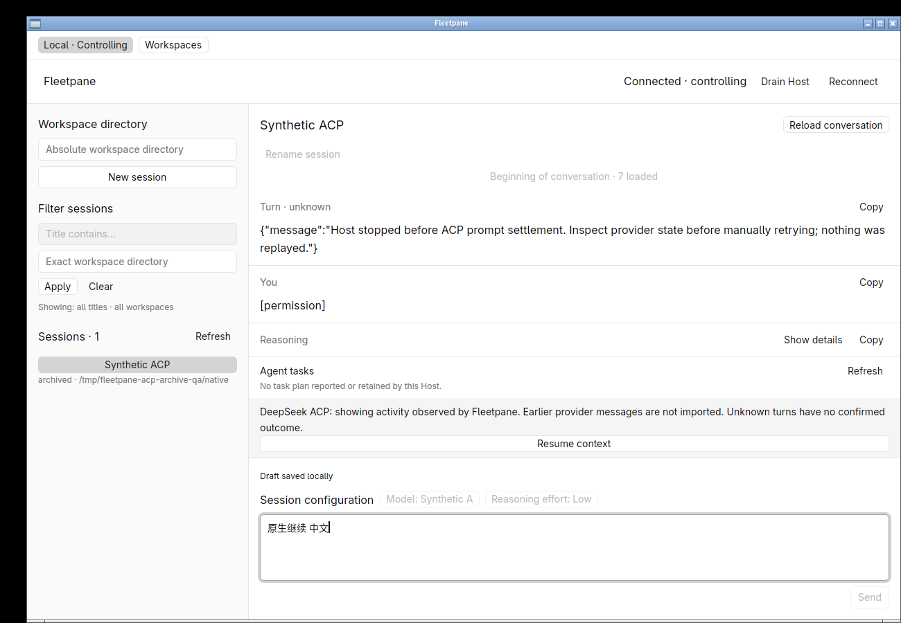
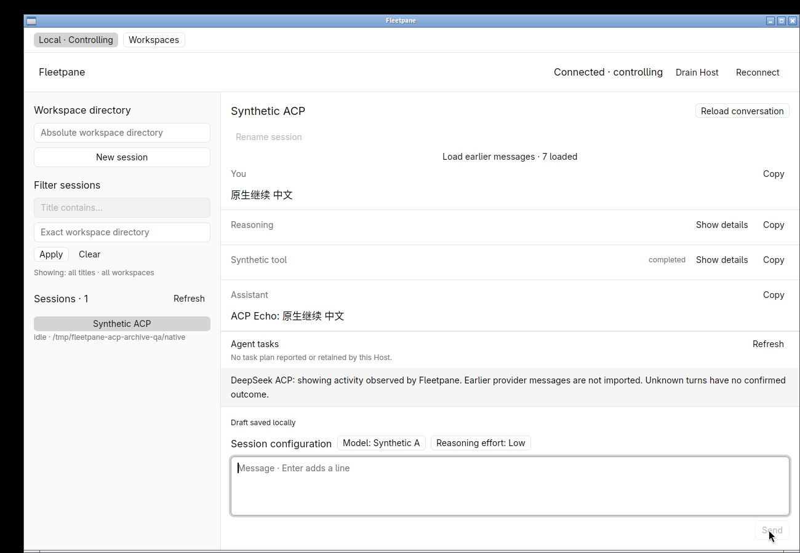
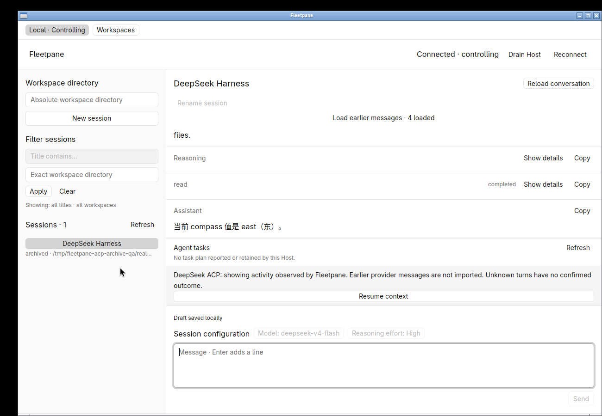
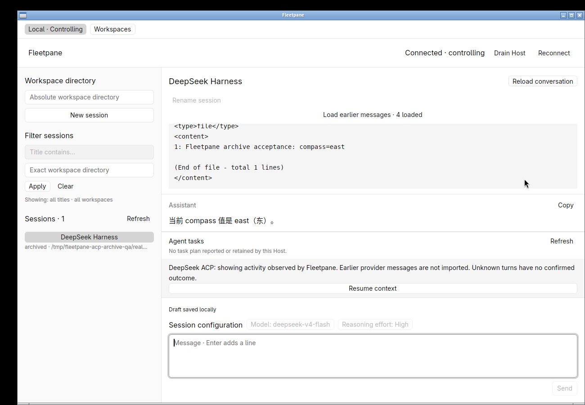
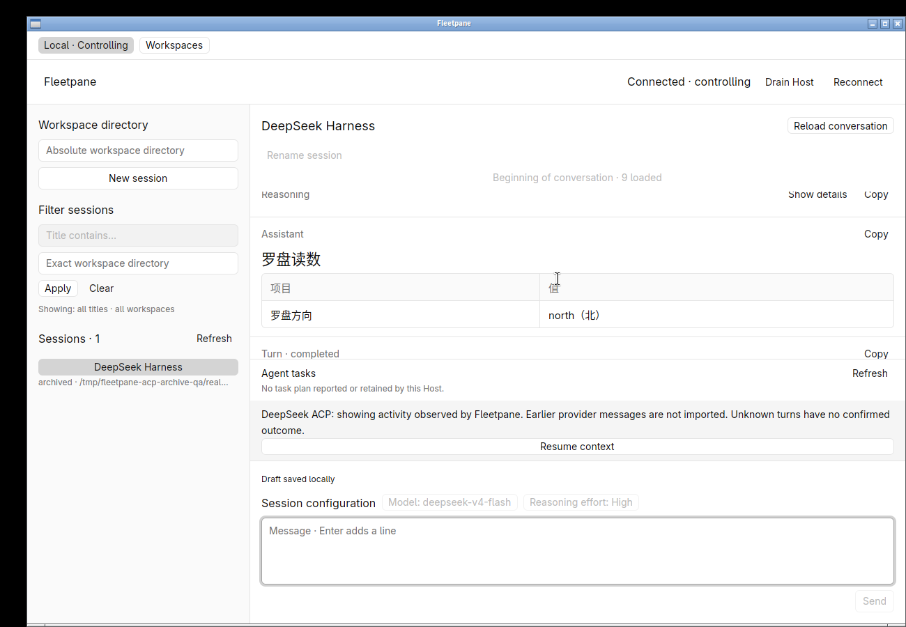
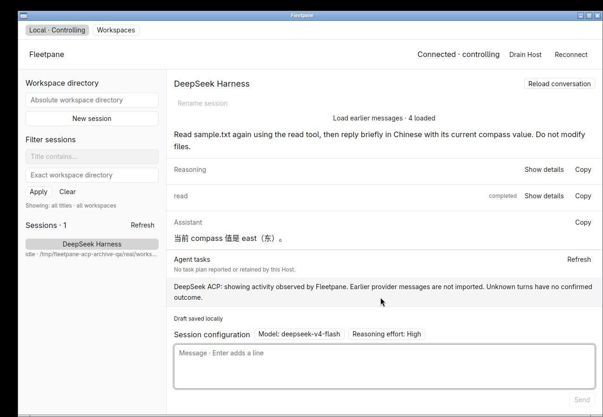

# Observed ACP history across Host restart — 2026-10-21

Uncommitted work based on `c91d269247207a08898e264c81083df4fbd4e745`.
Linux X11, software Vulkan, development builds and GPUI Kit 0.7.3.
This is covered local acceptance, not a replacement release or remote CI result.
[Receipt](assets/acp-archive/receipt.json) binds source, final binaries and evidence.

## Behavior and root cause

The adapter previously retained observed ACP messages/tools only in memory.
The pre-change process smoke explicitly confirmed that resuming after a Host
restart returned zero turns. The previous binary/source identity and baseline
result are retained. ACP context resume itself does not replay prior messages.

Schema-3 Host journals now save session metadata, turn metadata and individual
items transactionally before translated requests or observed events are emitted.
Updates preserve insertion order and rewrite the affected item, not earlier
turns. Recovery reconstructs bounded observed history independently of provider
residency. Session selection browses an `archived` record; **Resume context** must
succeed before sending/configuring. Metadata-only resume retains old items while
omitting them from that response. Explicit full reads keep frame-limit refusal.

Unsettled turns become `unknown`, with an explanation. Pending permission/RPC
state is not restored and no prompt is replayed. Failed resume retains history;
concurrent resume is refused. Archive failure fences Host writes before an
unsaved event is published. v1/v2 migration preserves admission/receipts; a current
missing, invalid or oversized archive is an error. See [ADR 0031](../adr/0031-durable-observed-acp-history.md).

## Commands and process verification

Passed 112 root Rust tests and 8 desktop tests. New regressions cover updated-item
scope, exact history and unknown outcomes, ephemeral permissions/residency,
failed/duplicate resume, large-history response limits, orphan/identity damage,
atomic upserts/order/accounting, migration and corruption/size refusal.

```sh
cargo test --workspace --locked
cargo clippy --workspace --all-targets --locked -- -D warnings
cargo build -p fleetpane-host --locked
cargo test --manifest-path apps/desktop/Cargo.toml --locked
cargo clippy --manifest-path apps/desktop/Cargo.toml --all-targets --locked -- -D warnings
cargo build --manifest-path apps/desktop/Cargo.toml --locked
cargo clippy --workspace --all-targets --locked --target x86_64-pc-windows-gnu -- -D warnings
cargo fmt --all --check
cargo fmt --manifest-path apps/desktop/Cargo.toml --check
git diff --check
python3 scripts/acp-smoke.py
python3 scripts/acp-history-smoke.py
python3 scripts/acp-archive-smoke.py
python3 scripts/journal-smoke.py
python3 scripts/terminal-smoke.py
python3 scripts/concurrency-smoke.py --output /tmp/fleetpane-acp-archive-concurrency.json
```

The new archive smoke uses private Host/provider process groups and two sessions.
It kills the first group with SIGKILL during a pending permission, restarts against
the same journal and checks exact old items/order, unknown status, empty pending
requests, stale-cursor refusal, inactive-send refusal and independent other-session
history. Explicit resume and one new prompt preserve old turns without replay.
An injected SQLite trigger then rejects an assistant item write: Host scope is
fenced and that item never appears in published events or the archive. Restart
retains the last accepted input as unknown. Damaged known history refuses startup.
All six recorded Host/provider PIDs are absent; each normal stop removes its socket.

Existing history smoke still traverses 1,449,683 bytes in 26 entries through six
byte-bounded pages. Journal smoke retains 302 exact side effects/receipts; real
PTY regression covers both Codex and ACP fixtures and storage/provider faults.
Twenty concurrent synthetic ACP streams remain correct: 19 completed, one
interrupted, exact text and one execution each. Snapshot-plus-metadata p95 was
389.676 ms for this development run. The combined sampled process RSS was
52,976 KiB. The workload includes Python fixture/probe processes and concurrent
machine activity; this is neither a UI latency measurement nor an incumbent
comparison. No performance improvement is claimed.

## Native and real DeepSeek acceptance

A private fixture Host completed a Chinese/Markdown turn, then stopped during an
unanswered permission. The native window browsed the resulting archive, paged to
the beginning, rendered completed and unknown status, inspected old tools and
copied the original user text exactly (32 UTF-8 bytes). There was no live approval
panel for the old request. Draft entry remained possible while Send was disabled.
**Resume context** preserved that draft without sending it; one manual Send then
produced one new completed Chinese turn, cleared the draft and retained old items.
Same-user CLI readback confirms the two prior item arrays and one new execution.





An independently owned installed DSH 0.2.0-rc.2 used a private home and temporary
credential-store copy, with no adopted user session, profile or shared process.
The default advertised model was deepseek-v4-flash at High effort. A real model
turn read synthetic `sample.txt` (`compass=north`) and returned Chinese Markdown.
After stopping that completed Host/provider, the next Host browsed exactly the
same observed items before resume, resumed explicitly, then completed a second
real `read` turn after the file changed to `compass=east`. The prior turn remained
identical. Both actual tool calls report completed; readbacks are retained.

The final recorded Host/desktop binaries additionally reopened this real saved
conversation in a new hidden desktop. Before context resume, the native view
showed the saved completed `read`, its original output and Chinese answer with
Send disabled. Tool Copy exactly matched the saved record (619 UTF-8 bytes). Paging to the
beginning rendered the original Chinese heading and Markdown table. Clicking
**Resume context** changed the session to idle; CLI readback still contained the
exact same two turns with no new prompt. All owned Host/provider/desktop processes
were then removed, their control sockets disappeared and the task-created DSH
home containing the temporary credential copy was deleted.
This final artifact check is distinct from the earlier fixture interaction run;
the only later Linux source changes between those runs were test additions and
Unix gating of the journal-specific archive code. Windows cross-target Clippy
covers compilation only; it is not Windows runtime or desktop acceptance.






## Limits and continuation

No DSH private transcript import, active-process takeover or uninterrupted Host
upgrade is implemented. Archived tool status preserves its last observation;
`in_progress` in an unknown turn is not a claim of live execution. Plans remain a
transient cache. The existing 64-session, 500-turn/item, 2-MiB per-session and
8-MiB adapter bounds remain; archive rows/identity bytes are capped separately at
64,064 rows / 16 MiB. There is no eviction, archive deletion UI or full traversal
of arbitrarily large histories. Unsupported/faulted reads remain explicit errors.

Paseo scoped-path review now covers ordinals 1–44; next is
`d883436395d3c0d15cfe68b0dee8052630989149` (45). The ledger records exclusions and
separates indexing, reviewed source, implementation and behavior evidence.
