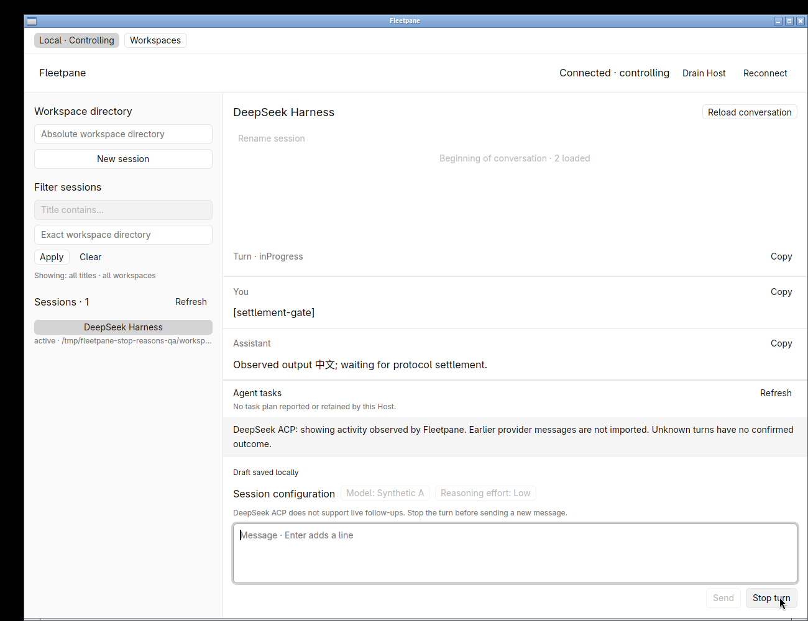
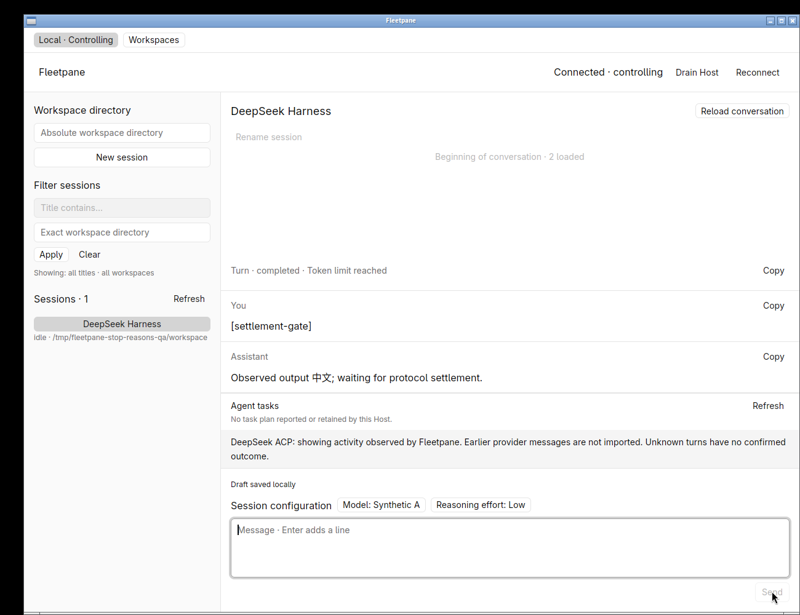
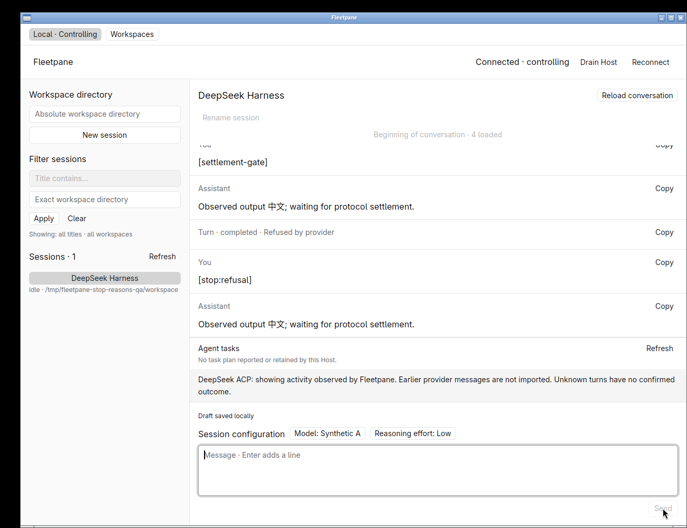
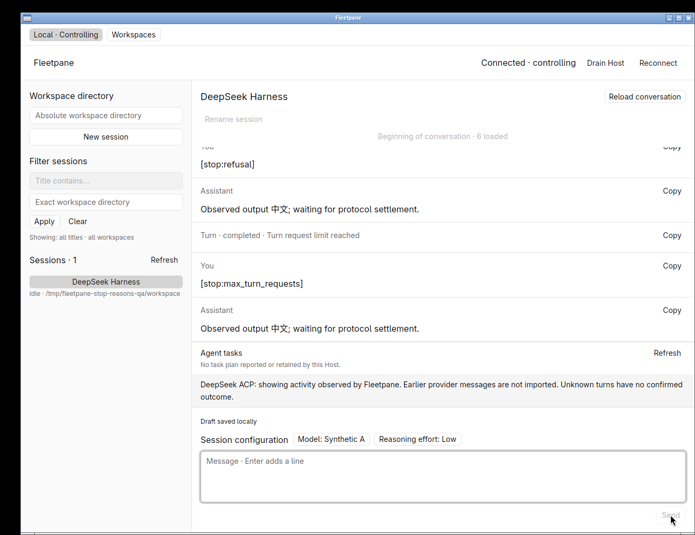
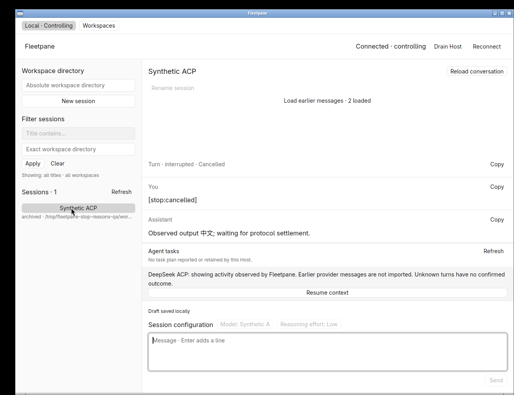

# Explicit ACP stop reasons — 2026-10-21

Uncommitted local work based on `c91d269247207a08898e264c81083df4fbd4e745`.
Linux X11, software Vulkan, GPUI Kit 0.7.3 development builds.
[Receipt](assets/acp-stop-reasons/receipt.json) binds source, binaries and evidence.

## Reproduction and change

Paseo root-history ordinals 45–48 cover nullable JSON metadata, protocol-based
settlement, nonblocking prompt admission and curated activity. Fleetpane already
settled ACP prompts from the actual reply rather than a quiet timer. Its runtime
retained `stopReason`, but the shared typed `Turn` ignored that field and native
rows rendered only `status`. A refusal or token limit therefore looked like an
ordinary completed turn. This was also lost when serializing typed snapshots.

The regression test failed before the fix (`Null` versus `end_turn`), then passed
for all five reasons. `Turn` now retains a typed optional reason. Completion
updates reconcile it alongside status/error; deserialized history pages and
snapshots retain it. Missing reasons remain compatible with Codex; unknown or
wrongly typed values are explicit projection errors rather than normal completion.

Native rows display End of turn, Token limit reached, Turn request limit reached,
Refused by provider or Cancelled alongside the existing protocol status. Copy
returns the original turn ID, status, reason and error as JSON metadata. The
protocol mapping remains unchanged: cancellation is interrupted; refusal and
limits terminate a prompt without establishing whether the user's task succeeded.
Error content remains inspectable. No success inference or automatic retry is added.

## Tests and process evidence

Passed 115 root Rust tests (4 + 4 + 39 + 68) and 9 desktop tests. Targeted
regressions cover snapshot/completion round-trips, unknown-reason refusal,
Codex absence compatibility, explicit adapter settlement and native row/copy data.

```sh
cargo test --workspace --locked
cargo clippy --workspace --all-targets --locked -- -D warnings
cargo build -p fleetpane-host --locked
cargo test --manifest-path apps/desktop/Cargo.toml --locked
cargo clippy --manifest-path apps/desktop/Cargo.toml --all-targets --locked -- -D warnings
cargo build --manifest-path apps/desktop/Cargo.toml --locked
cargo clippy --workspace --all-targets --locked --target x86_64-pc-windows-gnu -- -D warnings
cargo fmt --all --check
cargo fmt --manifest-path apps/desktop/Cargo.toml --check
git diff --check
python3 -m py_compile scripts/acp-fixture.py scripts/acp-stop-smoke.py
python3 scripts/acp-stop-smoke.py
python3 scripts/session-smoke.py
python3 scripts/acp-smoke.py
python3 scripts/acp-history-smoke.py
python3 scripts/acp-archive-smoke.py
```

The new Unix process smoke holds the first prompt's reply behind an explicit
fixture file gate, after emitting text. Admission returns before settlement and
2.2 seconds of quiet output leaves it in progress. A second session independently
completes all five reasons while the first still waits. Full and paged metadata
retain each exact reason. Releasing the gate settles the first prompt as
max_tokens; restarting against the same journal retains both exact histories,
with no prompt replay. All four owned Host/provider PIDs are removed. CI includes
this smoke on Unix; remote CI has not run for this uncommitted source.

Existing shared Codex fixture, ACP lifecycle, large byte-bounded history and
crash/storage-fault smokes also pass. The Windows check is cross-target Clippy,
not linking, execution or native acceptance.

## Native interaction and restart

A separate private fixture Host and hidden desktop sent a gated prompt from the
message editor. Its visible row stayed inProgress during silence. Releasing the
reply updated that retained row to Token limit reached without a reload. Further
native sends showed Refused by provider, Turn request limit reached, End of turn
and interrupted / Cancelled. Copy preserved max_tokens and refusal as 105/102-byte
JSON metadata. All five exact reasons and statuses were confirmed by CLI readback.

One automation input combined the two literal bracketed strings
`[stop:cancelled][stop:end_turn]`; the fixture correctly treated that as an
ordinary echo prompt and replied end_turn. It is retained in the raw prompt log;
it is not cancellation proof. A subsequent separate `[stop:cancelled]` prompt
provided the cancellation evidence.

After stopping only the owned Host/provider and restarting on the same journal,
all five turn item arrays and reasons were identical. The new native window read
the archived conversation with Send disabled and displayed interrupted / Cancelled
before any resume. Copy retained the exact cancelled metadata (106 UTF-8 bytes).
Closing the window using its titlebar exited the app with status 0 while the new
Host remained healthy with the same identity. All task-owned processes, control
socket and hidden desktop were then removed. No shared runtime was touched.







## Limits and history cursor

These stop-condition interactions use a synthetic ACP provider, not a real model
refusal/limit experiment. The preceding [archive acceptance](2026-10-21-acp-archive.md)
contains separate real DeepSeek read-tool/Markdown evidence. It is an earlier
source/binary snapshot; its receipt is retained unchanged. No new real model
capacity, performance improvement, Mac/Windows runtime acceptance, live Host
upgrade, provider transcript import or external Agent MCP API is established.

Continuous scoped-path Paseo source review is through ordinal 48,
`f2daa86d30560df29db2cfcc81708536c5a224ee`; next is ordinal 49,
`ca43aae5346b124715039f8c68754cb1e16e9dc8`. The ledger records precisely which
changed hunks were inspected; historical tests and providers were not executed.
