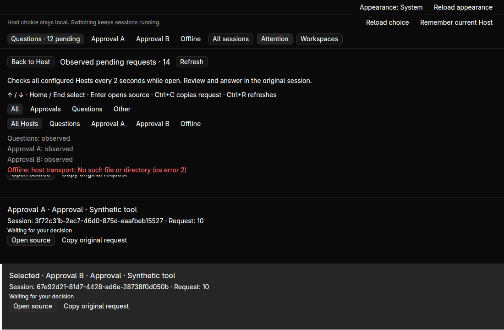
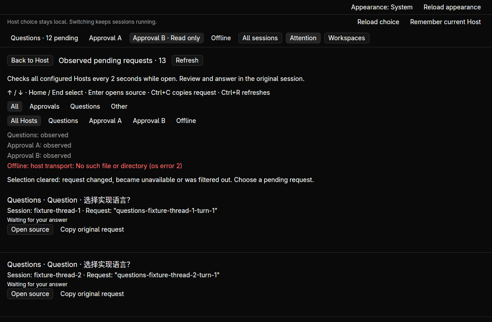
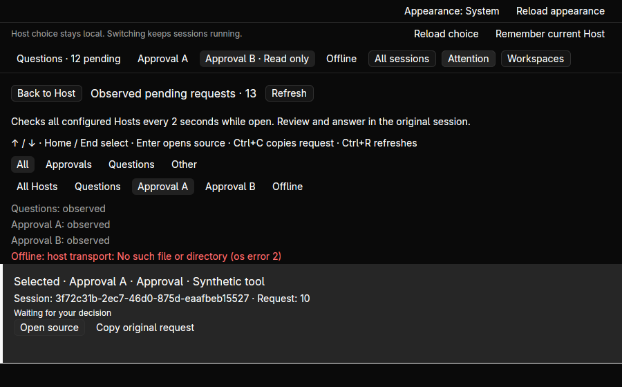

# Pending request navigation — 2026-10-21

Implemented on base `bede7b130f065c0946e38a9cda3427a95a3248c3`. Source and binary
hashes, original synthetic Host snapshots, clipboard readbacks and a process
receipt are in [the evidence directory](assets/attention-navigation/receipt.json).
Design: [ADR 0074](../adr/0074-pending-request-keyboard-navigation.md).

Attention now combines Host and request-kind filters with a keyboard cursor.
The cursor uses socket, Host incarnation and complete request payload, preserving
selection across reorder and clearing it when filtered, resolved or changed.
It never uses a row number or request ID alone as the source identity.



Three domain tests cover empty/unroutable queues, movement/end boundaries,
combined filters, colliding IDs, reorder/rename, Host replacement, changed scope
and resolution. Existing request validation rechecks the original source before
opening. Core workspace tests pass 242 tests; desktop passes 25, Python passes
15. Both strict Clippy/format checks and desktop build pass.

In hidden workspace `fleetpane-attention-nav-20261021`, owned Codex/ACP protocol
fixtures supply 12 independent questions, two approvals sharing numeric ID 10
and an offline endpoint. The final acceptance uses `/tmp/fp-nav-final`; initial
exploratory checks used a separate `/tmp/fp-nav-1021` fixture.

- End selects and scrolls to Approval B; Home/Down/Up select the first question.
  Ctrl+C returns the original 559-byte approval JSON. Enter opens B read-only,
  with its exact session/request source. All three full snapshots remain
  unchanged before explicit takeover.
- Explicit takeover/inspection of B permits a 46-byte Chinese multiline draft.
  Returning to Attention and refreshing retains B's exact selection and JSON.
  The question and Approval A snapshots stay completely unchanged.
- An explicit external decision delivers `reject-one` to B's original provider.
  The queue becomes 13 requests and clears selection; Enter opens nothing.
  Approval A's same numeric ID is never substituted. Source status and ordinary
  turn completion remain visible on B; draft recovery is independent of that
  approval result.
- At 900×560, Host filtering selects A and copies its own 559-byte JSON. Selecting
  resolved B gives an explicit empty result; End/Enter do nothing. The Questions type filter selects
  the original question; unit tests cover combined filter changes.
- Returning to B and copying its draft returns exactly
  `B 原始草稿\n保留缩进  Rust ↔ DeepSeek` (46 UTF-8 bytes). Normal close and window
  replacement retain the same saved draft and original provider processes. Typing
  `x` in the queue leaves the hidden draft unchanged at revision 1.




The first highlight relied on the theme accent and was difficult to distinguish;
final code adds explicit Selected text and a border. Native acceptance above was
repeated with that final binary. No external model, non-Linux native, global
shortcut, notification, mute/tray or replacement-release acceptance is claimed.

Checks:

```sh
cargo test --workspace --locked
cargo clippy --workspace --all-targets --locked -- -D warnings
cargo build -p fleetpane-host --locked
cargo build --manifest-path apps/desktop/Cargo.toml --locked
cargo test --manifest-path apps/desktop/Cargo.toml --locked
cargo clippy --manifest-path apps/desktop/Cargo.toml --all-targets --locked -- -D warnings
cargo fmt --all --check
cargo fmt --manifest-path apps/desktop/Cargo.toml --check
python3 -m unittest discover -s scripts/tests -p '*_test.py'
python3 scripts/host-choice-smoke.py
python3 scripts/attention-smoke.py --hold-seconds 5 --evidence-dir docs/verification/assets/attention-navigation/process
git diff --check
```

The default 125-second smoke was terminated (exit 143) without a receipt and is
not passing evidence. Its three orphaned fixture Hosts were explicitly stopped;
the five-second scoped rerun passes with exact replies and cleanup. Earlier
125-second acceptance remains historical evidence, not renewed endurance proof.
An exploratory native fixture ended before draft readback; the final isolated
fixture was recreated and completed the recorded checks. Neither interrupted
run establishes an application failure or an endurance pass.

Paseo scoped source review advances through ordinals 208–210, 13 selected paths
and 55,358 diff bytes with hashes. It preserves prior entries and leaves the
remaining changed paths explicitly unreviewed. Historical versions were not run;
next is ordinal 211, `670c38ab8cca39dad4bddb0e46fba2f495043f8b`.
