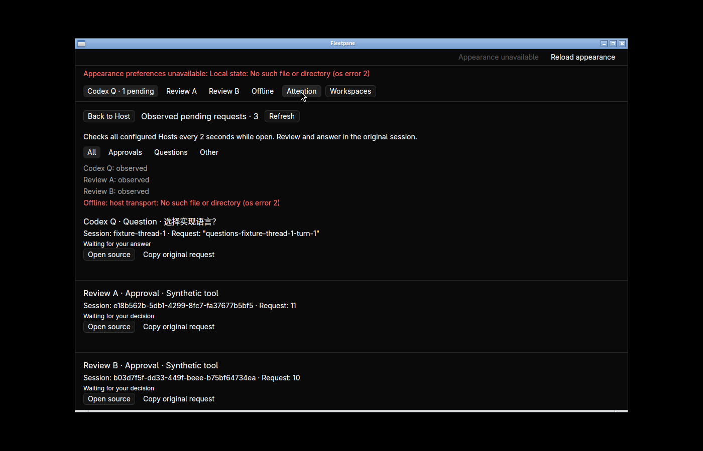
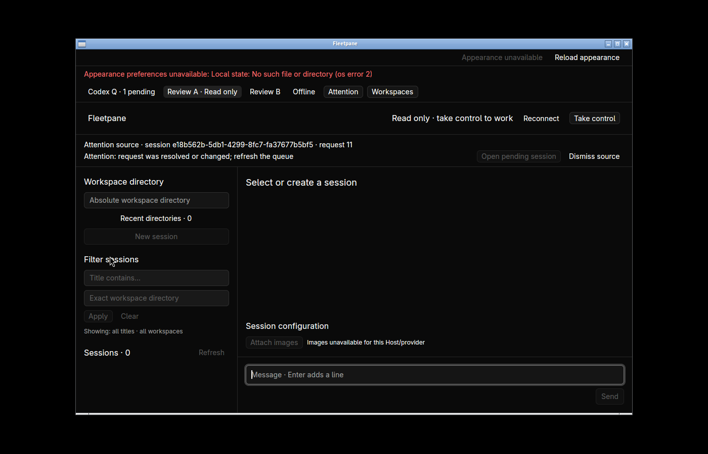
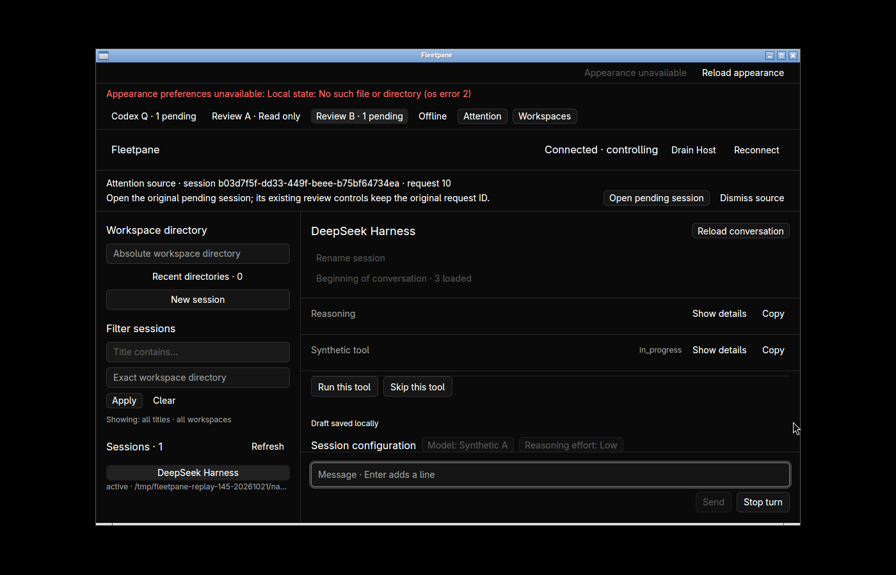
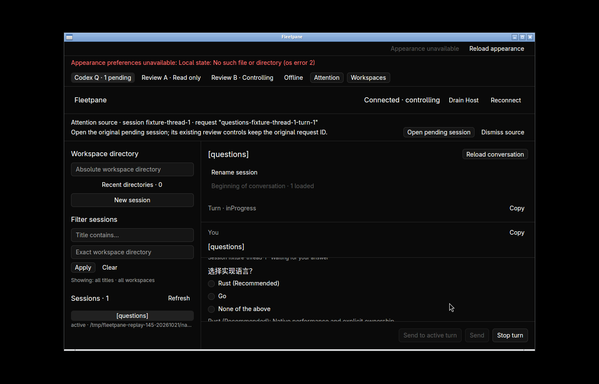
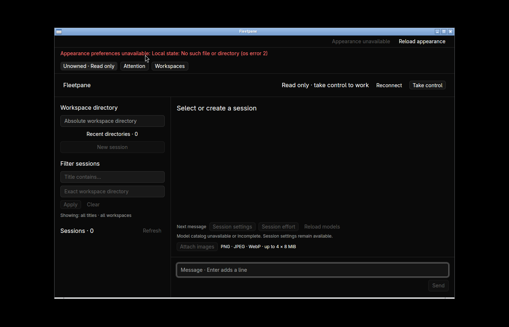

# Global pending requests — 2026-10-21

Local uncommitted work based on `c91d269247207a08898e264c81083df4fbd4e745`.
[Receipt](assets/attention-queue/receipt.json) binds source, binary identities,
logs, snapshots, clipboard readbacks, provider replies and cleanup. Design:
[ADR 0050](../adr/0050-observe-global-pending-requests.md).

## Shared engine and process checks

The CLI and native UI collect original pending requests from all configured
Hosts without takeover, provider reads, resume or decisions. Offline/faulted
Hosts remain explicit; unknown methods retain their payload. Three new unit
tests cover colliding IDs on separate Hosts, exact incarnation/request/target
validation and unavailable/malformed reporting.

`python3 scripts/attention-smoke.py --evidence-dir DIRECTORY` passes with its
default 125-second wait. Three owned real Host processes run deterministic Codex
and ACP protocol fixtures, plus an unavailable endpoint. Collection and waiting
leave all three complete snapshots unchanged, including both approvals with
numeric ID 10 and the unrelated question. Explicit controller replacement
rejects the old lease. The chosen approval reaches the provider as exactly
`allow-one`; duplicate submission is rejected, the other two snapshots remain
identical, provider PIDs survive, and all owned processes/sockets are cleaned up.
The receipt records the measured 125.000-second interval. This proves the covered
waiting boundary, not arbitrary-duration endurance or external model behavior.

`cargo test --workspace` passes **162** tests; desktop tests pass **15**.
Strict Clippy, both builds, both format checks and `git diff --check` pass:

```sh
cargo clippy --workspace --all-targets -- -D warnings
cargo test --workspace
cargo build -p fleetpane-host
cargo clippy --manifest-path apps/desktop/Cargo.toml --all-targets -- -D warnings
cargo test --manifest-path apps/desktop/Cargo.toml
cargo build --manifest-path apps/desktop/Cargo.toml
cargo fmt --all -- --check
cargo fmt --manifest-path apps/desktop/Cargo.toml -- --check
git diff --check
```

## Linux native acceptance

Hidden workspace `fleetpane-attention-20261021`, 1400×900. Accepted final desktop
SHA-256: `58c3516a4c47c9c87d73f02d367f577ca31c9fa7e420f46555b5178056cbde9f`.
Only task-owned synthetic sessions are used. Original native Hosts remain alive
across several window replacements: their running image identity is recorded
from `/proc/PID/exe`, separately from the final CLI/process-test binary. Native
fixture Hosts use `4f3a3de3…`; the new unowned-Host regression and process test use
`2f1cf6b2…`. No daemon implementation changes are claimed by this UI slice.



- The global queue shows pending requests from unopened Hosts and meaningful
  question text. Approval and question filters work; raw copy returns the exact
  original 559-byte request. Opening the queue, filtering, typing `x` and opening
  a read-only source preserve all three full Host snapshots and the exact draft.
- Source A is opened read-only at request 11. An explicit external CLI decision
  returns `reject-one` to its provider. Without Reconnect, the source banner
  becomes invalid, the pending badge clears and the queue falls from three to
  two. The question Host and approval B retain identical complete snapshots.
- Source B opens its original session after explicit takeover and Inspect.
  Scrolling the independent details region exposes **Run this tool** and
  **Skip this tool**. The native Run action returns original ID 10 and exact
  `allow-one` to ACP. The other two full Host snapshots and draft are unchanged
  at that boundary. B subsequently reports its expected turn completion; this
  is distinct from unrelated navigation effects.
- The remaining question opens the original two-page form. Native selection
  chooses Rust, then supplies Chinese/multiline notes and submits. A subsequent
  provider thread read contains the exact normalized answer object, including
  the existing `user_note:` convention. This is not a claim that question notes
  preserve trailing whitespace. The separate conversation draft remains exact:
  system clipboard readback matches all **32 bytes**, including trailing spaces
  and the final newline.
- After all explicit decisions, the queue shows zero observed requests and
  continues to display the unavailable Host, rather than reporting all clear.





## Reproduced connection regressions

The preserved pre-fix desktop binary `f4363fb4…` claims an unowned Host on open,
without a takeover click. `unowned-before.json` has no owner and
`unowned-after-before-app.json` has an owner. The accepted binary leaves the new
unowned Host's entire snapshot unchanged and visibly read-only.



The pre-fix source also retains request 10 after its external decision, while
the queue already shows the resolved state. The saved before screenshot and
provider readback establish that discrepancy. The final request-11 sequence
above verifies the corrected read-only observation path. Errors from snapshot
observation are separate from action errors; fault/recovery and all forced late
reply orderings were not exhaustively exercised natively.

Accepted apps `fixed-unowned` and `accepted-observer-attention` exit normally
with code 0. Earlier experimental windows are recorded separately, including a
launch that used a stale binary after a failed build; it is not final acceptance.
All four owned Host/provider groups (eight processes), earlier unowned-Host
generations and sockets are gone; the hidden workspace is stopped.

## Limits

This is local Linux acceptance with protocol fixtures. No new real OpenCodex or
DeepSeek model approval/question, hosted CI, release, performance comparison or
full product acceptance is claimed. Missing appearance preferences are shown
explicitly in these private fixture configurations. Pending-only collection does
not complete ATT-01–05: completion/failure/unread, request creation times,
notification/mute/tray, keyboard-next and remote/background workflows remain
open. A forced late source-navigation reply has not been tested. Git Diff work
remains deferred.
