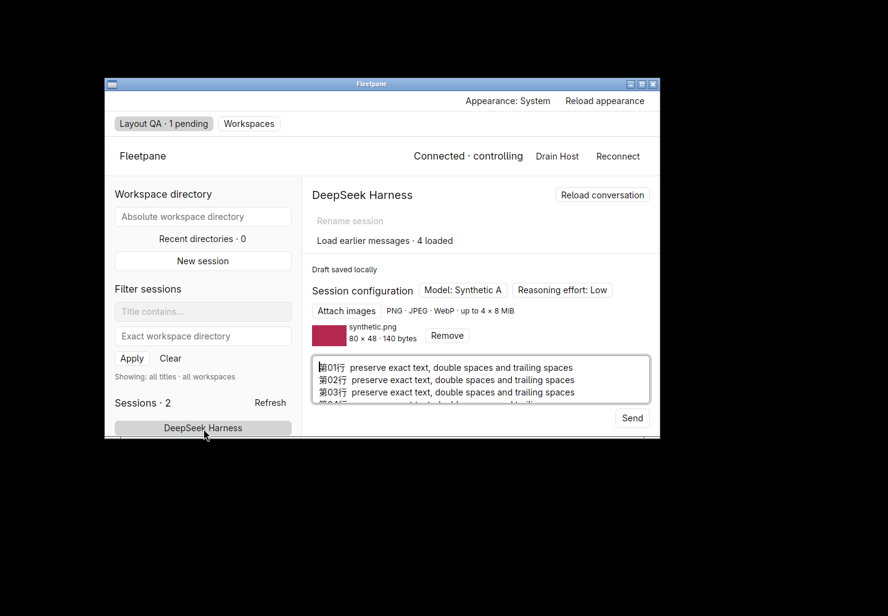
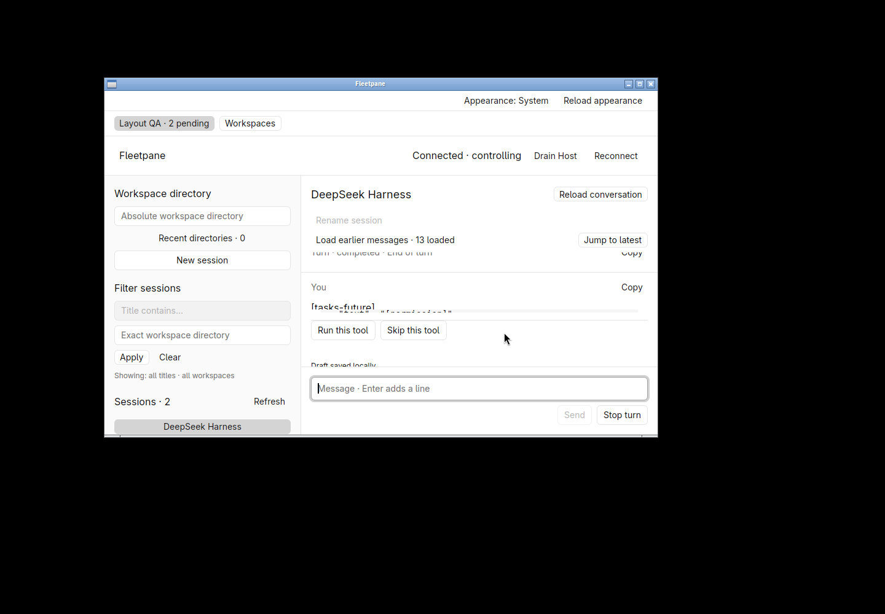
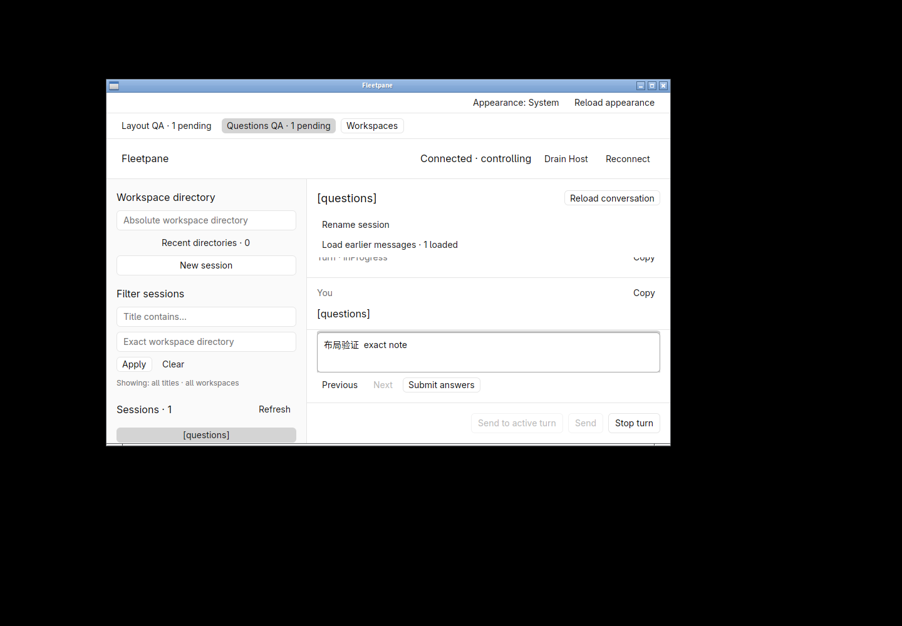
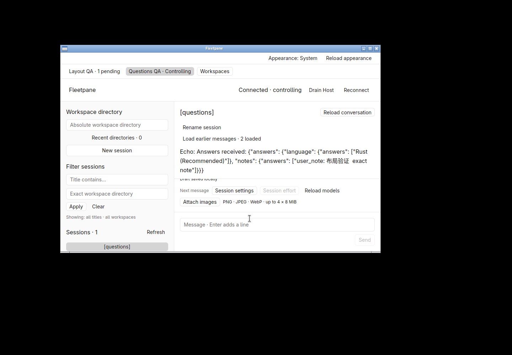

# Conversation space at the minimum window size — 2026-10-21

Retained uncommitted work on `c91d269247207a08898e264c81083df4fbd4e745`.
[Receipt](assets/conversation-space/receipt.json) binds the before/after binaries,
source, screenshots, readbacks and owned process cleanup. This is local Linux
native acceptance using ACP and Codex protocol fixtures, not external DSH or
OpenCodex model calls, hosted CI or release acceptance.

## Reproduction and correction

The baseline 900 × 560 client window has a three-row textarea holding 20 lines
(1,340 UTF-8 bytes, Unicode, double/trailing spaces and newlines), an 80 × 48 PNG,
retained tasks and an unrelated pending ACP review. All conversation height is
consumed; no message is visible. The new layout shares the actual space left
after header/editor between the virtual list and bounded scrollable details.
Configuration and image controls join that yielding region. The same size and
fixture now show the last assistant message while preserving the long editor.
See [ADR 0046](../adr/0046-share-conversation-space-with-details.md).

## Native interaction and readbacks

Hidden workspace `fleetpane-layout-20261021`; all Hosts, sessions and files are
owned synthetic fixtures. The final binary:

- Loads earlier history and scrolls the virtual list; **Jump to latest** appears.
  Scrolling task/configuration/image details separately leaves history position
  and exact saved draft intact. Native Select All/Copy returns all 1,340 bytes.
  Before/after Host mutation identities/count, activity, pending request and
  provider PIDs are unchanged. Explicit controller replacement changes owner,
  and observational query replies advance event sequence; neither is a send.
- Sends that exact draft and PNG through native Send. Provider fixture readback
  matches the full text and original image SHA-256/140-byte content. It clears
  the acknowledged draft; the other session's approval stays pending.
- Starts a selected-session permission, scrolls to **Skip this tool**, and settles
  only that request. A second selected-session permission is cancelled with
  fixed **Stop turn**. Original unrelated request and active turn remain intact.
- Resizes to 1100 × 720 and opens/closes the model menu in the relocated options
  region; menu items are visible outside the scrolling region and no option is
  changed. Returns to the minimum size in the subsequent question workflow.
- Opens a second owned Codex protocol Host, reads its pending two-question form,
  chooses Rust, navigates Next, enters `布局验证  exact note`, and submits at
  900 × 560. Message content remains visible while the question region scrolls.
  A query with the current controller lease reads back the provider's exact
  answer acknowledgement. Its turn/request settle. The complete separate ACP
  Host snapshot is identical before and after this question interaction.

Three native windows (baseline and two final-binary runs) close normally with
exit code 0. Both owned Hosts/providers are stopped after recording final
snapshots; the hidden workspace is stopped. The baseline process is not reused
or mistaken for the accepted binary. No personal desktop/session is touched.

## Checks and limits

`cargo fmt --manifest-path apps/desktop/Cargo.toml --check`,
`cargo clippy --manifest-path apps/desktop/Cargo.toml --all-targets --locked -- -D warnings`,
`cargo test --manifest-path apps/desktop/Cargo.toml --locked` (11 pass) and locked
native build pass. Engine/provider source did not change; its
[151-test worktree slice](2026-10-21-existing-worktrees.md) is separate evidence.

The first setup sent a second prompt before the first had settled; the Host
correctly rejected it. Setup now observes turn settlement. No production retry
was added. The first layout build exposed the now-unused render window argument;
it was removed before the final strict checks and accepted binary.

No FPS/latency claim, historical mobile runtime, new virtualization algorithm,
image picker/IME reacceptance, keyboard-only navigation or universal minimum
height under arbitrarily large outer banners is claimed. Small details require
scrolling; general pane sizing and broader accessibility remain open.
