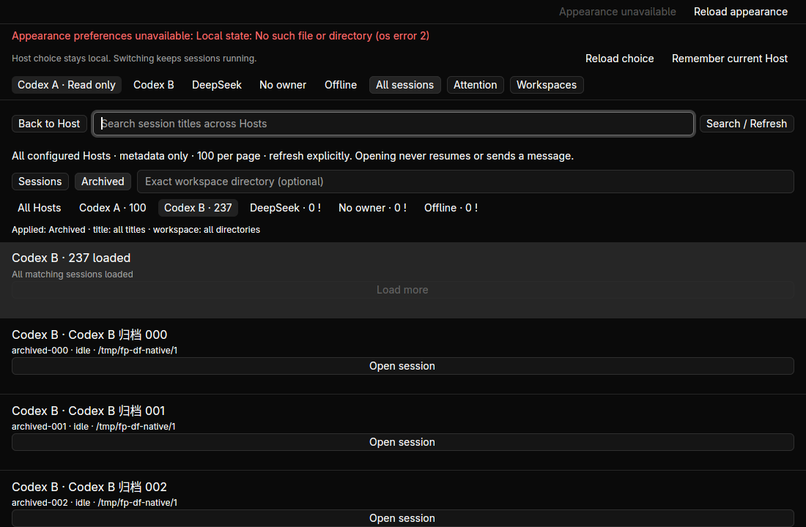
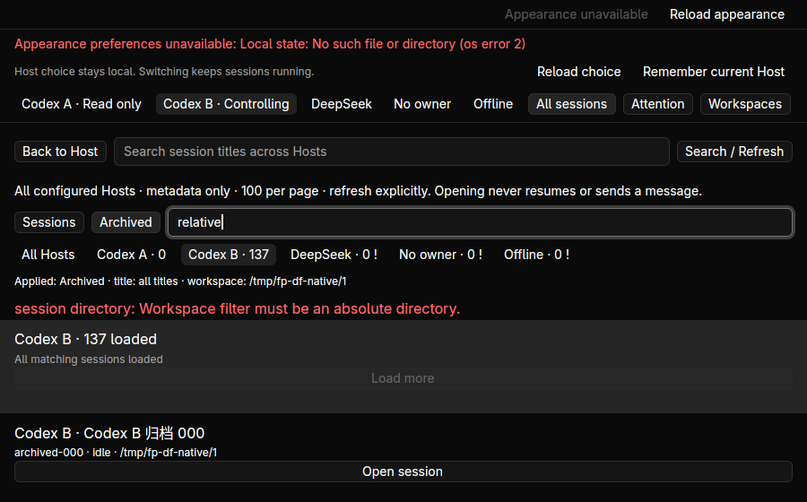
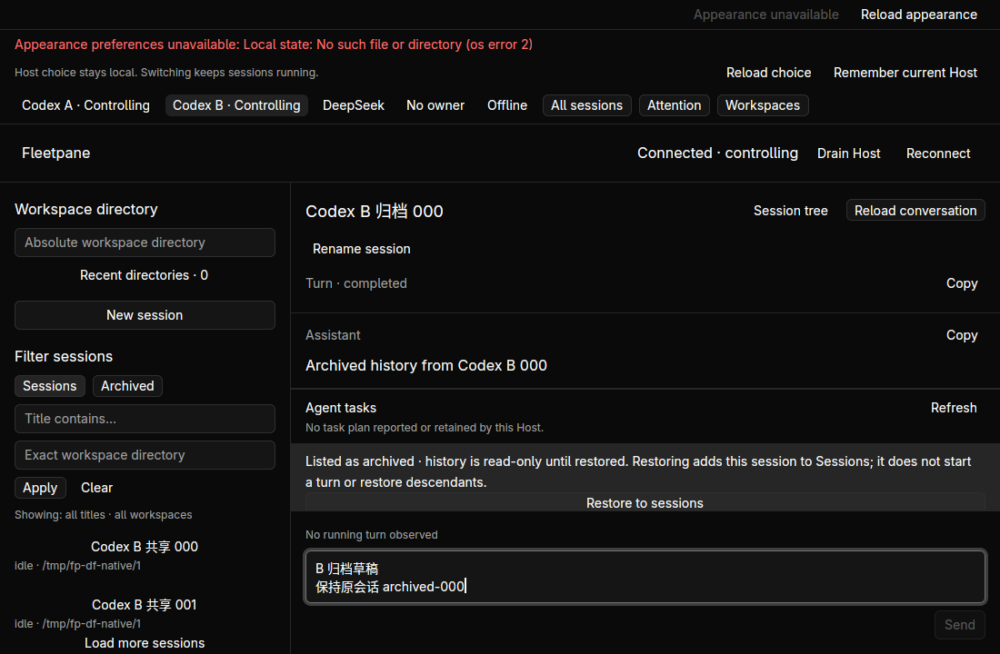
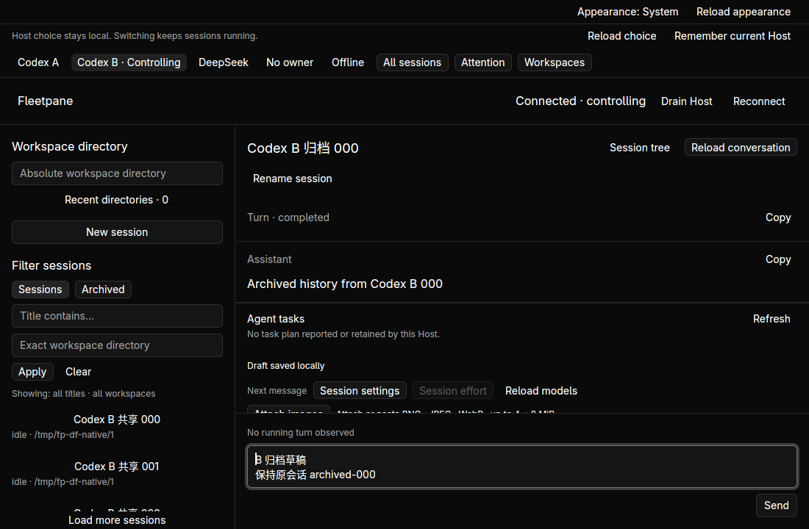

# Global archive and workspace filters — 2026-10-21

Implemented on base `bd31dbb`. Current provider scope is OpenCodex and DeepSeek
Harness; Kimi/GLM are excluded by the user. This acceptance uses private synthetic
Codex/ACP processes and a hidden Linux desktop. It does not refresh external
model, macOS/Windows native, performance or replacement-release acceptance.
See [ADR 0073](../adr/0073-cross-host-directory-filters.md) and the
[receipt](assets/directory-filters/receipt.json).



All sessions previously exposed title/Host filters; workspace/archive queries
existed in the shared engine and individual Host view. The global view and CLI
now expose those same bounded queries. The old global source carried only Host
and thread identity, and opening it always set selected archive membership to
false. The new typed source retains observed membership separately from idle,
notLoaded or other runtime status, keeping archived history read-only until an
explicit restore succeeds.

The extended process smoke has two Codex Hosts with colliding IDs, 237 ordinary
and 237 archived sessions each, a DeepSeek Host waiting for permission, an
unowned Host and an offline endpoint. CLI archive pages return 100/100/37;
workspace-filtered archive pages return 100/37. Unicode search finds archived-236
outside the original page. Invalid/duplicate flags, relative paths, unavailable
Hosts, wrong Host incarnation and missing paging fences fail explicitly. All
Host snapshots retain every field except the event sequence, which advances for
observational query responses. Ownership, provider identity, operation receipts,
active turn and pending request remain unchanged.

Two added domain tests cover source membership independent of idle runtime
status, missing/stale source refusal, and failed archive-query replacement
clearing previous rows/cursor. Existing directory/fleet tests retain query/cursor
validation and per-Host failure isolation.

In hidden workspace `fleetpane-directory-filters-20261021`:

- Archived on Codex B loads 100 → 200 → 237. Exact workspace filtering excludes
  A's same-ID rows and gives B 100 → 137. Title search/Enter finds archived-236.
  Invalid relative input retains the last applied query and reports an error.
- Opening B's archived-000 retains the exact source banner before explicit
  takeover. Inspection shows the archive warning, Restore action and disabled
  Send. Copy returns `Archived history from Codex B 000` (33 UTF-8 bytes).
- A draft `B 归档草稿\n保持原会话 archived-000` survives switching to A's
  archived-236, explicit restore of B, normal window close and replacement.
  Clipboard reads the exact **43 UTF-8 bytes**, and SQLite binds it to B's socket,
  Host incarnation, thread and cwd. Nothing is sent.
- Restore adds one mutation on B. Refreshing Archives finds A's archived-000
  and excludes B's restored one; normal Sessions finds B's restored session.
  Replacement starts read-only; explicit takeover/open reloads the saved draft.
- The original ACP permission, active turn, owner, provider PID and operation
  inventory remain unchanged. ACP provider archive listing reports its actual
  unsupported error rather than presenting observed nonresident history as a
  provider archive. No approval, answer, Stop or new turn occurs.
- Filtering, errors and source opening are exercised at 900×560 as well as
  1100×720. Restore/draft replacement acceptance uses 1100×720; no general pane
  sizing, accessibility or small-window restore acceptance is claimed.





The first native run displayed a pre-existing default appearance-store error
because that separate default parent was absent in this environment. Replacement
uses an explicit task-owned preferences directory and loads System successfully.
This batch does not claim a fix to appearance initialization. Early screenshots
taken during async transitions were re-observed after completion; no code change
was made to mask those intermediate frames.

Checks:

```sh
cargo test --workspace --locked
cargo clippy --workspace --all-targets --locked -- -D warnings
cargo build -p fleetpane-host --locked
cargo build --manifest-path apps/desktop/Cargo.toml --locked
cargo test --manifest-path apps/desktop/Cargo.toml --locked
cargo clippy --manifest-path apps/desktop/Cargo.toml --all-targets --locked -- -D warnings
cargo fmt --all --check
cargo fmt --manifest-path apps/desktop/Cargo.toml --check
python3 -m unittest discover -s scripts/tests -p '*_test.py'
python3 scripts/fleet-directory-smoke.py --evidence-dir docs/verification/assets/directory-filters
python3 scripts/directory-smoke.py
python3 scripts/acp-review-smoke.py
python3 scripts/host-choice-smoke.py
git diff --check
```

239 core Rust tests, 25 desktop tests and 15 Python tests passed. Source/binary
hashes, logs, before/after synthetic Host snapshots and draft rows are retained.
Paseo's scoped review advances through ordinal 207; it is source review, not
historical-runtime acceptance. Filters are not persisted, external archive
changes need refresh, and no complete-history search or automatic resume is added.
