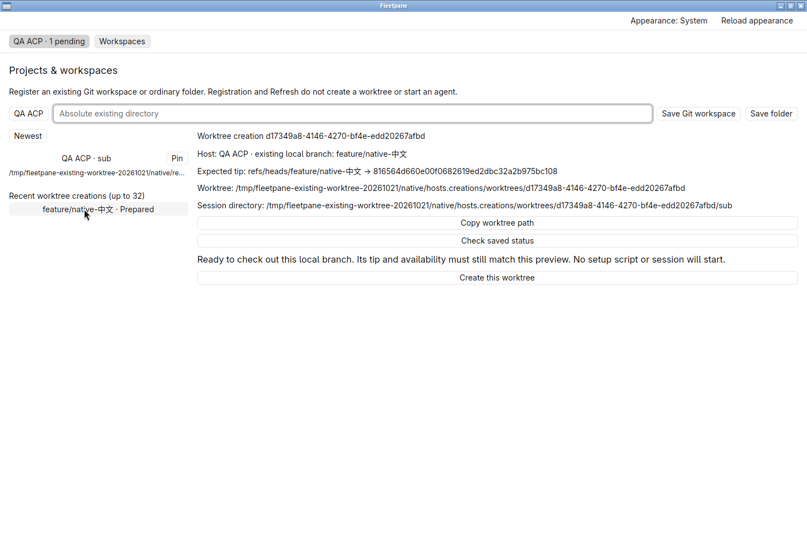
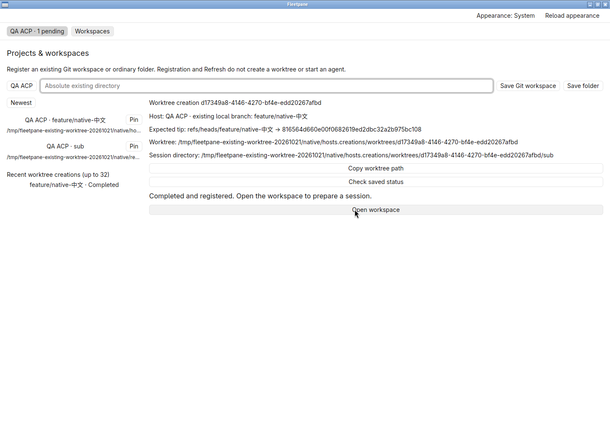
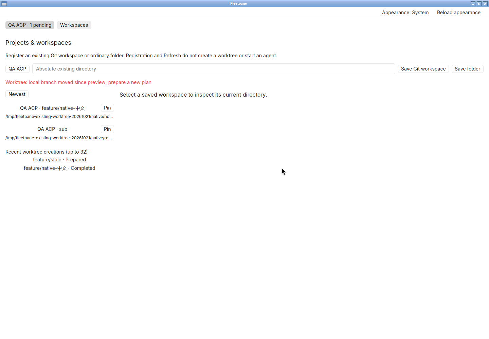
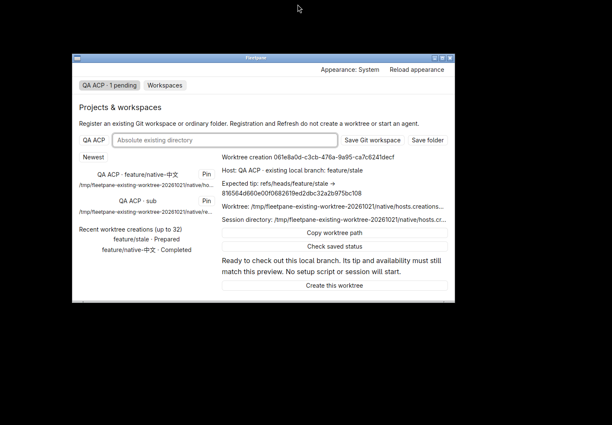

# Existing local branch worktrees — 2026-10-21

Retained uncommitted work based on `c91d269247207a08898e264c81083df4fbd4e745`.
[Receipt](assets/existing-worktrees/receipt.json) binds source, binary, fixture,
screenshots, process output and owned-resource cleanup. This is local acceptance;
no commit, push, hosted CI, release, external model or non-Linux runtime proof.

The shared engine now previews an unoccupied existing local branch, pins its
expected tip and checks it again before dispatch. Native and CLI use the same
typed plan/apply operations. A branch that moved, disappeared or became occupied
is refused before an attempt; late external changes produce a failed retained
outcome. See [ADR 0045](../adr/0045-existing-branch-worktrees.md).

## Real Git and lifecycle checks

- `python3 scripts/existing-worktrees-smoke.py`: Git 2.56.0 local branch with
  Unicode/slash name; a same-named tag at a different commit; exact tip and saved
  subdirectory; preserved source ref/index/untracked file; mode/UUID binding;
  absent, remote-only, occupied and malformed branches; moved/deleted/newly
  occupied preflight; cross-store guard from a linked source root; external
  late-tip failure/residual. No Host exists or is contacted in this test.
- `cargo test -p fleetpane-session --locked worktrees -- --nocapture`: real Git
  checkout blocked by an owned filter, cancelled async awaiter, second store's
  busy/prepared refusal, continued first checkout/result, occupied refusal after
  completion and a successful later new-branch creation. Guard tests cover
  duplicate acquisition, symlink, FIFO and non-private file refusal. Legacy
  mode-omission decoding is covered.
- `python3 scripts/worktrees-smoke.py`: original new-branch pinned baseline,
  concurrent one-attempt admission, source/parent replacement, partial failure,
  killed controller, 120-second deadline/descendants, paging and Codex fixture cwd
  all pass with the final binary. Failed attempts retain their residuals.
- `cargo test --workspace --locked`: 151 tests pass. Root/desktop formatting,
  strict all-target Clippy, 11 desktop tests, Host/native builds and Windows GNU
  engine cross-check pass. Windows desktop was not built or run.

An early test fixture configured a required smudge filter without a clean command;
Git status correctly refused it. The fixture now supplies `clean=cat`. Clippy also
caught an unnecessary let/return, which was removed before final checks. No lint
suppression or production fallback was added.

## Owned native workflow

Hidden workspace `fleetpane-existing-worktree-20261021`, real temporary Git repo,
private ACP protocol fixture. One original conversation has a saved draft and
another waits for a tool permission.

The window selects **Existing local branch**, previews `feature/native-中文`,
closes normally, reopens the saved plan, and creates the worktree. Its branch,
commit, project and relative `sub` cwd match the preview. Creation, reopening and
a separate stale-tip refusal leave the complete captured Host snapshot and exact
saved draft unchanged. The stale plan remains prepared with no target directory.
The result is then opened and explicitly prepared; only **New session** creates
one additional provider session, whose fixture readback has exactly the new cwd
and no prompts. Host/provider PIDs, active original turn and pending permission
are retained. Returning to the original conversation restores its exact draft.
An independent edit to the new checkout leaves the source file unchanged.

At a measured 900 × 560 client size the saved-plan tip, copy/check and Create
controls remain reachable. Both native app instances close with exit 0; the owned
Host/provider and hidden workspace are stopped. Final snapshots differ from the
post-session snapshot only in event sequence 27 → 30 after conversation query
replies. The first QA assertion incorrectly required that sequence unchanged
across those reads; raw snapshots and runtime query-recording code established
the distinction. Mutation IDs/count, owner, activity and permission are unchanged.

No existing user checkout, provider process or session was used. No setup,
worktree cleanup, automatic interrupted-attempt recovery, branch picker/list,
external Git fencing, Git version compatibility range or performance acceptance
is established. Process exit (including closing the last window) or hard-killed
controllers can still leave running Git; closing during checkout was not accepted
as a supervised continuation. Full
worktree lifecycle and safe deletion remain open.
