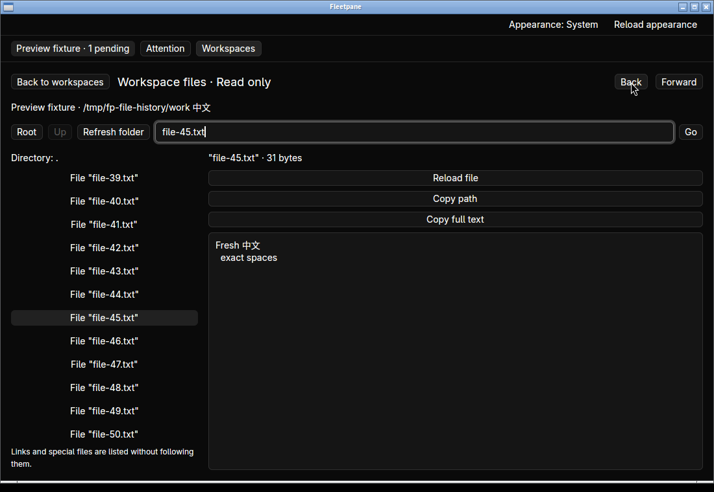
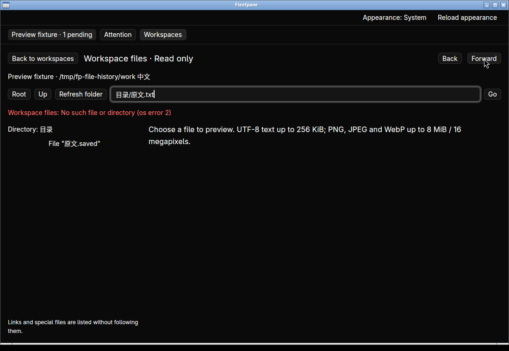
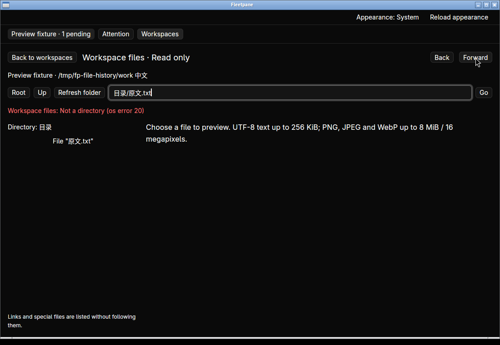
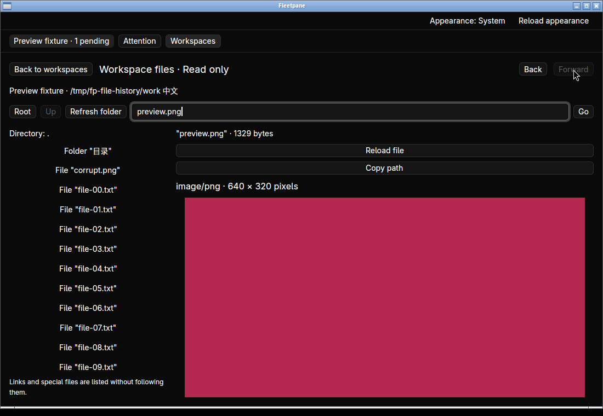

# Native file Back/Forward — 2026-10-21

Implemented on `8eb1c5de6fe2afbe6ecc4817cd0ea3f17e871ce6`.
[Receipt](assets/file-history/receipt.json) binds the changed source, before/final
binaries, screenshots, clipboard readback, complete Host snapshot hashes and
cleanup. This is Linux native acceptance with a synthetic ACP provider, not an
external OpenCodex/DeepSeek model run or release acceptance.

The previous binary provides Root, Up and Refresh but no file history. The new
view keeps 32 successful visits, including selected file/line and the top
directory-entry path. Back/Forward re-read through the existing shared engine;
they never claim control, resume or send to the provider. See
[ADR 0069](../adr/0069-window-local-file-history.md).

The final native binary in hidden workspace `fleetpane-file-history-20261021`
covers the following workflows:

- Scroll an 80-file directory to `file-39.txt`, choose `file-45.txt`, open Root,
  then Back. The selected file returns and the top row is `file-39.txt`. An earlier
  implementation returned to the top because GPUI's virtual-list child index
  was used as a directory ordinal. Capturing uniform-row geometry fixes the
  reproduced failure; all affected native workflows ran again with the final binary.
- Refresh the restored file and then Forward. The existing forward branch remains
  available and returns to Root. Opening a different file after Back removes it.
- Read externally edited Unicode/CRLF text, including trailing spaces. Four final
  native clipboard reads match all **31, 22, 33 and 31 bytes** respectively.
  After another external edit, Forward reads the new bytes rather than a cached
  preview. Paths entered with Go/Enter normalize to the observed relative path.
- Move `目录/原文.txt` away before Forward. The new listing shows the renamed
  entry, the old preview disappears, the error is visible and Forward remains
  available. Restore the file and explicitly retry: the original destination
  opens with exact text.
- Replace the destination's parent directory with a symlink outside the workspace.
  Forward refuses it with an explicit error, loads no outside bytes and retains
  the history cursor. Restore the directory and retry after another external
  edit: fresh text is copied exactly.
- Open the validated PNG, Back to the directory, then Forward. The image returns
  with its original 640×320 metadata and fitted preview. Return to workspaces and
  reopen files: the existing last-location cache retains the text selection,
  while the new file-history buttons start disabled.

The complete ACP Host snapshot is identical before the UI, after the first run,
after final navigation and after closing the final window. Provider PID 4096659,
ownership, operation journal and the unrelated pending permission remain intact.
The screenshots show one pending request throughout.

`cargo test --manifest-path apps/desktop/Cargo.toml --locked -j2` passes **22 tests**,
including history admission, failed-navigation invariants, refresh/branch behavior,
line identity and bounded eviction. Desktop `cargo fmt --check`, strict
`cargo clippy --all-targets --locked -- -D warnings` and `cargo build --locked` pass.
`python3 scripts/files-smoke.py`, `file-navigation-smoke.py` and
`file-images-smoke.py` pass, retaining the original shared filesystem boundaries.
Python checker/history tests also pass (**15**).

The window-close tool destroyed X windows but left the three desktop processes
alive. `workspace_stop` terminated them; this run makes no normal titlebar-close
claim. The owned Host/provider exited, the refused stale socket was removed and
the hidden desktop stopped. Existing user runtimes were untouched.

History lasts only for this file view. Preview scroll, fractional directory-row
offset, cross-view/restart history, keyboard bindings, gallery, editing and
macOS/Windows native interaction remain unaccepted. Source-line retention has
unit coverage but no new anchored native-conversation acceptance in this run.
