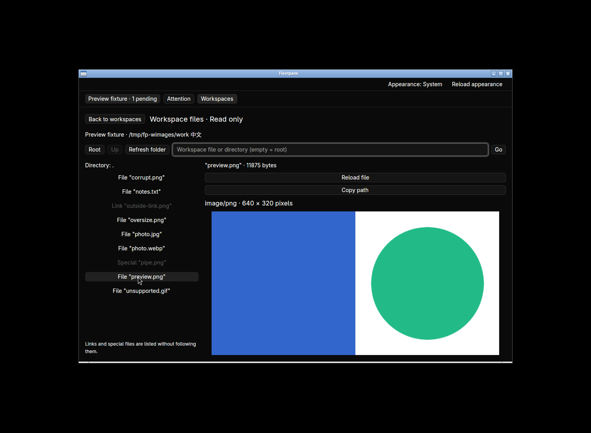
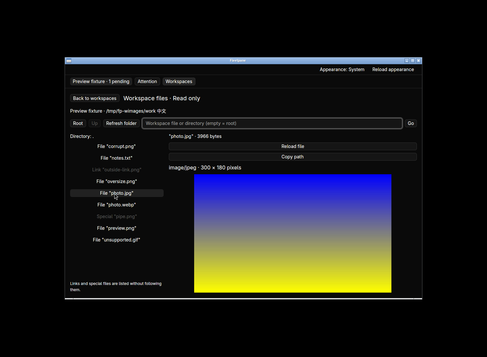
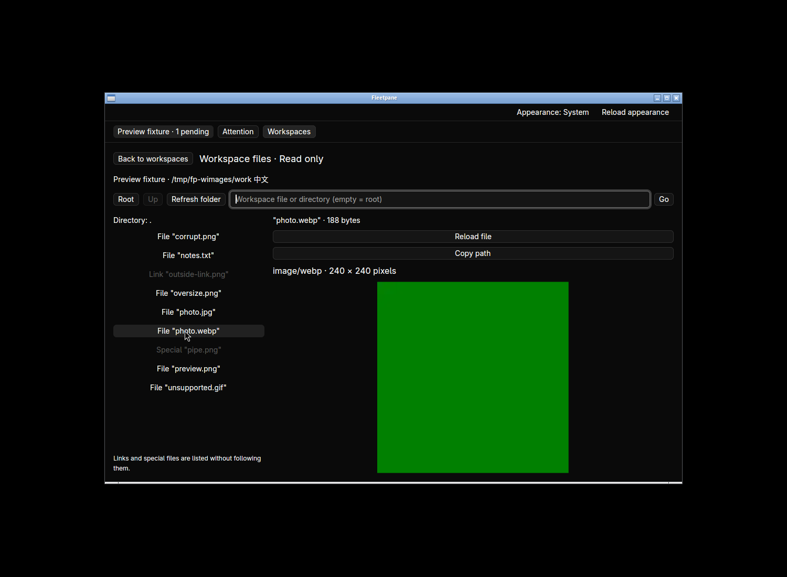
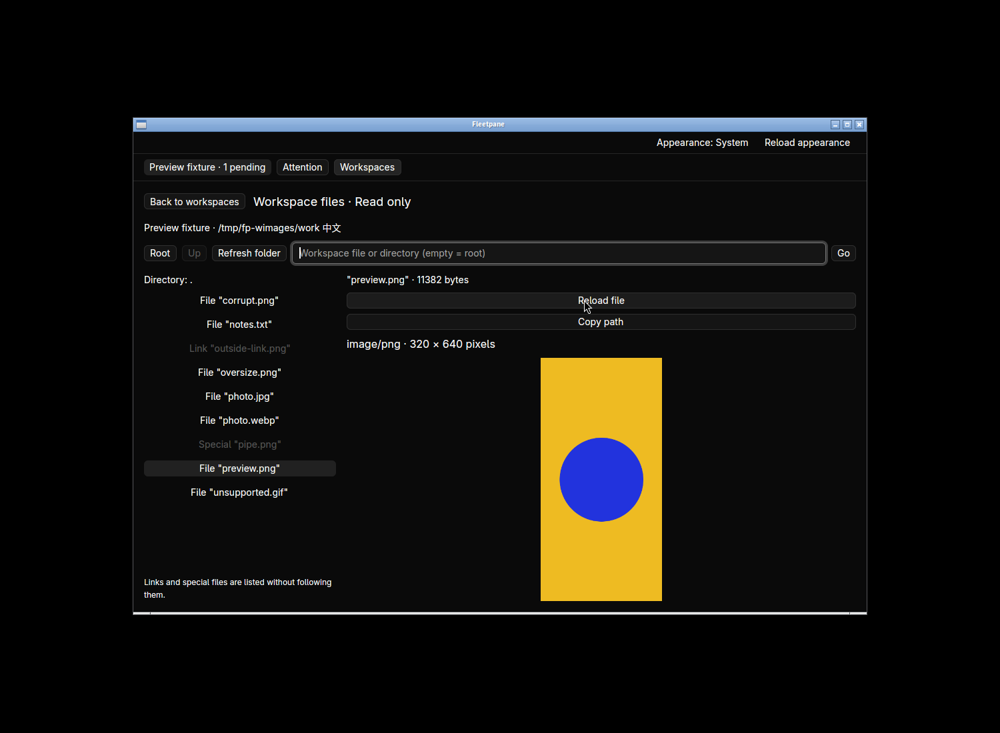
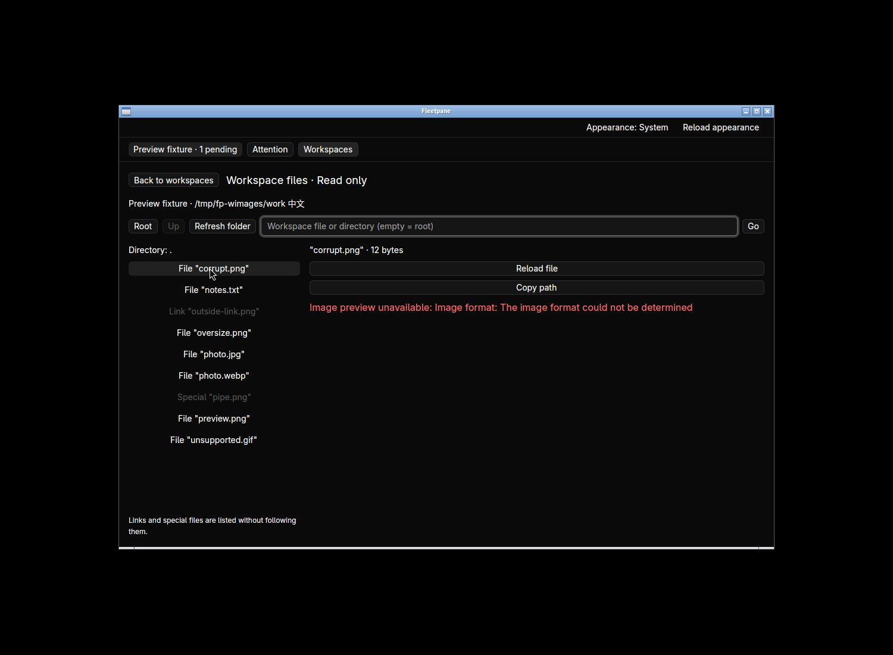
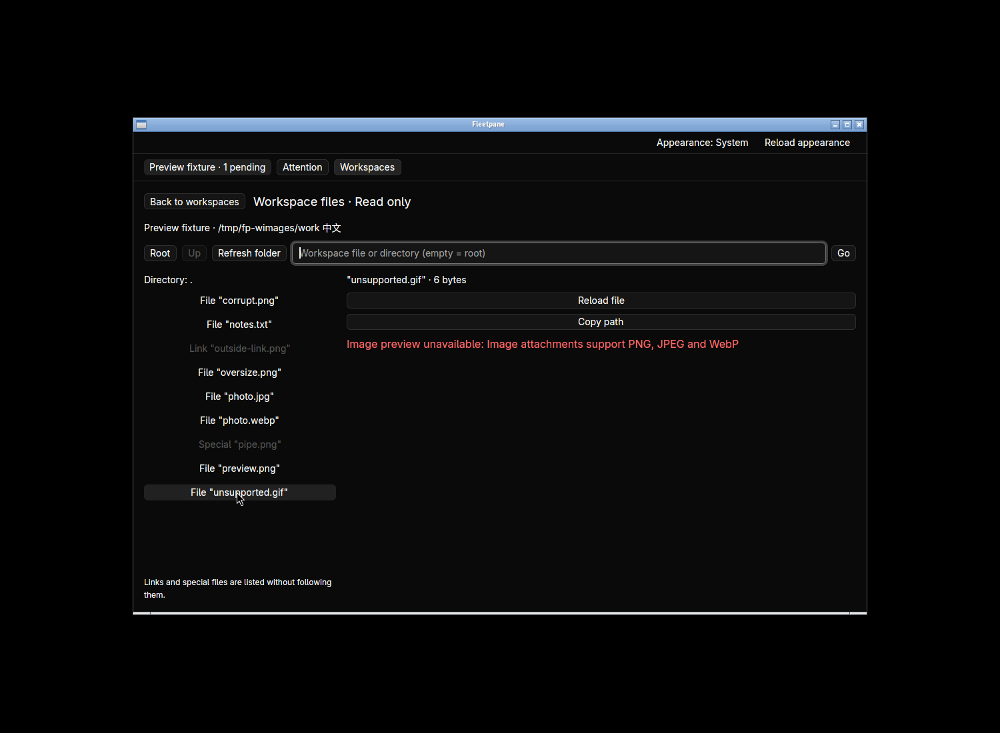
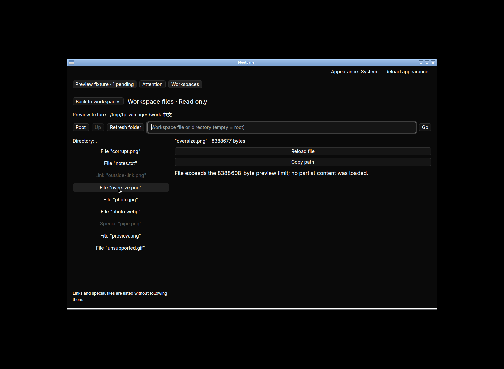
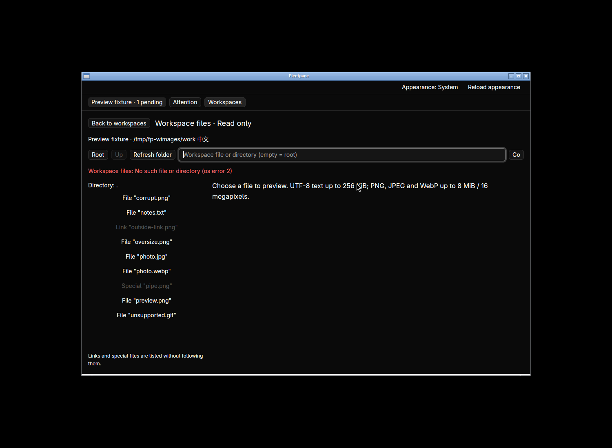
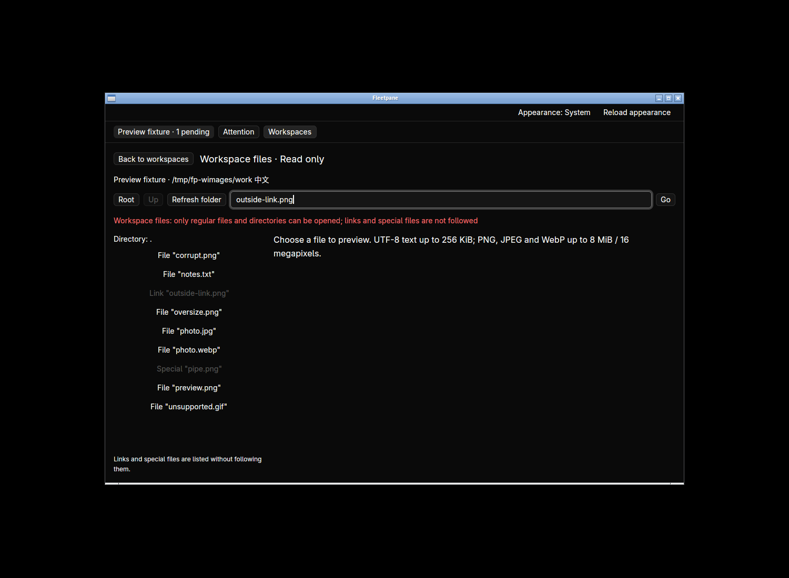

# Workspace image previews — 2026-10-21

Local work based on `a5ab83359b8abad0f2ffc08dc80e6702bf23b78c`.
[Receipt](assets/file-images/receipt.json) binds the final engine/desktop binaries,
source hashes, complete Host snapshots, checks and cleanup. This is Linux native
and shared Unix engine/CLI acceptance using owned fixtures. No external model,
live user session, remote CI or overall replacement acceptance is implied.
Design: [ADR 0067](../adr/0067-bounded-workspace-image-previews.md).

## Shared behavior

`Workspace::read_file` and `open_path` preserve no-follow saved-root identity
checks and bounded filesystem workers. PNG/JPEG/WebP validation reuses the
existing attachment validator without importing or writing attachments. Results
carry original base64 bytes, SHA-256, MIME, dimensions and byte count. Other text
retains exact Unicode/CRLF and the former 256 KiB bound.

Two new regressions [failed before the implementation](assets/file-images/before-tests.log)
and pass afterward: valid original image bytes including extensionless WebP and
reload, and explicit corruption/unsupported/pixel/size notices. The installed CLI
[receipt](assets/file-images/cli.json) covers extension-independent PNG, typed
file open, exact bytes/digest, external replacement/deletion, limits, no-follow
symlink/FIFO/traversal/outside refusal and replaced-root rejection. Existing
file/navigation process checks pass, including unchanged Codex/ACP snapshots.

## Native verification

The final accepted application ran in `fp-workspace-images` using private files
and an owned ACP fixture with a pending permission and active turn. No takeover
was performed. Complete Host snapshots before/after are identical, including
provider PID, ownership, mutation journal, pending request and activity.






PNG/JPEG/WebP render with the supplied type/size metadata. Native testing found
intrinsic image dimensions could enlarge the image element, which the parent
then clipped. Positioning the image inside the bounded flexible viewport fixes
that layout; the final captures show entire landscape, square and portrait images.
External PNG replacement followed by Reload changes dimensions and pixels.







Switching images to text preserves the text workflow; Copy full text returns the
original 25 bytes, including Chinese, CRLF and trailing spaces. Asset removal is
implemented on replacement/failure/close; native switches and normal window close
were exercised, but no cache-size or memory benchmark is claimed. Two preliminary
applications exited with code 0. The final application received SIGTERM from
workspace teardown after a titlebar-close attempt; normal-close acceptance of
that exact binary is not claimed. The hidden workspace stopped, the fixture
Host/provider ended and its socket disappeared. Other runtimes were untouched.

## Checks and remaining work

All commands pass on final affected source:

```sh
cargo fmt --all --check
cargo fmt --manifest-path apps/desktop/Cargo.toml --check
cargo test --workspace --locked                                  # 225 tests
cargo clippy --workspace --all-targets --locked -- -D warnings
cargo build -p fleetpane-host --locked
cargo test --manifest-path apps/desktop/Cargo.toml --locked        # 19 tests
cargo clippy --manifest-path apps/desktop/Cargo.toml --all-targets --locked -- -D warnings
cargo build --manifest-path apps/desktop/Cargo.toml --locked
python3 -m unittest discover -s scripts/tests -p '*test.py'         # 15 tests
python3 scripts/file-images-smoke.py
python3 scripts/files-smoke.py
python3 scripts/file-navigation-smoke.py
git diff --check
```

The new CLI smoke is wired into Unix CI; no remote result is claimed here.
Gallery/thumbnail loading, Markdown-file embedded images, zoom/full-size viewing,
other formats/media, animation control, editing, image clipboard export, large
file streaming and macOS/Windows native behavior remain open. Existing performance
budgets have not been measured. Source line anchors are explicitly text-only;
that image notice is implemented but has no separate native acceptance here.
