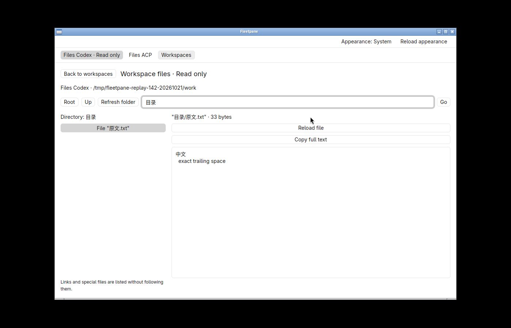
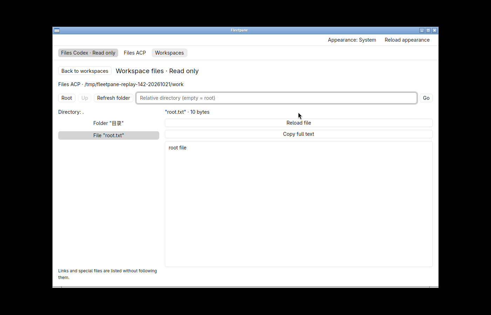
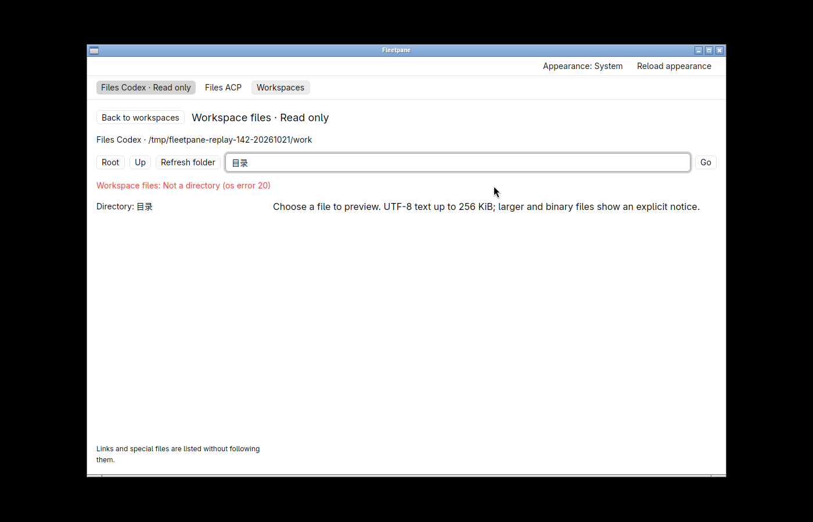
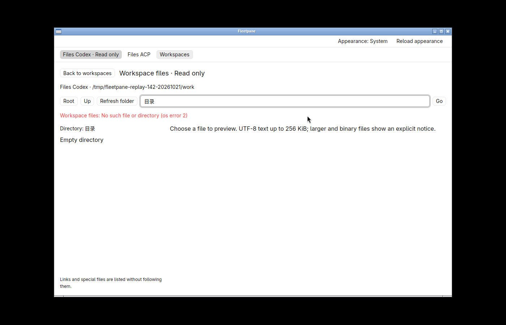

# Workspace file navigation recovery — 2026-10-21

Retained uncommitted work on `c91d269247207a08898e264c81083df4fbd4e745`.
[Receipt](assets/file-locations/receipt.json) binds source, binary, screenshots,
clipboard readbacks, complete Host snapshots and cleanup. This is local Linux
native acceptance with synthetic Codex/ACP protocol providers. No external
OpenCodex/DeepSeek model, hosted CI or release acceptance is claimed.

The previous native binary enters `目录`, then returns to root after **Back to
workspaces → Browse files**. The controller destroys the file view without saving
its location. The new controller keeps up to 32 recently used locations, scoped
by workspace, Host endpoint and saved directory identity. It keeps paths only;
reopening lists the directory and re-reads the selected file. See
[ADR 0048](../adr/0048-remember-workspace-file-locations.md).

The final binary in hidden workspace `fleetpane-files-location-20261021` covers:

- Reopen a Chinese-named directory/file and retain the highlighted selection.
  **Copy full text** returns the original 33 UTF-8 bytes, including CRLF and
  trailing spaces. An external edit followed by **Refresh folder** retains the
  selection and copies the exact new 24-byte text.
- Register the same physical root for two different Hosts. The ACP workspace
  initially opens at root, independently selects `root.txt`, and restores that
  selection after a round trip to the Codex workspace. Codex retains its Chinese
  subdirectory/file; native copies confirm both distinct contents.
- Replace the remembered directory with a symlink outside the root while the
  browser is closed. Reopen refuses it, displays the attempted directory in the
  editor and shows the filesystem error without loading outside bytes. Restore
  the directory, delete the remembered file, and reopen: the directory listing
  succeeds, the missing-file error is visible and no stale preview appears.
- Read complete snapshots before and after the native workflows. Both Codex and
  ACP snapshots are identical, including ownership, activity, mutation journal,
  provider identity and the unrelated pending ACP review.

The baseline and two implementation windows close normally with exit code 0.
The final run repeats the affected workflows after the path-input initialization
correction. The initial baseline launch omitted the explicit preferences directory
and showed a separate appearance-storage error; subsequent runs supply the owned
directory. No appearance code was changed. All four owned Host/provider processes
exit, their sockets are removed, and the hidden desktop is stopped.

`cargo fmt --manifest-path apps/desktop/Cargo.toml --check`,
`cargo clippy --manifest-path apps/desktop/Cargo.toml --all-targets --locked -- -D warnings`,
`cargo test --manifest-path apps/desktop/Cargo.toml --locked` (**13 pass**) and
`cargo build --manifest-path apps/desktop/Cargo.toml --locked` pass. New tests cover
identity isolation/invalidation and LRU eviction/update/promotion. Engine/provider
source did not change; its [157-test slice](2026-10-21-wait-turn.md) and bounded
[file-engine verification](2026-10-20-workspace-files.md) remain separate evidence.

Locations last for this window only. Cross-restart persistence, scroll-position
restoration, Back/Forward, deep links, editing, recursive search/watching and file
image previews remain open. No performance, accessibility or IME acceptance is
claimed. Git Diff expansion remains deferred.
