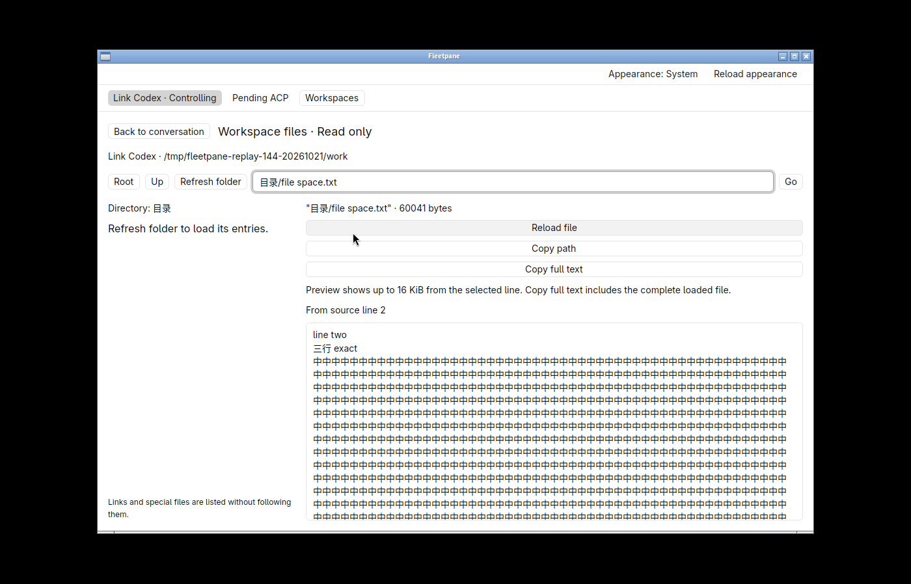
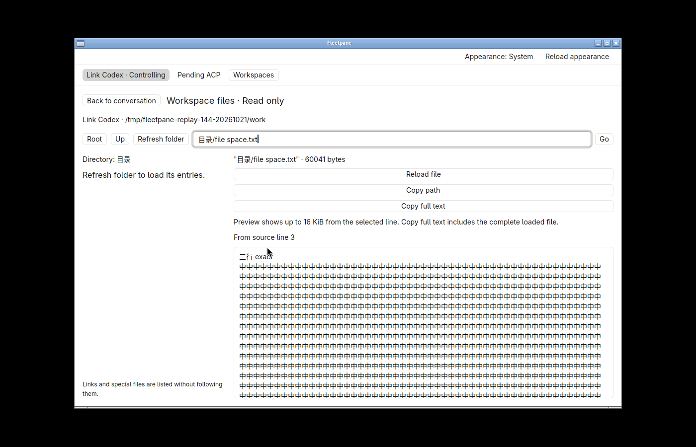
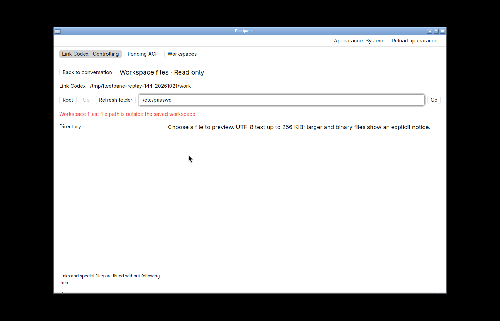

# Explicit conversation file navigation — 2026-10-21

Local uncommitted work based on `c91d269247207a08898e264c81083df4fbd4e745`.
[Receipt](assets/file-navigation/receipt.json) binds the accepted binaries, source,
test logs, screenshots, synthetic snapshots, clipboard readbacks and cleanup.
This is Linux native acceptance with owned protocol fixtures, not external model,
hosted CI, release or overall product acceptance. Design: [ADR 0049](../adr/0049-explicit-conversation-file-navigation.md).

## Engine and CLI

`Workspace::open_path` classifies a raw local path as a directory or regular file,
using the existing saved-root identity and descriptor-relative no-follow reads.
It accepts relative, `./` and in-root absolute paths. The shared CLI exposes
`workspace STORE open UUID PATH` with a typed directory/file result. Known-file
open works even when its parent exceeds the 500-entry listing limit.

The new link test first failed because a nonnumeric colon suffix was dropped,
turning an unsupported scheme into a filename. Keeping the original path before
scheme classification fixes that regression. Tests also cover percent-encoded
spaces/Unicode/colon names, local file URLs, positive anchors/ranges and malformed
or unsupported inputs. Raw path input preserves literal colons.

The shared open test covers exact CRLF/Unicode, file/directory/root
classification, large-parent known-file access, wrong endpoint lookup,
traversal/link/outside/missing/root-replacement refusal and saved-root reuse.
`python3 scripts/file-navigation-smoke.py --evidence-dir DIRECTORY` exercises the
actual CLI with an intentionally unavailable Host endpoint. It passes, including
exact 60 KB text, literal-colon names, FIFO refusal and replaced-root refusal.
The existing `python3 scripts/files-smoke.py` also passes: real Git workspace,
bounds, exact bytes, unchanged fixture file hashes and complete Codex/ACP Host
snapshots, with owned process cleanup.

## Native acceptance

Hidden workspace `fleetpane-file-links-20261021`, 1400×900, uses the accepted
desktop binary in the receipt. Applications `accepted-navigation` and
`accepted-tool-link` both exit normally with code 0.




- A Markdown absolute path with `:2` opens the Chinese-named file at line 2;
  the percent-encoded relative link with `#L3` starts at line 3. The UTF-8 preview
  is bounded to 16 KiB. **Copy full text** returns all **60,041 original bytes**,
  including CRLF, trailing spaces and the suffix beyond the visible preview.
  **Copy path** returns the exact 21-byte relative path.
- **Refresh folder** loads the parent, highlights the selected file and preserves
  the line-2 preview. Absolute raw input followed by **Enter** opens `root.txt`;
  `./目录` followed by **Go** opens the directory and clears the previous preview.
- Missing and outside-root Markdown links show explicit errors. An unsupported
  scheme shows its error in the conversation. No stale file content or root
  fallback is used.
- Switching to the unrelated ACP Host clears the file overlay. Returning retains
  the original conversation. Native select-all/copy gives the original **32-byte
  draft**, including its Chinese text and trailing spaces/newline.
- A valid structured tool card exposes its original location and opens the exact
  file from the beginning. Its displayed line metadata is not interpreted as a
  one-based anchor. The separate tool fixture uses a different Host endpoint with
  the same physical cwd; this also exercises initial local folder registration.





Complete Codex and ACP snapshots before and after the first workflow are equal,
including ownership, mutation journal, activity and the unrelated pending ACP
request. The exact saved draft is equal too. The separate tool Host's full snapshot
is also equal before/after file navigation. These are synthetic providers; no live
user session was opened or modified.

Two native findings were fixed before the accepted runs. Nonpaginated first-open
history was blocked while the selected draft loaded: same-thread observational
hydration now passes that guard, and the accepted run loads history without
Reload. The initial fixed-height textarea squeezed the filename/size row away;
the final flexible preview keeps metadata and buttons visible. Earlier candidate
screenshots are retained separately; their binary hashes were not captured and
are not presented as a reproducible baseline build. An initially malformed
synthetic tool item lacked its required `call` wrapper and correctly rendered an
invalid-item error. Tool navigation acceptance uses the corrected separate fixture;
no parser relaxation was made for malformed data.

## Checks and remaining gaps

The final source passes:

```sh
cargo fmt --all --check
cargo fmt --manifest-path apps/desktop/Cargo.toml --check
cargo clippy --workspace --all-targets --locked -- -D warnings
cargo test --workspace --locked                     # 159 tests pass
cargo build -p fleetpane-host --locked
cargo clippy --manifest-path apps/desktop/Cargo.toml --all-targets --locked -- -D warnings
cargo test --manifest-path apps/desktop/Cargo.toml --locked # 15 tests pass
cargo build --manifest-path apps/desktop/Cargo.toml --locked
git diff --check
```

Two new desktop tests cover exact bounded line previews (including absent lines)
and the narrow same-thread hydration exception. All six owned Host/provider
processes exit, their sockets are removed, and the hidden desktop's stop receipt
confirms termination. Other local applications and shared daemons were untouched.

Not accepted here: deliberately delayed stale-result delivery, external HTTP link
opening, every cwd alias, OS deep links, inline-code filename heuristics, range
highlighting, line/scroll persistence, file media/editing, remote workflows,
performance, accessibility, IME, other platforms or Git Diff expansion. Token and
Host/thread guards are implemented; Host switching alone does not prove every
late-reply ordering. Existing broader project gaps remain in the status matrix.
