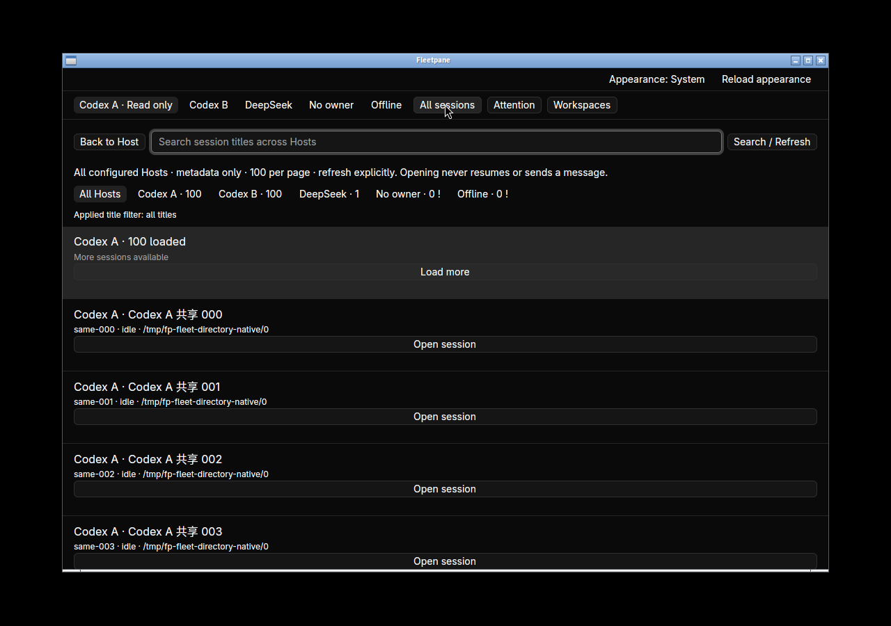
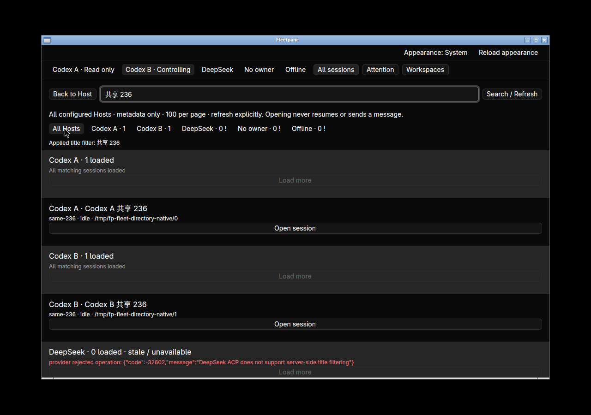
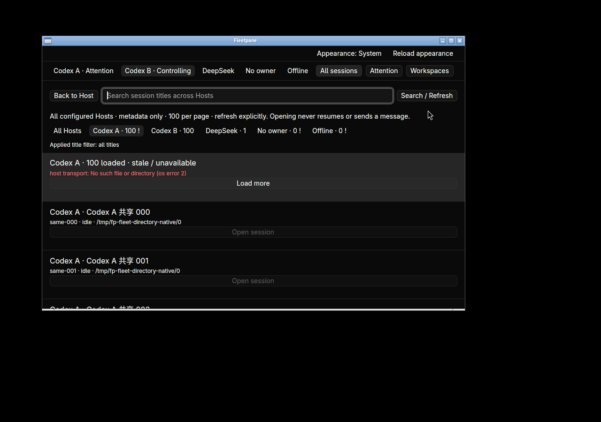
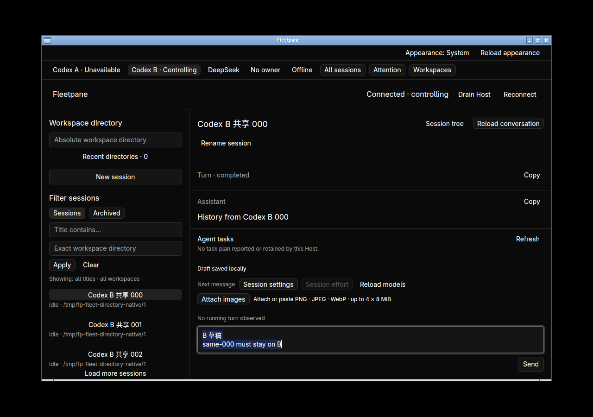

# Cross-Host session directory — 2026-10-21

Implemented on base `a2eb056`. This is shared engine/CLI and Linux native
acceptance with private synthetic Codex/ACP providers. No external model, remote
connection, macOS/Windows native or replacement-release claim is made.
See [ADR 0071](../adr/0071-cross-host-session-directory.md) and the
[receipt](assets/fleet-directory/receipt.json) for source/binary/check hashes.



The process fixture owns two Codex Hosts with 237 identically named IDs each,
one ACP Host waiting for permission, one unowned Host and one offline endpoint.
The shared `sessions` CLI returns configuration order, metadata-only 100-row
pages, independent Host incarnations and explicit partial errors. Paging one
Host returns 100 / 100 / 37; Unicode title search finds `same-236` on both Hosts
outside the original first page. Exact workspace, empty result, failed query,
unsupported ACP title search, unknown Host incarnation and missing paging fence
are checked. Invalid directory input fails explicitly.

Snapshot comparison preserves every field except `sequence`, which legitimately
advances when query replies enter the ordered event stream. The first checker
incorrectly required that sequence to remain constant; inspecting the field
differences and runtime query recording established the reason. The corrected
checker retains all other comparisons: owner, Host/provider PID, admission,
active turn, pending request and complete mutation-receipt inventory remain
unchanged. This is not evidence of an unchanged event stream.

Four new domain/protocol tests cover colliding identities, stale failed-query
retention versus clearing a different query, rejected replacement-Host paging,
cursor validation, controller change between the two snapshots, unowned refusal
and a metadata page that improperly includes history. Scripted transport asserts
only Snapshot / Query / Snapshot, with the original lease and 100-row limit;
the unowned case issues only Snapshot.

In hidden desktop `fleetpane-fleet-directory-20261021`:

- All sessions shows Codex A/B, DeepSeek, unowned and offline groups. Load more
  reaches 100 → 200 → 237 while the other groups retain their counts. Host filter
  buttons select the visible group; Unicode search/Enter refreshes all providers.
  DeepSeek's unsupported server-side title search is explicitly visible.
- Open `same-000` from B first: source banner names that exact ID, the view stays
  read-only and no Host ownership changes. Explicit Take control then Open selected
  session renders B's history. Repeating through A renders A's history for the
  same ID; native Copy reads exactly `History from Codex A 000` (24 bytes).
- A B-only draft, `B 草稿\nsame-000 must stay on B`, survives the A/B switch and
  reopening B through the global directory. Native clipboard reads exactly
  **32 UTF-8 bytes**, and SQLite readback binds it to B's endpoint/incarnation,
  thread and directory. Nothing was sent.
- At 900×560, directory search, Host filtering, paging and session opening remain
  usable. Stop the owned Host A, then Refresh: its 100 old rows remain visible
  with an explicit unavailable/stale error and disabled Open session buttons.
  Other groups stay available.
- Open the ACP source while it has an original pending permission. Read-only
  preparation preserves its owner, exact request, original active turn and
  mutation count. After explicit takeover and history inspection, that request
  and active turn still match, and no new mutation receipt appears. No approval,
  answer, Stop, resume or prompt was sent.




After adding protocol/input validation, the final rebuilt desktop is launched
again against the surviving Hosts. Search finds B's `same-236`; exact history
Copy reads `History from Codex B 236` (24 bytes). Clearing the filter and opening
B's `same-000` restores the same 32-byte draft after window replacement. The
receipt distinguishes first-run and final binaries. Both titlebar closes exit 0;
complete surviving Host snapshots before/after final close are identical.
The hidden workspace and all owned Host/provider processes are stopped afterward.



Commands, all passing:

```sh
cargo test --workspace --locked -j2
cargo clippy --workspace --all-targets --locked -j2 -- -D warnings
cargo build -p fleetpane-host --locked -j2
cargo test --manifest-path apps/desktop/Cargo.toml --locked -j2
cargo clippy --manifest-path apps/desktop/Cargo.toml --all-targets --locked -j2 -- -D warnings
cargo build --manifest-path apps/desktop/Cargo.toml --locked -j2
cargo fmt --all --check
cargo fmt --manifest-path apps/desktop/Cargo.toml --check
python3 scripts/fleet-directory-smoke.py
python3 scripts/directory-smoke.py
python3 -m unittest discover -s scripts/tests -p '*_test.py'
```

Workspace tests total **233**, including 162 session tests; desktop tests **25**;
Python tests **15**. The new process smoke is added to the existing standard
Linux/macOS CI jobs; this document records local results only. Registry editing,
real-time subscriptions, global running/activity order, remote connections,
provider-specific full-index limits, keyboard directory navigation and native
accessibility remain unaccepted. Current provider order is retained; filtering
never silently switches to incomplete local-only search.
