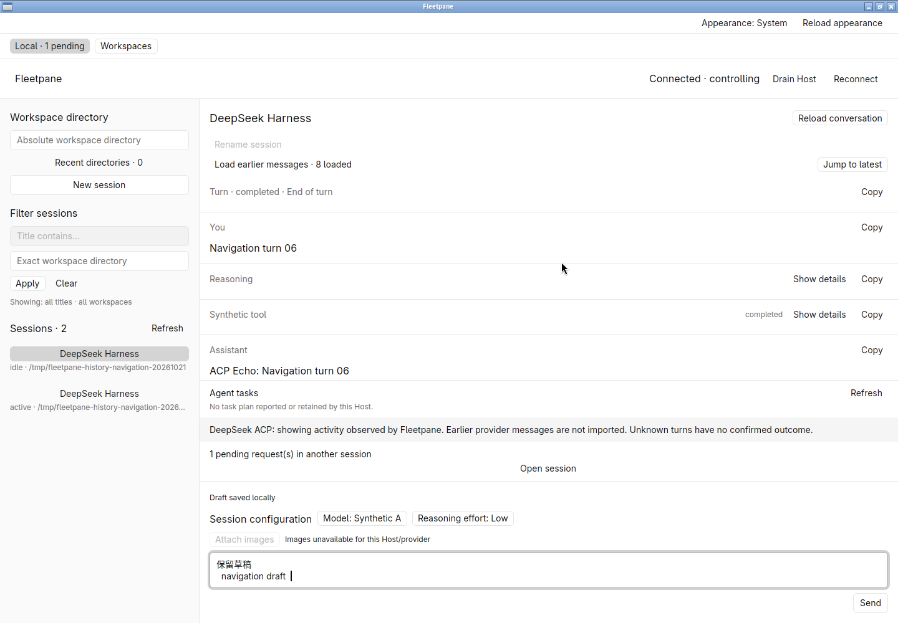
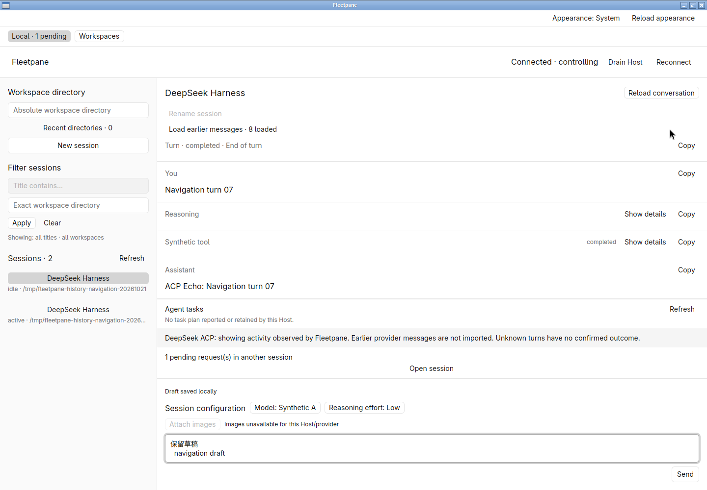
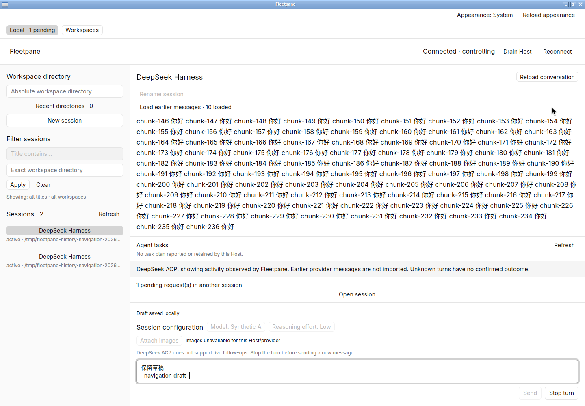
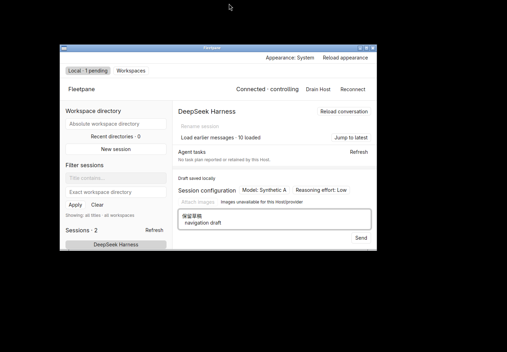

# Conversation tail navigation — 2026-10-21

Retained work on `c91d269247207a08898e264c81083df4fbd4e745`;
[receipt](assets/history-navigation/receipt.json) binds source, binary, fixture
adaptation and evidence hashes. This is local Linux native acceptance, not remote
CI, deployment, external model or macOS/Windows acceptance.

An owned ACP Host has eight completed turns in one session and a second session
waiting for an explicit tool permission. The native window claims control, opens
the first session, saves `保留草稿  \n  navigation draft  ` with exact whitespace,
loads an earlier history page and scrolls up. **Jump to latest** appears. Clicking
returns to the most recent loaded turn and hides the button. Host/provider/owner,
operation count, pending permission, active work and the saved draft revision/data
are unchanged. No provider mutation was generated by navigation.

The fixture's existing 50-chunk burst is extended only for this owned test to
300 chunks at 0.3 seconds each. A prompt is explicitly started through the owned
controller lease while the view is scrolled up. The older content remains visible
as new chunks arrive. Clicking **Jump to latest** resumes following. A second
manual scroll pauses following again; a second click resumes it. Screens show the
growing final row moving from chunk 87 through chunk 236 at the bottom, without
losing the exact draft or the other session's permission. Native Stop interrupts
only this stream; the other session remains active and waiting. Normal window
close exits zero. The owned Host/provider and hidden workspace are then stopped.

At 900 × 560 the navigation button and composer remain reachable, but the
timeline can have zero height. This existing minimum-height gap is explicitly
outside this change. The first resize attempt while maximized did not change the
window; only the restored, actually resized window is small-window evidence.
The initial QA preference directory also needed its required private permissions;
the corrected configuration was used before the accepted workflow.

Desktop formatting, strict Clippy, 11 desktop tests and native build passed.
The engine is unchanged by this UI slice; its latest queue-repair suite has
[separate evidence](2026-10-21-controller-store-queue.md). No new synthetic test
mirrors this button's implementation; actual native interaction is the acceptance
for the scroll behavior. Read-only/disconnected navigation, legacy providers
without paging, keyboard navigation, unread counts and cross-window scroll
restoration are not newly verified here. See [ADR 0044](../adr/0044-explicit-return-to-conversation-tail.md).
