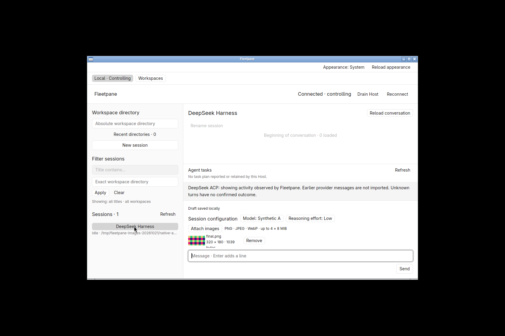
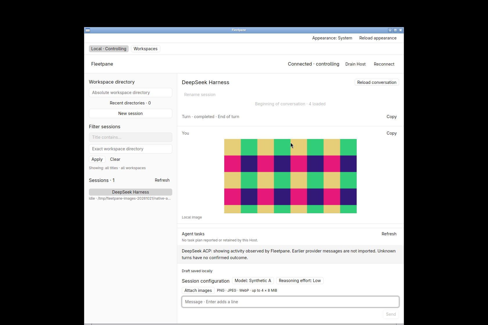
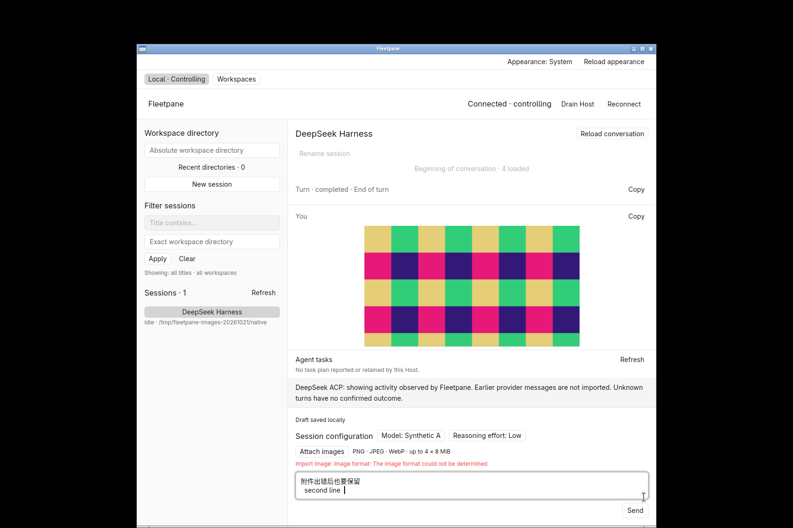
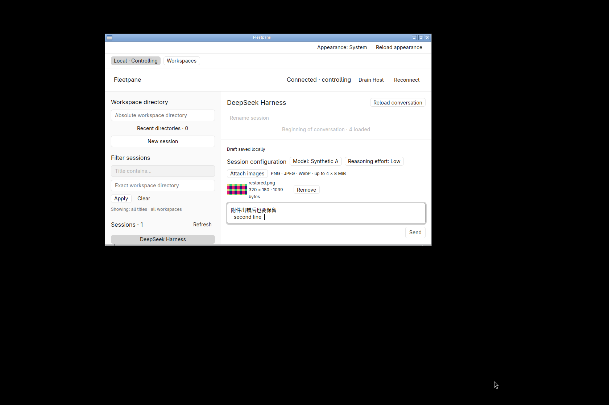

# Local image attachments — 2026-10-21

Built from `c91d269247207a08898e264c81083df4fbd4e745` plus the retained
uncommitted work. [Receipt](assets/image-attachments/receipt.json) records source,
binary and artifact hashes. Rust 1.98.1, GPUI Kit 0.7.3, Linux X11/software Vulkan.
This is local implementation/behavior evidence, not remote CI or release acceptance.

## Shared engine and provider evidence

`images-smoke.py` uses owned Host/provider processes. Supported ACP and Codex
fixtures verify image-only sends, original bytes after deleting source files,
3,147,775-byte PNG payloads, exact Chinese text/indentation/trailing spaces,
duplicate UUIDs after asset deletion, tamper refusal without fencing the provider,
failed selection preserving the revision, removal and receipt-driven draft clearing.
ACP restart restores local image references from its observed archive. A provider
without the image capability refuses sending and retains the draft without an
attempt or provider prompt. Unit tests additionally cover PNG/JPEG/WebP decoding,
wrong extensions, dimension/byte/count limits, symlinks/FIFO/directory sources,
non-private/corrupted assets, independent socket suffixes, quota/lock failure,
draft CAS compatibility and pending/unknown receipt recovery with images.

`codex-images-smoke.py` runs installed Codex app-server with an isolated CODEX_HOME
and a loopback SSE model. Two image-only turns, including the 3 MiB image, reach the
HTTP model with exact original SHA-256/byte counts. The second request includes
both images as conversation context. Sources are deleted before dispatch; saved
history keeps `localImage` references and stays below 16 KiB. Both turns complete,
the provider PID stays the same and the draft clears only after its receipt. This
proves real app-server image transport, not external model vision.

A separate disposable DSH_HOME handshake uses installed DSH 0.2.0-rc.2, with no
credential copy or prompt. Its ACP v1 initialize response explicitly reports
`promptCapabilities.image: false`. The UI/Host correctly keep its image sends
disabled; supported ACP image behavior uses the deterministic provider.

## Native workflows

Task-owned hidden desktop `fleetpane-images-20261021`; private Host sockets and
synthetic provider state. Native file-picker tests use a private session bus and
portal backend; the final run also isolates HOME/XDG data/cache/config.

Native checks cover two previews, removing exactly one image, normal close/reopen
without restarting the Host/provider, source deletion, restored preview, pure-image
Send, cleared composer and the actual image in user history. Importing a file
containing `not an image` shows a visible error and preserves the exact saved
Chinese two-line draft, including trailing spaces. A subsequent valid import keeps
that text. At 900 × 560 the image preview, Remove and Send remain reachable;
there is still no guaranteed timeline height. The final build repeats import,
normal close, source deletion, recovery and send after fixing asset-root aliasing.

Earlier QA attempts are not final acceptance: a picker first used the inherited
desktop bus and was moved to a private bus; its screenshots with personal recent
filenames are excluded. One low-level window-close tool removed the X window but
left its process running; this is not accepted as normal quit or fixed in product
code. That owned process was terminated. Final native close uses the window-manager
close action, checks process exit, and preserves all draft state.






## Checks and remaining acceptance

```sh
cargo fmt --all --check
cargo clippy --locked --workspace --all-targets -- -D warnings
cargo test --locked --workspace
cargo build --locked -p fleetpane-host
cargo check --locked --workspace --all-targets --target x86_64-pc-windows-gnu
cargo fmt --manifest-path apps/desktop/Cargo.toml --check
cargo clippy --manifest-path apps/desktop/Cargo.toml --locked --all-targets -- -D warnings
cargo test --manifest-path apps/desktop/Cargo.toml --locked
cargo build --manifest-path apps/desktop/Cargo.toml --locked
python3 scripts/images-smoke.py
python3 scripts/codex-images-smoke.py
python3 scripts/acp-smoke.py
python3 scripts/drafts-smoke.py
python3 scripts/steering-smoke.py
python3 scripts/acp-archive-smoke.py
python3 scripts/session-smoke.py
python3 scripts/runtime-smoke.py
python3 scripts/query-smoke.py
uvx --offline ruff check scripts/images-smoke.py scripts/codex-images-smoke.py scripts/acp-fixture.py scripts/provider-fixture.py
uvx --offline ruff format --check scripts/images-smoke.py scripts/codex-images-smoke.py scripts/acp-fixture.py scripts/provider-fixture.py
git diff --check
```

The final root workspace suite passed 147 tests; desktop passed 11. An earlier
full root run exposed SQLite lock contention in concurrent recent-directory and
workspace-pin writes. Its failure log is retained with this receipt; both isolated
tests and the subsequent full run passed. This run did not establish a contention guarantee. The later
[controller-store queue repair](2026-10-21-controller-store-queue.md) has separate
before/after evidence and source/binary identities. Formatting, Clippy,
Windows engine cross-check and the listed process smokes passed locally.

Remote CI, macOS/Windows native file pickers, real external vision models,
OpenCodex live image acceptance, remote upload and concurrent image-send resource
budgets remain unverified. Large base64 image echoes can exceed the unchanged
incoming provider frame limit. See [ADR 0042](../adr/0042-local-image-attachments.md).
