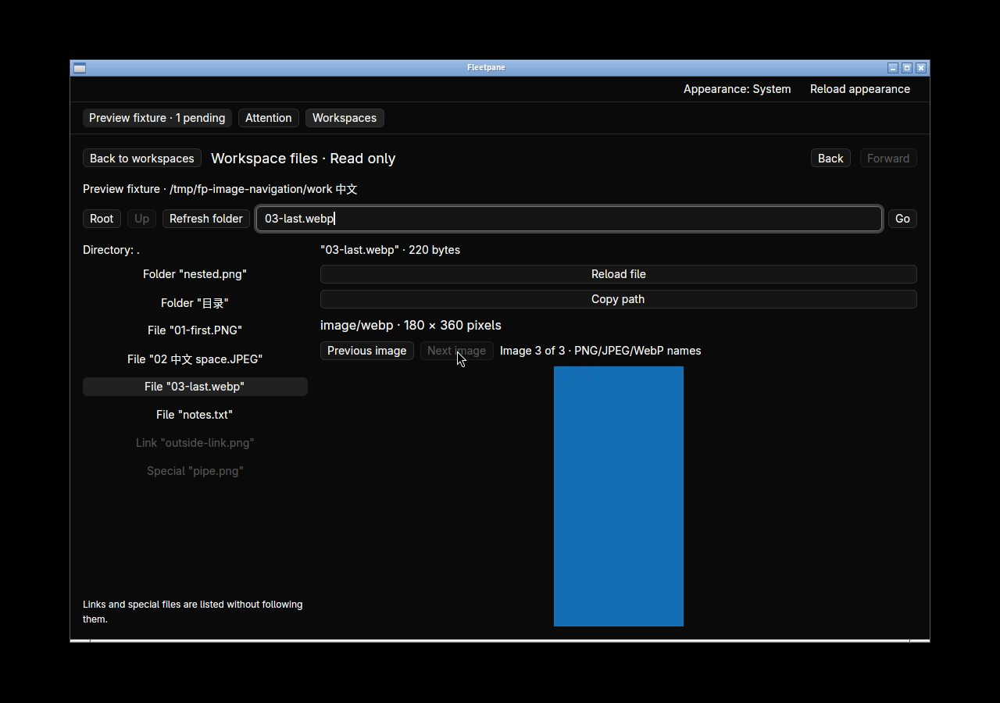
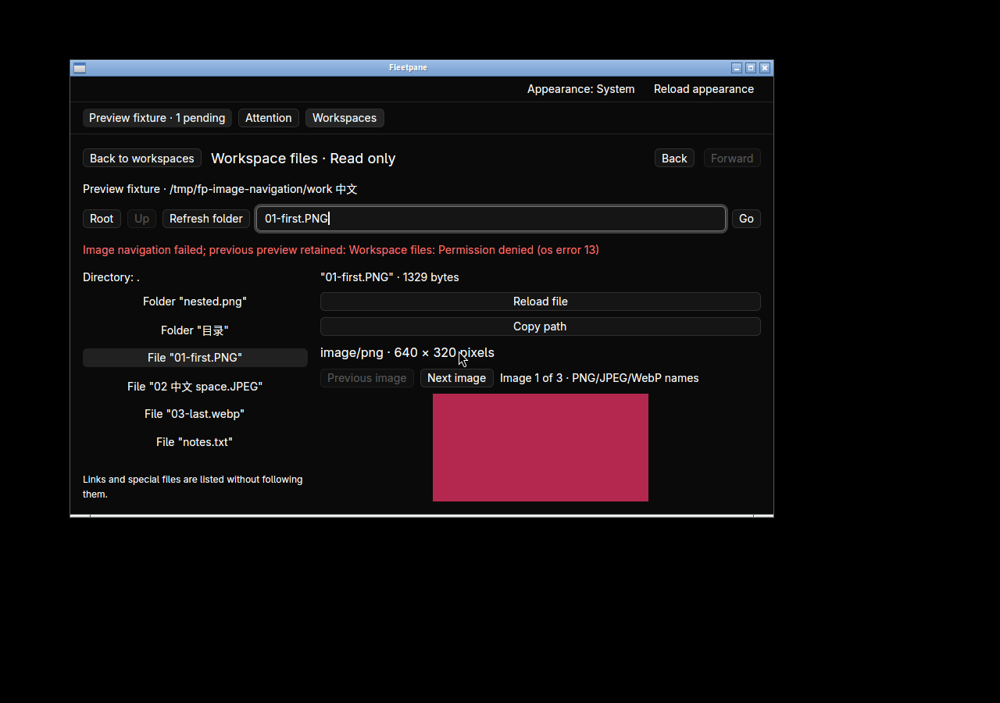
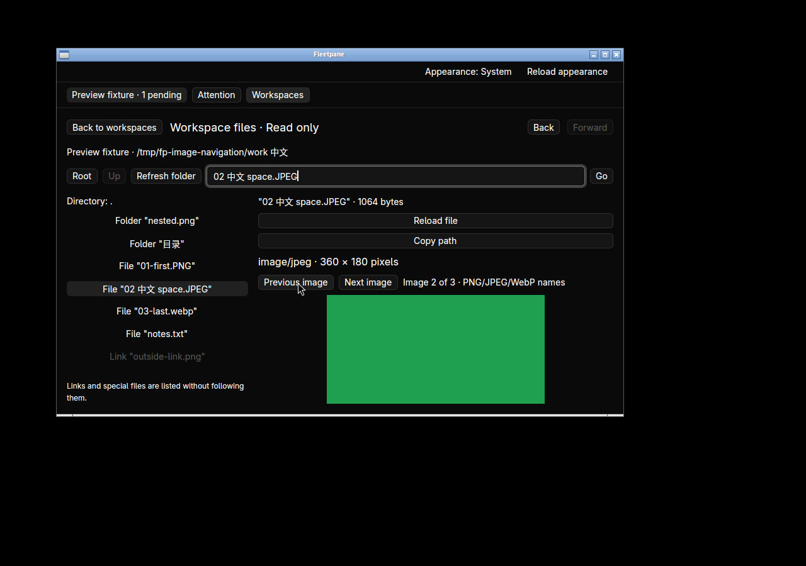

# Native directory image navigation — 2026-10-21

Implemented on base `72b2e7a`. The [receipt](assets/image-navigation/receipt.json)
binds source/binary hashes, checks, screenshots, clipboard observations and Host
snapshot preservation. This is Linux native acceptance with synthetic local
images and an ACP fixture, not an external-model or release acceptance.

The original binary has single-file preview and Back/Forward, with no sequential
image controls. The changed binary adds Previous image, Next image, position and
count. See [ADR 0070](../adr/0070-directory-image-navigation.md).



In isolated desktop `fleetpane-image-navigation-20261021`, the same private Host
and provider retain an unrelated pending permission throughout:

- PNG → corrupt PNG → PNG bytes under a WebP filename: corrupt input has its own
  visible error and remains Image 2 of 3. No silent skip. Editing the last image
  externally before Next shows its new 320×160 dimensions, not its earlier
  200×500 bytes. First/last buttons disable without wrapping.
- Native JPEG and WebP files generated by ImageMagick render with correct MIME
  and dimensions (360×180 JPEG and 180×360 WebP). A Chinese/space/uppercase JPEG
  path copies exactly as **20 UTF-8 bytes**. Earlier added-path copy is **12 bytes**.
- Delete the pending neighbor and add a different image before Next: the fresh
  listing selects the new path, with its observed 150×75 metadata. Delete the
  current image before another step: the explicit missing-current error keeps
  its previous preview; new directory metadata removes it from the list.
- Replace a neighbor with an outside symlink: it disappears from the image index,
  both image buttons disable at 1 of 1, and no outside content loads. A `.png`
  directory, another symlink, a `.png` FIFO and ordinary text never enter the count.
- Deny read permission to the next regular image: the error retains the current
  preview and 1-of-3 position. Restore permission and explicitly click Next: the
  JPEG opens. Replacing the saved root directory is explicitly refused and clears
  the preview; the original directory is restored afterward.
- Back/Forward revisit the image selection; a missing historical destination
  remains an explicit failure without moving the history cursor. Restoring it
  permits explicit retry. At 900×560, Previous/Next and the fitted image remain
  usable. Direct Go/Enter shows Load image list, which restores directory entries
  and position/count without sending to the provider.




Complete Host snapshots before the original desktop, after replacement, after
image navigation and after the candidate close request are identical. Provider
PID 729962, Host ownership, operations and the pending request remain unchanged.
The original desktop exited 0 after titlebar close. The candidate was still alive
in the immediate close readback and absent by cleanup; the final workspace record
says exit 0. This run does not establish its exact close/exit ordering. Workspace
stop completed, and only the owned Host/provider were terminated afterward.

Checks:

```sh
cargo test --manifest-path apps/desktop/Cargo.toml --locked -j2
cargo clippy --manifest-path apps/desktop/Cargo.toml --all-targets --locked -j2 -- -D warnings
cargo build --manifest-path apps/desktop/Cargo.toml --locked -j2
cargo fmt --manifest-path apps/desktop/Cargo.toml --check
python3 scripts/file-images-smoke.py
python3 scripts/file-navigation-smoke.py
```

All pass; desktop tests total **25**, including three new cases for filename
membership, exact directory order/endpoints, Unicode, fresh deletion and missing
current identity. Existing filesystem process checks retain byte, limit, root,
symlink and special-file boundaries. History-reader/Python checks are recorded
separately in the receipt. No new remote CI result or macOS/Windows native claim.

The count uses the most recent explicit directory observation. No watcher,
thumbnail grid, preload, zoom, full-size window, cross-view history, embedded
Markdown image or extensionless image discovery is provided by this slice.
