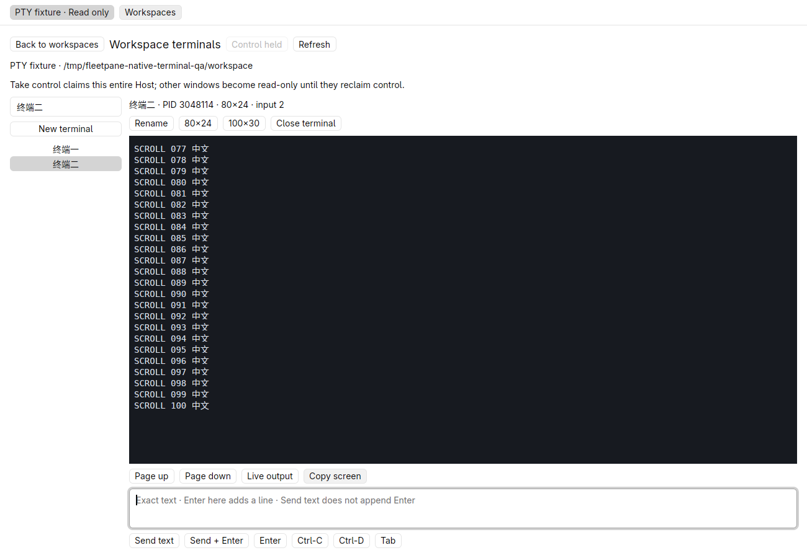
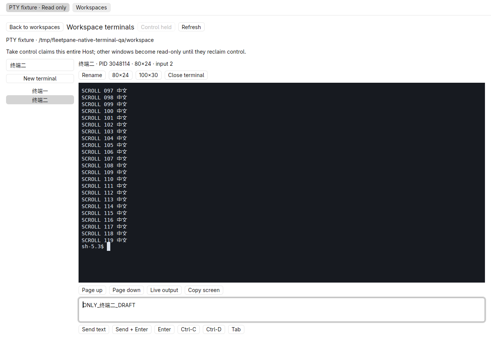
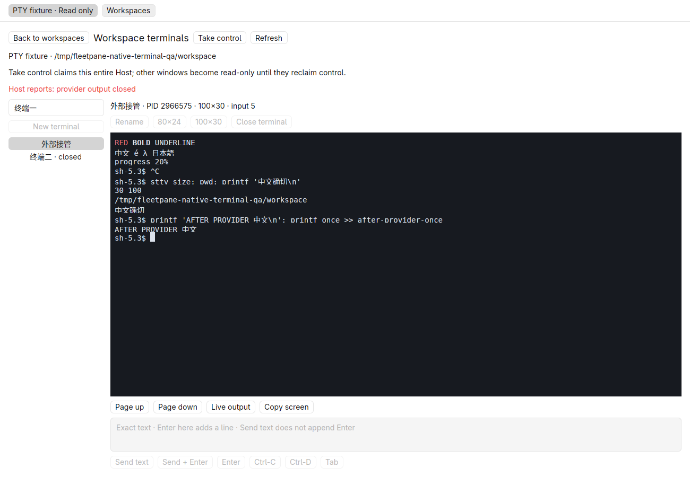
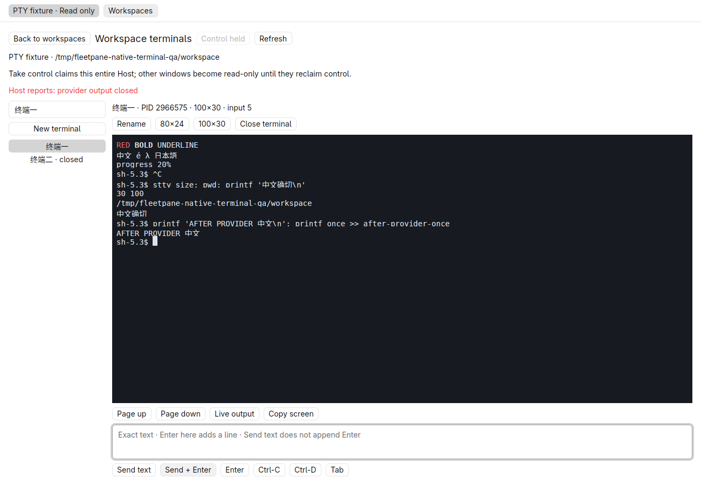
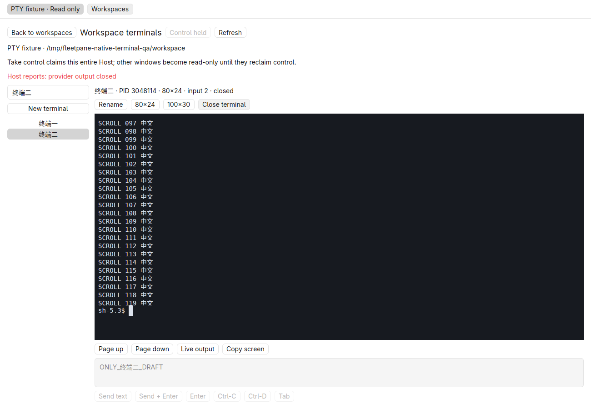
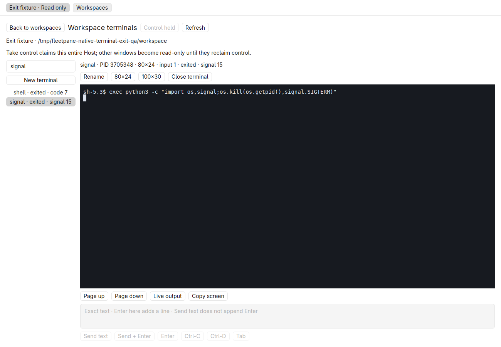

# Native terminal panel — 2026-10-21

Uncommitted work based on `c91d269247207a08898e264c81083df4fbd4e745`.
Linux X11, software Vulkan, Rust development builds and GPUI Kit 0.7.3.
Private fixture provider plus real POSIX shells; no shared runtime or real LLM
was used. This acceptance does not establish macOS/Windows behavior, IME,
performance improvement, remote CI or complete terminal/Paseo compatibility.

## Implementation and checks

The shared session screen validates identity/ranges, decodes incremental UTF-8
and ANSI, and bounds dimensions/scrollback. The GPUI Kit view exposes shell
selection, explicit control, create/rename/resize/close, visible-screen copy,
history paging, exact text and control bytes. Uncertain operation checks use the
same immutable UUID without dispatching again. The panel does not implement a
raw keyboard terminal. See [ADR 0030](../adr/0030-native-terminal-screen.md).

Passed commands:

```sh
cargo test --workspace --locked
cargo clippy --workspace --all-targets --locked -- -D warnings
cargo build -p fleetpane-host --locked
cargo fmt --all --check
cargo test --manifest-path apps/desktop/Cargo.toml --locked
cargo clippy --manifest-path apps/desktop/Cargo.toml --all-targets --locked -- -D warnings
cargo build --manifest-path apps/desktop/Cargo.toml --locked
cargo fmt --manifest-path apps/desktop/Cargo.toml --check
python3 scripts/terminal-smoke.py
git diff --check
```

107 root Rust tests and 8 desktop tests passed. Three new screen tests cover
byte-split UTF-8/escape sequences, combining/wide glyphs, styles, carriage-return
updates, alternate screen restoration, loss/reset, wrong identities/cursors,
scrollback bounds and invalid dimensions. A desktop regression covers one click
queued during a read, coalesced polls, duplicate-click exclusion and no replay
following completion. Root checks ran after the screen/dependency change;
affected desktop checks ran again after the interaction fixes. The final Host
build also includes a later help-text update; native behavior used unchanged
runtime/session sources. Artifact identities are recorded in the receipt.

The existing real-PTY process smoke passed for Codex and ACP protocol fixtures,
including ownership, bytes, resize, output loss, durable lost-reply deduplication,
provider-fault independence and journal-fault fencing. Its raw result is retained
alongside this slice's test/build logs.

## Native observations

The window opened the registered ordinary workspace, then **Terminals**.
It listed/read shells without taking control. Explicit control enabled creation;
the shell's actual `pwd` matched the saved directory. Unicode rename preserved
terminal UUID/PID. **100×30** changed `stty size` to `30 100`.

**Send text** sent a command without executing it; a separate **Enter** executed
it and appended exactly one `once` marker. The screen showed red, bold and
underlined text, Chinese/Japanese, a combining accent, and `progress 20%`
overwriting `progress 10%`. Copy returned the expected 64 UTF-8 bytes without ANSI:
`RED BOLD UNDERLINE`, `中文 é λ 日本語`, the final progress line and prompt.
A live alternate-screen test showed green `ALTERNATE 中文` and restored the
primary screen afterward. Initial render/resize/alternate screenshots predate
only the scheduler/draft fix; final screenshots below use the corrected build.

The initial trial reproduced a lost Send click while a background read disabled
controls. Splitting read activity from mutation activity fixed the owning cause.
The corrected build sent a 120-line command during polling. **Page up** and
**Copy screen** returned exactly lines 077 through 100; **Live output** returned
to the prompt. An unsent Chinese draft stayed with terminal two when switching
to terminal one and back. Ctrl-C preserved the current unsent composer text.




Closing the first desktop preserved both shell UUIDs/PIDs, geometry, labels and
input sequence. The corrected desktop reopened those same shells. An external
explicit controller takeover changed the panel to read-only, retaining output.



Terminating only the owned fixture provider showed its fault while PTYs remained
usable. The native panel closed terminal two and sent another command to the
original terminal one; same-user CLI readback showed its same PID and the
closed second shell. The second side-effect file contained exactly one `once`.




Restarting the owned Host produced a new incarnation with no terminal resources.
The panel cleared its old selection/control and did not resend either command;
both side-effect files remained `once`. This is refusal/reconciliation evidence,
not PTY recovery across a Host update. Hosts, provider, native windows and hidden
desktop were stopped afterward; identities and cleanup are in the
[receipt](assets/native-terminals/receipt.json).

## Exit-state follow-up

Following the scoped review through Paseo ordinal 42, the panel now displays
actual exit code or terminating signal instead of only an exited label. A second
private native run used the final desktop binary and freshly built Host. Desktop
tests (8), Clippy and build passed again after this change.

A real shell executed `exec python3 late.py`: the main process exited with code
7 while a forked writer held the PTY open for twelve seconds. The panel showed
`exited · code 7 · output still open` with input disabled, then received
`LATE_OUTPUT 中文` and removed the open-output notice after EOF. A separate shell
terminated itself with SIGTERM; both native display and same-user CLI readback
reported signal 15. The earlier exited output remained inspectable. Both PTY
process groups were absent at cleanup, along with this second Host/provider,
desktop and hidden workspace. The receipt's exit addendum binds this final binary
and source separately from the first native run.




## Limits

Raw key forwarding, selection, IME, terminal query replies/mouse reporting,
automatic geometry, conversation association and Host update recovery remain
open. Resize does not reflow history; screen copy is visible emulated text, not
raw bytes or complete history. One selected screen is retained; drafts and pending
operation selection are transient. Native lost-reply Check operation, hostile
escape/compatibility suites, output-loss notice and 60×200 boundary acceptance
were not exercised through this window; corresponding engine/protocol evidence
must not be promoted to native acceptance. No real OpenCodex/DeepSeek model
integration was rerun for this independent PTY slice.
