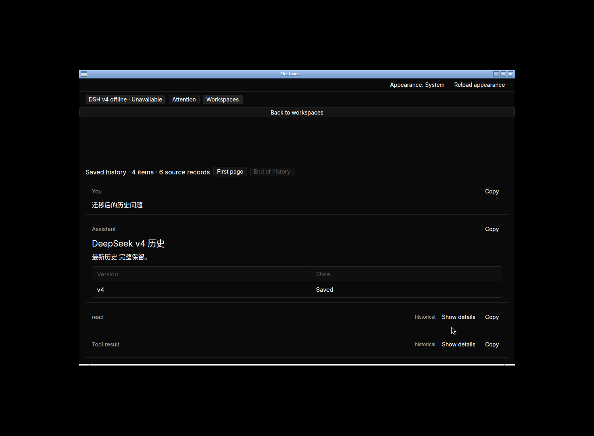

# DeepSeek v4 history migration — 2026-10-21

The migration engine now imports DeepSeek Harness v4 plain/compressed histories
and selects the highest canonical generation. An old binary reproduced silently
choosing v3 when a newer v4 artifact coexisted. Unsupported/corrupt newest
generations and ambiguous compression fail explicitly. [Contract](../adr/0063-deepseek-v4-history-generations.md).

## Automated verification

- `cargo test --workspace --locked`: **211 tests pass** (4 client, 4 protocol,
  63 runtime, 140 session). The focused `cargo test -p fleetpane-session --locked
  paseo_import` run passes **24 tests**, including three new generation regressions.
  These cover canonical names, numeric selection including future v12 refusal,
  plain and concatenated Zstandard v4, raw native tool results, header mismatch,
  corrupt latest generation, encoding ambiguity, source preservation and reopened
  snapshots after source removal. Failure leaves no published/temporary archive.
- `cargo test --manifest-path apps/desktop/Cargo.toml --locked`: **19 pass**.
  Both strict Clippy checks (`--all-targets --locked -- -D warnings`), both format
  checks, Host/desktop builds, script Ruff and `git diff --check` pass.
- `python3 scripts/paseo-dsh-v4-smoke.py`: public CLI preview/import/copy/read
  selects v4, preserves exact Markdown/native tool output and an unknown record,
  leaves sources unchanged, and rereads after source deletion with no Host.
  `--binary OLD_BINARY --before` reproduces the former v3 selection.
- The same smoke with `--dsh-codec` pointing at the installed DSH package's
  `dsh-session-format-v3-to-v4/lib/index.js` uses that provider's released encoder
  and strict decoder, then concatenated Zstandard frames. All checks pass; no
  credentials or external model are used. This validates physical framing,
  not full model-session lifecycle semantics.
- Existing single-workspace, bulk migration and independent Codex fork smoke
  scripts pass. Python history/concurrency script tests: **15 pass**.
  The new dependency-free v4 smoke is included in non-Windows CI; remote CI has
  not run against this working tree.

The [receipt](assets/paseo-dsh-v4/receipt.json) records source/executable hashes,
process identities and local results. Logs and synthetic screenshots are alongside
it. An initial test compile failed because a borrowed path was passed to an owned
path API; corrected before verification. No failing unit run is counted as a
before-fix reproduction: the retained old executable's CLI result is that proof.

## Native verification

Task-owned hidden Linux workspace `default`, display 1500 × 1100 and app
1100 × 720. The returned workspace handle is used throughout. Endpoint absent,
so no provider starts and no live Paseo session is claimed or resumed.

1. Preview synthetic Unicode workspace metadata and import it in place. Click
   **Copy workspace history**, then **Sessions → View history**. The selected raw
   source is `session.v4.jsonl.zstd`, while a valid old v3 artifact coexists.
2. The page shows four items and six retained source records. Chinese question,
   heading, emphasis and Markdown table render; **Copy** returns the exact
   105-byte Markdown. Expand the tool result: native tool-role content appears,
   and **Copy** returns the exact original result and call identity.
3. Close/relaunch the desktop using the same controller store. Without recopying,
   reopen the imported session and read the same history. Both running desktop
   executable hashes match the final built binary. Private archive and original
   source hashes remain unchanged; no Host socket exists.

The first closed desktop still had a live process when cleanup was checked;
workspace stop terminated both owned app groups. Graceful process exit remains a
separate known gap. The task-owned hidden workspace is stopped; no existing user
daemon, agent or shared proxy is restarted.

## Real local archive readback

One real nonempty v4 log associated with a Paseo session was copied into a private
temporary controller store through the public CLI. It retained **86 source
records / 51 projected items**, first page **13 items** within the byte budget,
with no incomplete-tail warning. Header version is 4; the source SHA-256 is
unchanged and no Host starts. Private transcript/path evidence stays under
`/tmp/fp-dsh-v4-real`; only aggregate counts enter repository artifacts. This is
one real read-only sample, not full migration or native acceptance of private data.

## Remaining limits

Already imported snapshots retain their original generation; this does not
refresh old v3 copies. DeepSeek context continuation, future formats, full semantic
validation, external image copying, durable batch receipts and synchronization
remain open. No new model run, non-Linux acceptance, performance improvement,
replacement release, commit, push or hosted CI success is claimed.
