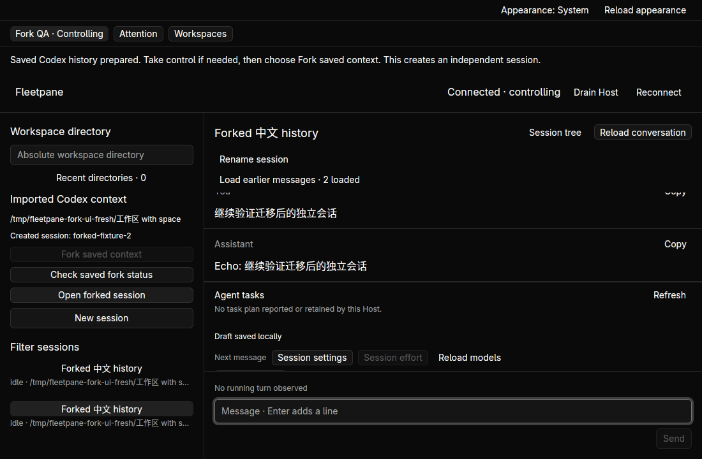

# Continue a migrated Codex context — 2026-10-21

Complete saved legacy Codex histories can now prepare and explicitly dispatch an
independent provider fork. The source identity and snapshot remain intact. GUI
and CLI share a durable operation binding, reject repeated submission and recover
the original result through a read-only receipt. [Contract and remaining limits](../adr/0061-independent-codex-history-continuation.md).

## Automated and real-provider checks

- `cargo test --workspace --locked`: **206 tests** pass (4 client, 4 protocol,
  63 runtime, 135 session). Five new tests cover raw export after source removal,
  exact unknown-record preservation, modified-export refusal, incomplete tails,
  paginated/unknown/null/malformed history modes, schema-8 upgrade preserving
  archived data, concurrent attempt CAS/reopen and invalid fork replies.
- `cargo test --manifest-path apps/desktop/Cargo.toml --locked`: **19 tests** pass.
  Root/desktop format checks, both `cargo clippy ... --all-targets --locked -- -D
  warnings`, builds and `git diff --check` pass.
- `python3 scripts/paseo-fork-smoke.py`: four concurrent preparations converge on
  one UUID/export; preparation has no provider mutation. Source-log removal does
  not prevent forking. Successful history readback, one side effect, duplicate
  refusal, immutable archive hash, killed controller after admission, pending
  receipt and Host-restart unknown without replay all pass. A separate drain /
  reopen case preserves its original stale binding and refuses dispatch without
  consuming its attempt.
- `python3 scripts/paseo-fork-smoke.py --real`: installed Codex **0.163.0** with
  an empty task-owned `CODEX_HOME` and loopback rejecting model. The fork has a
  new ID, idle status, matching cwd and no model call. Legacy history reads back
  the imported marker. Explicit next-turn HTTP input contains that marker; the
  expected rejection settles as a failed turn. No external model/account is used
  in this mode.
- `python3 scripts/paseo-fork-smoke.py --opencodex`: independent native Codex
  app-server through the already-serving OpenCodex loopback proxy on port 10100,
  model `gpt-6-astra`, private configuration and no credential/session copying.
  A real completed turn returns `FLEETPANE_IMPORTED_CONTEXT_中文_42`, present only
  in the imported conversation. The script checks the new turn's assistant item,
  not a substring in older history. This proves continuation from saved context.
  The shared OpenCodex service is not reconfigured or restarted. The `opencodex`
  CLI itself does not implement `app-server`; native Codex owns that protocol.
- Existing single/bulk migration, appearance, recent-directory and archive
  restoration smoke checks pass. Python script tests: **15** pass. Synthetic
  fork coverage is included in non-Windows CI configuration; hosted CI has not
  run against this working tree.

The local fixture originally contained only model-context `response_item`
records, so native legacy UI history was empty. Codex's legacy transcript contract
uses separate `event_msg` records. The fixture now supplies both and tests model
context and visible history independently; production export preserves all raw
records. An initial cleanup race waited only for the Host/Node launcher, allowing
the native child to keep writing its private home. Cleanup now waits for the
owned process group after stopping the Host, and real checks exit successfully.

## Native acceptance

Hidden Linux workspace `fp-paseo-fork`, 1500 × 1100 display, 1100 × 720 windows.
Public artifacts use synthetic data. The [baseline receipt](assets/paseo-fork/receipt.json)
records source/archive hashes and the two controller stores. These native images
precede the later unsent-reprepare change; current binary/source identities and
new native acceptance are recorded in the [reprepare receipt](assets/paseo-reprepare/receipt.json).

The original native run prepared and created one fork, hydrated the saved Chinese
Markdown history and disabled repeated dispatch. After replacing the desktop,
the final binary reopened the imported session, recovered the same created ID
through **Check saved fork status**, and opened its history. The original provider's side
effect file still contains exactly one fork. The final sidebar layout keeps the
session list visible while the expanded controls scroll within a height bound.
A further native finding was that successful fork hydration did not refresh the
session directory. The final build refreshes it once after hydration settles;
the fresh final run below verifies the new session appears in that list.
The original Host predates the final build; its recovery evidence is distinguished
from fresh final-Host acceptance in the receipt.

A second private controller and final Host/desktop binaries exercise a fresh
preparation and explicit native fork, history hydration and subsequent send.
Source metadata/log and archived SQLite hashes are checked independently of
rendering. Final native Send and desktop replacement retained the exact completed
Chinese reply; [readback](assets/paseo-fork/native-readback.json) distinguishes
the earlier controller's fork from the final controller's one dispatch. Native screenshots show prepared ownership gating, completed history
and a recovered result. These desktop cases use a deterministic provider; the
real OpenCodex continuation above uses the CLI/shared engine.

## Remaining boundaries

DeepSeek ACP, paginated Codex context stores, live Paseo takeover, partial tool
exchange repair, refreshing archives, multiple
independent forks from one imported identity remain open. A pre-admission crash
after persisting `attempted` can have an unresolved missing receipt; it does not
authorize automatic resend. Legacy full-history hydration retains the existing
500-item/2 MiB UI limit. No full migration of user real data, remote CI, platform
acceptance beyond Linux, commit or push is claimed.

Only task-owned desktops/Hosts are stopped after acceptance. Existing Paseo,
Codex sessions, shared proxy and unrelated hidden workspaces remain untouched.
