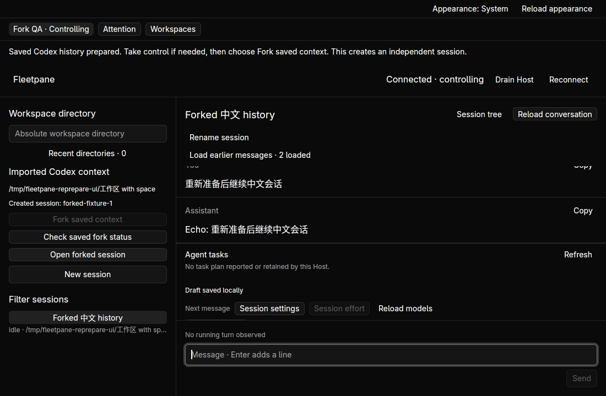

# Reprepare an unsent imported Codex context — 2026-10-21

A migration preparation previously became permanently unusable after a Host
restart or a drain/ready transition. **Reprepare unsent context** now explicitly
replaces only an unattempted binding. GUI and CLI share the conditional update;
old controllers must supply their reviewed operation UUID before sending. Already
attempted bindings remain immutable, including pending or unknown results.
[Decision and limits](../adr/0062-reprepare-unsent-codex-context.md).

## Automated verification

- `cargo test --workspace --locked`: **208 tests**, all pass: 4 client,
  4 protocol, 63 runtime, 137 session. **21 migration tests** pass in the focused
  run. Two new regressions cover concurrent replacements, stale-controller dispatch
  refusal, persisted identity after reopen, failed preparation preserving the
  saved binding, and replacement racing the original dispatch-attempt CAS. The
  existing dispatch-binding test also refuses replacement after an attempt.
- `cargo test --manifest-path apps/desktop/Cargo.toml --locked`: **19 tests** pass.
  Both manifest format checks, both `cargo clippy ... --all-targets --locked --
  -D warnings`, Host/desktop builds and `git diff --check` pass.
- `python3 scripts/paseo-fork-smoke.py`: stale dispatch refusal before/after
  drain, failed reprepare preserving the binding, two processes racing the same
  expected UUID (one wins), old-UUID refusal, offline failure and Host replacement
  followed by a successful independent fork. Exactly one provider side effect.
  A pending operation, a created operation and a restarted Host's unknown outcome
  refuse replacement. Existing preparation/export/archive checks still pass.
- `python3 scripts/paseo-fork-smoke.py --real`: installed Codex 0.163.0, private
  empty home, synthetic legacy archive and a loopback rejecting model. A drain/
  ready cycle and explicit reprepare precede the fork. New context is idle and
  no model request occurs until explicit Send. Its input contains the imported
  marker and the expected local rejection settles as failed. No external model
  or account in this mode.
- `python3 scripts/paseo-fork-smoke.py --opencodex`: the same reprepare/fork flow
  with a private native Codex app-server and existing OpenCodex proxy on loopback
  port 10100, model `gpt-6-astra`. A **new completed assistant turn** recalls
  `FLEETPANE_IMPORTED_CONTEXT_中文_42` from the archived context. No shared proxy
  restart/reconfiguration or source-thread resume.
- Single-workspace and batch import smoke checks still pass. Python history-tool
  tests: **15 pass** using `python3 -m unittest discover -s scripts/tests -p
  '*_test.py'`. Updated fork cases run through the existing non-Windows CI step;
  hosted CI has not run against this dirty working tree.

The [receipt](assets/paseo-reprepare/receipt.json) records source SHA-256, current
Host/desktop executable hashes, running-process identity, checks and native readback.
Raw command output is saved alongside it. These are local results.

## Native verification

Hidden Linux workspace `fp-paseo-fork`, 1500 × 1100 display and 1100 × 720 app.
A fresh task-owned store imports synthetic Unicode metadata, a workspace path with
spaces and complete legacy history. Both running executables match the final
binaries. The real provider test above uses CLI/shared engine; native interaction
uses the deterministic provider, without an external model.

1. Open the saved import and prepare its context. Take control explicitly, then
   drain its Host. Reprepare is refused while draining; saved UUID and `attempted`
   stay unchanged and the provider records no fork.
2. Accept new work. The original fork is still refused because its admission
   generation is stale. **Check saved fork status** reads the saved unattempted
   record; **Reprepare unsent context** creates a new operation UUID, reuses the
   original export and saves generation 2. No fork has been submitted.
3. Explicitly fork. Exactly one independent session appears in the directory;
   old Chinese/Markdown history is hydrated and the repeated-dispatch/reprepare
   controls are disabled or absent. Send `重新准备后继续中文会话`; the new completed
   turn contains exactly `Echo: 重新准备后继续中文会话`.
4. Replace only the desktop. Reopen the import, check saved status and explicitly
   open the same created ID. The same Host/provider processes and completed new
   turn remain. No second fork; source metadata, original JSONL and private
   archived SQLite SHA-256 all remain unchanged.

## Remaining limits

Reprepare stays on the registered endpoint; changing targets, keeping an audit
history of superseded unsent bindings and repeated independent forks remain open.
A failed pre-admission GUI dispatch conservatively disables its local attempt
until **Check saved fork status** reads the persisted state. Nothing automatically
replaces or resends. DeepSeek ACP and paginated Codex context continuation, full
real-data migration and non-Linux native acceptance remain open. No replacement
release, remote CI, commit or push is claimed.

After acceptance, only task-owned apps, Hosts and the hidden workspace are stopped.
Existing user Paseo/Codex sessions and shared model proxy remain untouched.
