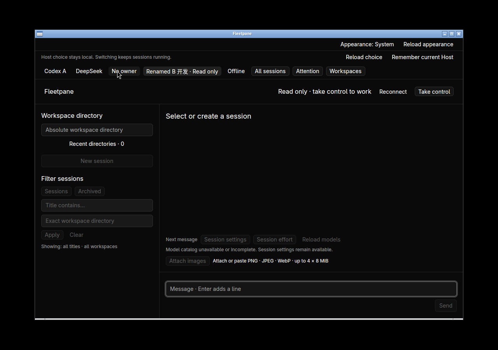
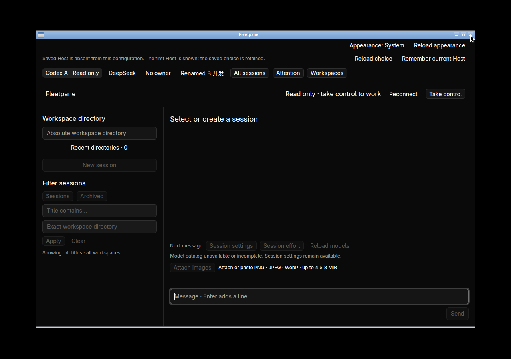
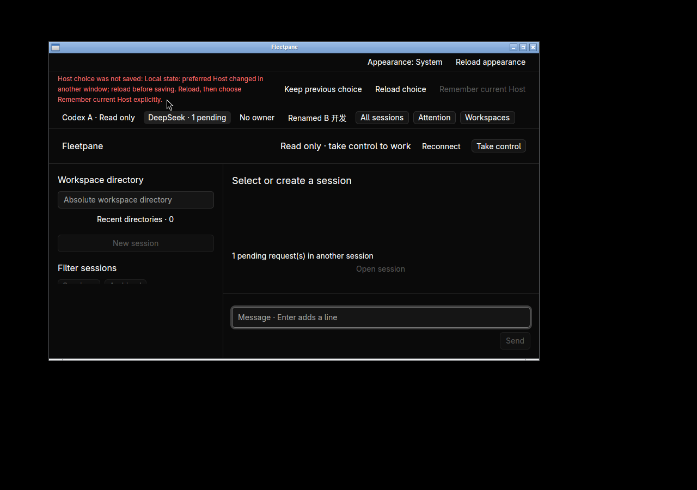

# Preferred Host — 2026-10-21

Implemented on base `5959ee8`. The native workbench now restores the last selected
local Host by exact socket path from its configuration-local controller store.
See [ADR 0072](../adr/0072-preferred-host.md) and the
[receipt](assets/preferred-host/receipt.json). Tests use private synthetic providers;
there is no external-model, remote-connection or non-Linux native acceptance.

Four shared tests cover exact Unicode paths across reopen/name/order changes,
missing endpoint without substitution, concurrent revision conflicts, failed
commit preservation, invalid/oversized/corrupt records and a schema-10 upgrade
that retains existing appearance and draft bytes. CLI smoke exercises the same
command in separate processes, including nonexistent configuration member,
conflict, failed commit, migration and refusal to overwrite corrupt data. No Host
is started by that smoke. Existing migration tests/fixtures now expect schema 11
and remove its table when constructing genuinely older schemas.

In isolated desktop `fleetpane-host-choice-20261021`:

- Select Codex B. CLI readback is revision 1 with B's exact socket. Close/reopen
  with a renamed B and changed configuration order: B is restored. Reorder again
  to put B fourth: B remains selected; the record still has revision 1.
- Select the offline endpoint and close normally. Reopening selects **Offline ·
  Unavailable**, with the original transport failure and no switch to a live Host.
  Remove that endpoint from the configuration: startup explains why it shows the
  first Host, while the original revision-2 offline preference remains unchanged.
- Inject a SQLite trigger that rejects selection writes. Clicking another Host
  keeps it usable and shows the exact write failure. Readback retains revision 2.
  At 900×560 the failure and all preference controls are visible. Titlebar close
  refuses to hide the error. Remove the trigger, Reload choice, then Remember
  current Host: revision 3 is saved; reload itself does not navigate or write.
- A separate CLI writer saves B at revision 4. Selecting DeepSeek in the stale
  window shows the revision conflict; the database still points to B. Keep
  previous choice explicitly discards this window's unsaved preference, retains
  the original ACP pending request and lets the normal titlebar close exit 0.
- Hold a real SQLite write transaction, select A and request normal titlebar
  close before releasing the lock. After release the stored A revision is 5 and
  the desktop exits 0. No extra delay or retry was added to persistence.
- The final rebuilt desktop restores A. Rapid B → A selection followed by normal
  close leaves A at revision 7 and exits 0. This final build differs from the
  earlier screenshots only by an extra unsaved-preference status message after
  explicit discard; the receipt binds the final binary and current source hashes.
  The first native binary hash was not retained.





All four complete Host snapshots compare equal to baseline after native actions
and final normal close: owner, incarnation, Host/provider PID, event sequence,
full receipt inventory, active turn and exact DeepSeek pending permission are
unchanged. Selection only uses local storage plus the existing read-only Host
snapshot observers. No control acquisition, history resume, prompt, Stop or
answer was sent. The two first windows were destroyed using the direct X-window
close tool and needed owned-process cleanup; those are **not** normal-close
acceptance. Subsequent five titlebar closes exit 0. All owned providers/Hosts and
the hidden workspace are stopped afterward.

Local checks pass:

```sh
cargo test --workspace --locked -j2
cargo clippy --workspace --all-targets --locked -j2 -- -D warnings
cargo build -p fleetpane-host --locked -j2
cargo test --manifest-path apps/desktop/Cargo.toml --locked -j2
cargo clippy --manifest-path apps/desktop/Cargo.toml --all-targets --locked -j2 -- -D warnings
cargo build --manifest-path apps/desktop/Cargo.toml --locked -j2
cargo fmt --all --check
cargo fmt --manifest-path apps/desktop/Cargo.toml --check
python3 scripts/host-choice-smoke.py
python3 scripts/appearance-smoke.py
python3 scripts/recent-directories-smoke.py
python3 scripts/paseo-import-smoke.py
python3 scripts/fleet-directory-smoke.py
python3 scripts/acp-review-smoke.py
python3 -m unittest discover -s scripts/tests -p '*_test.py'
```

Workspace tests **237** (166 session), desktop **25**, Python **15**. New process
smoke runs in the existing standard Unix CI jobs. The preceding `5959ee8` CI run
[39612953372](https://github.com/arucil/fleetpane/actions/runs/39612953372) passed
Windows, macOS and desktop-linux, but Ubuntu failed while restarting the ACP
review fixture. That failure predates this feature; its log only retains a
12-second generic startup timeout. Local ACP review passes. Startup diagnostics
now report an exited process immediately with generation/status/actual stderr,
and include that context on timeout; an injected provider exit verifies those
diagnostics. **The original CI startup cause is unconfirmed**; no retry or larger
timeout was introduced. Exact-head CI must be reported separately.

Limits: selected session, scroll position, config-file relocation, automatic
cross-window preference refresh, editable registry, remote authentication and
macOS/Windows native behavior remain unaccepted. Schema 11 is incompatible with
older readers; source configuration files are never rewritten by preference saves.
