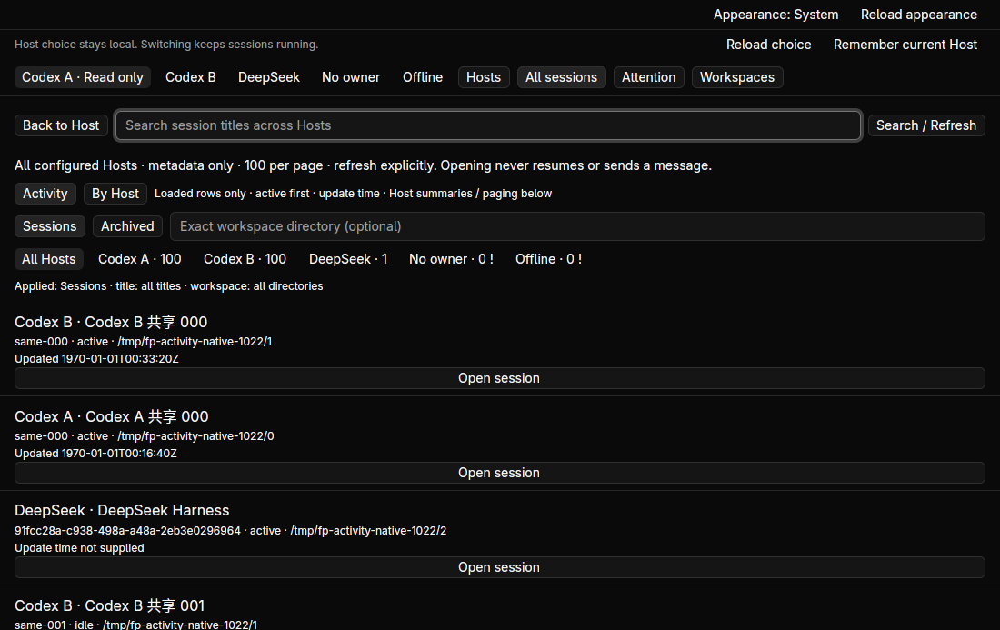
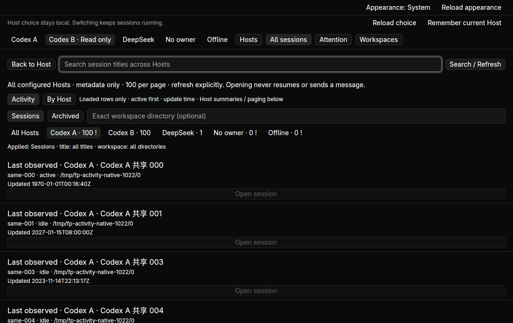
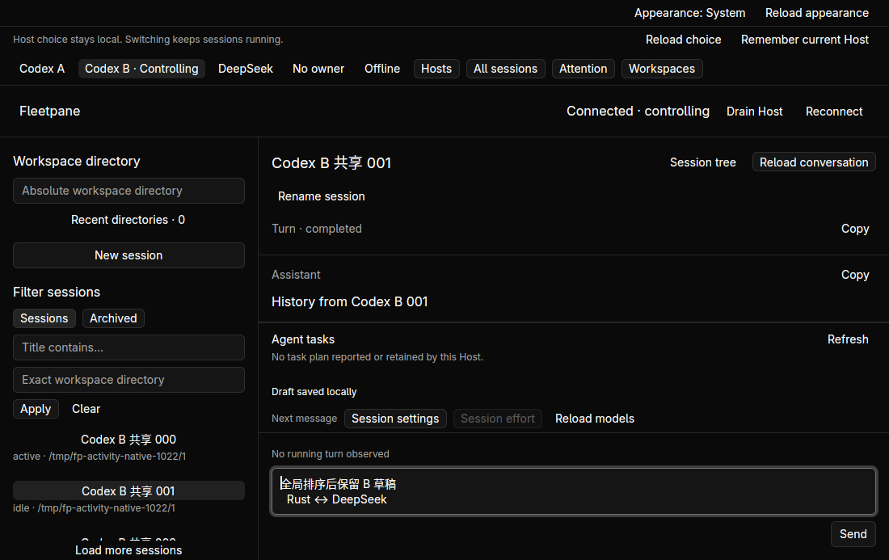

# Cross-Host activity ordering — 2026-10-22

Implemented on `ec10af5`. Covered engine and Linux native fixture workflows are
verified locally. This is not full-index ordering, realtime subscription or
external-model acceptance. [ADR](../adr/0077-loaded-session-activity-order.md),
[receipt](assets/activity-order/receipt.json).

Activity puts fresh active sessions first, then supplied update time descending,
with deterministic endpoint/session tie breaks. By Host retains provider page
order. A cached, virtualized row projection carries exact source indices. Codex
Unix seconds and ACP RFC3339 offsets/subseconds compare as UTC instants. Missing
and invalid timestamps remain explicit; invalid ACP strings remain stored intact.
The timestamp API was checked against [Chrono documentation](https://docs.rs/chrono/0.4.45/chrono/struct.DateTime.html).

Three domain regressions cover cross-Host colliding IDs, filtering, deterministic
ties, stale-last ordering, exact source identity, missing times, fractional ACP
offsets, invalid strings, out-of-range seconds, and typed timestamp round trips.
These cover presentation ordering without changing provider history or queries.

Hidden desktop `fleetpane-activity-20261022` ran two synthetic Codex inventories
of 237 identically named IDs, one ACP permission, one unowned Host and an offline
endpoint, via `scripts/activity-fixture.py ABSOLUTE_NEW_ROOT`. Native checks:

- Activity initially shows B and A active rows followed by the original ACP
  permission session, then recent idle rows. By Host and Host filters retain their
  sources. B pages 100 → 200 → 237 while A remains at 100.
- Opening B's `same-001` first prepares that exact read-only source, then explicit
  Take control / Open selected session loads B history. Native Copy reads exactly
  `History from Codex B 001`, 24 UTF-8 bytes.
- The 50-byte multiline draft `全局排序后保留 B 草稿\n  Rust ↔ DeepSeek`
  survives list ordering, filtering, another window launch and reopening B.
  Native clipboard readback is byte-exact. It was never sent.
- At 900×560, Activity/By Host/filter controls and session Open remain usable.
  Stopping owned A and refreshing puts fresh Hosts before retained stale A rows.
  The final binary labels every unavailable row Last observed, disables Open,
  and retains the error in the Host summary.
- Before any explicit takeover, all four Host snapshots match except sequence,
  which advances for metadata query responses. At final close the independent
  ACP and unowned snapshots still match excluding sequence. B has no new
  mutation receipts or operation IDs. Both GUI windows close normally with exit
  0; the hidden workspace, fixtures and owned sockets were stopped.

Commands passed: `cargo test --workspace --locked -j2` (248 tests), desktop tests
(27), strict Clippy for both workspaces, core/desktop builds, both format checks,
`python3 scripts/fleet-directory-smoke.py`, `python3 scripts/directory-smoke.py`,
Python syntax compilation and all 15 repository Python tests. Logs and hashes
are in the receipt. The final UI-label adjustment was rechecked with Clippy,
rebuild and native relaunch; engine logic did not change afterward.

The first workspace-start call used the wrong acknowledgement field; the tool
refused before starting. The corrected acknowledged isolated workspace succeeded.
An ACP comparison initially included the query response sequence and failed;
field inspection showed sequence was the only difference. The corrected comparison
preserves every other field. These attempts are not passing checks.

Paseo ordinals 220–225 have 24 selected path diffs recorded in the
[source receipt](assets/activity-order/source-review.json); no historical tree
was executed. Fetch refreshed upstream to `ce67efa9e7faa8024a60e78c7b6f0ecf5ca21c5c`,
fork remains `2d0977759b168264adb3961a862eda8cd574f562`, unique reachable count 6215;
the first 225 full SHAs retain their order. Next is ordinal 226
`2c84447ec261b2e57e01c2de081d623c9dd9e507`.

Ordering covers only loaded pages. Directory reads still finish as one bounded
collection, so a slow Host can delay the batch for up to ten seconds. No global
last-user-message time, full-index running list, realtime activity, keyboard
directory navigation, accessibility, remote connection or non-Linux native claim.
