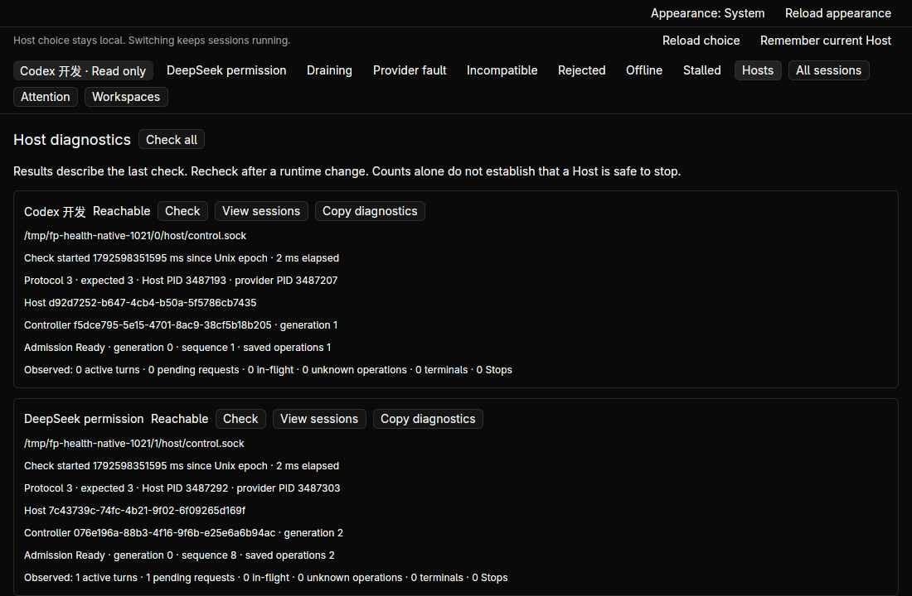
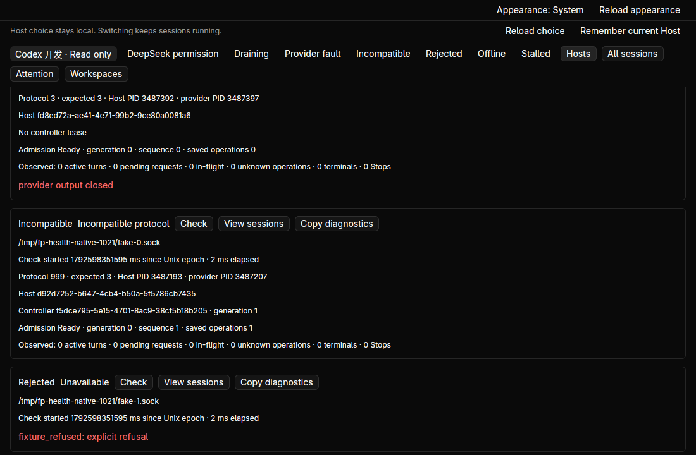
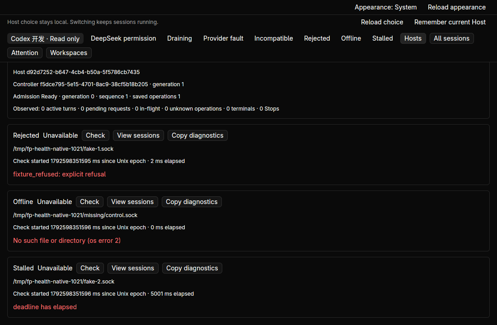
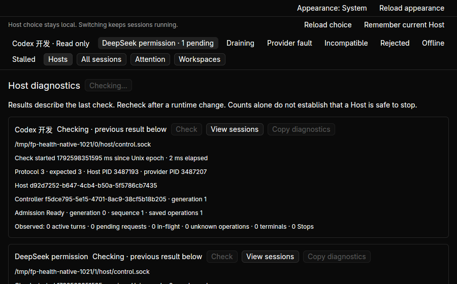
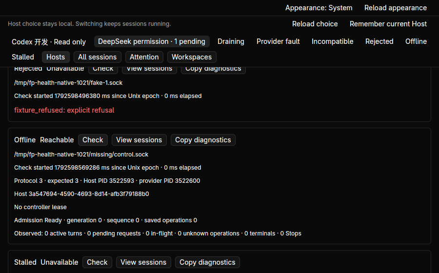
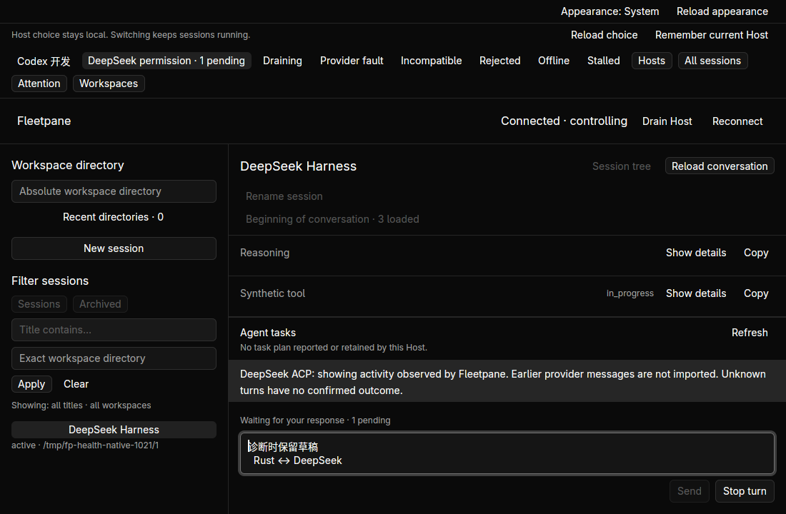

# Per-Host diagnostics — 2026-10-22

Implemented on base `c031f7fffb4f3c9ff99b803de80d91bc8c700c5d`.
[Source/binary receipt](assets/host-diagnostics/receipt.json),
[process evidence](assets/host-diagnostics/process.json) and
[clipboard readbacks](assets/host-diagnostics/clipboard.json) use synthetic
providers only. Design: [ADR 0075](../adr/0075-observational-host-diagnostics.md).

Native **Hosts** and CLI `host-diagnostics CONFIG [HOST_NAME]` share a typed
observational projection. Results distinguish reachability from incompatible
protocol, draining admission and provider/Host fault. Copies retain endpoint,
process/controller identities, check time, counters and errors, excluding
provider initialization data and request payloads. Existing raw `hosts` output
is unchanged.



Two unit tests cover state precedence, protocol mismatch, fault scope, unavailable
state, retained counts, absent legacy Stop progress and excluded content.
The process smoke starts four owned Hosts: Codex, ACP with pending permission,
draining Codex and Codex with a deliberately exited provider. Three fake sockets
supply an incompatible snapshot, explicit rejection and a stalled reply; the
eighth endpoint is missing. Collection returns configuration order in 5.01 s.
The fast endpoint completes in 3 ms while the stalled endpoint hits the existing
five-second transport timeout. The UI receives the bounded batch at completion;
this does not claim progressive card arrival or a performance improvement.
Exact single-Host selection and missing-name refusal are checked. Fake endpoints
receive only Snapshot requests. Four complete before/after snapshots are equal.




Native acceptance uses hidden workspace `fleetpane-host-health-20261021` and
owned fixtures under `/tmp/fp-health-native-1021`:

- Opening Hosts, checking all, scrolling, copying the ACP report and selecting
  another Host leave all four complete snapshots unchanged. The exact copied ACP
  JSON is 852 bytes and reports one active turn and one pending request without
  their identities or payloads. A stalled single-Host check followed by selection
  of DeepSeek does not navigate back when its reply times out.
- Explicitly taking control and opening the pending ACP session allows the exact
  41-byte draft `诊断时保留草稿\n  Rust ↔ DeepSeek`. Returning to Hosts and typing `x`
  leaves this saved draft at revision 1. A subsequent full check leaves all four
  snapshots unchanged relative to the post-inspection baseline; takeover and
  session inspection are separate intentional operations.
- At 900×560 the toolbar wraps; cards scroll to the final stalled endpoint,
  retaining access to Check and Copy. Checking shows retained results as previous
  observations and disables repeated checks/copy while preserving navigation.
- Copying the missing endpoint yields its exact 274-byte error report. Starting
  an owned Host at that same endpoint and clicking its Check changes only its
  observation to Reachable; its 696-byte JSON has no controller lease, sequence 0
  and zero operations. Other cards retain their earlier check timestamps and the
  four original snapshots remain equal to the post-inspection baseline.
- Returning to DeepSeek restores the exact multiline draft and original pending
  request. Ctrl+A/C yields precisely the 41 original bytes. Normal Alt+F4 exits
  with code 0. A replacement desktop restores the selected endpoint, explicit
  takeover/inspection restores the same draft, and another clipboard read matches
  byte-for-byte. All original provider/Host identities and the pending permission
  survive; the other three entire snapshots remain unchanged.





Core workspace: 244 tests; desktop: 25; Python: 15. Strict Clippy, both format
checks and Host/desktop builds pass. Initial compile feedback corrected a wrong
enum pattern. The first process-fixture run used an incorrectly encoded error
response, failed its assertion and cleaned up its owned Hosts. The corrected
run recorded above passes; neither failed attempt is passing evidence.

```sh
cargo test --workspace --locked
cargo clippy --workspace --all-targets --locked -- -D warnings
cargo build -p fleetpane-host --locked
cargo build --manifest-path apps/desktop/Cargo.toml --locked
cargo test --manifest-path apps/desktop/Cargo.toml --locked
cargo clippy --manifest-path apps/desktop/Cargo.toml --all-targets --locked -- -D warnings
cargo fmt --all --check
cargo fmt --manifest-path apps/desktop/Cargo.toml --check
python3 -m unittest discover -s scripts/tests -p '*_test.py'
python3 scripts/host-diagnostics-smoke.py --evidence-dir docs/verification/assets/host-diagnostics --native-root /tmp/fp-health-native-1021
git diff --check
```

The native-root smoke retains its owned fixture processes for GUI validation
until SIGTERM, then cleans them up; ordinary smoke uses a temporary root and
exits after its assertions. No live user Host or session was changed. Native
coverage is Linux with synthetic providers. Host-scope fault/unreported scope
and absent Stop progress are unit-only. Whole-collection failure is implemented
with retained results but not injected in native acceptance. External models,
macOS/Windows UI, remote authentication, editable registry, telemetry, safe Host
retirement and live Host updates are not claimed.

Paseo source review advances through ordinals 211–214, with eight selected path
diffs (28,329 bytes) and their hashes in
[the review receipt](assets/paseo-replay/host-diagnostics/receipt.json).
Original captured tips and previous 210 entries are unchanged. The refreshed
history command saw a newer fork tip; ordering was independently checked against
the original ledger's pinned tips rather than replacing the captured index.
The historical code was not run. Next: ordinal 215,
`393aa44e68b59a1582e91643d5cf6ccb6ceb39a6`.
