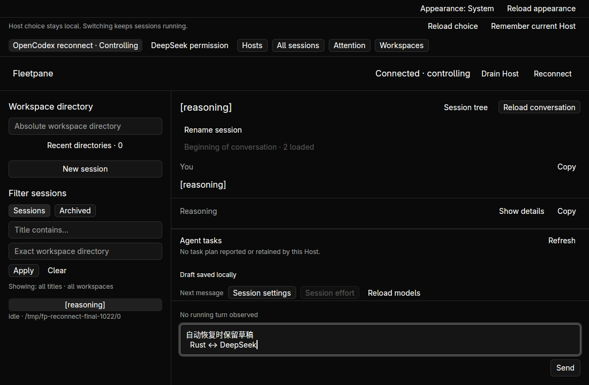
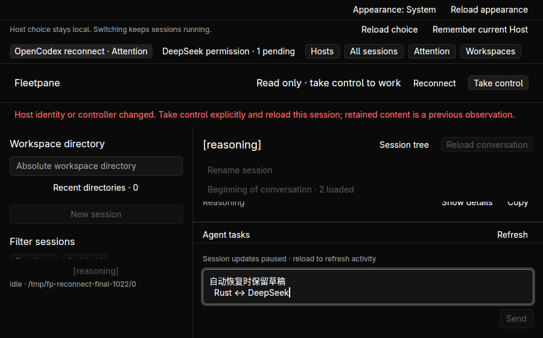
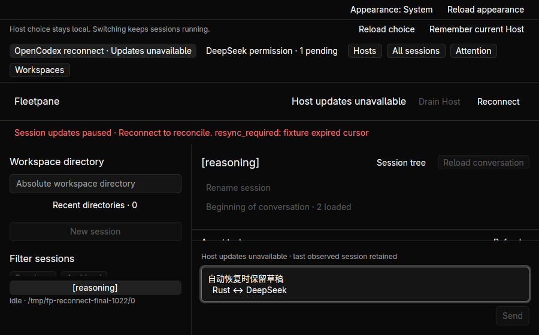

# Observational read recovery — 2026-10-22

Base: `252a7da05df510263bd00d81baef3dcd38c00c17`.
Design: [ADR 0076](../adr/0076-automatic-observational-read-recovery.md).

An owned Unix proxy reproduced the old binary's permanent paused state after
one failed snapshot: restoring the proxy and advancing the synthetic provider
did not fetch new events. The Host/provider kept running. Before and after
screenshots and the [receipt](assets/read-recovery/receipt.json) are retained.

The final candidate was exercised in hidden Linux workspace
`fleetpane-reconnect-20261022`, with owned Codex-protocol and ACP fixtures.
The proxy's `online`, `offline`, `gap`, `replaced` and `incompatible` modes are
available in `scripts/reconnect-fixture.py ABSOLUTE_NEW_ROOT`. Launch through
the workspace so a command-runner lifetime does not terminate fixture processes.
Change `mode-N.json` to switch a proxy; `reasoning.json` stage 2 completes the
Codex fixture. Complete snapshots are read directly from each owned Host.

- A failed read retries snapshots/events with the original cursor; same-Host
  replay receives the completed turn without a provider action. Minimize/restore
  wakes observational polling. Original Host/provider PIDs, lease, operation IDs
  and journal count are unchanged; the other entire ACP snapshot is unchanged.
- The 47-byte draft `自动恢复时保留草稿\n  Rust ↔ DeepSeek` is editable while
  disconnected, survives recovery and explicit history reconciliation, and
  copies back byte-for-byte. Normal desktop replacement preserves it.
- A forced expired cursor stops event replay. Later successful snapshots do not
  skip the cursor: all subsequent requests remain Snapshot until explicit
  Reconnect reads the selected history. At 900×560 the status, retained draft
  and Reconnect remain visible and Send stays disabled.
- A proxy reports a different Host UUID. The view drops local authority and
  offers explicit Take control. Restoring the original snapshot does not
  restore that authority; seven subsequent requests were Snapshot only.
  A separate real competing controller claim on the original Host also drops
  the GUI into read-only state. Explicit takeover reloads the selected history.
- The ACP Host's complete snapshot, original permission and lease are equal
  before/after transport loss and recovery. Recovery sends only Snapshot/Events,
  never a permission reply. The 900×560 view retains the pending state.

Three regressions cover transport scheduling versus protocol/identity/uncertain
outcomes, and actual Unix frames: truncated, invalid JSON and unknown response
are Protocol errors; EOF is Transport; replay reads the original cursor and
exact missing event. Malformed mutation admissions remain Pending, and malformed
answer confirmations remain uncertain Transport errors; only observational reads
use the stricter protocol classification. 245 core tests, 27 desktop tests, 15 Python tests, strict Clippy, format and builds
are recorded in the receipt. Query smoke also retains its 160-read/deduplication
evidence. Historical source review inspected 14 selected path diffs (24,819
bytes), ordinals 215–219, [hashes](assets/read-recovery/source-review.json).
Historical code was not executed. Next is ordinal 220
`0c571f6f43ca6af53362f95d315d858bafffb3e5`.

The first test compile found GPUI's wildcard-imported test macro recursion;
explicit imports fixed it without changing recursion limits. An initial evidence
comparison used a nonexistent `operations` field; the corrected assertion uses
`operation_ids` and `journal_total`. The first final-binary launch raced fixture
configuration creation and exited 2; relaunch after the ready marker succeeded.
The unrelated attention smoke hit partial JSON while the synthetic ACP provider
rewrote its store; atomic replacement fixed that fixture race and the corrected
one-second permission/isolation smoke passed. The previous 125-second run failed
and is not long-wait acceptance for this change. Python Ruff was unavailable;
Python syntax compilation and the repository unit suite were used.
An earlier exec-owned fixture exited with its runner; acceptance was repeated
with workspace-owned fixtures. These failed attempts are not passing evidence.

All owned fixture processes and the hidden workspace were cleaned up.

No external model, OS suspend, macOS/Windows GUI, remote authentication or live
Host update is claimed. The incompatible-protocol and malformed-wire boundaries
are unit-covered; native acceptance specifically covers a changed Host UUID and
expired event cursor. Replay after event-ring expiry remains explicit. Large
outer errors can reduce conversation space; general banner layout remains open.
